<picture>
  <source media="(max-width: 640px) and (prefers-reduced-motion: reduce)" srcset="assets/presentation/tgwitness-investigation-mobile-static.svg">
  <source media="(prefers-reduced-motion: reduce)" srcset="assets/presentation/tgwitness-investigation-static.svg">
  <source media="(max-width: 640px)" srcset="assets/presentation/tgwitness-investigation-mobile-animated.svg">
  
</picture>

# The illustrated investigation

How a case comes together, in pictures. The records are made up, for the real interface
[open the demo](https://phishdestroy.github.io/TgWitness/demo/).

[Project](../README.md) · [Investigation handbook](wiki/Home.md) · [Evidence model](HOW-IT-WORKS.md)

### Link the captured events

<picture>
  <source media="(max-width: 640px) and (prefers-reduced-motion: reduce)" srcset="assets/presentation/case-chain-mobile-static.svg">
  <source media="(prefers-reduced-motion: reduce)" srcset="assets/presentation/evidence-chain-static.svg">
  <source media="(max-width: 640px)" srcset="assets/presentation/case-chain-mobile.svg">
  
</picture>

[The evidence model](HOW-IT-WORKS.md)

### Detect a changed record

<picture>
  <source media="(prefers-reduced-motion: reduce)" srcset="assets/presentation/evidence-tamper-static.svg">
  
</picture>

[Export and verify](wiki/Exports-and-Verification.md)

### Retain an independent checkpoint

<picture>
  <source media="(prefers-reduced-motion: reduce)" srcset="assets/presentation/evidence-checkpoint-static.svg">
  
</picture>

[Independent witness](wiki/Independent-Witness.md)

A signature shows the record wasn't changed. It doesn't prove the message came from
Telegram, that nothing was missed or that the content is true.

[Back to the project](../README.md) · [Documentation](README.md)
