# TgWitness in motion

Two short films and three animated explanations of the investigation workflow.
The films are concept illustrations with fictional records; see the
[workspace screenshots](../README.md#screenshots) for the application itself.

[Try the demo](QUICKSTART.md#explore-the-interface) · [Read the handbook](https://github.com/phishdestroy/TgWitness/wiki) · [Presentation kit](assets/presentation/README.md)

## Follow the trail

Channels, groups, bots and private chats become a connected investigation.
Preserve the observed record, trace its context and prepare a verifiable handoff.

<picture>
  <source media="(prefers-reduced-motion: reduce)" srcset="assets/presentation/tgwitness-investigation-static.svg">
  
</picture>

**12 seconds · Silent · MP4 1280 × 672**

[Download MP4](assets/presentation/investigation.mp4) · [View GIF](assets/presentation/investigation.gif) · [Static illustration](assets/presentation/tgwitness-investigation-static.svg)

## Keep the changes

A message changes from 14:00 to 16:30, then disappears from the chat. Versions
captured before the deletion remain in the local record.

<picture>
  <source media="(prefers-reduced-motion: reduce)" srcset="assets/presentation/message-history-static.png">
  
</picture>

**12 seconds · Silent · MP4 1280 × 576**

[Download MP4](assets/presentation/message-history.mp4) · [View GIF](assets/presentation/message-history.gif) · [Learn about collection](COLLECTION.md)

## How the record holds together

Each explanation has a static alternative and follows your reduced-motion setting.

### Link the captured events

<picture>
  <source media="(prefers-reduced-motion: reduce)" srcset="assets/presentation/evidence-chain-static.svg">
  
</picture>

[Static diagram](assets/presentation/evidence-chain-static.svg) · [The evidence model](HOW-IT-WORKS.md)

### Detect a changed record

<picture>
  <source media="(prefers-reduced-motion: reduce)" srcset="assets/presentation/evidence-tamper-static.svg">
  
</picture>

[Static diagram](assets/presentation/evidence-tamper-static.svg) · [Export and verify](wiki/Exports-and-Verification.md)

### Retain an independent checkpoint

<picture>
  <source media="(prefers-reduced-motion: reduce)" srcset="assets/presentation/evidence-checkpoint-static.svg">
  
</picture>

[Static diagram](assets/presentation/evidence-checkpoint-static.svg) · [Witness and proof](wiki/Witness-and-Proof.md)

Signatures establish integrity relative to a trusted key. They do not prove
Telegram origin, complete capture or the truth of the content.

[Back to the project](../README.md) · [Documentation](README.md)
