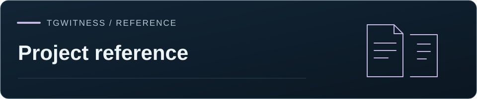

[TgWitness](../README.md) / [Documentation](README.md)

# Current capabilities

[Start, scale and evidence](OVERVIEW.md) explains the one-command installation,
temporary GitHub capture, investigation options and published measurements.

Source version: **0.9.3 preview**. The [installer](https://get.destroy.tools/)
includes the exact source revision in its signed manifest. Tagged packages are
available under [Releases](https://github.com/phishdestroy/TgWitness/releases).

| Workflow | Guide |
| --- | --- |
| Live messages, edits, deletion notices and attachments | [Collection](COLLECTION.md) |
| Standard/Takeout history with resumable cursors | [Full history](BACKFILL.md) |
| Secret Chats created or accepted by TgWitness; optional protocol dependency | [Secret Chats](PSEUDO-SECRET.md) |
| Account and chat export, file policies and minimized sharing copies | [Account export](ACCOUNT-EXPORT.md) |
| Stopped chat exports: signed saved range, resume, start over, partial archive after authorization loss | [Export hashes](EXPORT_HASHES.md) |
| Signed journals, checkpoints and standalone verification | [Evidence](EVIDENCE.md) |
| RFC 3161 time stamps with stored OCSP/CRL evidence, OpenTimestamps and drand rounds | [Timestamps](TIMESTAMP.md) |
| Account sessions: new-session alerts, ending other sessions, only-session mode and a witness probe | [Accounts](ACCOUNTS.md#witness-probe) |
| Separate witness with online Merkle continuity checks | [Witness](WITNESS.md) |
| Official-client capture and session video | [Trusted Live](TRUSTED-LIVE.md) |
| GitHub capture with a session time budget and encrypted delivery | [GitHub capture](SEALED-ACTIONS.md) |
| Intel TDX collection, independent quote verification and an offline quote check in `verify.py` | [High assurance](HIGH-ASSURANCE.md) |
| Guided first setup: Just download, Follow chats or Evidence for a case | [First setup](SETTINGS.md) |
| Case documentation: subject cards, conversation plans, translation, watchlists, online watch and a BagIt case package with court templates | [Investigation mode](INVESTIGATION-MODE.md) |
| Exposure check of the investigating account's privacy rules and profile | [Account control](INVESTIGATION-MODE.md#account-control) |
| Live map of panel access, account routes, Telegram targets and outside services, with recent network observations | [System map](SYSTEM-MAP.md) |

[Choose a collection method](COLLECTION-MODES.md) for scope, output and recovery behavior.
[Secret Chat installation and package check](PSEUDO-SECRET.md) records the shipped
integration, optional protocol dependency and account-level controls.
[Development history and scale](OVERVIEW.md#testing-history-and-duration) puts the
public release timeline and selected measurements in context.
[Actions](https://github.com/phishdestroy/TgWitness/actions) records automated checks
for each revision; [Verification](VERIFICATION.md) records completed deployment and
live-account tests. See the [changelog](CHANGELOG.md) for changes.

The optional forensics helpers match complete MTProto frames against the journal offline:
the frame helper verifies payload digests and message identifiers against journal references.
Frames are supplied explicitly; a PCAP file travels in the bundle as an attachment.
The frame-match result is reviewed together with the acquisition path, capture records and custody.
