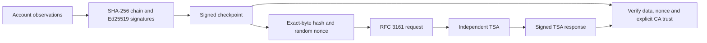

[TgWitness](../README.md) / [Documentation](README.md) · [Evidence and verification](EVIDENCE.md)


# Independent timestamps and evidence handoff

TgWitness prepares RFC 3161 requests and verifies timestamp authority (TSA) responses.
This manual procedure neither selects a TSA nor submits data; evidence mode does both on a
schedule ([evidence format](EVIDENCE.md#rfc-3161-preparation-and-response-verification-02)). A prepared request is
**not yet a timestamp proof**.

## What the proof binds



The collector signature binds records to its key. A trusted TSA response can
establish that a particular checkpoint existed by the TSA's stated time. The
checkpoint can then bind the journal prefix. This upper time bound applies to
that committed prefix; individual Telegram actions retain their recorded event times.

## Procedure

The journal verifier reports backward steps and unparseable `observed_at` values
in `chronology` when present, and includes a warning in its command output. It
preserves the signed timestamps and still checks their signatures. A backward step
can come from a clock correction, so review it with the host's clock records.
Independent time comes from verified external timestamps, witness posts read from
their public t.me page and drand rounds; `--strict` governs signer pinning and
supported formats.

Recorded drand values receive structural and hash self-consistency checks offline.
`--check-drand` compares selected recorded rounds with HTTPS relay responses; the
result states how many rounds were compared and which relays answered, and the
compared rounds supply the authenticated lower time bound.

1. Retain the collector key fingerprint through a separate trusted channel; it
   identifies the collector independently of the examined ZIP.
2. In **Exports → Prepare timestamp request**, download the selected workspace's
   request ZIP. Extract `checkpoint.json`, `timestamp.tsq`, `SHA256SUMS` and
   `README.txt`. Do not change the checkpoint bytes.
3. Choose a TSA appropriate to the investigation. Submit `timestamp.tsq` using its
   documented method, with `application/timestamp-query` for an HTTP service.
   Save the original binary reply as `timestamp.tsr`, the endpoint, retrieval time
   and request outcome. The request contains a hash and nonce rather than messages;
   network metadata still reveals the request.
4. Obtain the trusted root certificate independently of the reply, plus any
   intermediates required. A certificate in the reply does not become trusted merely
   because it is included there.
5. From a trusted TgWitness installation, verify:

```sh
python -m tgwitness.anchor verify --checkpoint checkpoint.json --request timestamp.tsq --response timestamp.tsr --ca trusted-tsa-root.pem
```

Add `--intermediates tsa-intermediates.pem` if needed. OpenSSL is not needed: the
signature, the signing certificate reference and the chain are checked in Python with the
`cryptography` library, the same code `verify.py --tsa-ca` uses. `openssl ts -verify`
remains an independent second check for an expert who wants one.

6. Export a signed journal ZIP after the checkpoint so it includes that prefix.
   Verify using the independently known fingerprint:

```sh
python tgwitness/verify.py evidence.zip --fingerprint TRUSTED_SHA256 --checkpoint checkpoint.json
```

   This shows that the export contains the timestamped prefix. `verify.py` reads
   timestamp receipts only from the ZIP, where evidence mode stores them; the manual
   reply is checked in step 5 and covers the records up to this checkpoint.

7. Preserve the ZIP, checkpoint, request, reply, certificate chain, verification
   results and handoff record outside the collector. Repeat verification at receipt.

To prepare a request from a saved checkpoint:

```sh
python -m tgwitness.anchor prepare checkpoint.json --out timestamp-request.zip
```

Preparation canonicalizes JSON and includes the matching checkpoint in the archive.
Use the **checkpoint bytes from that archive** for TSA verification, even if the
input file had different whitespace.

## Verification boundaries

| Check | Current behavior |
| --- | --- |
| Data | SHA-256 of the exact checkpoint bytes must match the response |
| Request | With `--request`, the original query and nonce are verified |
| TSA signature | The signature, the signing certificate and its chain to the explicit CA are checked at the stamped time |
| Collector signature | Separately verified by the journal verifier with a pinned key |
| Revocation | Evidence mode stores OCSP/CRL evidence that `verify.py` checks |
| Scheduled submission | Evidence mode, turned on by every setup goal |

`--request` is technically optional, but omitting it prevents verification of the
original nonce. For this full procedure, the result's `request_checked` must be true.
Each certificate in the chain must be valid at the stamped time, and the signing
certificate must be for time stamping only.

The TSA response anchors the submitted checkpoint bytes to its stated time.
Review that result with the acquisition records and environment verification for
the selected mode. Evidence mode includes the Belgian government's qualified TSA
(`http://tsa.belgium.be/connect`; RFC 3161 replies are signed, so plain HTTP does not
weaken them). With that provider's root passed to `--tsa-ca`, `verify.py` reports a
qualified eIDAS time stamp and its time stamping unit; Regulation (EU) No 910/2014,
article 41(2), presumes the accuracy of its time and the integrity of the bound data.

### Signing certificate revocation

Right after each reply, evidence mode fetches revocation evidence for the TSA signing
certificate: an OCSP response from the certificate's AIA OCSP address, otherwise the CRL
from its distribution point (at most 4 MiB). It is stored next to the reply as
`checkpoint-N.<service>.ocsp` or `.crl` and exported with it. A failed fetch never holds
back the time stamp; the `anchor.completed` record lists it as `unavailable` with the reason.

`verify.py` checks the OCSP response signature (by the issuer, or by a responder certificate
the issuer gave the OCSP signing purpose), the certificate ID and the status, and that the
answer was issued at or after genTime or was still current then (nextUpdate). For a CRL it
checks the issuer's signature, the same time window and that the serial number is not listed.
It then reports `signing certificate not revoked as of <time> (OCSP|CRL)`, the failed check,
or `revocation not checked (no OCSP/CRL in the archive)`. A signing certificate revoked at or
before genTime fails verification; a later revocation is shown as a warning.

## Evidence records and renewal (RFC 4998)

An RFC 3161 time stamp holds only as long as its hash algorithm and the TSA's signing key and
certificate, and a case can outlast them. Evidence mode also keeps an RFC 4998 Evidence Record
(ERS) for each retained checkpoint and renews it.

On each evidence pass, checkpoints without a record go into a hash tree, and the configured TSAs
are asked in order for one time stamp over its root. Each checkpoint gets
`checkpoints/anchors/checkpoint-N.ers`: an `EvidenceRecord` whose `ArchiveTimeStampSequence` holds
one `ArchiveTimeStampChain` with an `ArchiveTimeStamp` carrying the reduced hash tree for that
checkpoint and the TSA token. A record can list hashes of neighbouring checkpoints; validators such
as EU DSS warn about this. An ASiC-E export also carries `META-INF/evidencerecord.ers` with
`META-INF/ASiCEvidenceRecordManifest.xml`, the evidence record for the container's data objects
(ETSI EN 319 162-1). A ZIP export carries the checkpoint records under `anchors/`.

Renewal follows RFC 4998 section 5 and only appends:

| Renewal | When | What is stamped |
| --- | --- | --- |
| Time stamp renewal | The newest token's signing certificate expires within N months (default 6), its signature hash is marked weak, or on request | Hash of the previous token, same algorithm; the stamp is added to the last chain |
| Hash-tree renewal | The chain's hash algorithm is marked weak, or on request | `H(H(checkpoint) + H(previous ArchiveTimeStampSequence))` with a stronger algorithm (default SHA-512); a new chain is added |

Each renewal goes to a new file, `checkpoint-N.renewal-K.ers`; earlier files and chains stay byte
for byte the same. The proof reaches back to the first time stamp only if every link checks in
order, so renew while the newest token still validates: before its signing certificate expires,
its revocation information disappears or its hash or signature algorithm breaks. A later renewal
adds a stamp but does not extend the earlier proof.

The evidence-mode background loop checks the policy daily and on request
(`evidence_record.demand_renewal`). Each attempt is journalled as `evidence_record.created` or
`evidence_record.renewed` with the service, time, hash algorithm, tree root, checkpoint range,
`ok` and errors; unreadable records go to `evidence_record.check_failed`. A failing TSA is retried
with the checkpoint-stamping backoff, counted separately, while the next listed TSA is tried. The
policy (`months_before_expiry`, `weak_algorithms`, `algorithm`, `stronger_algorithm`) is the
profile setting `evidence_record_policy`; the panel has no control for it yet.

The collector checks each new record against its checkpoint and the TSA's signature before writing
it. `verify.py` checks every record in an export: hash trees, tokens, order of chains and renewals,
and reports the earliest proven time and the state of the newest stamp. EU DSS reads the same
records with the checkpoint as detached data.

Regulation (EU) 2024/1183 (eIDAS 2.0) added qualified electronic archiving and qualified electronic
ledgers to Regulation (EU) No 910/2014. TgWitness writes records in standard formats but is not a
trust service; its archive and journal have no qualified status. A qualified provider would need,
among other things:

- Archiving (Articles 45i and 45j): a qualified trust service provider keeping the data for the
  legal or contractual preservation period, durable and legible beyond the technological validity
  period and protected against loss and alteration, with an automated integrity report for
  authorised relying parties from the start of preservation to retrieval. Article 45i(2)
  presumes integrity and origin for such a service.
- Ledgers (Articles 45k and 45l): a ledger created and managed by one or more qualified trust
  service providers that establishes the origin of records, orders them uniquely and
  chronologically, and makes later changes immediately detectable. The TgWitness journal is
  hash-chained and signed with the collector's own key, which alone is not a qualified ledger.
- Both: qualified status granted by a supervisory body and a trusted-list entry (Articles 21 and
  22), the obligations of Article 24, conformity assessment at least every 24 months (Article 20)
  and the reference standards of the implementing acts under Articles 45j(2) and 45l(2).

Qualified time stamps from a qualified TSA (Articles 41 and 42) keep their own presumption per
token; renewal does not create one for the record as a whole.

## Handoff record

Record the case identifier, sender and recipient, UTC transfer time and its source,
purpose, filenames/SHA-256 values, collector fingerprint, sequence range, known
gaps, verifier version and verification outcome. Sign and independently retain this
record through your organization's process. A multi-user custody-record system is
not implemented in TgWitness.

## Live service check, 9 November 2026

One RFC 3161 request was sent to each default service. Both granted it.

| Service | Reply | Signing unit | Verifier result |
| --- | --- | --- | --- |
| `http://tsa.belgium.be/connect` | Granted, policy 2.16.56.13.6.3.1.1000 | Timestamp Unit 202301 | Qualified eIDAS time stamp |
| `https://freetsa.org/tsr` | Granted | FreeTSA | RFC 3161 time stamp |

The Belgian signing certificate carries the qcStatements compliance statement and
matches the unit recorded in the verifier. Local tests also use a synthetic CA/TSA to
check rejection of changed data, a changed nonce and a wrong CA.

On 10 November 2026 the Belgian OCSP responder, a delegated responder certificate, answered
"good" for Timestamp Unit 202301. FreeTSA's OCSP address (port 2560) did not answer within
40 seconds from the test host; its CRL (PEM, 1 KB) was used instead.
