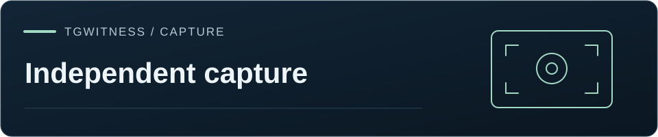
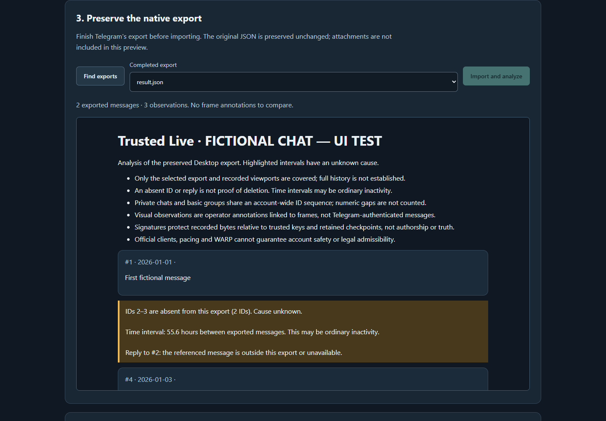

[TgWitness](../README.md) / [Documentation](README.md) · [Independent capture](OPTIONAL-CAPTURE.md)



# Trusted Live (preview)

Trusted Live is an isolated official-client recorder, available alongside the other
recorders under **More tools → Extras → Independent capture**. Its panel selects Telegram Desktop
Linux or Telegram Web, native JSON export / visual capture / hybrid, and a provisioned
connector. It does not start TgWitness's Telethon collector or import a Telegram session.

Validation includes automated acceptance tests and the
[CPU Ubuntu and WARP integration](VERIFICATION.md#trusted-live-cpu-ubuntu-and-warp--5-november-2026).
Real-account native export/hybrid collection and attestation of this recorder's TDX image
remain separate live checks.



<details>
<summary>On this page</summary>

- [What is implemented](#what-is-implemented)
- [What each record covers](#what-each-record-covers)
- [Linux deployment, local or remote](#linux-deployment-local-or-remote)
- [Independent witness and verification](#independent-witness-and-verification)
- [Tests](#tests)
- [Protocol references](#protocol-references)

</details>

## What is implemented

| Component | Behavior |
| --- | --- |
| Account isolation | One case per recorder volume; fresh profile inside runtime tmpfs. Reopening an existing case permits export only. |
| Official client | Unmodified, SHA-256-pinned Telegram Desktop distribution; alternatively Chromium opens `https://web.telegram.org/k/`. No DOM extraction, Telegram protocol calls, or session import. |
| Manual session | Operator logs in, opens the chat and prepares the native export using the authenticated client screen. Login input is never added to the journal or process command line. |
| Capture guard | While recording, only individual paced wheel steps are accepted. Text, clicks, keys and clipboard actions are unavailable. Focus loss / connector failure stops the client. The emergency button stops the process before waiting for a capture lock. |
| Video | FFmpeg H.264 segments, local UTC clock overlay, signed segment hashes. Setup/paused frames are not preserved. Video failure stops live collection. |
| Native export | Preserve completed `result.json` bytes from the isolated `/exports` inbox. Preserve subsequent versions rather than rewrite earlier evidence. |
| Continuity | Chat-type-aware ID intervals, unresolved replies and time intervals. Inline annotations in a separate chat view and downloadable HTML/JSON artifacts. Original exports and client pixels stay unchanged. |
| Hybrid | Compare the export with **operator-transcribed** messages linked to preserved frames. No fabricated IDs from pixels. Unannotated frames have no automatic message-level comparison. |
| Integrity | Existing independent-capture Ed25519 chain, content-addressed artifacts, signed ZIP manifest and checkpoints. Verifier recomputes continuity reports and HTML from preserved observations. |
| Time evidence | Periodic drand queries through the chosen HTTP/SOCKS connector; two HTTPS relays must agree. Independent witness retains signed checkpoints with fresh challenges. |
| Network isolation | Container OUTPUT policy denies everything except local `127.0.0.1`, established replies and the selected proxy IPv4/port. Docker's embedded DNS at `127.0.0.11` is blocked along with external DNS, IPv6 and direct fallback. Policy precedes client launch; privileges are then dropped. |
| Provider witness | Optional independent read-only polling of Cloudflare WARP Connector status/connections and scoped Gateway DNS observations; raw responses are signed as artifacts in the witness journal. |
| Cleanup | Stop the process group and remove the created profile. Server-side logout is never claimed without confirmation; the operator logs out or revokes the session in Telegram Devices. |

## What each record covers

- Telegram decides account restrictions, new-device checks and bans. Read receipts and
  presence can change while viewing.
- The guard covers inputs **through this recorder** during capture; host administration
  sits outside it. Manual setup is not recorded. Selecting export options or logging
  out requires pausing, and those intervals are recorded as coverage gaps.
- Native export generation is manual. This version preserves the selected JSON and
  recorded procedure; linked attachments are packaged by the other export modes.
  Verify the saved file together with that procedure.
- Gaps keep their own label, separate from deletions. Private/basic-group IDs share an
  account-wide sequence; channel/supergroup intervals are listed as candidates. Export
  date filters and visibility explain many absent records.
- Video-only collection records what appeared on screen. Hybrid comparison links the
  export's messages to the video through annotations.
- With a trusted key and independently retained checkpoints, the hash chain detects a
  complete rebuild or truncation. Drand supplies a lower time bound; `--check-drand`
  compares the rounds across relays.
- WARP is operator-provisioned and can change its public IP. For HTTP/SOCKS gateways
  the collector samples Cloudflare's HTTPS trace, requires `warp=on`/`plus` for a
  WARP-labelled route, and stops on an observed egress-IP change. This checks the
  probe's route; configure the gateway to route all destinations consistently.
  MTProxy-only routes report that the probe is unavailable.
  Cloudflare samples record network activity; message content comes from the client
  capture. Missing, inaccessible or truncated DNS logs are labelled. MTProxy cannot
  carry public drand HTTPS requests; these intervals are explicitly marked unavailable.
- This container runs as a hardened Docker recorder. Intel TDX attestation applies to
  the separately measured sealed image; TDX for this recorder needs its own measured
  build, attestation policy and live qualification.

## Linux deployment, local or remote

Use a Linux Docker host. The Windows development panel can test the workflow with
synthetic data, but cannot run the Linux screen or enforce its namespace firewall.
Keep one Compose project and evidence volume per account/case.

1. The image pins the official [Telegram Desktop 7.3.5 Linux release](https://github.com/telegramdesktop/tdesktop/releases/tag/v7.3.5).
   Its archive SHA-256 is `62082a56b212f22d75106dd13b7e3b9bc4ecdbfb472146b56c74da74199855b7`;
   the example pins the extracted binary SHA-256 too. Review its source before use.
   For another release, set `TELEGRAM_ARCHIVE_URL`, `TELEGRAM_ARCHIVE_SHA256` and the
   configuration's binary hash together. The Docker build refuses a changed archive. A hash downloaded
   from the same compromised source is not independent provenance.
2. Provision your chosen SOCKS5/HTTP gateway or MTProxy. For WARP, the gateway must
   actually route through your WARP deployment. Choose a fixed numeric IPv4 endpoint.
   This feature does not create a Cloudflare account, subscription or connector.
3. Copy `addons/capture/config/trusted.example.json` to a private configuration file.
   Set the Desktop binary hash and connector address/port/mode. Keep the documented
   `/session`, `/exports`, `/data`, display and guard paths for the supplied image.
4. Set `TELEGRAM_ARCHIVE_SHA256`, `TRUSTED_CONFIG` (absolute file path), and
   `TRUSTED_CONNECTOR` (configured connector ID), then run from the repository root:

   ```sh
   docker compose --project-directory . -p trusted-case001 \
     -f addons/capture/compose.trusted.yaml up --build -d
   ```

   The control port binds only to `127.0.0.1:8793`. On a remote host, forward it using
   your existing secure access channel. Do not publish this unencrypted HTTP port.
   Set `public_origin` to the exact browser origin when using a reverse proxy.
   The host must support Chromium's sandbox; no `--no-sandbox` fallback is provided.
5. Read the generated **control token** on the host and open `http://127.0.0.1:8793`.
   The **witness token** permits only checkpoint reads. Neither token is a Telegram
   credential. The main TgWitness panel may pin this recorder's fingerprint and URL;
   put its screen URL into the connection to open the full workflow.
6. Select the case/client/method/connector. For Desktop, configure the same proxy in
   Telegram before signing in. Direct connections are already denied by the runtime.
   Enter credentials only in the isolated official client. Use **Refresh screen** as
   needed; preview frames also refresh automatically.
7. Choose the chat and, for export/hybrid, complete Telegram's native JSON export to
   `/exports`. Close login and export dialogs. Start recording, scroll at your reading
   pace, and use **Find exports → Import and analyze**. For comparison, annotate a
   preserved viewport with the IDs/text you actually observed.
8. Pause, log out manually, and finish. Verify session revocation in Telegram Devices.
   Download the signed ZIP and retain a checkpoint separately. `docker compose down`
   removes the ephemeral profile/export inbox; **do not use `down -v`** before preserving
   the evidence volume. Recreate the runtime for a different account or case.

Proxy credentials, if required, are entered in Desktop's own settings. The supplied
Chromium launch configuration and drand fetcher support unauthenticated gateway
endpoints only; deploy a private authenticated upstream behind that gateway if needed.

## Independent witness and verification

On a different trusted host, run the existing capture witness:

```sh
python -m tgwitness_capture witness --data witness-case001 \
  --url https://recorder.example --token-file recorder-witness-token.txt \
  --fingerprint TRUSTED_RECORDER_SHA256 --interval 30
```

For provider observations add `--cloudflare-config provider.json` and
`--cloudflare-token-file provider-read-token.txt`. The provider JSON contains:

```json
{
  "account": "32_HEX_ACCOUNT_ID",
  "connector_id": "WARP_CONNECTOR_UUID",
  "gateway_location": "OPTIONAL_GATEWAY_LOCATION_UUID",
  "source_ip": "COLLECTOR_SOURCE_IP_AS_SEEN_BY_GATEWAY"
}
```

Omit both optional Gateway fields if DNS observations are not available. Scope the
token to connector reads and, where used, Analytics/PII reads. The implementation
never requests the WARP connector's deployment token or mutates provider resources.
Gateway queries cover the preceding five minutes, capped at 1,000 rows; saturation
is reported as possible truncation. Source IP and resource-to-case attribution are
reviewed independently of the operator's configuration.

Stop the witness cleanly to package its signed network observations:

```sh
python -m tgwitness_capture export --data witness-case001 --output witness-case001.zip
python -m tgwitness_capture verify trusted-live.zip \
  --fingerprint TRUSTED_RECORDER_SHA256 \
  --receipt witness-case001/receipts/RECEIPT.json \
  --witness-fingerprint TRUSTED_WITNESS_SHA256 --require-final-anchor --check-drand
```

Pause collection and let the witness retain that exact head **before** exporting the
collector archive. The receipt must name its exact boundary for `--require-final-anchor`.
Export itself appends a later `export.created` event outside the exported boundary.
The provider observations are in the separate witness ZIP; keep it with its receipt.

## Tests

```sh
python -m ruff check .
```

The private capture suite covers malformed/duplicate JSON, chat ID scope, huge bounded intervals,
unknown replies, HTML injection, guarded inputs, pacing, lost route/focus, token roles,
cross-origin requests, file boundaries, frame attribution, report recomputation,
truncation versus retained checkpoints, provider failures, and real FFmpeg encoding.
The FFmpeg test uses a synthetic video source; the browser suite uses local fixtures.
These local fixture tests do **not** qualify a live Telegram/WARP session or the Linux firewall.
The later [CPU Ubuntu and WARP integration run](VERIFICATION.md#trusted-live-cpu-ubuntu-and-warp--5-november-2026)
records actual route isolation, provider reads, official-client startup and video verification.

Private container acceptance builds the pinned image on Linux.
It launches the unauthenticated official Desktop against a TCP sink that forwards
nothing, checks direct IPv4/IPv6/DNS blocking, captures real display video, imports a
generated JSON fixture, verifies the signed ZIP and checks profile cleanup. The
validation workspace retains its screenshot, logs and synthetic evidence. It does
not sign in to Telegram or exercise a WARP deployment.

Local validation on 2026-11-05 (Windows, Python 3.12): **77 tests passed, none skipped**
with `--capture-browser` and `--capture-ffmpeg` pointing to an installed encoder.
The new panel also completed native-export import, styled inline observations, mobile
layout, cleanup and ZIP download in Chromium without console errors. Provider/drand
responses and the Telegram screen were synthetic; FFmpeg encoding was real. Ruff,
JavaScript syntax checks and source-archive checks passed. One upstream Starlette
TestClient deprecation warning remains. The optional-capture CI job reports Linux
image and namespace validation separately. Later WARP/provider network results are
recorded in the integration run above. Real account login/export/hybrid comparison
and TDX attestation of this recorder remain unexecuted.

For a local synthetic UI demonstration (no Telegram connection is possible):

```sh
python tools/preview_trusted_live.py --ffmpeg /path/to/ffmpeg
```

Open `http://127.0.0.1:8794`, token `synthetic-ui-only-not-a-real-account-token`.
The preview uses temporary data and a synthetic client. It is not a deployment mode.

## Protocol references

- [Telegram message-ID sequences](https://core.telegram.org/api/updates).
- [drand beacon HTTP API](https://docs.drand.love/developer/API-v2/drand-http-api/).
- [Cloudflare WARP verification and routing caveats](https://developers.cloudflare.com/cloudflare-one/team-and-resources/devices/cloudflare-one-client/deployment/manual-deployment/).
- [Read-only WARP Connector endpoints](https://developers.cloudflare.com/api/resources/zero_trust/subresources/tunnels/subresources/warp_connector/).
