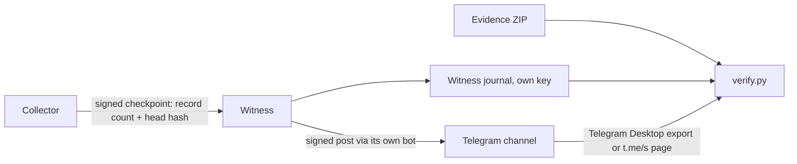

# Independent witness

[Настройка бота и прокси на русском](ru/WITNESS.md).

A collector signs its own journal, so whoever controls the collector and its key could in
principle rewrite or truncate the journal and sign it again. A witness makes that
detectable. It is a separate process — another container, or better a server someone else
runs — that every few minutes fetches the collector's signed journal head, signs what it
saw with its own key, keeps it in its own journal and posts it to a Telegram channel.



## What the witness gets, and what it does not

| The witness has | The witness never has |
| --- | --- |
| A read-only **witness token** for one workspace | The collector's Telegram session or API credentials |
| Its own Ed25519 key and journal | The collector's vault, signing key or panel token |
| Its own Telegram bot token | Message content: the head is a record count and a hash |

The token is created on the panel's **Witness** page, shown once and stored only as a
SHA-256. It opens exactly one endpoint, `GET /api/witness/head`, which returns a freshly
signed checkpoint plus signed content-free collection counters and operational health.
It cannot open the panel, read message content or change settings, and the
panel token is not accepted there. Revoke a token on the same page. The collector records
when a new witness key starts checking (`witness.seen`) and shows the last check per token;
a witness that has not checked within 2.5 intervals is marked overdue.

New witnesses send a random challenge on
each poll; the capture statement echoes it under the collector signature. Counters are
bound to the exact checkpoint and are included in signed witness posts. Legacy heads
remain accepted by the standalone witness. Journal growth alone is never counted as a new message.

## What it checks and records

Every interval (10 minutes by default) the witness:

1. fetches the head itself (the collector cannot push or skip it);
2. verifies the collector's signature, the pinned collector key (`--collector-fingerprint`,
   or the first key seen), a nondecreasing count and an unchanged head at an unchanged count;
3. appends a signed record to its own journal: `witness.anchor` with status `ok`,
   `key_changed`, `rollback` (fewer records than before), `fork` (same length, different
   head) or `invalid` (the answer failed verification), or `witness.no_response` when the
   collector did not answer;
4. posts the result to the channel, signed, including "no answer" while the witness is
   running and can reach the Bot API. The post ID is recorded (`witness.posted`),
   a failed post too (`witness.post_failed`).

A post looks like this; the last line carries the signed statement:

```text
TgWitness witness #42 · journal head
Collector 3fa9c2d1e0b4a7f6: 18234 records
Head 9b1f…c07e
2026-10-28T19:40:00.123+00:00
TGW1.eyJhdCI6…<statement>.<signature>
```

## Run a witness

You need a Telegram bot (create one with @BotFather), a channel where that bot is an
administrator, and the collector's address reachable from the witness — over HTTPS outside
a private network (see the HTTPS profile in [deployment](DEPLOYMENT.md)).

Open **Extras → A bot in your channel → Set up a bot** in the panel. Three steps cover
read-only access, your channel and interval, then launching the witness. Publication
policy, optional HTTP/SOCKS5 proxy and custom Bot API address are under **Advanced settings**. The form
downloads `witness.json` with this workspace's collector key pinned. Download the newly
created read-only token with **Save access file** as `witness-token.txt`; place it and a `bot-token.txt`
created on the witness host beside that JSON. The collector never receives the bot token.
Downloading does not start a service or publish a message. No hosted project witness is
implicitly enrolled.

```sh
python -m tgwitness.witness run --config witness.json --check-config
python -m tgwitness.witness run --config witness.json
python -m tgwitness.witness fingerprint --config witness.json
```

The first command checks configuration and secret files without network requests or key
creation. Paths in JSON are relative to that file; CLI/environment paths are relative to
the working directory. Retain the witness fingerprint outside its host. The collector's
last-poll indicator confirms a request only; publication is reported by Proof or checked
in the witness journal and channel.

If the panel stays behind an SSH tunnel, expose only the scoped witness endpoint on a
separate HTTPS hostname with [this Caddy example](../deploy/Caddyfile.witness.example).
The default workspace then uses `https://witness.example.org`, other workspaces use
`https://witness.example.org/profiles/ID`. Tokens are still required; the panel and its
other API routes are not forwarded by that virtual host.

Choose `all` for regularly published checkpoints. A five-minute interval means about 288
posts per workspace per day. `changes`/`problems` deliberately leave some checks unpublished.
MTProxy is for the collector's Telegram client. Witness HTTP polling and Telegram's HTTPS
Bot API use their own direct/HTTP/SOCKS5 route ([Bot API](https://core.telegram.org/bots/api)).

**Next to the collector, with Docker** (same host — independent process and key, but the
same operator): put the values in `.env` and start the profile.

```sh
TGWITNESS_WITNESS_TOKEN=tgww_...
TGWITNESS_WITNESS_BOT_TOKEN=123456:ABC...
TGWITNESS_WITNESS_CHANNEL=@your_witness_channel
# another workspace: TGWITNESS_WITNESS_COLLECTOR=http://tgwitness:8787/profiles/<workspace ID>

docker compose --profile witness up -d
docker compose logs witness     # prints the witness key fingerprint
```

With a published image use `docker compose --project-directory . -f deploy/compose/compose.image.yaml --profile witness up -d`.

**On someone else's server** (a real independent witness): copy the repository there, set
`TGWITNESS_WITNESS_COLLECTOR=https://your-collector.example.org` plus the three values above
in `.env`, then

```sh
docker compose --project-directory . -f deploy/compose/compose.witness.yaml up -d
```

or without Docker:

```sh
python -m tgwitness.witness run --collector https://your-collector.example.org \
    --token-file witness-token.txt --bot-token-file bot-token.txt --channel @your_witness_channel
```

### Options

| Option | Environment | Default | Meaning |
| --- | --- | --- | --- |
| `--interval` | `TGWITNESS_WITNESS_INTERVAL` | 10 | Minutes between checks, 1–1440 |
| `--timeout` | `_TIMEOUT` | 30 | Seconds to wait for the collector and the Bot API, 5–600 |
| `--post` | `_POST` | `all` | `all`: every check; `changes`: a new head or a problem; `problems`: only problems and missing answers |
| `--title` | `_TITLE` | `TgWitness witness` | First words of every channel post |
| `--collector-fingerprint` | `_COLLECTOR_FINGERPRINT` | – | Pin the collector key instead of trusting the first answer |
| `--proxy` | `_PROXY` | direct | `socks5://host:port` or `http://host:port` |
| `--bot-api` | `_BOT_API` | `https://api.telegram.org` | Bot API address, e.g. a local Bot API server |
| `--data-dir` | `_DATA` | `witness-data` | Witness key and journal |
| `--config` | `_CONFIG` | – | JSON file with any of the options above |

The collector address, tokens and channel come from `--collector`, `--token` or
`--token-file`, `--bot-token` or `--bot-token-file` and `--channel`, or `_COLLECTOR`, `_TOKEN`,
`_TOKEN_FILE`, `_BOT_TOKEN`, `_BOT_TOKEN_FILE` and `_CHANNEL`, which keeps secrets out of the
process list.

A config file uses the option names with underscores, plus `texts`, which replaces the words
of the channel posts:

```json
{"collector": "https://your-collector.example.org", "token_file": "witness-token.txt",
 "bot_token_file": "bot-token.txt", "channel": "@your_witness_channel",
 "interval": 5, "timeout": 30, "post": "changes", "title": "Partner witness",
 "texts": {"ok": "journal head", "no_response": "no answer from the collector", "records": "records"}}
```

`texts` keys: `ok`, `key_changed`, `rollback`, `fork`, `invalid`, `no_response`, `collector`,
`records`, `head`. The command line wins over the environment, the environment over the file.
Unknown options or text keys stop the witness with a message instead of being ignored.
Wording never affects verification: verify.py checks the signed token at the end of every
post. With `--post changes` or `problems`, checks that were not posted are still in the
witness journal and `verify.py` lists them as never posted; the start record names the
policy. Every check still appears in the journal, so fewer posts mean fewer independent
Telegram times, not fewer checks.

Without a channel the witness still keeps its journal. Keep the witness key fingerprint
(`python -m tgwitness.witness fingerprint`) somewhere else.

## Verify

On the witness side, export its journal:

```sh
python -m tgwitness.witness export --out witness.zip
# Docker (add -f deploy/compose/compose.witness.yaml on a witness server):
docker compose exec witness python -m tgwitness.witness export --out /witness/witness.zip
docker compose cp witness:/witness/witness.zip .
```

Then, anywhere, with the collector's signed ZIP and the channel exported from Telegram
Desktop (*Export chat history* → JSON gives `result.json`) or its public `https://t.me/s/…`
page:

```sh
python verify.py tgwitness-evidence.zip --fingerprint COLLECTOR_SHA256 \
    --witness witness.zip --witness-fingerprint WITNESS_SHA256 --channel result.json
```

`verify.py` checks the witness journal (chain and signatures), then that **every head the
witness saw is part of the exported journal**: the record at that count must have exactly
that hash. A head that does not match fails verification — the journal was changed after
the witness saw it. It also reports heads seen after the export, anomalies the witness
recorded, answers that failed, periods whose matching checkpoints are present in this
export ("Witnessed from X to Y") and gaps. Later checkpoints do not extend those periods.
The result includes the last matched record number and the number of trailing records
without a matching checkpoint. Only answers signed by the export's own key count: an export signed
by a key the witness never saw is reported as not witnessed, and without `--fingerprint` its
signer stays unpinned. With `--channel` every signed post must match the witness journal
record by record: changed posts fail verification, missing posts are listed. A date in a
supplied Telegram JSON export is editable metadata, outside the signed witness token.
Matching the token does not authenticate the publication date; the result explicitly
reports that publication-time verification was not performed.

### Require a witnessed export boundary

For a handover that must include a witnessed final record, add `--require-witness`:

```sh
python verify.py tgwitness-evidence.zip --fingerprint COLLECTOR_SHA256 \
    --witness witness.zip --witness-fingerprint WITNESS_SHA256 --require-witness
```

This requires the independently retained witness fingerprint and a matching checkpoint
at the exact end of this export. A checkpoint covering only an earlier prefix is
insufficient. Pause collection, let the witness observe the final state, and export
before further journal writes; if the journal changes, retain another checkpoint and
export that state. A later checkpoint alone cannot verify a shorter export's final hash.
When `--channel` is also supplied, missing claimed posts or an empty match set fail this
strict check. Without the flag, ordinary integrity checks still report unwitnessed
records without rejecting an otherwise intact archive.

The flag enforces consistency with the supplied, pinned witness records. The operator
must still establish the witness's independence and preserve its records separately.
It does not establish message truth, complete collection or an independently measured runtime.

A witness shows what the collector reported at those times and that later exports agree
with it. It does not show that the collector recorded everything Telegram delivered, or
that message content is true. A witness run by the same operator on the same machine is
weaker than one run by someone else.

An increased count alone cannot establish append-only continuity online: the offline
comparison must match each retained prefix hash against the full collector export.
Witness downtime and failed publication leave intervals without external anchors. Missing
posts can be reported against a retained witness journal; neither a channel nor a server
controlled by the same operator is an immutable third-party archive.
