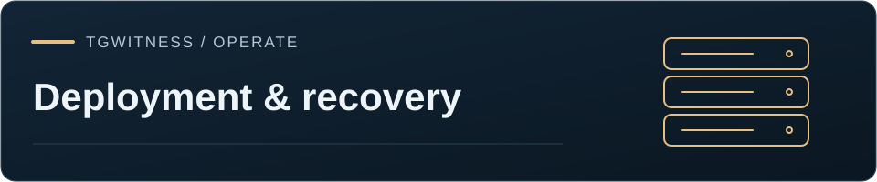

[TgWitness](../../README.md) / [التوثيق](../README.md) / [المجلد](README.md)



[English](../DEPLOYMENT.md) · [Русский](../ru/DEPLOYMENT.md) · [Українська](../uk/DEPLOYMENT.md) · [Español](../es/DEPLOYMENT.md) · [Português (Brasil)](../pt/DEPLOYMENT.md) · [Türkçe](../tr/DEPLOYMENT.md) · **العربية** · [فارسی](../fa/DEPLOYMENT.md) · [اردو](../ur/DEPLOYMENT.md) · [हिन्दी](../hi/DEPLOYMENT.md) · [Bahasa Indonesia](../id/DEPLOYMENT.md) · [Tiếng Việt](../vi/DEPLOYMENT.md) · [简体中文](../zh/DEPLOYMENT.md)

# النشر والتشغيل

## اختيار طريقة التثبيت

للحزمة المحمولة، استخرج `TgWitness-<version>-windows-amd64-portable.zip` من GitHub Releases.
وللطرق الأخرى، نزّل ملف ZIP للمصدر واستخرجه أو انسخ المستودع (clone)، ثم شغّل ما يلي من دليل
المشروع:

| التثبيت | التشغيل | هل يعمل في الخلفية؟ |
| --- | --- | --- |
| حزمة Windows المحمولة | `TgWitness.cmd` | لا؛ أبقِ النافذة مفتوحة. |
| تثبيت أصلي على Windows | `Start.cmd` | لا؛ استخدم مهمة تسجيل الدخول الاختيارية للعمل في الخلفية. |
| تثبيت أصلي على Linux/macOS | `sh start.sh` | لا؛ استخدم systemd/launchd للعمل في الخلفية. |
| على أي مضيف مدعوم عبر Docker | `docker compose up -d --build --wait` | نعم، ما دامت خدمة Docker (daemon) تعمل. |
| مساعد Docker على Windows | `scripts\Docker.cmd` | نعم؛ ينتظر المساعد حتى يصبح خادم الويب سليمًا. |
| مساعد Docker على Linux/macOS | `sh scripts/docker-start.sh` | نعم؛ ينتظر المساعد حتى يصبح خادم الويب سليمًا. |

لخادم سحابي ينبغي أن يتمكن طرف ثالث من فحصه — يُنشأ عبر واجهة API لدى المزوّد، دون SSH، ولا
يُوصَل إليه إلا عبر Cloudflare Tunnel — راجع [النشر عالي الضمان](../HIGH-ASSURANCE.md).

يُنشئ التشغيل الأصلي `.venv` خاصًا ويثبّت التبعيات بإصداراتها المحددة. ويبنيها Docker داخل الصورة
دون الحاجة إلى Python على المضيف. يتطلب الإعداد الأول اتصالًا بالإنترنت. وإذا لم يُعثر على
Python 3.11 أو أحدث، يطلب `Start.cmd` الإذن قبل تثبيت Python 3.12 لمستخدم Windows الحالي (عبر
winget، وإلا فعبر مثبّت python.org بعد التحقق من توقيع Python Software Foundation)؛ ولا يطلب
أبدًا صلاحيات المسؤول. ويظل Docker وخدمات نظام التشغيل متطلبات مسبقة.

تستخدم التثبيتات الأصلية والمحمولة `data/live` داخل مجلدها. ويستخدم Docker وحدة التخزين المسماة
`tgwitness-data` في `/data`. وهذه تثبيتات منفصلة إلى أن تنقل دليل البيانات كاملًا عن قصد. لا
تتوقع أن تكتشف حاوية Docker جديدة حسابات التثبيت الأصلي تلقائيًا.

## متطلبات التثبيت

يحتاج التثبيت الأصلي إلى Python 3.11 أو أحدث مع `venv` و`ensurepip`، واتصال بالإنترنت لتثبيت
التبعيات أول مرة، ودليل مشروع قابل للكتابة لإنشاء `.venv`. لا تحتاج اللوحة المضمّنة إلى Node.js
ولا إلى بناء الواجهة الأمامية. شغّل المشغّل من حساب نظام التشغيل العادي؛ إذ لا يتطلب TgWitness
صلاحيات المسؤول أو root.

- **نظام Windows:** يجرّب `Start.cmd` الأمر `py -3`، ثم `python`، ثم مجلدات التثبيت الافتراضية
  الخاصة بالمستخدم وفي Program Files، ويتطلب الإصدار 3.11 أو أحدث. وإذا لم ينجح أي منها، يعرض
  التثبيت التلقائي للمستخدم الحالي الموصوف أعلاه. ويعمل `py -3 start.py` أيضًا. ولا تحتاج الحزمة
  المحمولة إلى Python إطلاقًا.
- **نظام Linux:** يجرّب `start.sh` كلًّا من `python3.13` و`python3.12` و`python3.11` و`python3`
  و`python`، وإذا لم يستوفِ أيٌّ منها الشرط يطبع أمر التثبيت لـ apt أو dnf أو pacman أو zypper أو
  apk أو Homebrew. قد تتطلب تثبيتات Debian/Ubuntu الحزمة `python3-venv` المطابقة للمفسّر المحدد.
  ويجب استبدال إصدار Python الافتراضي الأقدم في التوزيعة بإصدار Python 3.11 أو أحدث، أو تثبيت هذا
  الإصدار إلى جانبه.
- **نظام macOS:** ثبّت توزيعة حديثة من Python 3.11 أو أحدث؛ ولا تفترض أن المفسّر المرفق بنظام
  التشغيل يفي بالمتطلب. استخدم `python3 start.py` من دليل المشروع.
- **باستخدام Docker:** استخدم Docker Engine/Desktop مع Compose v2.20 أو أحدث. ويجب أن يستخدم
  Docker Desktop حاويات Linux على Windows. تثبّت الحاوية تبعيات Python الخاصة بها، ولا يحتاج
  المضيف إلى تثبيت Python منفصل.

## الحاسوب المحلي

استخدم `Start.cmd` على Windows أو `sh start.sh` على Linux/macOS. ويهيّئ `scripts\Setup.cmd` أو
`sh start.sh --setup-only` البيئة. يثبّت المشغّل التبعيات عند الاستخدام الأول، وتعيد مرات التشغيل
اللاحقة استخدام البيئة نفسها. يلزم الاتصال بالإنترنت للإعداد ولجمع البيانات من Telegram، لكن
تصفّح القيود الموجودة وإنشاء عمليات التصدير يعملان دون اتصال.

شغّل `python start.py --check` بعد الإعداد لفحص التبعيات المحلية وEd25519 والتخزين وتهيئة
المفاتيح وعنوان الاستماع دون تشغيل مجمّع. استخدم `--json` للحصول على مخرجات منظّمة. ومرّر قيم
`--data-dir` و`--host` و`--port` التي تنوي استخدامها. لا يثبّت الفحص حزمًا ولا ينشئ سجلًا ولا
يتصل بـ Telegram؛ وليس تأهيلًا لسلامة البيانات أو للتغطية. ويتحقق بدء التشغيل من السجلات
الموجودة بشكل منفصل. كما أن `python start.py --help` لا يجري أي تثبيت.

بعد استخدام start.py، شغّل الأوامر المساعدة باستخدام `.venv\Scripts\python.exe` على Windows أو
`.venv/bin/python` على Linux/macOS، أو فعّل تلك البيئة أولًا. تفترض أمثلة `python -m ...` أدناه
أن البيئة مفعّلة.

~~~sh
python -m tgwitness --data-dir /path/to/private/data --host 127.0.0.1 --port 8787
~~~

متغيرات البيئة: TGWITNESS_DATA، TGWITNESS_HOST، TGWITNESS_PORT، TGWITNESS_TOKEN. ويختار
TGWITNESS_VAULT_KEY_FILE وضع المفتاح الخارجي لتثبيت جديد؛ انظر [المفتاح الرئيسي الخارجي](../SECURITY-MODEL.md#external-master-key). إذا وُفّر TGWITNESS_TOKEN
فيجب أن يحتوي على 24 حرفًا على الأقل؛ استخدم قيمة عشوائية تشفيريًا. ومن دونه يولّد التطبيق رمزًا
عشوائيًا بطول 256 بت في panel-token.txt. ولا يعيد التجاوز عبر متغير البيئة كتابة ذلك الملف. أعد
التشغيل لتدوير بيانات الاعتماد.

لا يجوز أن تمتلك دليل البيانات إلا عملية واحدة بالضبط. ويمنع قفل ملفات على مستوى نظام التشغيل،
يعمل على جميع المنصات، الكتابةَ المتزامنة غير المقصودة. استخدم عاملًا (worker) واحدًا لـ Uvicorn.
يمكن للوحة إدارة أي عدد من مساحات العمل، وتوضع أدلة مساحات العمل الإضافية تحت profiles/<id>/.
ولنسخ خدمة منفصلة، استخدم أدلة ومنافذ منفصلة. مكان ملفات SQLite WAL هو التخزين المحلي الدائم، لا
نظام ملفات شبكي. لا تشارك وحدة تخزين واحدة بين النسخ المتماثلة.

## حزمة Windows المحمولة

يتضمن كل GitHub Release الملف `TgWitness-<version>-windows-amd64-portable.zip` وملف `.sha256`
الخاص به. وتحتوي الحزمة على بيئة تشغيل Python 3.12 الرسمية القابلة للتضمين من python.org (مجموعها
الاختباري محدد في `tools/build_portable.py`)، وعلى TgWitness وتبعياته بإصداراتها المحددة، وثلاثة
مشغّلات:

| الملف | الغرض |
| --- | --- |
| `TgWitness.cmd` | يشغّل اللوحة؛ وتُمرَّر الخيارات الإضافية كما هي، مثل `TgWitness.cmd --port 8790` |
| `TgWitness-Demo.cmd` | يشغّل العرض التوضيحي الاصطناعي في `data\demo` |
| `TgWitness-Check.cmd` | يجري فحص الجاهزية دون تشغيل التطبيق |

يُضمَّن قاموس الصرف الروسي بإصداره المحدد وملفات تعريف ألوان PDF للاستخدام دون اتصال. ولا يسمح
التحزيم داخل مجلدات `data` الخاصة بالتبعيات إلا بالمسارات المعروفة لهذه الملفات؛ وأي ملف غير
متوقع في تلك المجلدات يُفشل البناء.

استخرج الأرشيف كاملًا إلى مجلد قابل للكتابة مثل `Documents\TgWitness`؛ ولا تشغّله من داخل ملف
ZIP أو من Program Files. تستخدم بيئة التشغيل مسار وحدات معزولًا، لذا لا تؤثر فيها تثبيتات Python
الأخرى ولا `PYTHONPATH`. تبقى البيانات في مجلد `data` داخل الحزمة. للتحديث، أوقف TgWitness،
واستخرج الإصدار الجديد إلى مجلد جديد، ثم انسخ مجلد `data` إليه.

لبناء الحزمة بنفسك على Windows 64 بت باستخدام Python 3.12:

~~~sh
python tools/build_portable.py
~~~

## الحاوية

```sh
docker compose up -d --build --wait
```

ينشئ هذا الأمر وحدة تخزين دائمة مسمّاة لـ /data. ويُربط منفذ الويب بـ 127.0.0.1:8787. تعمل
العملية بالمعرّف UID 10001 مع إسقاط الصلاحيات (capabilities)، ونظام ملفات جذر للقراءة فقط،
و/data و/tmp قابلين للكتابة. يتحقق `--wait` من سلامة خادم الويب قبل أن يعود؛ أما تفويض Telegram
والتسليم فيظهران في اللوحة. وتستخدم المساعدات المرفقة مهلة جاهزية مدتها 180 ثانية بعد البناء.
وقد يستغرق تنزيل التبعيات أول مرة وقتًا أطول من ذلك.

يستخدم ملفا Compose الأساسيان كلاهما اسم المشروع `tgwitness`، لذا فإن استخراج إصدار جديد في دليل
آخر لا يؤدي بصمت إلى اختيار وحدة تخزين بيانات جديدة. أبقِ نشرًا واحدًا فقط نشطًا لهذا المشروع.
وللتثبيتات المستقلة، استخدم `docker compose -p NAME ...` باسم فريد ومنفذ مضيف مختلف، واحتفظ بكليهما
عند التحديث. ولنشر أقدم يستخدم اسم مشروع مختلفًا، واصل استخدام اسمه الأصلي مع `-p`؛ ويسرد
`docker compose ls` المشاريع الموجودة.

لاستخدام منفذ loopback مختلف، انسخ `deploy/env.example` إلى `.env` وغيّر `TGWITNESS_PORT`. على
سبيل المثال، يتيح `TGWITNESS_PORT=8788` اللوحة على `http://127.0.0.1:8788`، بينما تظل الحاوية
تستمع على 8787. ويتجاهل Git الملف `.env`.

استرجع الرمز الأولي:

~~~sh
docker compose exec tgwitness cat /data/panel-token.txt
~~~

أوامر مفيدة:

```sh
docker compose ps
docker compose logs --tail 100 -f
docker compose stop
docker compose up -d --wait
```

يعيد الإعداد `restart: unless-stopped` تشغيل المجمّع بعد تعطّله أو بعد إعادة تشغيل خدمة Docker
(daemon). على خادم Linux، فعّل تشغيل Docker عند الإقلاع باستخدام مدير الخدمات في توزيعتك، وغالبًا
ما يكون ذلك بالأمر `sudo systemctl enable --now docker`. وعلى Windows/macOS، فعّل إعداد Docker
Desktop الخاص بالتشغيل عند تسجيل الدخول. وقد يؤدي تسجيل الخروج من سطح المكتب أو السكون أو توقف
خدمة Docker إلى انقطاع الجمع. أما الحاوية التي أُوقفت صراحةً فتبقى متوقفة حتى تشغّلها مجددًا.

يُحدَّد حجم /tmp بـ 512 MiB في التهيئة النموذجية. وتُنشأ عمليات التصدير بدلًا من ذلك في المجلد
`temporary-exports/` الخاص بكل مساحة عمل على /data الدائم. احجز هناك مساحة لعمليات التصدير
المتزامنة، ونمو السجل وWAL، والوسائط، والنسخ الاحتياطية. يستخدم المشغّل deploy/constraints.txt
لتقييد تبعيات وقت التشغيل بإصداراتها المؤهَّلة. أما Docker والخوادم عالية الضمان فتثبّت من
deploy/requirements.lock وdeploy/build.lock باستخدام pip --require-hashes: يجب أن يطابق كل ملف حزمة
قيمة SHA-256 مسجّلة في الـ commit، فيُرفض أي ملف استُبدل على PyPI أو على مرآة. ولا تزال صورة
Python الأساسية وحزم نظام التشغيل تتطلب تأهيلًا مستقلًا للإصدار.

لا تستخدم docker compose down -v إلا إذا كنت تنوي إتلاف السجل والمفاتيح. تُبلغ حالة سلامة الحاوية
عن توفر خادم الويب، لا عن نجاح الالتقاط من Telegram. افحص في اللوحة حالة المجمّع ونبضه وأخطاءه
وأحداث التغطية.

### ملف تعريف الشاهد المستقل

تشغّل الخدمة الاختيارية `witness` [شاهدًا مستقلًا](../WITNESS.md) في حاويتها الخاصة، بمفتاحه
وسجله الخاصين في وحدة التخزين `witness-data`، ولا يملك للوصول إلى المجمّع إلا رمز شاهد للقراءة فقط.
أنشئ الرمز في اللوحة ضمن **المزيد من الأدوات → إضافات → شاهد مستقل**، وأضفه مع رمز البوت والقناة
إلى `.env`، ثم شغّل ملف التعريف:

```sh
docker compose --profile witness up -d          # deploy/compose/compose.image.yaml: same flag
docker compose logs witness                     # witness key fingerprint
```

تصل الخدمة إلى المجمّع داخل شبكة Compose على `http://tgwitness:8787` (ويتجاوز
`TGWITNESS_WITNESS_COLLECTOR` هذه القيمة، مثلًا `/profiles/<workspace ID>` لمساحة عمل أخرى). ولشاهد
على خادم منفصل يديره شخص آخر، استخدم هناك `deploy/compose/compose.witness.yaml` مع ضبط
`TGWITNESS_WITNESS_COLLECTOR` على عنوان HTTPS الخاص بالمجمّع؛ فهذا الملف لا يحتوي إلا على الشاهد.

## تثبيت صورة منشورة

انسخ `deploy/env.example` إلى `.env`. واضبط `TGWITNESS_IMAGE` على الإصدار المنشور، مستخدمًا مسار
المستودع **بأحرف صغيرة**، مثلًا:

```dotenv
TGWITNESS_IMAGE=ghcr.io/your-owner/your-repository:0.9.3
TGWITNESS_PORT=8787
```

شغّل هذا الملف وحده، بدلًا من `compose.yaml`:

```sh
docker compose --project-directory . -f deploy/compose/compose.image.yaml pull
docker compose --project-directory . -f deploy/compose/compose.image.yaml up -d --wait
docker compose --project-directory . -f deploy/compose/compose.image.yaml exec tgwitness cat /data/panel-token.txt
```

لا حاجة على المضيف إلى بناء من المصدر ولا إلى Python ولا إلى مُصرِّف. يستهدف سير عمل الإصدار
حاويات Linux بمعماريتي AMD64 وARM64، بما في ذلك آلة Linux الافتراضية في Docker Desktop. استخدم
وسم إصدار أو `ghcr.io/owner/repository@sha256:...` من ملخص سير العمل. لم يُهيَّأ وسم `latest`
متحرك ولا ترقية تلقائية للتطبيق دون إشراف. ويستخدم إصدارا الصورة والمصدر وحدة تخزين البيانات
نفسها عندما يتطابق اسم المشروع.

<a name="automatic-https-on-a-server"></a>

## تفعيل HTTPS تلقائيًا على الخادم

استخدم خادمًا عليه Docker، ونطاقًا تتحكم فيه، وتخزينًا محليًا دائمًا. وجّه سجلات A/AAAA للنطاق
إلى الخادم؛ ولا تنشر سجل AAAA إلا إذا كان الخادم قابلًا للوصول عبر IPv6. اسمح باتصالات TCP
الواردة على المنفذين 80 و443 وباتصالات DNS/HTTPS الصادرة لإصدار الشهادات. ويجب ألا تكون هذه
المنافذ مشغولة مسبقًا بخدمات أخرى.

انسخ `deploy/env.example` إلى `.env` واضبط اسم المضيف، دون مخطط (scheme) أو مسار:

```dotenv
TGWITNESS_DOMAIN=watch.your-domain.org
```

شغّل البناء من المصدر مع طبقة HTTPS الإضافية:

```sh
docker compose -f compose.yaml -f deploy/compose/compose.https.yaml up -d --build --wait
docker compose -f compose.yaml -f deploy/compose/compose.https.yaml exec tgwitness cat /data/panel-token.txt
```

```sh
docker compose --project-directory . -f deploy/compose/compose.image.yaml -f deploy/compose/compose.https.yaml up -d --wait
```

للصورة المنشورة، استخدم `deploy/compose/compose.image.yaml` ملفًا أول بدلًا من ذلك. واحتفظ
بوسيطي `-f` كليهما في أوامر الحالة والسجلات (logs) والتحديث والإيقاف اللاحقة.

يحصل Caddy على الشهادة ويجدّدها، ويعيد توجيه HTTP إلى HTTPS، ويمرّر الطلبات إلى المجمّع عبر شبكة
Compose الخاصة. ولحالة الشهادة وحدة تخزين دائمة خاصة بها. ويبقى منفذ المضيف المباشر للمجمّع
مقتصرًا على loopback. ولا تفعّل تهيئة Caddy المرفقة تسجيل الوصول (access logging).

افتح `https://watch.your-domain.org` وأدخل رمز اللوحة. تغطي جاهزية Compose الحاويات؛ أما إصدار
الشهادة وإمكانية الوصول من الخارج فيعتمدان على DNS والجدار الناري. إذا لم يكن HTTPS جاهزًا، فافحص
DNS وقواعد الجدار الناري ومخرجات الأمر التالي:

```sh
docker compose -f compose.yaml -f deploy/compose/compose.https.yaml logs --tail 100 caddy
```

تتبع صورة Caddy المرفقة الوسم `2-alpine`. ويؤدي السحب (pull) إلى تحديث تلك الصورة؛ فثبّت في نشرك
ملخّصًا (digest) مختبرًا إذا كنت تحتاج إلى إصدارات بنية تحتية ثابتة.

## التحديثات والنسخ الاحتياطية

حافظ على اسم مشروع Compose ووحدة تخزين البيانات عبر التحديثات. أوقف المجمّع أولًا وأنشئ نسخة
احتياطية كاملة. للنشر الافتراضي المبني من المصدر:

```sh
docker compose stop
docker compose cp tgwitness:/data ../tgwitness-backup-before-update
```

استخدم في كل مرة وجهة نسخ احتياطي جديدة خارج المستودع، واحمها بوصفها مادة تتيح الوصول إلى
الحسابات. المسار في المثال للتوضيح؛ استخدم موقع النسخ الاحتياطي الخاص بك. انسخ الدليل كاملًا، بما
في ذلك الملفات المخفية وجميع مساحات العمل والمفاتيح والسجلات والوسائط. وانسخ احتياطيًا المفتاح
الرئيسي الخارجي للخزينة بشكل منفصل إن كان مهيّأً. ملف ZIP للأدلة ليس نسخة احتياطية قابلة للاستعادة
للتطبيق. ومع HTTPS، احتفظ أيضًا بوحدات تخزين Caddy إذا كنت تحتاج إلى الإبقاء على حالة الشهادة
والحساب لديه.

لنشر من المصدر، احصل على ملفات الإصدار الجديد وشغّل:

```sh
docker compose up -d --build --wait
```

لنشر قائم على صورة، غيّر `TGWITNESS_IMAGE` إلى الإصدار المطلوب، ثم شغّل:

```sh
docker compose --project-directory . -f deploy/compose/compose.image.yaml pull
docker compose --project-directory . -f deploy/compose/compose.image.yaml up -d --wait
```

استخدم ملف (أو ملفات) Compose الخاصة بتثبيتك في أوامر الإيقاف والنسخ السابقة أيضًا. احتفظ بـ `.env`
والتهيئة المخصصة واسم المشروع نفسه. يحتفظ `down` بوحدات التخزين المسماة؛ أما **`down -v` فيحذفها**.
لا تنسخ `.venv` بين أنظمة تشغيل أو إصدارات Python مختلفة. لتحديث تثبيت أصلي، أوقف TgWitness،
وانسخ دليل بياناته كاملًا احتياطيًا، واستبدل ملفات المصدر، وشغّل `python start.py --setup-only` قبل
التشغيل.

بعد التحديث، تحقّق من الوصول إلى اللوحة وهوية الحساب وحالة المراقبة والتغطية. بعد إعادة التشغيل
يستأنف TgWitness من موضع تحديثات Telegram المحفوظ ويطلب التحديثات التي فاتته أثناء التحديث. وقد
يتطلب التراجع النسخة الاحتياطية السابقة للتحديث إذا غيّر إصدار مستقبلي صيغ التخزين.

## الخادم البعيد

أبقِ الخدمة مرتبطة بـ loopback واستخدم نفق SSH، أو أنهِ HTTPS عند وكيل عكسي. ملف Compose الأساسي
محلي فقط؛ وتوفّر الطبقة الاختيارية `deploy/compose/compose.https.yaml` خادم Caddy لنطاق مهيّأ.
أبقِ رمز Bearer خارج عناوين URL وسجلات الوكيل. وينبغي للوكيل العكسي أن يحدّ من حجم الطلبات
ومعدلات الاتصال. لا تعرّض HTTP غير المشفّر للإنترنت.

تتوفر في [deploy/](../../deploy/README.md) أمثلة لـ systemd ولمهمة تسجيل دخول على Windows ولوكيل
مستخدم (user agent) على macOS ولـ Caddy. راجع مساراتها وكيّفها قبل التثبيت. إنها قوالب مرفقة،
وليست تأهيلات للمنصات نُفّذت محليًا. ولا يسجّل المشغّل العادي أي خدمة أو مهمة في الخلفية.

على Windows، يخزّن التشغيل دون نافذة عبر `pythonw.exe` تشخيصات بدء التشغيل والخادم في
`logs/server.log` داخل دليل البيانات (5 MiB لكل ملف، مع نسختين احتياطيتين بالتدوير). أما التشغيل من
وحدة التحكم فيُبقي التسجيل في وحدة التحكم. وتسجيل الوصول عبر HTTP معطّل في الوضعين. احمِ السجلات
مع دليل البيانات وراجعها قبل مشاركتها.

## إعادة التشغيل والفجوات

تُحفظ آخر حالة مراقبة طُلبت. فإذا كانت المراقبة نشطة، يحاول بدء التشغيل إعادة الاتصال واستئناف
المصادر المحددة. ويُلغي الإيقاف المؤقت اليدوي هذه النية. وتُسجَّل إعادة التشغيل الفاشلة وتُعرض في
اللوحة.

يخزّن TgWitness موضع تحديثات Telegram للحساب ولكل قناة (pts، qts، seq وdate) في خزينة مساحة
العمل، ويستعيده عند التشغيل التالي. ثم يطلب العميل التحديثات التي فاتته أثناء توقف العملية، وتستعيد
إعادة الفحص الدورية الرسائل الفائتة وتسجّل الرسائل المحفوظة التي لم يعد Telegram يعيدها. يُعاد
تحميل قائمة المحادثات (dialogs) عند البدء. ويسجّل كل بدء تشغيل رأس السجل السابق، وحدّ فترة عدم
الاتصال، وموضع التحديث الذي استُؤنف منه. يفحص المراقب الاتصال كل 10 ثوانٍ ويضيف نبضًا كل دقيقة
(**المزيد من الأدوات → المعلمات → سجل نشاط المُجمِّع كل**). وتُسجَّل حالات انقطاع الاتصال وفترات
الصمت فجواتٍ في التغطية مع أسبابها. وتُخزَّن لقطات سجل الرسائل بوصفها ملاحظات منفصلة لسجل الرسائل
الحالي، إلى جانب القيود الحية.

تُخزَّن قائمة انتظار الوسائط في قاعدة بيانات SQLite الخاصة بكل مساحة عمل. وتُحفظ الرسالة ومهمتها
معًا في عملية ذرّية واحدة (commit). وتُستعاد المهام الجارية التي انقطعت لإعادة محاولتها عند البدء.
لكل تنزيل مهلة أساسية قدرها 120 ثانية، يُضاف إليها وقت يتناسب مع حجمه بمعدل 256 KiB/s، وحدّ لكل
نوع من المرفقات يتراوح بين 1 و2,000 MiB؛ وتوجد إعدادات المهلة والسرعة وإعادة المحاولة ضمن
**المزيد من الأدوات → المعلمات**. يتخطى المجمّع الملفات غير المعروف حجمها. ويحتفظ الإيقاف المؤقت
بالأعمال الموجودة في قائمة الانتظار. وتستخدم إعادة المحاولة واصف الملف الأصلي الذي رُصد، ولا
تستخدم أبدًا أحدث إصدار لرسالة عُدّلت لاحقًا. لحالات الفشل المؤقتة عدد محدود من إعادات المحاولة؛
وتبقى فترات توقف FloodWait الخاصة بالوسائط سارية بعد إعادة التشغيل. استعادة الوسائط منفصلة عن
استعادة تحديثات Telegram، ولا يمكنها إعادة إنشاء الملفات التي اختفت.

## النسخ الاحتياطي والاستعادة والسعة

أوقف العملية قبل نسخ **دليل البيانات بالكامل**، بما في ذلك vault.key وsigning.enc وcredentials.enc
وملفات قاعدة بيانات SQLite وWAL والوسائط والرمز ونقاط التحقق وجميع الأدلة الفرعية في profiles/.
استعد النسخة الكاملة أثناء توقف الخدمة الوجهة. يؤدي فقدان مفاتيح الخزينة أو عدم تطابق مفتاح
التوقيع إلى فشل بدء التشغيل؛ لا تُعِد توليد المفاتيح لفرض الوصول.

أبقِ النسخ الاحتياطية التي تحتوي على أسرار مشفّرة ومقيّدة الوصول. ملفات ZIP للأدلة عناصر مراجعة
قابلة للنقل، وليست نسخًا احتياطية للتطبيق ولا لجلسات Telegram. لا يوجد حذف تلقائي وفق مدة
احتفاظ. خطّط لمساحة القرص لجميع الرسائل والبيانات الوصفية الخام والوسائط وعمليات التصدير المؤقتة
والنسخ الاحتياطية.

يعالج التحقق عند بدء التشغيل والتصدير القيود بشكل متدفق بدلًا من تحميل السجل كاملًا. يثبّت التصدير
لقطة قراءة بينما يمكن أن تستمر عمليات الكتابة الجديدة في WAL؛ وقد تحتفظ عمليات التصدير الطويلة
بصفحات WAL، لذا تظل سعة القرص مهمة. يُحدّ حجم ملفات ZIP بـ 4 GiB غير مضغوطة لتتوافق مع الإعداد
الافتراضي لأداة التحقق المستقلة؛ ويرفع **المزيد من الأدوات → المعلمات → أكبر ملف ZIP موقّع** هذا
الحد، ويُتحقَّق من هذه الأرشيفات باستخدام `verify.py --max-gib N`. لا يوجد حد لعدد الأحداث في
الصيغ الأخرى. تبثّ المتصفحات المدعومة أجزاء الاستجابة إلى ملف يختاره المستخدم. أما المتصفحات
الأخرى فتخزّن مؤقتًا 128 MiB على الأكثر وتحيل عمليات النقل الأكبر إلى أداة سطر الأوامر
المصادَق عليها:

~~~sh
python -m tgwitness.download --token-file data/live/panel-token.txt --out evidence.zip
~~~

استخدم `--profile ID` من **عمليات التصدير → معرف مساحة العمل** لمساحة عمل أخرى، أو
`--format zip|jsonl|csv|html`، أو `--url https://your-server` لخادم بعيد، أو `--max-mib` لتغيير حد
النقل البالغ 5 GiB. لا يُسمح بـ HTTP غير المشفّر إلا عبر loopback. تنتقل الرموز في الترويسات،
وتُرفض عمليات إعادة التوجيه، ولا يُكتب فوق الملفات الموجودة، ولا تُنشر التنزيلات غير المكتملة
كملفات مكتملة. إذا تجاوز TGWITNESS_TOKEN الرمز المولَّد، فاستخدم ملفًا محميًا بشكل منفصل يحتوي على
تلك القيمة الفعالة: فالتجاوز لا يعيد كتابة panel-token.txt. قيمة SHA-256 التي يعرضها الأمر مجرد
مجموع اختباري للنقل؛ تحقّق من ملف ZIP الموقّع بشكل مستقل.

تعرض اللوحة الوسائط المنتظرة أو الفاشلة، وأقدم الوسائط المعلّقة، والمساحة الحرة على القرص، وفترات
توقف طلبات Telegram، والمصادر غير المؤكَّد الوصول إليها. هذه التشخيصات ليست مراقبًا كاملًا للتسليم
من طرف إلى طرف. تتشارك مساحات العمل عملية واحدة؛ لذا قد يظل حساب كثيف النشاط يؤثر في الحسابات
الأخرى. ولا تزال الأعمال التالية متبقية: عمليات عاملة منفصلة، والاحتفاظ والتدوير، واستعادة
التحديثات بشكل دائم، والتأهيل الكامل للنشر. الوصول المقيَّد النطاق إلى اللوحة موثّق في
[الوصول والأذونات](../ACCESS.md)؛ ونقاط التحقق المستقلة مشروحة في [دليل الشاهد](../WITNESS.md).

الإجراءات التفصيلية: [الاتصال/الأمان](../CONNECTION-SECURITY.md) و[أوضاع التشغيل](../OPERATIONS.md).
