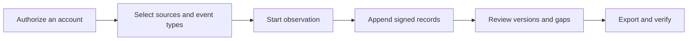

[English](../../README.md) · [Русский](../ru/README.md) · [Українська](../uk/README.md) · [Español](../es/README.md) · [Português (Brasil)](../pt/README.md) · [Türkçe](../tr/README.md) · **العربية** · [فارسی](../fa/README.md) · [اردو](../ur/README.md) · [हिन्दी](../hi/README.md) · [Bahasa Indonesia](../id/README.md) · [Tiếng Việt](../vi/README.md) · [简体中文](../zh/README.md)


<p align="center">
  <strong>مساحة عمل المراقبة الخاصة بك على Telegram.</strong><br>
  احتفظ بالمحادثات التي تم التقاطها، وافهم ما الذي تغير، وشارك سجلاً موقّعاً.<br>
  على جهاز الكمبيوتر أو الخادم الخاص بك. باستخدام حساباتك الخاصة.
</p>

<p align="center">
  
  
  
  
  
</p>

<p align="center">
  <a href="#البداية-السريعة">البداية السريعة</a> ·
  <a href="#الميزات">الميزات</a> ·
  <a href="#ربط-حساب-telegram">الحسابات</a> ·
  <a href="#الأدلة-والتحقق">الأدلة</a> ·
  <a href="#النشر">النشر</a> ·
  <a href="../README.md">التوثيق</a>
</p>

> [!TIP]
> **استكشف قبل الاتصال.** قم بتشغيل `scripts\Demo.cmd` أو `sh start.sh --demo` لفتح مساحة عمل تحتوي على محادثات خيالية. لا حاجة إلى حساب Telegram.

**هل أنت جديد هنا؟** [ابدأ →](QUICKSTART.md) · [ويكي →](../wiki/Home.md) · [اختر دليلاً →](../README.md) · [احصل على المساعدة →](../../.github/SUPPORT.md) · [اطلع على ما تم اختباره →](../VERIFICATION.md)

> [!WARNING]
> **استخدم حساب Telegram مخصصًا لا تمانع في فقدانه.** ننصح بشدة بعدم ربط حسابات شخصية أو ذات قيمة، أو إنشاء بيانات اعتماد API ID / API hash عليها. قد يقوم Telegram بتقييد الحسابات أو حظرها نهائيًا. [اقرأ دليل الحساب](../ACCOUNTS.md).

## الميزات

- **محادثات ذات سجل تاريخي.** اقرأ الرسائل المحفوظة، وقارن التعديلات التي تم تسجيلها، واطلع على إشعارات الحذف في سياق المحادثة.
- **راقب وفقًا لشروطك.** اختر الدردشات الفردية، أو مجلد Telegram، أو الحساب بأكمله. لكل حساب مساحة عمل وإعدادات خاصة به.
- **ملفات تصدير يمكنك التحقق منها.** ملف ZIP موقّع، وسجلات أصلية، ومرفقات محفوظة، وتقرير HTML يمكن قراءته دون اتصال بالإنترنت. حماية اختيارية بكلمة مرور عند التسليم.
- **مصممة للاستخدام اليومي.** سمات فاتحة وداكنة، و13 لغة، ووظيفة البحث، والتنقل باستخدام Ctrl/Cmd+K، وإجراء الإجراءات مباشرةً من «الدردشات».

<details>
<summary>جميع الإمكانيات والتفاصيل الفنية</summary>

- **مسار الاتصال الخاص بك.** ضمن **«الحساب» → «إعدادات البروكسي**»، اختر من قوائم MTProxy العامة المجمعة، أو قم بتحديثها من مصادرها، أو الصق رابط بروكسي Telegram الخاص بك. لا يزال البروكسي اليدوي SOCKS5/HTTP/MTProxy ودليل المشغلين متاحين. يتم تنزيل القوائم العامة وتصفيتها، ولكن لم يتم توصيل أي حساب عبر خادم مدرج في القائمة حتى الآن. [كيف تعمل القوائم العامة](../CONNECTION-SECURITY.md#public-proxies-supplied-by-your-installation).

- **مجلة لما تراه حساباتك فعليًّا.** الرسائل الجديدة، والتعديلات، وإشعارات الحذف، وردود الفعل، وأحداث العضوية، والثغرات في التغطية من المجموعات والقنوات التي تختارها.
- **المحادثات المختارة، أو مجلد Telegram، أو الحساب بأكمله.** اختر الأنواع المراد تسجيلها — القنوات، المجموعات، المحادثات الخاصة، الروبوتات — وتُضاف المحادثات الجديدة فور ظهورها. الاستثناءات، الرسائل الصادرة الخاصة بك والتعديلات، عمليات الحذف في المحادثات الخاصة المطابقة لمحادثتها، عمليات إعادة الفحص ذات الأولوية وحدود المرفقات لكل نوع ([مجموعة](../COLLECTION.md#observation-scope-chosen-chats-a-folder-or-the-whole-account)).
- **وضع التحقيق.** زر واحد يُعد حسابًا مخصصًا ينضم إلى الفرق ويتواصل مع الروبوتات: يتم تسجيل كل ما يراه ويرسله، ويتم الاحتفاظ بالأزرار الموجودة أسفل رسائل الروبوتات (الروابط، وتطبيقات الويب، والنصوص المراد نسخها)، وتصبح التعديلات التي تتم عبر الأزرار فقط إصدارات جديدة، ويحصل كل دردشة أو روبوت جديد على ملفه الشخصي (الوصف، والأوامر، والأعضاء) ويتم حفظ الرسائل المرئية السابقة دفعة واحدة ([وضع التحقيق](../COLLECTION.md#investigation-mode-joining-teams-and-talking-to-bots)). يشرح **دليل الحساب المخصص** في اللوحة (`/dedicated-account.html`) لماذا يجب عدم استخدام الحساب الرئيسي، ولماذا يعمل TgWitness من خلال أزواج هاش التطبيق/معرف التطبيق العامة، ولماذا لا يمنح زوج واجهة برمجة التطبيقات (API) بحد ذاته حق الوصول إلى حسابك (مع روابط إلى وثائق Telegram)، ويقدم قائمة بطرق إنشاء حساب إضافي.
- **تفاعل مباشرةً من خلال الدردشات.** أرسل الرسائل والردود، واضغط على أزرار الرد من البوت أو إرسال الرسائل النصية، أو قم بمعاينة دعوة Telegram وانضم إليها. يقوم الحساب المحدد بتنفيذ الإجراء؛ وتدخل الطلبات ومعاينات الدعوات وردود البوت المنبثقة/عناوين URL إلى سجله الموقّع ([العميل المصغر للوحة](../COLLECTION.md#act-from-the-panel)).
- **تغطية يمكنك الإشارة إليها.** تشير التقارير والمُحقق إلى «مراقبة مستمرة من X إلى Y»، مع سرد الثغرات وأسبابها ومعرّفات الرسائل التي لم يتم رصدها مطلقًا — دون الإشارة إليها على أنها محذوفة.
- **ملفات تعريف الأشخاص، الاشتراك الاختياري لكل محادثة.** سجل الأسماء وأسماء المستخدمين، علامات Telegram، SHA-256 وpHash للصورة الرمزية، النشاط، من يرد على من والمحافظ والهواتف وأسماء المستخدمين والروابط المذكورة — يتم إنشاؤها فقط من السجلات المحفوظة، حيث تشير كل حقيقة إلى سجلها في المجلة، ويتم تصديرها كملف منفصل موقّع ([نموذج الأدلة](../EVIDENCE.md#people-profiles)).
- **شاهد مستقل.** تقوم عملية منفصلة، لها مفتاحها الخاص وروبوتها الخاص، بجلب رأس المجلة الموقّع، ونشره على قناة Telegram، والإبلاغ عندما لا يرد المجمع؛ ويقوم المُثبِت بمقارنة الصادرات به. الفاصل الزمني، ومدة الانتظار، والعمليات التي يتم نشرها، وصياغة المنشورات هي خيارات أو ملف تكوين JSON ([شاهد](../WITNESS.md)). تم الاختبار على خادم Bot API محلي، ولم يتم بعد اختباره مع بوت وقناة حقيقيين.
- **إعدادات التجميع في لوحة التحكم.** توجد حدود وسرعة التجميع، وعمليات إعادة التحقق، وعمليات التنزيل، وملفات تعريف الأشخاص، والإشعارات، وعمليات التصدير في صفحة **«المعلمات»** مع نطاقاتها وقيمها الافتراضية؛ ويتم تسجيل كل تغيير في السجل الموقّع ([الإعدادات والمعلمات](#الإعدادات-والمعلمات)).
- **التعديلات والحذف في سياقها.** كل تعديل يمثل إصدارًا منفصلاً يظهر بجانب الإصدار السابق؛ ولا يؤدي إشعار الحذف أبدًا إلى محو المحتوى الذي تم تسجيله بالفعل.
- **ملفات تصدير موقعة وقابلة للتحقق.** يتم ربط كل حدث بسلسلة هاش (SHA-256) وتوقيعه (Ed25519). تحتوي حزمة ZIP الموقعة على ملفات JSONL و CSV وتقرير HTML غير متصل بالإنترنت ووسائط محفوظة وأداة تحقق مستقلة.
- **عمليات تصدير محمية بكلمة مرور.** يمكنك اختيارياً وضع أي ملف تصدير في ملف ZIP مضغوط بـ WinZip AES-256، وهو التنسيق الذي يقرأه كل من 7-Zip و WinRAR؛ وتبقى المحتويات الموقعة بداخله دون تغيير. تم فتح أرشيف تجريبي بايتًا بايتًا في libarchive (Windows `tar`) وتم رفض كلمة مرور خاطئة ([نموذج إثبات](../EVIDENCE.md#investigation-handoff)).
- **الإشعارات.** المشاكل (مساحة القرص المنخفضة، الحساب الذي تم تسجيل الخروج منه، أخطاء المجمع أو النسخ أو الطابع الزمني)، التغييرات في الدردشات التي تمت مراقبتها والملخص اليومي، يتم إرسالها عبر [Apprise](https://github.com/caronc/apprise) إلى Matrix و Telegram و Discord و Slack و ntfy والبريد الإلكتروني والعديد من الخدمات الأخرى — بدون نص الرسالة ما لم تقم بتشغيل ميزة المقتطفات — ويتم سردها في اللوحة. يتم اختبار التسليم على نقطة نهاية محلية؛ ولم يتم اختبار الخدمات نفسها بعد.
- **25 لغة للواجهة.** تشترك لوحة التحكم والوثائق الكاملة في نفس اللغات، بما في ذلك الألمانية والفرنسية واليابانية والعبرية. تم إعداد الترجمات باستخدام DeepL. يتم عرض محتوى Telegram وسجلات السجل دائمًا بالضبط كما تم حفظها.
- **مظهر فاتح ومظهر داكن.** يتبع إعدادات النظام بشكل افتراضي؛ ويتم حفظ الاختيار لكل متصفح على حدة.
- **تنقل سهل باستخدام لوحة المفاتيح.** اضغط على **Ctrl+K** (Mac: **⌘K**) أو اختر **«الانتقال إلى...»** للعثور على قسم ما. استخدم مفاتيح الأسهم ومفتاح Enter لفتحه؛ ويؤدي الضغط على مفتاح Escape إلى إغلاق القائمة.
- **حسابات متعددة.** أي عدد من مساحات العمل المنفصلة، لكل منها جلسة Telegram خاصة بها، ومجلة، ومفتاح توقيع، ومسار وكيل، وسياسة التقاط.
- **طرق تسجيل دخول مرنة.** الهاتف + الرمز + المصادقة الثنائية (2FA)، رمز الاستجابة السريعة (QR)، Telethon/Pyrogram `.session`، ملف ZIP لـ TData على Telegram Desktop، Telethon StringSession، أو مفتاح مصادقة كامل مع معرّف DC الخاص به.
- **بروكسيات لكل حساب.** SOCKS5 وHTTP CONNECT، تم اختبارهما على بروكسيات اختبار محلية، وMTProxy التجريبي، الذي لم يتم اختباره بعد مع خادم حقيقي. لا يعود البروكسي الفاشل أبدًا بصمت إلى الاتصال المباشر.
- **مصممة لتكون خاصة بطبيعتها.** تعمل على جهاز الكمبيوتر أو الخادم الخاص بك. واجهة مستخدم ويب مدمجة، بدون Node.js، بدون خدمة مستضافة، بدون قياس عن بُعد. يتم تخزين الجلسات وبيانات اعتماد واجهة برمجة التطبيقات (API) وأسرار البروكسي في خزينة مشفرة.
- **سهلة التشغيل.** انقر نقرًا مزدوجًا على نظام Windows، أو استخدم برنامج نصي واحد على أنظمة Linux/macOS، أو استخدم Docker Compose مع HTTPS التلقائي الاختياري. حتى الآن، لم يتم تشغيل سوى برامج التشغيل الخاصة بنظام Windows؛ اطلع على [ما تم اختباره](#ما-تم-اختباره).

</details>

## البداية السريعة

| المنصة | كيف تبدأ | المتطلبات |
| --- | --- | --- |
| **نظام Windows، لم يتم تثبيت أي برامج** | قم بتنزيل `TgWitness-<version>-windows-amd64-portable.zip` من [قسم الإصدارات](../../../../releases)، ثم قم بفك الضغط، وانقر نقرًا مزدوجًا على **`TgWitness.cmd`** | لا شيء؛ لغة Python مدمجة |
| Windows، من المصدر | انقر نقرًا مزدوجًا على **`Start.cmd`** | Python 3.11+؛ يتم توفيره وتثبيته لك في حالة عدم توفره |
| Linux / macOS | `sh start.sh` | Python 3.11+ مع `venv`؛ يقوم البرنامج النصي بطباعة أمر التثبيت الخاص بنظامك في حالة عدم وجوده |
| Docker، أي نظام تشغيل | انقر نقرًا مزدوجًا على **`scripts\Docker.cmd`** أو قم بتشغيل `sh scripts/docker-start.sh` | محرك Docker/Desktop مع Compose 2.20+ |

1. افتح **http://127.0.0.1:8787**.
2. الصق رمز الوصول الخاص باللوحة:
   - التثبيت المحمول أو من المصدر: محتويات `data/live/panel-token.txt`
   - Docker: تم طباعته بواسطة `scripts\Docker.cmd`/`scripts/docker-start.sh`، أو `docker compose exec tgwitness cat /data/panel-token.txt`
3. أضف حساب Telegram الخاص بك، واختر الدردشات التي تريد مراقبةها، ثم اضغط على **«بدء المراقبة**».

يؤدي التشغيل الأول للمصدر إلى إنشاء صورة خاصة `.venv` وتثبيت التبعيات المثبتة (يتطلب اتصالاً بالإنترنت). تقوم أدوات Docker المساعدة بإنشاء الصورة، والانتظار حتى تصبح اللوحة في حالة جيدة، ثم طباعة عنوانها ورمزها. `python start.py --check` (أو `TgWitness-Check.cmd` في الحزمة المحمولة) تقدم تقريرًا عن الجاهزية دون الحاجة إلى استخدام Telegram.

> **هل تريد فقط إلقاء نظرة؟** قم بتشغيل **`scripts\Demo.cmd`** أو `sh start.sh --demo`. ستفتح مجلة خيالية مباشرةً في المتصفح؛ ولا يتم ربط أي حساب Telegram بها، وتُخزَّن البيانات بشكل منفصل في `data/demo`.

<details>
<summary><strong>داخل مساحة العمل: المحادثات، والسجل، وعمليات التصدير</strong></summary>

<picture>
  <source media="(prefers-color-scheme: dark)" srcset="../assets/chats-dark.png">
  
</picture>

### سجل المراقبة


### التصدير الموقّع


</details>


## ربط حساب Telegram

> [!CAUTION]
> لا تقم بربط سوى الحسابات المخصصة التي يمكنك تحمل خسارتها. قد يقوم Telegram بحظر الحسابات بشكل دائم ودون سابق إنذار؛ انظر التحذير الموجود في أعلى هذه الصفحة. يشرح **دليل الحسابات المخصصة** الموجود في اللوحة (الشريط الجانبي، أو `/dedicated-account.html`) سبب الحاجة إلى حساب مخصص وكيفية الحصول عليه.

تسجيل الدخول عبر الهاتف أو رمز الاستجابة السريعة (QR) أو جلسة عمل قائمة — دون الحاجة إلى معرّف واجهة برمجة التطبيقات (API ID) أو التجزئة (hash).

**لماذا مجموعة واجهات برمجة التطبيقات (API) المدمجة؟** من المعروف أن إنشاء معرّف API خاص بك على [my.telegram.org](https://my.telegram.org) يؤدي إلى تقييد الحسابات، ولا تنشر Telegram حدودًا واضحة — وقد فقد العديد من الباحثين حساباتهم الرئيسية بهذه الطريقة. تنص صفحة [«الحصول على معرّف واجهة برمجة التطبيقات (API ID)»](https://core.telegram.org/api/obtaining_api_id) الخاصة بـ Telegram على أن الحسابات التي تستخدم عملاء واجهة برمجة التطبيقات (API) غير الرسميين تُوضع تلقائيًا تحت المراقبة، وترسل المستخدمين المحظورين خطأً إلى recover@telegram.org. ولذلك، يوفر TgWitness أزواج واجهة برمجة التطبيقات (API) العامة التي تستخدمها بالفعل عملاء مفتوحة المصدر آخرون، بحيث لا تضطر أبدًا إلى إنشاء واحدة. إذا كان لديك معرّف API خاص بك، فأدخله في حقل **«معرّف API + التجزئة**» وسيتم استخدامه بدلاً من ذلك.

عندما لا يتم إدخال أي زوج أو استيراده أو يكون محفوظًا بالفعل في مساحة العمل، يختار TgWitness أحد الأزواج الخمسين الموجودة في المجموعة وينتقل إلى الزوج التالي إذا رفض Telegram أحد الأزواج. ويبقى الزوج الذي قام بتسجيل الدخول مرتبطًا بهذا الحساب. يُعرّف الزوج التطبيق؛ ولا يزال عليك تفويض حساب Telegram الخاص بك بشكل منفصل. يعمل رمز الوصول الخاص باللوحة على فتح TgWitness وهو منفصل عن تسجيل الدخول إلى Telegram.

| ما لديك | كيفية استخدامه |
| --- | --- |
| رقم الهاتف الذي يتيح الوصول إلى الحساب | علامة التبويب **«الهاتف**»: الرمز من Telegram، ثم كلمة مرور المصادقة الثنائية (2FA) إذا كانت مفعّلة |
| تطبيق Telegram مسجل الدخول مسبقًا | علامة التبويب **«رمز الاستجابة السريعة**»: الإعدادات → الأجهزة → ربط جهاز سطح المكتب |
| Telethon (المخطط 7/8) أو Pyrogram (المخطط 2/3) `.session` | علامة التبويب **«الملفات»** |
| زوج الصور `name.session` + `name.json` | علامة التبويب **«الملفات**»، حدد كلا الخيارين؛ حيث يوفر ملف JSON معرّف API/التجزئة |
| مجلد Telegram Desktop `tdata` | ملف ZIP فقط `key_datas` و`D877F783D5D3EF8Cs`، ثم **«الملفات**»؛ رمز المرور المحلي إن تم تعيينه |
| Telethon StringSession، `.txt` أو `.tgwitness-session` | علامة التبويب **«الملفات»** أو *«رمز المرور» أو نص الجلسة* |
| ملف JSON للحساب مع مفتاح جلسة أو مفتاح مصادقة | علامة التبويب **«الملفات»** |
| مفتاح المصادقة الكامل (512 حرفًا سداسي عشري) + معرّف DC | علامة التبويب **«مفتاح المصادقة**»؛ يتم التحقق من معرف المستخدم الاختياري مقابل Telegram |

غير مدعوم: تخزين TDLib، وسلاسل جلسات Pyrogram، ورموز البوت، وTData متعدد الحسابات، وقوائم الحسابات المجمعة. يتم تحويل الملفات في ذاكرة الخادم الخاص بك والتحقق منها مع Telegram قبل حفظها. يشرح [دليل الحسابات](../ACCOUNTS.md) كل تنسيق خطوة بخطوة: كيفية الحصول على بيانات اعتماد API، وكيفية التعرف على الملف، وحقول JSON، والحدود، ورسائل الخطأ.

بعد تسجيل الدخول، افتح **«المصادر»** (سيتم تحميل محادثاتك تلقائيًا)، وأضف المجموعات التي تحتاجها، واختر ما تريد تسجيله (على سبيل المثال*:* *الرسائل، والتعديلات، والحذف*)، وابدأ المراقبة. حافظ على استمرار العملية: **«إيقاف المراقبة** مؤقتًا» يوقف عملية التجميع، بينما **«قفل»** يوقف الوصول عبر المتصفح فقط.

## لقطات شاشة

| مقارنة التعديلات | المصادر وسياسة التقاط البيانات |
| --- | --- |
|  |  |
| **التصدير الموقّع** | **تسجيل الدخول** |
|  |  |
| **المجلة** | **السمة الداكنة** |
|  |  |

تستخدم جميع لقطات الشاشة بيانات توضيحية اصطناعية. يشفر رمز الاستجابة السريعة (QR) الموجود في [ملف qr-login.png](../assets/qr-login.png) رمزًا افتراضيًا من عملية النقل التجريبية.


## كيف تعمل



تنتمي كل مساحة عمل إلى حساب Telegram واحد. يقبل المجمع التحديثات الواردة من عميل ذلك الحساب، ويطبق سياسة التقاط البيانات المحفوظة، ويضيف الملاحظات إلى دفتر ملاحظات قابل للإضافة فقط.

| المراقبة | ما يتم الاحتفاظ به | الحدود |
| --- | --- | --- |
| رسالة جديدة | النص، معرّف المرسل، مرجع الرد، البيانات الوصفية، وقت المراقبة | يتم توفير التحديثات فقط للمصادر المختارة |
| تحرير | نسخة منفصلة من المحتوى | لا يمكن استعادة الإصدارات الوسيطة التي فاتت أثناء عدم الاتصال بالإنترنت |
| الحذف | معرف الرسالة بالإضافة إلى كل ما تم تسجيله سابقًا | عادةً ما لا يذكر Telegram من قام بالحذف ومتى تم ذلك |
| ردود الفعل | الأرقام والهويات الحديثة عند توفرها | لمحة عامة، وليست سجل تغييرات كامل |
| العضوية | رسائل الخدمة وتحديثات المشاركين | ليس من المؤكد وصول كل عملية انضمام/انسحاب |
| المرفق | ملف اختياري معالج حسب المحتوى باستخدام SHA-256 | قد تختفي الملفات قبل تنزيلها؛ ويتم تسجيل النتائج |
| التغطية | التشغيل، والإيقاف، وقطع الاتصال، وعمليات التحقق من النشاط، وتغييرات السياسات | الحيوية ليست دليلاً على التقاط كامل |
| لمحة عن التاريخ | أحدث الرسائل المرئية، بحد أقصى 500 رسالة ما لم يتم رفع هذا الحد في **المعلمات**، مع تسمية صريحة | لا يمكن استعادة التعديلات أو الحذوفات المفقودة |

اقرأ [كيفية عمل عملية التجميع](../COLLECTION.md) فيما يتعلق بالسياسات وقوائم انتظار المرفقات وعمليات إعادة التشغيل.

## الإعدادات والمعلمات

يتم تغيير كل شيء من خلال لوحة التحكم، لكل مساحة عمل، دون الحاجة إلى تعديل الكود أو ملفات التكوين. يتم تسجيل كل تغيير في النطاق أو السياسة أو المعلمة في السجل الموقّع مع القيم قبل التغيير وبعده، كما يتم توثيق القيم السارية عند بدء كل عملية مراقبة.

| أين | ما تقوم بتعيينه |
| --- | --- |
| **المصادر** | النطاق (المحادثات المختارة، مجلد Telegram، الحساب بأكمله)، أنواع المصادر، الاستثناءات، الإجراءات الخاصة، التغييرات التي يجب الاحتفاظ بها، أنواع المرفقات وحجم كل نوع (1–2,000 MiB)، فترة إعادة الفحص للمحادثات ذات الأولوية والمحادثات الأخرى (أي عدد من الدقائق، 0 = معطل)، لقطات السجل، الإشعارات |
| **عمليات التصدير** | التنزيلات المحمية بكلمة مرور، ووضع الأدلة (الفاصل الزمني، وسلطات الطابع الزمني، والتقويمات)، ونسخة S3 خارج الموقع (الفاصل الزمني، والاحتفاظ بـ Object Lock، والوضع) |
| **Witness** | رموز الشهود للقراءة فقط؛ تُعرض خيارات الشاهد الخاصة بأوامر جاهزة |
| **المعلمات** | حجم قائمة الدردشات وتحديثها، وفترات النبض ونقاط الفحص، ومخزن بدء التشغيل المؤقت، وكيفية توزيع طلبات إعادة الفحص (التأخير الأول، عدد الدردشات في كل دورة، فترة التوقف المؤقت، الرسائل المستردة والمعاد طلبها)، مساحة القرص الاحتياطية، مهلة التنزيل، السرعة ومحاولات إعادة المحاولة، ما تبحث عنه ملفات تعريف الأشخاص، بما في ذلك التعبيرات العادية الخاصة بك، حجم الإشعارات وتواترها، اللقطة، حدود ملفات ZIP والتنزيل عبر المتصفح، مهلة إجراءات اللوحة، مهلة عميل Telegram والمحاولات المتكررة |

تُظهر القيم المحددة **للمعلمات** نطاقها وقيمتها الافتراضية؛ ويتم تمييز القيم التي تم تغييرها ويمكن استعادتها واحدة تلو الأخرى أو جميعها دفعة واحدة. وتسري هذه القيم اعتبارًا من الاستخدام التالي؛ حيث يتم تطبيق مهلة الانتظار وإعادة المحاولة في تطبيق Telegram اعتبارًا من الاتصال التالي. ويتطلب الحد الأقصى لحجم ملفات ZIP الذي يتجاوز 4 جيجابايت استخدام `verify.py --max-gib N` عند التحقق من الأرشيف ([العمليات](../OPERATIONS.md#panel-layout)).


## الأدلة والتحقق

| تصدير | المحتويات | النزاهة |
| --- | --- | --- |
| **ملف ZIP موقّع** | JSONL، CSV، تقرير HTML، التغطية، الوسائط، قائمة المحتويات، أداة التحقق | أحداث موقعة بالإضافة إلى قائمة موقعة لكل ملف، تحدد اسم المنتج. استخدم هذا للتسليم. |
| JSONL | السجلات الأصلية مع التجزئات والتوقيعات | توقيعات Ed25519 لكل حدث وسلسلة التجزئة |
| CSV / HTML | جدول آمن للاستخدام في جداول البيانات / تقرير قابل للقراءة دون اتصال بالإنترنت | متوفر فقط داخل ملف ZIP الموقّع |
| ملف JSON الخاص بـ Checkpoint | طول المجلة وتجزئة العنوان | موقعة بشكل منفصل؛ احتفظ بها خارج المجمع |
| إيصال التشغيل بتنسيق JSON | تجزئات الكود، وإصدارات التبعيات، والنطاق، والإعدادات | بيان الإجراءات الموقع بشكل منفصل |
| ملفات تعريف الأشخاص بتنسيق JSON | ملفات تعريف إحدى الدردشات مع مراجع السجلات | بيان موقّع؛ تم التحقق من تجزئات السجل مقارنةً بملف ZIP |
| ملف ZIP لمجلة Witness | عدد الشهود الذين تم استدعاؤهم، والأجوبة التي لم يتم الرد عليها، ومنشورات القناة | موقّع بمفتاح الشاهد نفسه |

تؤثر المرشحات على التصفح فقط؛ حيث تحتوي عمليات التصدير دائمًا على المجلة الكاملة حتى رقم تسلسلي محدد. تحقق من الأرشيف باستخدام نسخة موثوقة من أداة التحقق وبصمة مفتاح ونقطة فحص محفوظة بشكل مستقل:

```sh
python -m pip install cryptography
python tgwitness/verify.py tgwitness-evidence.zip --fingerprint TRUSTED_PUBLIC_KEY_SHA256 --checkpoint tgwitness-checkpoint.json
# with an independent witness and its channel (Telegram Desktop export)
python tgwitness/verify.py tgwitness-evidence.zip --fingerprint TRUSTED_PUBLIC_KEY_SHA256 \
    --witness witness.zip --witness-fingerprint WITNESS_SHA256 --channel result.json
```

يقوم أداة التحقق بطباعة اسم المنتج الموقع، وفترات المراقبة المستمرة، والفجوات، ومعرفات الرسائل التي لم تتم ملاحظتها مطلقًا، ويفشل إذا اختلفت المجلة عن أي رأس شاهده الشاهد.

توفر التوقيعات دليلاً على عدم التلاعب فيما يتعلق بمفتاح توقيع موثوق به. وهي **لا** تثبت منشأ Telegram، أو صحة المحتوى، أو الوقت الموثوق به، كما أنها لا توفر الحماية من المشغل الذي يتحكم في أداة التجميع ومفتاحها. بالنسبة للوقت الموثوق به، يقوم وضع الأدلة (المعطل افتراضيًا) بختم نقاط التحقق بختم زمني باستخدام سلطات RFC 3161 وتقويمات OpenTimestamps، أو تقوم اللوحة بإعداد طلب RFC 3161 دون اتصال بالإنترنت ([إجراء الختم الزمني](../TIMESTAMP.md)). يتم اختبار كلاهما على خوادم اختبار محلية، ولم يتم اختبارهما بعد على الخدمات العامة. انظر [نموذج الأدلة](../EVIDENCE.md) وقائمة مراجعة [تسليم التحقيق](../EVIDENCE.md#investigation-handoff).

## النشر

> [!NOTE]
> تم إعداد إعدادات Docker وCaddy (HTTPS) وsystemd وlaunchd الواردة أدناه، وقد اجتازت ملفاتها فحوصات الصياغة، ولكن لم يتم تشغيل أي منها بعد. أما الحزمة المحمولة لنظام Windows والتشغيل من المصدر على نظام Windows فقد تم تشغيلهما بالفعل.

**خادم محلي أو خادم واحد باستخدام Docker:**

```sh
docker compose up -d --build --wait
docker compose exec tgwitness cat /data/panel-token.txt
```

تعمل الحاوية كمستخدم غير جذر مع نظام ملفات للقراءة فقط، وتنشر فقط على `127.0.0.1:8787`، وتحتفظ بجميع البيانات في وحدة تخزين مسماة.

**خادم عام مزود ببروتوكول HTTPS التلقائي (Caddy):** انسخ `deploy/env.example` إلى `.env`، واضبط `TGWITNESS_DOMAIN`، ووجه DNS إلى الخادم، وافتح منافذ TCP 80/443 وقم بتشغيل البرنامج

```sh
docker compose -f compose.yaml -f deploy/compose/compose.https.yaml up -d --build --wait
```

**نظام Windows دون الحاجة إلى تثبيت أي شيء:** يحتوي ملف ZIP المحمول المرفق مع كل إصدار على بيئة تشغيل Python الرسمية المدمجة وجميع التبعيات. تظل البيانات في مجلدها `data`؛ للتحديث، قم باستخراج الإصدار الجديد ونسخ هذا المجلد إلى المكان المطلوب.

**بدون استخدام Docker:** توجد قوالب systemd ومهمة تسجيل الدخول في Windows و launchd في [مجلد deploy/.](../../deploy/README.md) يتم تناول التحديثات والنسخ الاحتياطية والمنافذ البديلة وصور GHCR (بمجرد نشرها من خلال سير عمل الإصدار) في [قسم النشر](DEPLOYMENT.md).

### سطر الأوامر

```text
python start.py [--demo] [--setup-only] [--check [--json]] [--host HOST] [--port PORT] [--data-dir DIR]
```

| المهمة | الأمر (من بيئة المشروع) |
| --- | --- |
| فحص الجاهزية دون بدء التشغيل | `python start.py --check` |
| تحويل جلسة Telethon SQLite إلى وضع غير متصل بالإنترنت | `python -m tgwitness.sessions account.session --out account.tgwitness-session` |
| بث ملف تصدير كبير إلى القرص | `python -m tgwitness.download --token-file data/live/panel-token.txt --out evidence.zip` |
| التحقق من الأرشيف المُصدَّر | `python tgwitness/verify.py tgwitness-evidence.zip --fingerprint SHA256` |
| التحقق من أرشيف يزيد حجمه عن 4 جيجابايت | `python tgwitness/verify.py big-evidence.zip --fingerprint SHA256 --max-gib 16` |
| تشغيل شاهد مستقل من ملف التكوين | `python -m tgwitness.witness run --config witness.json` |

يجب تشغيل الأوامر المساعدة `python -m tgwitness…` داخل `.venv` (`.venv\Scripts\python.exe` في نظام Windows، و`.venv/bin/python` في الأنظمة الأخرى).

| متغير | الغرض |
| --- | --- |
| `TGWITNESS_HOST`, `TGWITNESS_PORT` | عنوان الاستماع والمنفذ (الافتراضي `127.0.0.1:8787`) |
| `TGWITNESS_DATA` | دليل البيانات (`data/live` افتراضيًا) |
| `TGWITNESS_TOKEN` | رمز لوحة ثابت بدلاً من الرمز الذي تم إنشاؤه (24 حرفًا على الأقل) |
| `TGWITNESS_VAULT_KEY_FILE` | المفتاح الرئيسي الخارجي للخزينة للتثبيتات الجديدة |
| `TGWITNESS_DOMAIN`, `TGWITNESS_IMAGE` | اسم مضيف Docker HTTPS والصورة المنشورة (انظر `deploy/env.example`) |
| `TGWITNESS_WITNESS_*` | الشاهد المستقل: المجمع، الرموز المميزة، القناة، `_INTERVAL`، `_TIMEOUT`، `_POST` (الكل، التغييرات، المشاكل)، `_TITLE`، `_CONFIG` ([الشاهد](../WITNESS.md#options)) |


## المسؤولية وحماية البيانات (اللائحة العامة لحماية البيانات - GDPR)

TgWitness هي أداة. ومن يديرها هو الذي يقرر ما يتم جمعه، ولماذا، وإلى متى، وهو المسؤول عن ذلك — بموجب اللائحة العامة لحماية البيانات (GDPR) الخاصة بالاتحاد الأوروبي والمملكة المتحدة، عادةً بصفته *المتحكم* في تلك البيانات الشخصية. تحتوي رسائل Telegram على بيانات شخصية لأشخاص لم يوافقوا أبدًا على تسجيلها: الأسماء، وأسماء المستخدمين، وأرقام الهوية، والصور، وأرقام الهواتف، والآراء. لا يُعد هذا القسم مشورة قانونية؛ يرجى مراجعة القانون الذي ينطبق عليك وشروط Telegram.

- **يجب أن يكون هناك أساس قانوني وغرض.** عادةً ما يُعتمد على منع الاحتيال، وأمن الشبكات والمعلومات، والدفاع عن المطالبات القانونية باعتبارها مصالح مشروعة (المادة 6(1)(و) من اللائحة العامة لحماية البيانات (GDPR)، الفقرتان التفسيريتان 47 و49؛ والمادة 9(2)(و) فيما يتعلق بالمطالبات القانونية). قم بتدوين الغرض لكل حالة على حدة. تعمل السلطات العامة بموجب أسسها القانونية الخاصة.
- **اجمع أقل قدر ممكن من البيانات بما يتناسب مع الغرض المطلوب.** ابدأ بالدردشات المختارة. يعمل كل من وضع «المجلد» ووضع «الحساب بالكامل» على تسجيل الدردشات الخاصة ورسائل الأطراف الثالثة: استخدمهما فقط على الحسابات المخصصة لهذا الغرض؛ حيث تطلب اللوحة التأكيد وتسجلها المجلة الموقعة. قم بإيقاف تشغيل أنواع الأحداث وأنواع المرفقات والإجراءات الخاصة التي لا تحتاج إليها، واستبعد الدردشات.
- **تُعد ملفات تعريف الأشخاص بمثابة تحليل للملفات الشخصية.** وهي معطلة افتراضيًا ويتم تفعيلها لكل محادثة على حدة. استخدمها في تحقيقات محددة، ولا تبني عليها قرارات آلية بشأن الأشخاص (المادة 22)، وقم بإيقاف تشغيلها أو إزالة المحادثة عند الانتهاء — مما يؤدي إلى حذفها. عادةً ما تتطلب المراقبة المنهجية لعدد كبير من الأشخاص إجراء تقييم لأثر حماية البيانات (المادة 35).
- **حافظ على أمانها.** تُخزّن الجلسات وبيانات الاعتماد والمفاتيح في خزينة مشفرة؛ ضع دليل البيانات على قرص مشفر، وقم بتعيين كلمة مرور للتصدير (AES-256 ZIP)، واحرص على أن تكون لوحة التحكم محمية ببروتوكول HTTPS، وامنح الشاهد رمزًا للقراءة فقط. لا تحتوي الإشعارات على نص رسالة ما لم تقم بتشغيل ميزة المقتطفات، والتي ترسل النص إلى خدمة الإشعارات.
- **الاحتفاظ بالبيانات ومسحها.** المجلة مخصصة للإضافة فقط حتى يمكن إثبات سلامتها؛ ولا يمكن إزالة سجلات فردية دون كسر سلسلة التوقيعات. خطط للاحتفاظ بالبيانات لكل مساحة عمل وقم بحذف مساحة العمل بأكملها (الحسابات → حذف) أو دليل بياناتها عند انتهاء الغرض منها. لا يمكن حذف النسخ الموجودة خارج الموقع والخاضعة لـ S3 Object Lock قبل تاريخ الاحتفاظ بها — اختر المدة وفقًا لذلك. هناك استثناءات لحق الحذف، على سبيل المثال لإقامة دعاوى قانونية أو الدفاع عنها (المادة 17(3)(هـ)).
- **الطلبات المقدمة من الأشخاص المسجلين.** تتيح ملفات تصدير الدردشات وملفات الملفات الشخصية العثور على المعلومات المحفوظة عن شخص ما (المادة 15).
- **لا يتم إرسال أي شيء إلى المؤلفين.** لا تحتوي TgWitness على أي نظام قياس عن بُعد ولا خدمة مستضافة؛ ولا تغادر البيانات جهازك إلا عبر المسارات التي تقوم بتكوينها (Telegram، خدمات الطوابع الزمنية، نسخة S3، الإشعارات، الشاهد).

## الأمن وحالة المشروع


- تستمع اللوحة إلى localhost بشكل افتراضي. للوصول عن بُعد، استخدم ملف تعريف HTTPS Compose أو نفق SSH؛ ولا تكشف أبدًا عن بروتوكول HTTP العادي.
- يتم تخزين جلسات Telegram وبيانات اعتماد واجهة برمجة التطبيقات (API) وبيانات اعتماد الوكيل ومفتاح التوقيع في خزينة مشفرة باستخدام خوارزمية Fernet. بشكل افتراضي، يوجد المفتاح في نفس دليل البيانات؛ قم بتعيين `TGWITNESS_VAULT_KEY_FILE` لاستخدام مفتاح رئيسي خارجي. **لا** يقوم TgWitness بتشفير محتوى الرسائل والوسائط المحلية؛ لذا، احتفظ بدليل البيانات على قرص أو وحدة تخزين مشفرة. يمكن تشفير ملفات ZIP المصدقة بكلمة مرور بشكل اختياري.
- يتم استبعاد ملفات البيانات والجلسات والرموز المميزة والمفاتيح وعمليات التصدير من إصدارات git و Docker.
- يرجى الإبلاغ عن الثغرات الأمنية بشكل خاص كما هو موضح في [ملف SECURITY.md](../../.github/SECURITY.md).

### ما تم اختباره

يعمل TgWitness 0**.6.1** على نظام التشغيل Windows 11 باستخدام Python 3.12. الحالة في 29 أكتوبر 2026:

| المجال | كيف تم اختباره |
| --- | --- |
| الرسائل، والتعديلات، والحذف، والمرفقات، وإعادة الفحص بعد إعادة التشغيل، فترات توقف FloodWait | تم إجراؤها باستخدام **حساب Telegram حقيقي**، في الفترة من 27 إلى 29 أكتوبر 2026: 9,968 سجلًا موقّعًا، تم التحقق من كل توقيع وسلسلة التجزئة ([اختبار مباشر](../VERIFICATION.md#live-telegram-test-whole-account--29-october-2026)) |
| مراقبة الحساب بأكمله، ولقطات من السجل | تم إجراؤها باستخدام **حساب حقيقي** في 29 أكتوبر 2026: رسائل من مجموعتين أو قناتين و3 محادثات خاصة وروبوتات |
| الضغط على زر الرسالة من قسم **«الدردشات»** | تم إجراؤها مرة واحدة باستخدام **حساب حقيقي** |
| تسجيل الدخول باستخدام ملفات جلسات Telethon/Pyrogram وملفات TData الخاصة بـ Telegram Desktop | تم إنجاز ذلك باستخدام **حساب حقيقي واحد** |
| تسجيل الدخول عبر الهاتف ورمز الاستجابة السريعة (QR) ومفتاح المصادقة، وإدراج المحادثات الجديدة ضمن النطاق مع رسائلها السابقة، وإرسال الرسائل، والانضمام بدعوة، وردود الفعل، والعضوية، وملفات تعريف الأشخاص، وإدارة عدة حسابات في آن واحد، وعمليات التصدير، وأداة التحقق | اختبارات آلية باستخدام عملاء Telegram اصطناعيين |
| بروكسيات SOCKS5/HTTP، روبوت Witness، أداة مراقبة Proof، الإشعارات، نسخة S3، RFC 3161 و OpenTimestamps | اختبارات آلية على خوادم الاختبار المحلية |
| قوائم MTProxy العامة | تم تنزيلها وتصفيتها (118 خادمًا في 29 أكتوبر)؛ لم يتم الاتصال عبرها بعد |
| MTProxy، Docker، HTTPS مع Caddy، Linux، macOS، Python 3.11 و3.13، سير عمل التكامل المستمر (CI) وإصدار الإصدارات، الانقطاعات الطويلة، المراجعة الأمنية المستقلة | **لم يتم اختباره بعد** |

التفاصيل: [سجل التحقق،](../VERIFICATION.md) [وحالة الإصدار](../internal/RELEASE.md)، [والجاهزية](../internal/READINESS.md).


## التطوير

```sh
python -m venv .venv && source .venv/bin/activate     # Windows: .venv\Scripts\Activate.ps1
python -m pip install -c deploy/constraints.txt -e ".[dev]"
python -m pytest -q                                    # unit and integration tests
python -m playwright install chromium
python tools/check_browser.py                          # end-to-end UI acceptance
python tools/check_account_browser.py                  # sign-in flows
python tools/capture_screenshots.py --docs             # refresh README images
python tools/build_portable.py                         # Windows portable ZIP (Windows + Python 3.12)
python tools/build_source.py                          # source ZIP with SHA-256 manifest
python tools/build_site.py                             # static project site in dist/site
python tools/check_site.py                             # website browser acceptance
```

تستخدم مجموعة الاختبارات الآلية كائنات Telegram اصطناعية ولا تتصل أبدًا بحسابات حقيقية؛ وقد تم وصف الاختبار المباشر أعلاه. تم تكوين CI لتشغيل مصفوفة الاختبار على أنظمة Windows وLinux وmacOS باستخدام Python 3.11–3.13، وفحوصات المتصفح، وتعبئة المصدر، والإصدار المحمول لنظام Windows، وإصدار Docker. تم إعداد سير عمل الإصدار لإرفاق ملف ZIP المصدر وملف wheel وملف ZIP المحمول لنظام Windows وصورة GHCR متعددة البنى بإصدار GitHub منشور. لم يتم تشغيل أي من سير العمل حتى الآن. اقرأ [ملف CONTRIBUTING.md](../../.github/CONTRIBUTING.md) قبل فتح طلب سحب (pull request).

## التوثيق

| الدليل | الأغلفة |
| --- | --- |
| [البداية السريعة](QUICKSTART.md) | التشغيل الأول، ربط الحساب والتصدير الأول |
| [الحسابات وتنسيقات الجلسات](../ACCOUNTS.md) | بيانات تسجيل الدخول، والتحويل، والحسابات المتعددة |
| [كيفية عمل عملية الجمع](../COLLECTION.md) | تسجيل السياسات والإصدارات والمرفقات والثغرات |
| [الاتصال والأمان](../CONNECTION-SECURITY.md) | الخوادم الوكيلة والتشفير والمفاتيح |
| [العمليات](../OPERATIONS.md) | سير العمل اليومي، النسخ الاحتياطي، الاستعادة، السعة |
| [النشر](DEPLOYMENT.md) and [قوالب الخدمات](../../deploy/README.md) | الخوادم، والحاويات، وHTTPS، والتحديثات |
| [نموذج الأدلة](../EVIDENCE.md) [والطوابع الزمنية](../TIMESTAMP.md) | النزاهة، والتغطية، وملفات تعريف الأشخاص، والثقة، وتسليم المهام |
| [شاهد مستقل](../WITNESS.md) | رموز الشهود للقراءة فقط، ملف تعريف Docker، منشورات القناة، عمليات التحقق المزدوجة |
| [البنية](../ARCHITECTURE.md) [ونموذج المنتج](../PRODUCT.md) | التفاصيل الداخلية وقرارات التصميم |
| [التحقق](../VERIFICATION.md) [والجاهزية](../internal/READINESS.md) | العمليات التي تم تنفيذها والأعمال المتبقية |
| [سجل التغييرات](../CHANGELOG.md) | سجل الإصدارات |
| [الموقع الإلكتروني والنشر](../internal/PUBLISHING.md) | معاينة الموقع المحلي، GitHub Pages، أول منشور |


## الترخيص

[MIT License](../../LICENSE)

## الأدلة في هذا المجلد

| الملف | المحتوى |
| --- | --- |
| [DEPLOYMENT.md](DEPLOYMENT.md) | النشر والتشغيل |
| [QUICKSTART.md](QUICKSTART.md) | البدء السريع في TgWitness |

[إشعار عدم التوافق بين الترخيص والبنية](TAYLOR-WESSING-EXCLUSION.md) · [MIT License](../../LICENSE)
