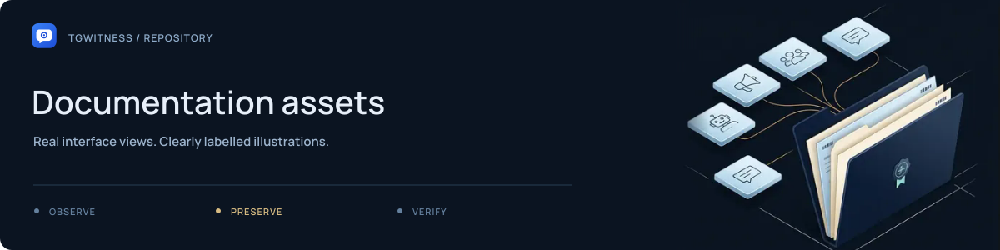

# Documentation assets

[Project](../../README.md) · [Documentation](../README.md) · [Wiki](../wiki/Home.md) · [Support](../../.github/SUPPORT.md)

Screenshots and presentation artwork used by the repository and documentation.
Application screenshots use fictional demonstration data.

| Asset group | Use |
| --- | --- |
| `chats.png`, `chats-dark.png`, `detail.png` | Saved conversations and version comparison |
| `workspace.png`, `workspace-dark.png`, `sources.png` | Journal and collection scope |
| `exports.png` | Signed export preparation |
| `connection.png`, `qr-login.png`, `proxy-setup.png`, `public-proxies.png` | Account and connection setup |
| `extras.png`, `witness-setup.png` | Optional witness workflows |
| [`presentation/`](presentation/README.md) | Investigation artwork, shared SVG covers, navigation and dividers |

## Refresh screenshots

From the project root:

```sh
python tools/capture_screenshots.py
```

Inspect `test-results/screens/` first. The explicit `--docs` option refreshes the
documentation assets. Keep screenshots and illustrative artwork distinguishable;
an illustration is not an application screen or a verification result.
