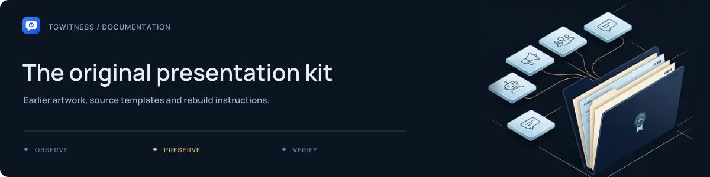
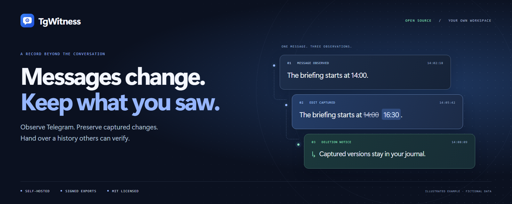

# TgWitness presentation kit

Repository artwork uses the application's own mark, ink-and-blue palette and
fictional message history. The source is [artwork.html](../../../website/artwork.html);
all text and shapes are editable HTML/CSS. No external fonts or image services are needed.

| Asset | Size | Use |
| --- | --- | --- |
| [Repository cover](tgwitness-cover.png) | 1600 × 640 | Main README and wiki home |
| [GitHub preview](tgwitness-github.png) | 1280 × 640 | Repository social preview |
| [Social preview](tgwitness-social.png) | 1200 × 630 | Website Open Graph image |
| [Square artwork](tgwitness-square.png) | 1080 × 1080 | Narrow-screen README cover and project announcements |
| [Workflow](tgwitness-workflow.png) | 1600 × 500 | Observe → Preserve → Verify explanation |



## Rebuild

From the development environment with Playwright Chromium installed:

```sh
python website/render_artwork.py
```

Render one asset with `--format cover`, `--format github`, `--format social`, `--format square` or
`--format workflow`. Repeat the flag to select several. An existing Russian cover
can be refreshed explicitly with `--format cover-ru`; the default set is English.

The renderer blocks HTTP and HTTPS requests. It writes the PNGs in this directory
and does not start the application or read an account.

## Use on GitHub

The README and wiki link their images directly. The website builder includes the
social preview automatically. To use the image for a repository link shared on
other sites, upload `tgwitness-github.png` in the repository's **Settings → Social
preview → Edit → Upload an image**. Its 1280 × 640 size follows
[GitHub's social-preview guidance](https://docs.github.com/en/repositories/managing-your-repositorys-settings-and-features/customizing-your-repository/customizing-your-repositorys-social-media-preview).
Committing the image alone does not change that GitHub setting.

Keep screenshots synthetic and labels descriptive. Do not add a passing CI badge,
download count, endorsement or verification claim without matching evidence.
