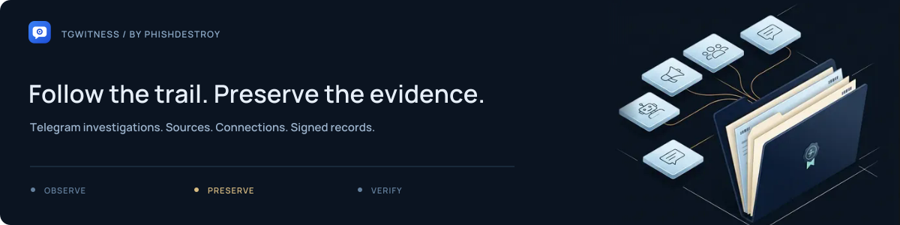

# Investigation presentation kit

The shared visual system for the repository and wiki: midnight blue, ice-blue
headings, warm connection lines and the original TgWitness application mark.
The approved investigation artwork was generated with Gemini; captions, typography
and animation are SVG elements. The artwork illustrates a workflow, not an app screen.

| Asset | Purpose |
| --- | --- |
| `identity-hero*.svg` | Current repository cover: a large wordmark, the original dossier illustration, travelling records and a drawn signature; separate phone and still compositions |
| `identity-wiki.svg`, `identity-wiki-static.svg` | Wide handbook cover in the same investigation identity |
| `identity-nav-{demo,start,wiki}.svg` | Three clear entrances: the workspace, local setup and handbook |
| `identity-action-{setup,account,deploy}*.svg` | Setup, dedicated-account and server links in the PhishDestroy two-line button style; animated rims, highlights, icons and arrows, with separate stills |
| `readme-investigation-animated.svg`, `tgwitness-investigation-static.svg` | Original investigation composition, retained as the source of the illustrated scene |
| `case-{demo,start,wiki,evidence}.svg` | Earlier navigation assets retained for existing references |
| `case-path*.svg` | The four-step case route, with separate desktop, phone and reduced-motion compositions |
| `case-chain-mobile*.svg` | A vertical record-chain explanation with readable phone captions, exact digest/signature formulas and a separate still |
| `repository-cover*.svg`, `repository-cover*.webp` | Earlier compact journal cover, retained for existing links |
| `repository-{demo,setup,modes}.svg` | Earlier navigation assets, retained for existing links |
| `tgwitness-investigation-mobile-{animated,static}.svg` | Mobile composition of the approved investigation scene, with motion and a separate still |
| `entry-{demo,guides,wiki}.svg` | Three navigation cards matching the PhishDestroy repository family |
| `readme-typing.svg`, `readme-typing-static.svg` | Animated typing line and its readable still |
| `readme-workspace-*.webp` | Actual demo screenshots in a 13-second loop: conversation, saved versions and deletion notices; both themes, a readable phone crop and separate stills |
| `readme-investigation-animated.svg`, `readme-evidence-*-animated.svg` | The approved SVG scenes exported for README's picture-controlled motion preference |
| [Repository cover](readme-cover.svg), [static cover](readme-cover-static.svg), [mobile cover](readme-cover-mobile.svg) | Compact TgWitness masthead with the original animated investigation scene and reduced-motion alternative |
| [Workspace preview, light](workspace-preview-light.png), [dark](workspace-preview-dark.png) | Framed, unmodified Chats screenshots with fictional demo data |
| `nav-*.svg` | Four equal-width navigation buttons; two per row on narrow screens |
| [README hero](readme-hero.svg) | Compact animated repository cover |
| [Shared brand cover](brand.svg) | Reduced-motion README alternative and translated introductions |
| [Investigation artwork](tgwitness-investigation-static.svg) | Full-size static composition |
| [Animated investigation](tgwitness-investigation-animated.svg) | Extended investigation sequence |
| [Investigation overview film](investigation-overview.mp4) | The illustrated SVG sequence as a 12-second, 1280 × 720 MP4 |
| [Mobile cover](mobile.svg) | Legible narrow-screen composition |
| [Capability cards](capabilities.svg), [mobile cards](capabilities-mobile.svg) | Collection, captured versions, investigation and verification |
| [Film navigation](button-films.svg) | Direct access to the films and animation gallery |
| [Investigation film](investigation.mp4), [GIF](investigation.gif) | 12-second concept film, 1280 × 672 MP4 |
| [Message history film](message-history.mp4), [GIF](message-history.gif), [still](message-history-static.png) | 12-second concept film, 1280 × 576 MP4 |
| [GitHub preview](preview-github.png) | 1280 × 640 repository sharing image |
| [Website preview](preview-social.png) | 1200 × 630 Open Graph image |
| [Workflow](workflow.svg) | Observe → Preserve → Verify |
| `evidence-*-animated.svg` | Record chain, changed content and retained checkpoint explanations |
| `evidence-*-static.svg` | Static alternatives to the three explanations |
| `wiki-*.svg` | Individual wiki covers |
| `folder-*.svg` | Directory introductions |
| [Divider](divider.svg), `button-*.svg` | Shared section and navigation elements |

## Use and maintenance

The main README opens with a large wordmark and the investigation scene. Sources
float, records travel into a dossier, and a signature draws itself. The composition
keeps those movements in the artwork; type and navigation remain steady. The
handbook has its own wide cover using the same artwork and typography.

Setup actions use the icon, title, subtitle and accent-line structure shared with
ShortDot, TrustName and the forensic toolkit. Motion runs inside each linked SVG;
the labels remain still and a `picture` source selects a still when motion is reduced.

Three navigation images lead to the real demo, local setup and handbook. The real
application recording follows, with a clear caption distinguishing it from the
illustration. Feature copy stays concise; installation commands, the main evidence
diagram and trust boundaries remain visible. Details expand where they are needed.
Motion is part of the page design, with no players or download prompts.

Regenerate the identity covers and navigation with:

```sh
python website/render_identity.py --font /path/to/Manrope.ttf
```

Regenerate the supporting phone evidence diagram and earlier case-path assets with:

```sh
python website/render_case_assets.py --font /path/to/Manrope.ttf
```

Both renderers require `fonttools`. Captions are outlined using the retained OFL-licensed
Manrope font. The images have no remote fonts or scripts. The previous compact
journal cover remains reproducible with `website/render_readme.py` for older links.

Each animated `picture` selects a separate still for reduced motion. The mobile
cover has a separate composition. The `readme-*` animation
exports leave reduced-motion selection to the containing `picture`: another media
query inside the selected SVG can read the operating-system preference instead
and unexpectedly freeze the animation. Standalone documentation SVGs retain their
own reduced-motion behavior.
The [illustrated reference](../../SHOWCASE.md) shows the diagrams inline. Additional screenshots,
tamper/checkpoint explanations, the notice and the source map expand on demand.

Use relative links inside the repository. The wiki builder copies referenced images
into the separate Wiki repository and rewrites their links. Keep captions in image
alt text too; never replace essential instructions with an image.

The SVGs are self-contained and contain no JavaScript. Headings and captions are
outlined from Manrope for consistent rendering. The font licence is retained in
[OFL-Manrope.txt](OFL-Manrope.txt). Review animation as an ordinary image, both
themes and a narrow viewport before replacing an asset.

The original artwork and renderer remain documented in [launch-kit](../launch-kit/README.md).

To refresh the workspace loop, build the site with `python tools/build_site.py`,
then run `python website/capture_readme.py` with Playwright Chromium and Pillow
installed. The capture script opens only the local demo, performs the real UI
actions and exports light/dark desktop and phone variants. Each state holds for
3.5–5 seconds, with short dissolves between screenshots. It does not connect an
account or synthesize application content. Reduced-motion sources show the saved
versions as a still.

## Films and animations

The archived concept films are silent H.264 MP4s using
fictional records. The investigation overview renders the illustrated SVG sequence
at 24 frames per second. The two earlier concept films retain their original exports
and GIF alternatives. These films illustrate the workflow; they are not recordings
of a live account.

These files are retained as source assets for maintainers. The README and Wiki
use inline animated illustrations, with no film navigation, player blocks or
download prompts. The publication builder allows only these three MP4s and the
two named GIFs. SVG animations keep their static reduced-motion alternatives;
the message-history still is [`message-history-static.png`](message-history-static.png).

## Preview images

Both PNGs are rendered from the static repository identity, with the same
illustration and outlined typography as the repository. From the development
environment with Playwright Chromium installed:

```sh
python website/render_presentation.py
```

Use `--format github` or `--format social` to render one image. The renderer blocks
network requests and does not open the application or account data.

The website builder includes `preview-social.png` automatically. GitHub's repository
sharing image is a separate setting: upload `preview-github.png` under
**Settings → Social preview → Edit → Upload an image**. It follows
[GitHub's recommended dimensions and file limit](https://docs.github.com/en/repositories/managing-your-repositorys-settings-and-features/customizing-your-repository/customizing-your-repositorys-social-media-preview).
