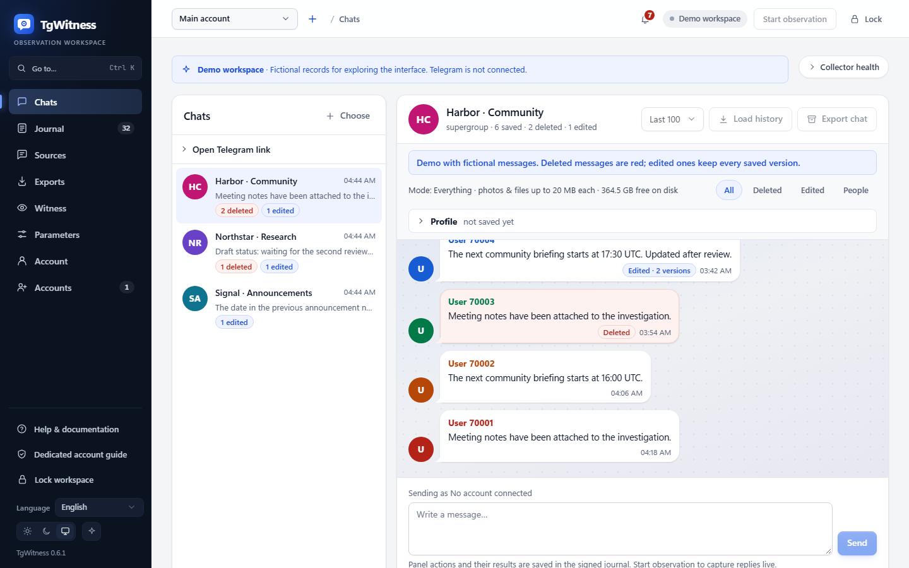
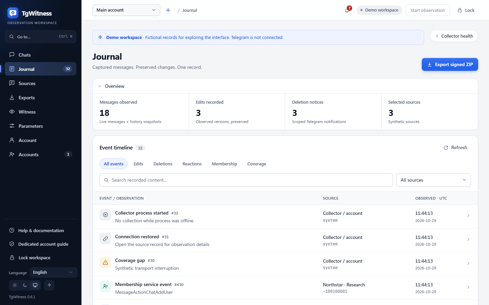
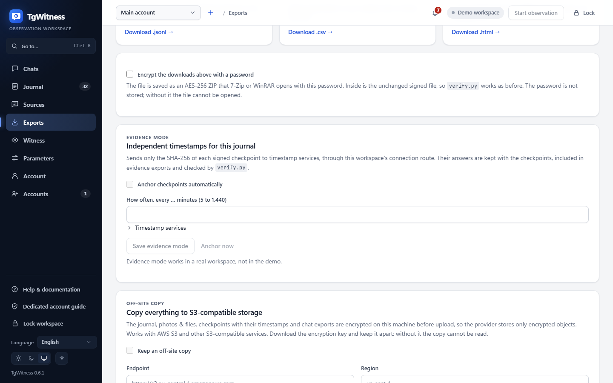
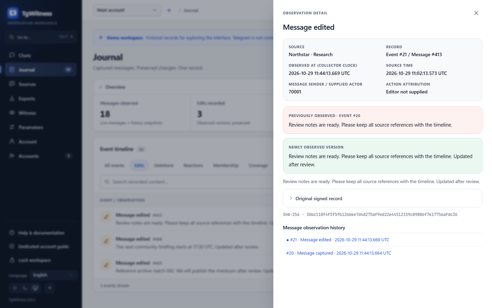
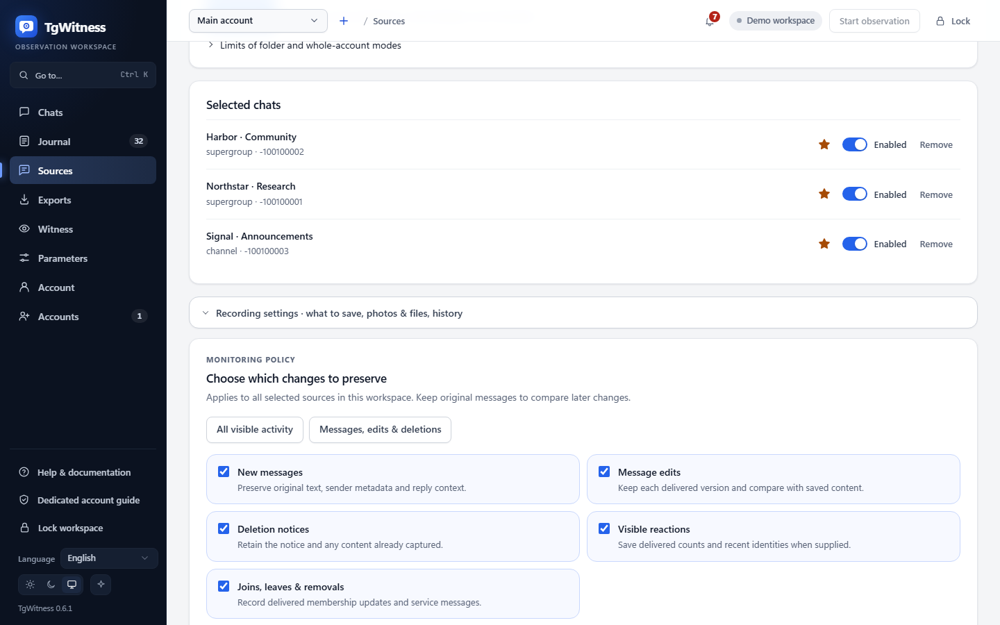
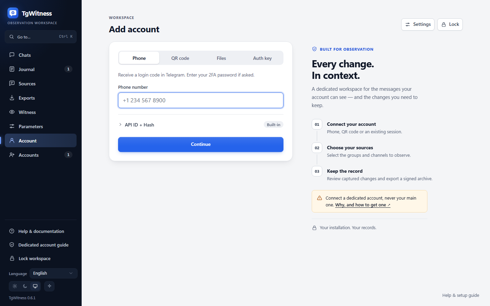
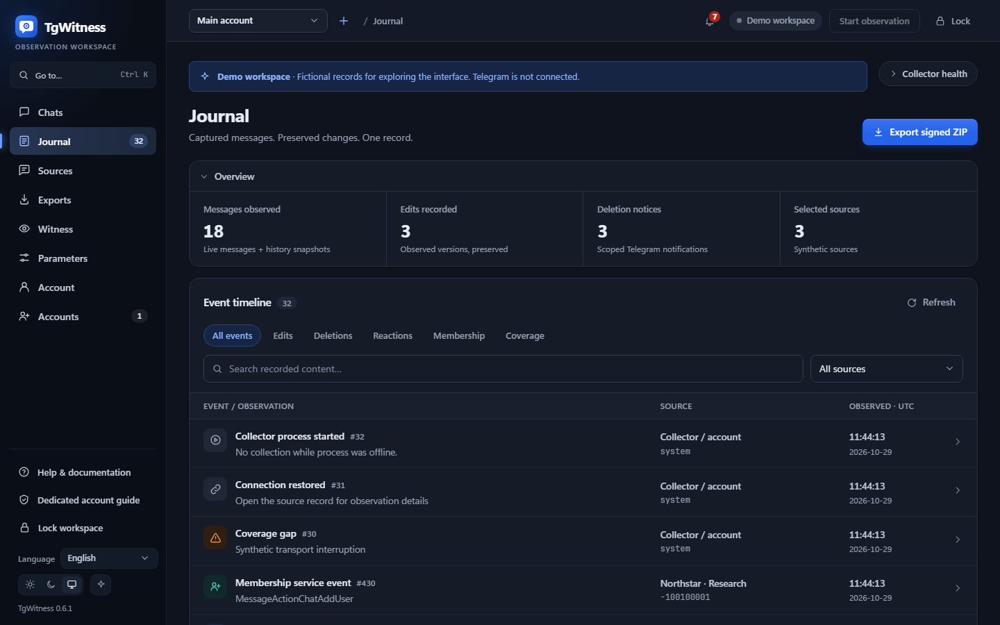
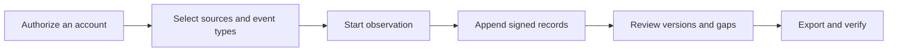

[English](../../README.md) · [Русский](../ru/README.md) · [Українська](../uk/README.md) · **Español** · [Português (Brasil)](../pt/README.md) · [Türkçe](../tr/README.md) · [العربية](../ar/README.md) · [فارسی](../fa/README.md) · [اردو](../ur/README.md) · [हिन्दी](../hi/README.md) · [Bahasa Indonesia](../id/README.md) · [Tiếng Việt](../vi/README.md) · [简体中文](../zh/README.md)


<p align="center">
  <strong>Su espacio de trabajo de observación en Telegram.</strong><br>
  Conserve las conversaciones capturadas, comprenda qué ha cambiado y comparta un historial firmado.<br>
  En su propio ordenador o servidor. Con sus propias cuentas.
</p>

<p align="center">
  
  
  
  
  
</p>

<p align="center">
  <a href="#inicio-rápido">Inicio rápido</a> ·
  <a href="#características">Características</a> ·
  <a href="#conectar-una-cuenta-de-telegram">Cuentas</a> ·
  <a href="#pruebas-y-verificación">Pruebas</a> ·
  <a href="#implementación">Implementación</a> ·
  <a href="../README.md">Documentación</a>
</p>

> [!TIP]
> **Explore la plataforma antes de conectarse.** Ejecute `scripts\Demo.cmd` o `sh start.sh --demo` para abrir un espacio de trabajo con conversaciones ficticias. No es necesario disponer de una cuenta de Telegram.

**¿Es la primera vez que visita esta página?** [Inicio →](QUICKSTART.md) · [Wiki →](../wiki/Home.md) · [Elija una guía →](../README.md) · [Obtenga ayuda →](../../.github/SUPPORT.md) · [Vea lo que se ha probado →](../VERIFICATION.md)

> [!WARNING]
> **Utilice una cuenta de Telegram específica que pueda permitirse perder.** Le recomendamos encarecidamente que no vincule cuentas personales o de valor, ni cree credenciales de API ID o API hash en ellas. Telegram puede restringir o bloquear de forma permanente las cuentas. [Lea la guía sobre cuentas](../ACCOUNTS.md).

## Características

- **Conversaciones con historial.** Lea los mensajes guardados, compare las modificaciones capturadas y consulte los avisos de eliminación en el contexto de la conversación.
- **Vigile según sus propias condiciones.** Elija chats individuales, una carpeta de Telegram o toda la cuenta. Cada cuenta dispone de su propio espacio de trabajo y configuración.
- **Exportaciones que puede verificar.** Un archivo ZIP firmado, registros originales, archivos adjuntos conservados y un informe HTML sin conexión. Protección opcional con contraseña para el traspaso.
- **Diseñado para el uso diario.** Temas claro y oscuro, 13 idiomas, función de búsqueda, navegación mediante Ctrl/Cmd+K y acciones directamente desde los chats.

<details>
<summary>Todas las funcionalidades y detalles técnicos</summary>

- **Su ruta de conexión.** En **Cuenta → Configuración de proxy**, elija entre las listas públicas de MTProxy incluidas, actualícelas desde sus fuentes o pegue su propio enlace de proxy de Telegram. Siguen estando disponibles las opciones manuales SOCKS5/HTTP/MTProxy y un catálogo de operadores. Las listas públicas se descargan y se filtran, pero aún no se ha conectado ninguna cuenta a través de un servidor de la lista. [Cómo funcionan las listas públicas](../CONNECTION-SECURITY.md#public-proxies-supplied-by-your-installation).

- **Un diario de lo que sus cuentas ven realmente.** Nuevos mensajes, modificaciones, avisos de eliminación, reacciones, eventos relacionados con los miembros y lagunas de cobertura de los grupos y canales que seleccione.
- **Chats seleccionados, una carpeta de Telegram o toda la cuenta.** Seleccione los tipos que desea registrar —canales, grupos, chats privados, bots— y los nuevos chats se añadirán en cuanto aparezcan. Exclusiones, mensajes propios enviados y ediciones, eliminaciones en chats privados emparejadas con su chat correspondiente, revisiones prioritarias y límites de archivos adjuntos por tipo ([colección](../COLLECTION.md#observation-scope-chosen-chats-a-folder-or-the-whole-account)).
- **Modo de investigación.** Con un solo botón se crea una cuenta dedicada que se une a equipos y se comunica con bots: todo lo que ve y envía queda registrado; los botones que aparecen debajo de los mensajes de los bots (enlaces, aplicaciones web, textos para copiar) se conservan, y las modificaciones realizadas únicamente mediante botones se convierten en nuevas versiones; además, cada nuevo chat o bot obtiene su perfil (descripción, comandos, miembros) y los mensajes visibles anteriores se guardan de inmediato ([modo de investigación](../COLLECTION.md#investigation-mode-joining-teams-and-talking-to-bots)). **La guía de cuentas dedicadas** del panel (`/dedicated-account.html`) explica por qué no debe utilizarse la cuenta principal, por qué TgWitness funciona a través de pares de hash de aplicación/ID de aplicación públicos y por qué un par de API no concede por sí mismo acceso a su cuenta (con enlaces a la documentación de Telegram), y enumera las formas de crear una cuenta adicional.
- **Actúe directamente desde los chats.** Envíe mensajes y respuestas, pulse los botones de devolución de llamada o de texto del bot, o bien obtenga una vista previa de una invitación de Telegram y únase a ella. La cuenta seleccionada lleva a cabo la acción; las solicitudes, las vistas previas de las invitaciones y las respuestas del bot en forma de ventana emergente o URL se registran en su diario firmado ([minicliente del panel](../COLLECTION.md#act-from-the-panel)).
- **Cobertura que puede constatar.** Los informes y el verificador indican «observado de forma continua desde X hasta Y», enumeran las lagunas con su motivo y los ID de los mensajes que nunca se observaron —sin presentarlos en ningún momento como eliminados—.
- **Perfiles de usuarios, con opción de participación voluntaria por chat.** Historial de nombres y nombres de usuario, indicadores de Telegram, SHA-256 y pHash del avatar, actividad, quién responde a quién y carteras, teléfonos, nombres de usuario y enlaces mencionados — todo ello elaborado únicamente a partir de registros guardados, cada dato vinculado a su correspondiente entrada en el diario, exportado como un archivo firmado independiente ([modelo de pruebas](../EVIDENCE.md#people-profiles)).
- **Testigo independiente.** Un proceso independiente, con su propia clave y su propio bot, recupera el encabezado firmado del diario, lo publica en un canal de Telegram e informa cuando el recopilador no responde; el verificador compara las exportaciones con dicho encabezado. El intervalo, el tiempo de espera, qué comprobaciones se publican y el texto de las publicaciones son opciones que se definen en un archivo de configuración JSON ([witness](../WITNESS.md)). Se ha probado con un servidor local de la API de bots, pero aún no con un bot ni un canal reales.
- **Configuración de la recopilación en el panel.** Los límites y la frecuencia de la recopilación, las verificaciones, las descargas, los perfiles de personas, las notificaciones y las exportaciones se encuentran en la página **«Parámetros»,** junto con sus rangos y valores predeterminados; cada cambio queda registrado en el diario firmado ([configuración y parámetros](#configuración-y-parámetros)).
- **Modificaciones y eliminaciones en contexto.** Cada modificación se muestra como una versión independiente junto a la anterior; un aviso de eliminación nunca borra el contenido que ya se había capturado.
- **Exportaciones firmadas y verificables.** Cada evento se somete a una cadena de hash (SHA-256) y se firma (Ed25519). El archivo ZIP firmado incluye archivos JSONL, CSV, un informe HTML sin conexión, archivos multimedia conservados y un verificador independiente.
- **Exportaciones protegidas con contraseña.** Opcionalmente, puede guardar cualquier exportación en un archivo ZIP con cifrado AES-256 de WinZip, formato compatible con 7-Zip y WinRAR; el contenido firmado del interior permanece inalterado. Se abrió un archivo de prueba byte a byte en libarchive (Windows `tar`) y se rechazó una contraseña incorrecta ([modelo de prueba](../EVIDENCE.md#investigation-handoff)).
- **Notificaciones.** Problemas (espacio en disco insuficiente, cuenta desconectada, errores del recopilador, de copia o de marca de tiempo), cambios en los chats observados y un resumen diario, enviados a través de [Apprise](https://github.com/caronc/apprise) a Matrix, Telegram, Discord, Slack, ntfy, correo electrónico y muchos otros servicios —sin el texto del mensaje, a menos que active los extractos— y mostrados en el panel. La entrega se ha probado con un punto final local; los propios servicios aún no se han probado.
- **13 idiomas de interfaz:** inglés, ruso, ucraniano, español, portugués (Brasil), turco, árabe, persa, urdu, hindi, indonesio, vietnamita y chino simplificado, traducidos automáticamente con DeepL. Las secciones más recientes utilizan texto de reserva en inglés catalogado explícitamente; los controles del minicliente siguen estando en inglés. El contenido de Telegram y los registros del diario se muestran siempre tal y como se han guardado.
- **Tema claro y oscuro.** Por defecto**,** sigue la configuración del sistema; la elección se guarda para cada navegador.
- **Navegación optimizada para el teclado.** Pulse **Ctrl+K** (Mac: **⌘K**) o seleccione **«Ir a…»** para buscar una sección. Utilice las teclas de flecha y la tecla Intro para abrirla; la tecla Esc cierra el menú.
- **Cuentas múltiples.** Cualquier número de espacios de trabajo aislados, cada uno con su propia sesión de Telegram, diario, clave de firma, ruta de proxy y política de captura.
- **Inicio de sesión flexible.** Teléfono + código + autenticación de dos factores (2FA), código QR, Telethon/Pyrogram `.session`, archivo ZIP de TData de Telegram Desktop, StringSession de Telethon o una clave de autenticación completa con su ID de DC.
- **Proxies por cuenta.** SOCKS5 y HTTP CONNECT, probados con proxies de prueba locales, y MTProxy experimental, aún sin probar con un servidor real. Un proxy que falla nunca recurre de forma silenciosa a una conexión directa.
- **Privacidad integrada por diseño.** Se ejecuta en su ordenador o servidor. Interfaz de usuario web integrada, sin Node.js, sin servicio alojado, sin telemetría. Las sesiones, las credenciales de la API y los secretos del proxy se almacenan en una bóveda cifrada.
- **Fácil de ejecutar.** Haga doble clic en Windows, ejecute un script en Linux/macOS o utilice Docker Compose con HTTPS automático opcional. Hasta la fecha solo se han probado los ejecutables de Windows; consulte [qué se ha probado](#lo-que-se-ha-probado).

</details>

## Inicio rápido

| Plataforma | Cómo empezar | Requisitos: |
| --- | --- | --- |
| **Windows, sin nada instalado** | Descargue `TgWitness-<version>-windows-amd64-portable.zip` desde [«Releases»](../../../../releases), descomprímalo y haga doble clic en **`TgWitness.cmd`** | Nada; Python viene incluido |
| Windows, desde el código fuente | Haga doble clic en **`Start.cmd`** | Python 3.11 o superior; se le ofrecerá e instalará automáticamente en caso de que no lo tenga. |
| Linux / macOS | `sh start.sh` | Python 3.11+ con `venv`; el script muestra el comando de instalación para su sistema en caso de que falte |
| Docker, cualquier sistema operativo | Haga doble clic en **`scripts\Docker.cmd`** o ejecute `sh scripts/docker-start.sh` | Docker Engine/Desktop con Compose 2.20 o superior |

1. Abrir **http://127.0.0.1:8787**.
2. Pegue el token de acceso al panel:
   - Instalación portátil o desde el código fuente: el contenido de `data/live/panel-token.txt`
   - Docker: generado por `scripts\Docker.cmd`/`scripts/docker-start.sh` o `docker compose exec tgwitness cat /data/panel-token.txt`
3. Añada su cuenta de Telegram, elija los chats que desea observar y pulse **«Iniciar observación**».

La primera ejecución del código fuente crea un `.venv` privado e instala las dependencias fijadas (se requiere acceso a Internet). Las utilidades de Docker compilan la imagen, esperan a que el panel esté operativo y muestran su dirección y token. `python start.py --check` (o `TgWitness-Check.cmd` en el paquete portátil) proporciona un informe de estado sin necesidad de acceder a Telegram.

> **¿Solo está echando un vistazo?** Ejecute **`scripts\Demo.cmd`** o `sh start.sh --demo`. Se abrirá directamente en el navegador un diario ficticio; no hay ninguna cuenta de Telegram conectada y los datos se almacenan por separado en `data/demo`.

<details>
<summary><strong>El espacio de trabajo: chats, historial y exportaciones</strong></summary>

<picture>
  <source media="(prefers-color-scheme: dark)" srcset="../assets/chats-dark.png">
  
</picture>

### Historial de observaciones



### Exportaciones firmadas



</details>


## Conectar una cuenta de Telegram

> [!CAUTION]
> Conecte únicamente cuentas dedicadas que pueda permitirse perder. Telegram puede bloquear cuentas de forma permanente e impredecible; consulte la advertencia que figura en la parte superior de esta página. La **guía sobre cuentas dedicadas** del panel (barra lateral o `/dedicated-account.html`) explica por qué y cómo obtener una.

Inicie sesión mediante teléfono, código QR o una sesión existente; no se necesita ningún ID de API ni hash.

**¿Por qué un conjunto de API integrado?** Se sabe que crear su propio ID de API en [my.telegram.org](https://my.telegram.org) puede provocar la restricción de las cuentas, y Telegram no publica límites claros; muchos investigadores han perdido sus cuentas principales de esta forma. La propia página de Telegram [«Obtener un ID de API»](https://core.telegram.org/api/obtaining_api_id) indica que las cuentas que utilizan clientes de API no oficiales se someten automáticamente a vigilancia y remite a los usuarios bloqueados por error a recover@telegram.org. Por ello, TgWitness incluye pares de API públicos que ya utilizan otros clientes de código abierto, de modo que nunca tendrá que crear uno. Si dispone de su propio ID de API, introdúzcalo en el campo **«ID de API + Hash»** y se utilizará en su lugar.

Cuando no se introduce, importa ni se ha guardado previamente ningún par en el espacio de trabajo, TgWitness selecciona uno de los 50 pares del conjunto y pasa al siguiente si Telegram rechaza uno. El par que ha iniciado sesión permanece vinculado a esa cuenta. Un par identifica la aplicación; usted sigue autorizando su cuenta de Telegram por separado. El token de acceso al panel abre TgWitness y es independiente del inicio de sesión en Telegram.

| Lo que tiene | Cómo utilizarlo |
| --- | --- |
| Número de teléfono con acceso a la cuenta | Pestaña **«Teléfono**»: código de Telegram y, a continuación, contraseña de autenticación de dos factores (2FA) si está habilitada |
| Una aplicación de Telegram en la que ya se ha iniciado sesión | Pestaña **«Código QR**»: Ajustes → Dispositivos → Vincular dispositivo de escritorio |
| Telethon (esquema 7/8) o Pyrogram (esquema 2/3) `.session` | Pestaña **«Archivos»** |
| Par de imágenes: `name.session` + `name.json` | Pestaña **«Archivos»**, seleccione ambos; el archivo JSON proporciona el ID y el hash de la API |
| Carpeta de Telegram Desktop `tdata` | Solo ZIP `key_datas` y `D877F783D5D3EF8Cs`, a continuación **«Archivos»**; código de acceso local, si se ha configurado |
| Telethon StringSession, `.txt` o `.tgwitness-session` | Pestaña **«Archivos»**, *«Código de acceso»* o *texto de la sesión* |
| Archivo JSON de la cuenta con una sesión o una clave de autenticación | Pestaña **«Archivos»** |
| Clave de autenticación completa (512 caracteres hexadecimales) + ID de DC | Pestaña **«Clave de autenticación»**; el ID de usuario opcional se compara con el de Telegram |

No compatible con: almacenamiento TDLib, cadenas de sesión de Pyrogram, tokens de bot, TData con varias cuentas y listas de cuentas masivas. Los archivos se convierten en memoria en su servidor y se comprueban con Telegram antes de guardarse. La [guía de cuentas](../ACCOUNTS.md) explica cada formato paso a paso: cómo obtener las credenciales de la API, cómo reconocer un archivo, los campos JSON, los límites y los mensajes de error.

Una vez que haya iniciado sesión, abra **«Fuentes»** (sus chats se cargarán automáticamente), añada los grupos que necesite, elija qué desea capturar (por ejemplo*,* *mensajes, modificaciones y eliminaciones*) y comience la observación. Mantenga el proceso en marcha: la **opción «Pausar observación»** detiene la recopilación, mientras que **«Bloquear»** solo cierra el acceso al navegador.

## Capturas de pantalla

| Comparación de versiones | Fuentes y política de captura |
| --- | --- |
|  |  |
| **Exportaciones firmadas** | **Iniciar sesión** |
|  |  |
| **Diario** | **Tema oscuro** |
|  |  |

Todas las capturas de pantalla utilizan datos de demostración sintéticos. El código QR de [qr-login.png](../assets/qr-login.png) codifica un token ficticio del transporte de prueba.


## Cómo funciona



Cada espacio de trabajo pertenece a una cuenta de Telegram. El recopilador acepta actualizaciones del cliente de dicha cuenta, aplica la política de captura guardada y añade las observaciones a un diario de solo adición.

| Observación | Qué se conserva | Límites |
| --- | --- | --- |
| Nuevo mensaje | Texto, ID del remitente, referencia de respuesta, metadatos, hora de observación | Solo se envían actualizaciones de fuentes seleccionadas |
| Editar | Una versión independiente del contenido | Las versiones intermedias que se hayan perdido mientras se estaba sin conexión no se pueden recuperar. |
| Eliminación | ID del mensaje, además de todo lo capturado anteriormente | Telegram suele omitir quién ha eliminado el mensaje y cuándo. |
| Reacciones | Cuentas e identidades recientes, cuando se faciliten | Una instantánea, no un registro completo de cambios |
| Afiliación | Mensajes de servicio y actualizaciones para los participantes | No se garantiza que todas las notificaciones de incorporación o baja lleguen |
| Archivo adjunto | Archivo opcional con contenido dirigido y SHA-256 | Los archivos pueden desaparecer antes de descargarlos; los resultados quedan registrados. |
| Ámbito de cobertura | Inicios, paradas, desconexiones, pulsos de actividad, cambios en las políticas | La actividad no constituye prueba de una captura completa |
| Instantánea del historial | Últimos mensajes visibles, hasta 500 a menos que se aumente este límite en **«Parámetros»**, etiquetados de forma explícita | No es posible reconstruir las modificaciones o eliminaciones que se hayan perdido. |

Conozca [cómo funciona la recopilación de datos](../COLLECTION.md) en relación con las políticas, las colas de archivos adjuntos y los reinicios.

## Configuración y parámetros

Todo se modifica en el panel, por espacio de trabajo, sin necesidad de editar código ni archivos de configuración. Cada cambio de ámbito, política o parámetro queda registrado en el diario firmado con los valores anteriores y posteriores, y cada inicio de observación indica los valores vigentes.

| Dónde | Lo que debe configurar |
| --- | --- |
| **Fuentes** | Ámbito de aplicación (chats seleccionados, una carpeta de Telegram, toda la cuenta), tipos de fuentes, exclusiones, acciones propias, cambios que se deben conservar, tipos de archivos adjuntos y tamaño por tipo (1–2.000 MiB), intervalo de revisión para chats prioritarios y otros (cualquier número de minutos, 0 = desactivado), instantáneas del historial, notificaciones |
| **Exportaciones** | Descargas protegidas con contraseña, modo de pruebas (intervalo, autoridades de marca de tiempo y calendarios), copia externa en S3 (intervalo, retención y modo de Object Lock) |
| **Witness** | Tokens de testigo de solo lectura; las opciones propias del testigo se muestran mediante comandos predefinidos |
| **Parámetros** | Tamaño de la lista de chats y actualización, intervalos de «heartbeat» y de puntos de control, búfer de inicio, cómo las revisiones repetidas distribuyen las solicitudes (primer retraso, chats por pasada, pausa, mensajes recuperados y solicitados de nuevo), reserva de disco, tiempo de espera de descarga, velocidad y reintentos, qué buscan los perfiles de usuario, incluidas sus propias expresiones regulares, tamaño y frecuencia de las notificaciones, instantánea, límites de ZIP y de descarga en el navegador, tiempo de espera de las acciones del panel, tiempos de espera y reintentos del cliente de Telegram |

Los valores de **los parámetros** muestran su rango y su valor por defecto; los que se han modificado aparecen marcados y pueden restablecerse uno a uno o todos a la vez. Se aplican a partir de su próximo uso; los tiempos de espera y los reintentos del cliente de Telegram se aplican a partir de la siguiente conexión. Un límite de ZIP superior a 4 GiB requiere `verify.py --max-gib N` cuando se verifica el archivo ([operaciones](../OPERATIONS.md#panel-layout)).


## Pruebas y verificación

| Exportar | Índice | Integridad |
| --- | --- | --- |
| **Archivo ZIP firmado** | JSONL, CSV, informe HTML, cobertura, medios, manifiesto, verificador | Eventos firmados, además de un manifiesto firmado de cada archivo, en el que se indica el autor. Utilícelo para el traspaso. |
| JSONL | Registros originales con hash y firmas | Firmas Ed25519 por evento y cadena de hash |
| CSV / HTML | Tabla compatible con hojas de cálculo / informe legible sin conexión | Incluido únicamente en el archivo ZIP firmado |
| JSON de Checkpoint | Longitud del diario y hash del encabezado | Firmado por separado; manténgalo fuera del colector |
| JSON de recibo de ejecución | Hashes del código, versiones de las dependencias, alcance y configuración | Declaración de proceso firmada por separado |
| Perfiles de personas en formato JSON | Perfiles de un chat con referencias de registros | Declaración firmada; se han comprobado los hash de los archivos con respecto al archivo ZIP |
| Archivo ZIP del diario Witness | Número de testigos recabados, respuestas no recibidas y publicaciones en el canal | Firmado con la propia clave del testigo |

Los filtros solo afectan a la navegación; las exportaciones siempre contienen el diario completo hasta un número de secuencia fijo. Verifique un archivo con una copia fiable del verificador y una huella digital y un punto de control de la clave conservados de forma independiente:

```sh
python -m pip install cryptography
python tgwitness/verify.py tgwitness-evidence.zip --fingerprint TRUSTED_PUBLIC_KEY_SHA256 --checkpoint tgwitness-checkpoint.json
# with an independent witness and its channel (Telegram Desktop export)
python tgwitness/verify.py tgwitness-evidence.zip --fingerprint TRUSTED_PUBLIC_KEY_SHA256 \
    --witness witness.zip --witness-fingerprint WITNESS_SHA256 --channel result.json
```

El verificador muestra el productor firmado, los periodos de observación continuos, las lagunas y los ID de los mensajes que nunca se observaron, y da un error si el diario difiere de cualquier registro que haya visto el testigo.

Las firmas proporcionan evidencia de manipulación en relación con una clave de firma de confianza. **No** acreditan el origen de Telegram, la veracidad del contenido ni la hora de confianza, y no protegen frente a un operador que controle el recopilador y su clave. En cuanto a la hora fiable, el modo de evidencia (desactivado por defecto) marca con sellos de tiempo los puntos de control mediante autoridades RFC 3161 y calendarios OpenTimestamps, o bien el panel prepara una solicitud RFC 3161 sin conexión ([procedimiento de sellado de tiempo](../TIMESTAMP.md)). Ambos se prueban con servidores de prueba locales, pero aún no con los servicios públicos. Consulte el [modelo de evidencia](../EVIDENCE.md) y la lista de comprobación para [el traspaso de la investigación](../EVIDENCE.md#investigation-handoff).

## Implementación

> [!NOTE]
> Las configuraciones de Docker, Caddy (HTTPS), systemd y launchd que se indican a continuación están preparadas y sus archivos superan las comprobaciones sintácticas, pero ninguna de ellas se ha ejecutado todavía. El paquete portátil para Windows y el código fuente en Windows sí se han ejecutado.

**Servidor local o único con Docker:**

```sh
docker compose up -d --build --wait
docker compose exec tgwitness cat /data/panel-token.txt
```

El contenedor se ejecuta como usuario no root con un sistema de archivos de solo lectura, publica únicamente en `127.0.0.1:8787` y almacena todos los datos en un volumen con nombre.

**Servidor público con HTTPS automático (Caddy):** copie `deploy/env.example` en `.env`, configure `TGWITNESS_DOMAIN`, apunte el DNS al servidor, abra los puertos TCP 80/443 y ejecute

```sh
docker compose -f compose.yaml -f deploy/compose/compose.https.yaml up -d --build --wait
```

**En Windows, sin necesidad de instalar nada:** el archivo ZIP portátil adjunto a cada versión contiene el entorno de ejecución oficial de Python integrado y todas las dependencias. Los datos permanecen en su carpeta `data`; para actualizar, extraiga la nueva versión y copie dicha carpeta en su lugar.

**Sin Docker:** las plantillas para systemd, la tarea de inicio de sesión de Windows y launchd se encuentran en [la carpeta «deploy/»](../../deploy/README.md). Las actualizaciones, las copias de seguridad, los puertos alternativos y las imágenes de GHCR (una vez que el flujo de trabajo de lanzamiento las publique) se tratan en [la sección de implementación](DEPLOYMENT.md).

### Línea de comandos

```text
python start.py [--demo] [--setup-only] [--check [--json]] [--host HOST] [--port PORT] [--data-dir DIR]
```

| Tarea | Comando (desde el entorno del proyecto) |
| --- | --- |
| Comprobación de estado sin iniciar el sistema | `python start.py --check` |
| Convertir una sesión de Telethon SQLite sin conexión | `python -m tgwitness.sessions account.session --out account.tgwitness-session` |
| Transmisión de una exportación de gran volumen al disco | `python -m tgwitness.download --token-file data/live/panel-token.txt --out evidence.zip` |
| Verificar un archivo exportado | `python tgwitness/verify.py tgwitness-evidence.zip --fingerprint SHA256` |
| Verificar un archivo de más de 4 GiB | `python tgwitness/verify.py big-evidence.zip --fingerprint SHA256 --max-gib 16` |
| Ejecute un testigo independiente a partir de un archivo de configuración | `python -m tgwitness.witness run --config witness.json` |

Los comandos auxiliares `python -m tgwitness…` deben ejecutarse dentro de `.venv` (`.venv\Scripts\python.exe` en Windows, `.venv/bin/python` en el resto de sistemas).

| Variable | Objetivo |
| --- | --- |
| `TGWITNESS_HOST`, `TGWITNESS_PORT` | Dirección y puerto de escucha (`127.0.0.1:8787` por defecto) |
| `TGWITNESS_DATA` | Directorio de datos (`data/live` por defecto) |
| `TGWITNESS_TOKEN` | Se ha corregido el token del panel en lugar del generado (mínimo 24 caracteres) |
| `TGWITNESS_VAULT_KEY_FILE` | Clave maestra externa del almacén para nuevas instalaciones |
| `TGWITNESS_DOMAIN`, `TGWITNESS_IMAGE` | Nombre de host HTTPS de Docker e imagen publicada (véase `deploy/env.example`) |
| `TGWITNESS_WITNESS_*` | Testigo independiente: recopilador, tokens, canal, `_INTERVAL`, `_TIMEOUT`, `_POST` (todo, cambios, problemas), `_TITLE`, `_CONFIG` ([testigo](../WITNESS.md#options)) |


## Responsabilidad y protección de datos (RGPD)

TgWitness es una herramienta. Quien la gestione decide qué datos se recopilan, por qué y durante cuánto tiempo, y es responsable de ello —en virtud del RGPD de la UE y el Reino Unido, normalmente en calidad de *responsable* del tratamiento de dichos datos personales—. Los mensajes de Telegram contienen datos personales de personas que nunca han dado su consentimiento para ser registrados: nombres, nombres de usuario, identificadores, fotos, números de teléfono y opiniones. Esta sección no constituye asesoramiento jurídico; consulte la legislación que le sea aplicable y las condiciones de uso de Telegram.

- **Cuente con una base jurídica y una finalidad.** La prevención del fraude, la seguridad de las redes y de la información, así como la defensa ante reclamaciones legales, suelen invocarse como intereses legítimos (art. 6, apartado 1, letra f), del RGPD; considerandos 47 y 49; art. 9, apartado 2, letra f), en lo que respecta a las reclamaciones legales). Anote la finalidad en cada caso concreto. Las autoridades públicas actúan en virtud de sus propias bases jurídicas.
- **Recopile solo lo estrictamente necesario para su finalidad.** Comience con los chats seleccionados. Los modos «carpeta» y «cuenta completa» registran chats privados y mensajes de terceros: utilícelos únicamente en cuentas específicas; el panel le pedirá confirmación y el registro firmado lo documentará. Desactive los tipos de eventos, los tipos de archivos adjuntos y las acciones propias que no necesite, y excluya chats.
- Los **perfiles de personas constituyen un perfilado.** Están desactivados de forma predeterminada y se activan por chat. Utilícelos para una investigación específica, no base en ellos decisiones automatizadas sobre personas (art. 22) y desactívelos o elimine el chat cuando haya terminado; de este modo, se borrarán. La vigilancia sistemática de un gran número de personas suele requerir una evaluación de impacto relativa a la protección de datos (art. 35).
- **Mantenga la seguridad.** Las sesiones, las credenciales y las claves se encuentran en una caja fuerte cifrada; coloque el directorio de datos en un disco cifrado, proteja las exportaciones con una contraseña (ZIP con AES-256), mantenga el panel protegido mediante HTTPS y asigne a un testigo únicamente su token de solo lectura. Las notificaciones no incluyen texto de mensaje a menos que active los extractos, lo que envía texto al servicio de notificaciones.
- **Conservación y supresión.** El diario es de solo adición, de modo que se puede demostrar su integridad; no es posible eliminar registros individuales sin romper la cadena de firmas. Planifique la conservación por espacio de trabajo y elimine todo el espacio de trabajo (Cuentas → Eliminar) o su directorio de datos cuando finalice la finalidad. Las copias externas protegidas por S3 Object Lock no pueden eliminarse antes de su fecha de retención; elija el periodo en consecuencia. El derecho de supresión tiene excepciones, por ejemplo, para el establecimiento o la defensa de reclamaciones legales (art. 17, apartado 3, letra e)).
- **Solicitudes de las personas registradas.** Las exportaciones de chats y los archivos de perfil permiten averiguar qué datos se conservan sobre una persona (art. 15).
- **No se envía nada a los autores.** TgWitness no cuenta con telemetría ni con ningún servicio alojado; los datos solo salen de su equipo a través de las rutas que usted configure (Telegram, servicios de marca de tiempo, copia en S3, notificaciones, testigo).

## Seguridad y estado del proyecto


- El panel escucha en localhost de forma predeterminada. Para el acceso remoto, utilice el perfil Compose de HTTPS o un túnel SSH; nunca exponga HTTP sin cifrar.
- Las sesiones de Telegram, las credenciales de la API, las credenciales del proxy y la clave de firma se almacenan en un almacén cifrado con Fernet. De forma predeterminada, su clave se encuentra en el mismo directorio de datos; configure `TGWITNESS_VAULT_KEY_FILE` para utilizar una clave maestra externa. TgWitness **no** cifra el contenido de los mensajes locales ni los archivos multimedia; mantenga el directorio de datos en un disco o volumen cifrado. Las exportaciones ZIP firmadas pueden cifrarse opcionalmente con contraseña.
- Los archivos de datos, las sesiones, los tokens, las claves y las exportaciones quedan excluidos de las compilaciones de Git y Docker.
- Notifique las vulnerabilidades de forma privada tal y como se describe en [SECURITY.md](../../.github/SECURITY.md).

### Lo que se ha probado

TgWitness **0.6.1** funciona en Windows 11 con Python 3.12. Estado a 29 de octubre de 2026:

| Área | Cómo se ha probado |
| --- | --- |
| Mensajes, modificaciones, eliminaciones, archivos adjuntos, nuevas comprobaciones tras reinicios, pausas de FloodWait | Realizado con **una cuenta real de Telegram**, del 27 al 29 de octubre de 2026: 9.968 registros firmados, con cada firma y la cadena de hash verificadas ([prueba en directo](../VERIFICATION.md#live-telegram-test-whole-account--29-october-2026)) |
| Observación de toda la cuenta y capturas de pantalla del historial | Realizado con **una cuenta real** el 29 de octubre de 2026: mensajes de 2 grupos o canales y 3 chats privados y bots |
| Al pulsar el botón de un mensaje en **«Chats»** | Realizado una vez con **una cuenta real** |
| Inicie sesión con los archivos de sesión de Telethon/Pyrogram y TData de Telegram Desktop | Realizado con **una cuenta real** |
| Inicio de sesión mediante teléfono, código QR y clave de autenticación; incorporación de nuevos chats al historial con sus mensajes anteriores; envío de mensajes; incorporación mediante invitación; reacciones; afiliación; perfiles de usuarios; gestión de varias cuentas a la vez; exportaciones y el verificador. | Pruebas automatizadas con clientes sintéticos de Telegram |
| Proxies SOCKS5/HTTP, bot de testigos, monitor de Proof, notificaciones, copia en S3, RFC 3161 y OpenTimestamps | Pruebas automatizadas en servidores de pruebas locales |
| Listas públicas de MTProxy | Descargado y filtrado (118 servidores a 29 de octubre); aún no se ha establecido conexión a través de ellos |
| MTProxy, Docker, HTTPS con Caddy, Linux, macOS, Python 3.11 y 3.13, flujos de trabajo de integración continua (CI) y lanzamiento, interrupciones prolongadas del servicio, revisión de seguridad independiente | **Aún no se ha probado** |

Detalles: [registro de verificación](../VERIFICATION.md), [estado de la versión](../internal/RELEASE.md) y [disponibilidad](../internal/READINESS.md).


## Desarrollo

```sh
python -m venv .venv && source .venv/bin/activate     # Windows: .venv\Scripts\Activate.ps1
python -m pip install -c deploy/constraints.txt -e ".[dev]"
python -m pytest -q                                    # unit and integration tests
python -m playwright install chromium
python tools/check_browser.py                          # end-to-end UI acceptance
python tools/check_account_browser.py                  # sign-in flows
python tools/capture_screenshots.py --docs             # refresh README images
python tools/build_portable.py                         # Windows portable ZIP (Windows + Python 3.12)
python tools/build_source.py                          # source ZIP with SHA-256 manifest
python tools/build_site.py                             # static project site in dist/site
python tools/check_site.py                             # website browser acceptance
```

El conjunto de pruebas automatizadas utiliza objetos sintéticos de Telegram y nunca se conecta a cuentas reales; la prueba en entorno real se describe más arriba. La integración continua (CI) está configurada para ejecutar la matriz de pruebas en Windows, Linux y macOS con Python 3.11–3.13, las comprobaciones del navegador, el empaquetado del código fuente, la compilación portátil para Windows y una compilación de Docker. El flujo de trabajo de lanzamiento está configurado para adjuntar el archivo ZIP con el código fuente, el archivo «wheel», el ZIP portátil para Windows y la imagen GHCR para múltiples arquitecturas a una versión publicada en GitHub. Ninguno de los dos flujos de trabajo se ha ejecutado todavía. Lea [el archivo CONTRIBUTING.md](../../.github/CONTRIBUTING.md) antes de abrir una solicitud de incorporación de cambios.

## Documentación

| Guía | Portadas |
| --- | --- |
| [Inicio rápido](QUICKSTART.md) | Primer inicio, conexión de la cuenta y primera exportación |
| [Formatos de cuentas y sesiones](../ACCOUNTS.md) | Datos de inicio de sesión, conversión, cuentas múltiples |
| [Cómo funciona la recopilación de datos](../COLLECTION.md) | Políticas de captura, versiones, archivos adjuntos y lagunas |
| [Conexión y seguridad](../CONNECTION-SECURITY.md) | Proxies, cifrado y claves |
| [Operaciones](../OPERATIONS.md) | Flujo de trabajo diario, copias de seguridad, restauración y capacidad |
| [Implementación](DEPLOYMENT.md) y [plantillas de servicio](../../deploy/README.md) | Servidores, contenedores, HTTPS, actualizaciones |
| [Modelo de pruebas](../EVIDENCE.md) y [marcas de tiempo](../TIMESTAMP.md) | Integridad, cobertura, perfiles de personas, confianza y traspaso de responsabilidades |
| [Testigo independiente](../WITNESS.md) | Tokens de testigo de solo lectura, perfil de Docker, publicaciones en canales, comprobaciones cruzadas |
| [Arquitectura](../ARCHITECTURE.md) y [modelo de producto](../PRODUCT.md) | Aspectos internos y decisiones de diseño |
| [Verificación](../VERIFICATION.md) y [preparación](../internal/READINESS.md) | Comprobaciones realizadas y trabajo pendiente |
| [Registro de cambios](../CHANGELOG.md) | Historial de versiones |
| [Página web y publicación](../internal/PUBLISHING.md) | Vista previa del sitio web local, GitHub Pages, primera publicación |


## Licencia

[MIT License](../../LICENSE)

## Guías de esta carpeta

| Archivo | Contenido |
| --- | --- |
| [DEPLOYMENT.md](DEPLOYMENT.md) | Implementación y operaciones |
| [QUICKSTART.md](QUICKSTART.md) | Guía de inicio rápido de TgWitness |

[Aviso sobre incompatibilidad de licencia y arquitectura](TAYLOR-WESSING-EXCLUSION.md) · [MIT License](../../LICENSE)
