[TgWitness](../../README.md) / [docs](../README.md)

<picture>
  <source media="(max-width: 640px) and (prefers-reduced-motion: reduce)" srcset="../assets/presentation/section-examples-mobile-static.svg">
  <source media="(prefers-reduced-motion: reduce)" srcset="../assets/presentation/section-examples-static.svg">
  <source media="(max-width: 640px)" srcset="../assets/presentation/section-examples-mobile.svg">
  
</picture>

# Documentation examples

Configuration files used by the guides. Copy a file to a private working
directory before adding local paths or verification inputs.

| File | Use |
| --- | --- |
| [`narrative.json`](narrative.json) | Report formats, diagrams, record limits and verification requirements, with `ru-html`, `de-proof` and `json-only` profiles |

Inspect a profile from the repository root:

```sh
python -m tgwitness.narrative --config docs/examples/narrative.json --profile json-only --print-config
```

This prints the resolved settings without opening an evidence archive.
The [narrative guide](../NARRATIVE.md) explains generation and trust requirements;
[export examples](../../examples/README.md) cover account and chat collection.
