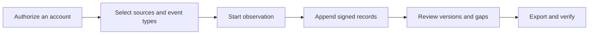

[English](../../README.md) · [Русский](../ru/README.md) · [Українська](../uk/README.md) · [Español](../es/README.md) · [Português (Brasil)](../pt/README.md) · [Türkçe](../tr/README.md) · [العربية](../ar/README.md) · **فارسی** · [اردو](../ur/README.md) · [हिन्दी](../hi/README.md) · [Bahasa Indonesia](../id/README.md) · [Tiếng Việt](../vi/README.md) · [简体中文](../zh/README.md)


<p align="center">
  <strong>محیط کاری مشاهده تلگرام شما.</strong><br>
  گفتگوهای ضبط‌شده را حفظ کنید، بفهمید چه تغییری رخ داده و تاریخچه‌ای امضا‌شده را به اشتراک بگذارید.<br>
  روی رایانه یا سرور خودتان. با حساب‌های کاربری خودتان.
</p>

<p align="center">
  
  
  
  
  
</p>

<p align="center">
  <a href="#راهاندازی-سریع">راه‌اندازی سریع</a> ·
  <a href="#ویژگیها">ویژگی‌ها</a> ·
  <a href="#اتصال-یک-حساب-تلگرام">حساب‌ها</a> ·
  <a href="#شواهد-و-راستیآزمایی">مدرک</a> ·
  <a href="#راهاندازی">راه‌اندازی</a> ·
  <a href="../README.md">مستندات</a>
</p>

> [!TIP]
> **قبل از اتصال، کاوش کنید.** با اجرای `Demo.cmd` یا `sh start.sh --demo` یک فضای کاری با گفتگوهای فرضی باز کنید. نیازی به حساب تلگرام نیست.

**جدید هستید؟** [شروع →](QUICKSTART.md) · [ویکی →](../wiki/Home.md) · [انتخاب راهنما →](../README.md) · [دریافت کمک →](../../.github/SUPPORT.md) · [مشاهده موارد آزمایش‌شده →](../VERIFICATION.md)

> [!WARNING]
> **از یک حساب تلگرام اختصاصی استفاده کنید که از دست دادنش برایتان مهم نباشد.** قویاً توصیه می‌کنیم حساب‌های شخصی یا باارزش را متصل نکنید یا روی آن‌ها شناسه/هَش API ایجاد نکنید. تلگرام می‌تواند حساب‌ها را محدود یا به‌طور دائم مسدود کند. [راهنمای حساب کاربری را بخوانید](../ACCOUNTS.md).

## ویژگی‌ها

- **گفت‌وگوهایی با تاریخچه.** پیام‌های ذخیره‌شده را بخوانید، ویرایش‌های ضبط‌شده را مقایسه کنید و اعلان‌های حذف را در زمینهٔ گفتگو ببینید.
- **مشاهده به شیوهٔ شما.** گفت‌وگوهای فردی، پوشه‌ای در تلگرام یا کل حساب را انتخاب کنید. هر حساب فضای کاری و تنظیمات مخصوص به خود را دارد.
- **خروجی‌هایی که می‌توانید تأیید کنید:** یک فایل ZIP امضا شده، سوابق اصلی، پیوست‌های حفظ‌شده و یک گزارش HTML آفلاین. محافظت اختیاری با رمز عبور برای تحویل.
- **ساخته‌شده برای استفادهٔ روزانه.** تم‌های روشن و تاریک، ۱۳ زبان، جستجو، ناوبری با Ctrl/Cmd+K و انجام اقدامات مستقیماً از چت‌ها.
- **افزونه ها هر زمان که نیاز داشته باشید.** یک [شاهد تلگرام در سه مرحله](../WITNESS.md)، یک [صفحه اثبات عمومی](../PROOF.md) جداگانه و راهنماهای راه‌اندازی واضح. با باز کردن **بخش «افزونه ها»** می‌توانید آن‌ها را انتخاب کنید؛ تنظیمات پیشرفته تا زمان نیاز پنهان می‌مانند.

<details>
<summary>تمام قابلیت‌ها و جزئیات فنی</summary></details>

- **مسیر اتصال شما.** در بخش **حساب کاربری → تنظیمات پروکسی**، از فهرست‌های عمومی همراه MTProxy انتخاب کنید، آن‌ها را از منابعشان تازه کنید یا لینک پروکسی تلگرام خود را بچسبانید. حالت دستی SOCKS5/HTTP/MTProxy و کاتالوگ اپراتور همچنان در دسترس هستند. فهرست‌های عمومی دانلود و فیلتر شده‌اند، اما هنوز هیچ حسابی از طریق هیچ‌یک از سرورهای فهرست‌شده متصل نشده است. [نحوه کار لیست‌های عمومی](../CONNECTION-SECURITY.md#public-proxies-supplied-by-your-installation).

- **ژورنالی از آنچه حساب‌های شما واقعاً می‌بینند:** پیام‌های جدید، ویرایش‌ها، اعلان‌های حذف، واکنش‌ها، رویدادهای عضویت و شکاف‌های پوشش‌دهی از گروه‌ها و کانال‌هایی که انتخاب می‌کنید.
- **گفت‌وگوهای انتخاب‌شده، یک پوشه تلگرام یا کل حساب کاربری.** انواع موارد قابل ضبط را انتخاب کنید — کانال‌ها، گروه‌ها، چت‌های خصوصی، ربات‌ها — و چت‌های جدید به محض ظاهر شدن اضافه می‌شوند. موارد مستثنی، پیام‌های ارسالی خود، ویرایش‌ها، حذف‌ها در چت‌های خصوصی که با خود چت مطابقت دارند، بازبینی‌های اولویت‌دار و محدودیت‌های ضمیمه برای هر نوع ([مجموعه](../COLLECTION.md#observation-scope-chosen-chats-a-folder-or-the-whole-account)).
- **حالت تحقیق.** یک دکمه یک حساب اختصاصی را آماده می‌کند که به تیم‌ها می‌پیوندد و با ربات‌ها گفتگو می‌کند: هر چیزی که می‌بیند و ارسال می‌کند ضبط می‌شود، دکمه‌ها در زیر پیام‌های ربات (لینک‌ها، اپلیکیشن‌های وب، متن‌های قابل کپی) ذخیره می‌شوند و ویرایش‌های صرفاً با دکمه به نسخه‌های جدید تبدیل می‌شوند، و هر چت یا ربات جدید پروفایل خود (توضیحات، دستورات، اعضا) را دریافت می‌کند و پیام‌های قابل مشاهده قبلی بلافاصله ذخیره می‌شوند ([حالت تحقیق](../COLLECTION.md#investigation-mode-joining-teams-and-talking-to-bots)). **راهنمای حساب اختصاصی** پنل (`/dedicated-account.html`) توضیح می‌دهد که چرا نباید از حساب اصلی استفاده کرد، چرا TgWitness از طریق جفت‌های هش/شناسهٔ عمومی اپلیکیشن کار می‌کند و چرا یک جفت API به خودی خود دسترسی به حساب کاربری شما را فراهم نمی‌کند (با لینک‌هایی به مستندات تلگرام)، و راه‌های ایجاد یک حساب اضافی را فهرست می‌کند.
- **مستقیماً از طریق چت‌ها اقدام کنید.** پیام‌ها و پاسخ‌ها ارسال کنید، دکمه‌های فراخوانی/متن ربات را فشار دهید یا پیش‌نمایش دعوت تلگرام را مشاهده و به آن بپیوندید. حساب انتخاب‌شده اقدام را انجام می‌دهد؛ درخواست‌ها، پیش‌نمایش‌های دعوت و پاسخ‌های پاپ‌آپ/URL ربات در دفترچه ثبت‌شدهٔ آن ([پنل مینی‌کلاینت](../COLLECTION.md#act-from-the-panel)) وارد می‌شوند.
- **پوشش قابل ارائه.** گزارش‌ها و اعتبارسنج می‌گویند «به‌طور مداوم از X تا Y مشاهده شده»، فواصل را همراه با دلیل آن‌ها و شناسه پیام‌هایی که هرگز مشاهده نشده‌اند فهرست می‌کنند — بدون اینکه آن‌ها را حذف‌شده جلوه دهند.
- **پروفایل افراد، عضویت اختیاری برای هر گفتگو.** تاریخچه نام و نام کاربری، پرچم‌های تلگرام، SHA-256 آواتار و pHash، فعالیت، اینکه چه کسی به چه کسی پاسخ می‌دهد و کیف‌پول‌ها، تلفن‌ها، نام‌های کاربری و لینک‌های ذکرشده — تنها از روی سوابق ذخیره‌شده ساخته شده، هر واقعیت به رکورد دفترچه خود اشاره می‌کند، به صورت یک فایل جداگانه امضا شده صادر می‌شود ([مدل مدرک](../EVIDENCE.md#people-profiles)).
- **شاهد مستقل.** یک فرآیند جداگانه با کلید و بات خود، سرآیند دفترچه یادداشت امضا شده را فراخوانی می‌کند، آن را در یک کانال تلگرام منتشر می‌کند و زمانی که گردآورنده پاسخ نمی‌دهد، گزارش می‌دهد؛ اعتبارسنج بر اساس آن، خروجی‌ها را بررسی می‌کند. گزینه‌های فاصله زمانی، محدودیت زمانی، بررسی‌هایی که منتشر می‌شوند و متن پست‌ها در فایل پیکربندی JSON ([witness](../WITNESS.md)) یا به‌صورت پارامتر تعیین می‌شوند. روی یک سرور محلی Bot API آزمایش شده است، اما هنوز با یک ربات و کانال واقعی نه.
- **تنظیمات جمع‌آوری در پنل.** محدودیت‌ها و سرعت جمع‌آوری، بازبینی‌ها، دانلودها، پروفایل‌های افراد، اعلان‌ها و خروجی‌ها در صفحه **پارامترها** همراه با محدوده‌ها و مقادیر پیش‌فرض قرار دارند؛ هر تغییر در دفترچه ثبت‌شده ([تنظیمات و پارامترها](#تنظیمات-و-پارامترها)) ثبت می‌شود.
- **ویرایش‌ها و حذف‌ها در زمینه.** هر ویرایش یک نسخهٔ مجزا است که در کنار نسخهٔ قبلی نمایش داده می‌شود؛ اطلاعیهٔ حذف هرگز محتوایی را که قبلاً ثبت شده است پاک نمی‌کند.
- **خروجی‌های امضا‌شده و قابل راستی‌آزمایی.** هر رویداد به‌صورت زنجیره‌ای هش (SHA-256) شده و امضا (Ed25519) می‌شود. بسته‌های ZIP امضا‌شده شامل JSONL، CSV، گزارش HTML آفلاین، رسانه‌های نگهداری‌شده و یک راستی‌آزمای مستقل هستند.
- **خروجی‌های محافظت‌شده با رمز عبور.** اختیاری: هر خروجی را در یک فایل ZIP با رمزگذاری AES-256 WinZip قرار دهید، فرمت قابل‌خواندن توسط 7-Zip و WinRAR؛ محتوای امضا‌شده درون آن بدون تغییر باقی می‌ماند. یک آرشیو آزمایشی که بایت‌به‌بايت در libarchive (`tar`) باز شد و رمز عبور نادرست رد شد ([مدل شواهد](../EVIDENCE.md#investigation-handoff)).
- **اعلان‌ها.** مشکلات (فضای کم دیسک، حساب خارج‌شده از ورود، خطاهای کالکتور، کپی یا زمان‌بندی)، تغییرات در چت‌های مشاهده‌شده و یک خلاصه روزانه، که از طریق [Apprise](https://github.com/caronc/apprise) به Matrix، Telegram، Discord، Slack، ntfy، ایمیل و بسیاری از سرویس‌های دیگر ارسال می‌شود — بدون متن پیام مگر اینکه گزیده‌ها را فعال کنید — و در پنل فهرست می‌شود. ارسال بر روی یک نقطه پایانی محلی آزمایش شده است؛ خود سرویس‌ها هنوز آزمایش نشده‌اند.
- **۱۳ زبان رابط کاربری:** انگلیسی، روسی، اوکراینی، اسپانیایی، پرتغالی (برزیلی)، ترکیه‌ای، عربی، فارسی، اردو، هندی، اندونزیایی، ویتنامی و چینی ساده‌شده، همگی با ترجمه ماشینی DeepL. بخش‌های جدیدتر از متن پشتیبان انگلیسی فهرست‌شده به‌طور صریح استفاده می‌کنند؛ کنترل‌های مینی‌کلاینت همچنان به زبان انگلیسی باقی می‌مانند. محتوای تلگرام و سوابق دفترچه همیشه دقیقاً همان‌طور که ذخیره شده‌اند نمایش داده می‌شوند.
- **تم روشن و تاریک.** به‌طور پیش‌فرض تنظیمات سیستم را دنبال می‌کند؛ انتخاب در هر مرورگر به‌خاطر سپرده می‌شود.
- **ناوبری مناسب صفحه‌کلید.** **کلیدهای Ctrl+K** (در مک: **⌘K**) را فشار دهید یا **«رفتن به…» را** انتخاب کنید تا بخشی را پیدا کنید. از کلیدهای جهت‌نما و Enter برای باز کردن آن استفاده کنید؛ با Esc منو را می‌بندید.
- **حساب‌های متعدد.** هر تعداد فضای کاری مجزا، هر کدام با جلسه تلگرام، دفترچه یادداشت، کلید امضا، مسیر پروکسی و سیاست ضبط اختصاصی خود.
- **ورود انعطاف‌پذیر.** تلفن + کد + احراز هویت دو مرحله‌ای، کد QR، `.session` تله‌تون/پایروگرام، فایل ZIP TData تلگرام دسکتاپ، Telethon StringSession، یا یک کلید احراز هویت کامل همراه با شناسه DC آن.
- **پروکسی‌های هر حساب کاربری.** SOCKS5 و HTTP CONNECT، آزمایش‌شده روی پروکسی‌های محلی آزمایشی، و MTProxy تجربی که هنوز روی سرور واقعی آزمایش نشده است. یک پروکسی ناموفق هرگز به‌طور بی‌صدا به اتصال مستقیم بازنمی‌گردد.
- **طراحی‌شده به‌صورت خصوصی.** روی رایانه یا سرور شما اجرا می‌شود. رابط کاربری وب یکپارچه، بدون Node.js، بدون سرویس میزبانی‌شده، بدون تله‌متری. جلسات، اعتبارنامه‌های API و رمزهای پروکسی در یک گاوصندوق رمزگذاری‌شده نگهداری می‌شوند.
- **راه‌اندازی آسان.** دوبار کلیک در ویندوز، یک اسکریپت در لینوکس/macOS یا Docker Compose با HTTPS خودکار اختیاری. تا کنون تنها لانچرهای ویندوز اجرا شده‌اند؛ ببینید [چه مواردی آزمایش شده‌اند](#آنچه-آزمایش-شده-است).

</details>

## راه‌اندازی سریع

| پلتفرم | چگونه شروع کنیم | پیش‌نیازها |
| --- | --- | --- |
| **ویندوز، هیچ چیزی نصب نشده است** | `TgWitness-<version>-windows-amd64-portable.zip` را از [بخش Releases](../../../../releases) دانلود کنید، آن را استخراج کرده و روی **`TgWitness.cmd`** دوبار کلیک کنید. | هیچ؛ پایتون همراه است |
| ویندوز، از سورس | روی **`Start.cmd`** دوبار کلیک کنید | پایتون ۳.۱۱+؛ در صورت عدم وجود، برای شما ارائه و نصب می‌شود |
| لینوکس / مک‌اواس | `sh start.sh` | پایتون ۳.۱۱+ با `venv`؛ این اسکریپت در صورت عدم وجود، دستور نصب را برای سیستم شما چاپ می‌کند |
| داکر، هر سیستم‌عامل | روی **`Docker.cmd`** دوبار کلیک کنید یا `sh docker-start.sh` را اجرا کنید | Docker Engine/Desktop با Compose 2.20+ |

1. **http://127.0.0.1:8787** را باز کنید.
2. توکن دسترسی پنل را الصاق کنید:
   - نصب قابل حمل یا سورس: محتویات `data/live/panel-token.txt`
   - Docker: چاپ‌شده توسط `Docker.cmd`/`docker-start.sh`، یا `docker compose exec tgwitness cat /data/panel-token.txt`
3. حساب تلگرام خود را اضافه کنید، چت‌های مورد نظر برای مشاهده را انتخاب کرده و دکمه **«شروع مشاهده» را** فشار دهید.

راه‌اندازی اولیه منبع، یک `.venv` خصوصی ایجاد می‌کند و وابستگی‌های سنجاق‌شده را نصب می‌کند (نیاز به دسترسی به اینترنت). کمک‌برنامه‌های Docker، تصویر را می‌سازند، منتظر می‌مانند تا پنل سالم شود و آدرس و توکن آن را چاپ می‌کنند. `python start.py --check` (یا `TgWitness-Check.cmd` در بسته قابل حمل) گزارشی از آمادگی ارائه می‌دهد بدون اینکه به تلگرام دسترسی پیدا کند.

> **فقط می‌خواهید ببینید؟** دستور **`Demo.cmd`** یا `sh start.sh --demo` را اجرا کنید. یک دفترچهٔ فرضی مستقیماً در مرورگر باز می‌شود؛ هیچ حساب تلگرامی متصل نیست و داده‌ها به‌طور جداگانه در `data/demo` نگهداری می‌شوند.

<details>
<summary><strong>در فضای کاری: چت‌ها، تاریخچه و خروجی‌ها</strong></summary></details>

<picture>
  <source media="(prefers-color-scheme: dark)" srcset="../assets/chats-dark.png">
  
</picture>

### تاریخچهٔ مشاهده


### صادرات امضا شده


</details>


## اتصال یک حساب تلگرام

> [!CAUTION]
> فقط حساب‌های اختصاصی را وصل کنید که از دست دادن‌شان برایتان مهم نباشد. تلگرام ممکن است حساب‌ها را به‌طور دائم و غیرقابل‌پیش‌بینی مسدود کند؛ هشدار بالای این صفحه را ببینید. **راهنمای حساب اختصاصی** پنل (ستون کناری یا `/dedicated-account.html`) توضیح می‌دهد چرا و چگونه باید یک حساب اختصاصی تهیه کنید.

ورود با تلفن، کد QR یا جلسهٔ موجود — بدون نیاز به شناسهٔ API یا هَش.

**چرا یک استخر API داخلی؟** ایجاد شناسه API خود در [my.telegram.org](https://my.telegram.org) باعث محدود شدن حساب‌ها می‌شود و تلگرام محدودیت‌های واضحی منتشر نمی‌کند — بسیاری از پژوهشگران به این ترتیب حساب‌های اصلی خود را از دست داده‌اند. صفحهٔ [«دریافت شناسهٔ API»](https://core.telegram.org/api/obtaining_api_id) خود تلگرام می‌گوید حساب‌هایی که از کلاینت‌های غیررسمی API استفاده می‌کنند، به‌طور خودکار تحت نظارت قرار می‌گیرند و کاربران به‌اشتباه مسدودشده را به recover@telegram.org می‌فرستد. بنابراین TgWitness جفت‌های API عمومی را که از قبل توسط کلاینت‌های متن‌باز دیگر استفاده می‌شوند، ارائه می‌دهد تا شما هرگز مجبور به ساختن یک شناسهٔ جدید نباشید. اگر شناسه API خود را دارید، آن را در قسمت **«شناسه API + هش»** وارد کنید تا به جای آن استفاده شود.

وقتی هیچ جفتی وارد نشده، وارد‌شده یا از قبل در فضای کاری ذخیره نشده باشد، TgWitness یکی از ۵۰ جفت موجود در استخر را انتخاب می‌کند و در صورت رد شدن توسط تلگرام، به جفت بعدی می‌رود. جفتی که وارد می‌شود با همان حساب باقی می‌ماند. یک جفت، برنامه را شناسایی می‌کند؛ شما همچنان حساب تلگرام خود را به‌طور جداگانه مجاز می‌کنید. توکن دسترسی پنل، TgWitness را باز می‌کند و از ورود به تلگرام مستقل است.

| آنچه در اختیار دارید | نحوه استفاده |
| --- | --- |
| شماره تلفن با دسترسی به حساب کاربری | زبانه‌ی **Phone**: کد تلگرام، سپس رمز عبور احراز هویت دو مرحله‌ای در صورت فعال بودن |
| اپلیکیشن تلگرامی که قبلاً وارد شده است | زبانه‌ی **کد QR**: تنظیمات → دستگاه‌ها → اتصال دستگاه دسکتاپ |
| تله‌تون (اسکیما ۷/۸) یا پایوگرام (اسکیما ۲/۳) `.session` | زبانه‌ی **فایل‌ها** |
| جفت `name.session` و `name.json` | در زبانهٔ **Files** هر دو را انتخاب کنید؛ فایل JSON حاوی شناسه/هش API است. |
| پوشه `tdata` در تلگرام دسکتاپ | فقط ZIP `key_datas` و `D877F783D5D3EF8Cs`، سپس **Files**؛ رمز عبور محلی در صورت تنظیم |
| Telethon StringSession، `.txt` یا `.tgwitness-session` | زبانه‌ی **فایل‌ها** یا *رمز عبور یا متن جلسه* |
| JSON حساب کاربری با جلسه یا کلید احراز هویت | زبانه‌ی **فایل‌ها** |
| کلید احراز هویت کامل (۵۱۲ کاراکتر هگزادسیمال) + شناسه DC | زبانه‌ی **کلید احراز هویت**؛ شناسهٔ کاربری اختیاری با تلگرام بررسی می‌شود |

پشتیبانی‌نشده: ذخیره‌سازی TDLib، رشته‌های جلسه Pyrogram، توکن‌های ربات، TData چندحساب و فهرست‌های انبوه حساب‌ها. فایل‌ها در حافظه سرور شما تبدیل شده و پیش از ذخیره با تلگرام بررسی می‌شوند. [راهنمای حساب‌ها](../ACCOUNTS.md) هر فرمت را گام‌به‌گام توضیح می‌دهد: نحوه دریافت اعتبارنامه‌های API، نحوه شناسایی فایل، فیلدهای JSON، محدودیت‌ها و پیام‌های خطا.

پس از ورود، **بخش Sources را** باز کنید (چت‌های شما به‌طور خودکار بارگذاری می‌شوند)، گروه‌های مورد نیاز را اضافه کنید، آنچه را می‌خواهید ضبط کنید (برای مثال *پیام‌ها، ویرایش‌ها و حذف‌ها*) انتخاب کرده و شروع به مشاهده کنید. روند را در حال اجرا نگه دارید: **توقف مشاهده** جمع‌آوری را متوقف می‌کند، **قفل کردن** فقط دسترسی مرورگر را می‌بندد.

## تصاویر صفحه

| ویرایش مقایسه | منابع و سیاست ضبط |
| --- | --- |
|  |  |
| **صادرات امضا شده** | **ورود** |
|  |  |
| **مجله** | **تم تاریک** |
|  |  |

تمام اسکرین‌شات‌ها از داده‌های نمایشی مصنوعی استفاده می‌کنند. کد QR در [qr-login.png](../assets/qr-login.png) یک توکن خیالی از حمل‌ونقل آزمایشی را رمزگذاری می‌کند.


## نحوه کار



هر فضای کاری متعلق به یک حساب تلگرام است. گردآورنده به‌روزرسانی‌ها را از کلاینت آن حساب دریافت می‌کند، سیاست ضبط ذخیره‌شده را اعمال می‌کند و مشاهدات را به یک دفترچه فقط-افزودنی اضافه می‌کند.

| مشاهده | چه چیزی حفظ شده است | مرز |
| --- | --- | --- |
| پیام جدید | متن، شناسه فرستنده، مرجع پاسخ، متادیتا، زمان مشاهده | فقط به‌روزرسانی‌های منابع منتخب ارائه می‌شوند |
| ویرایش | نسخهٔ محتوای جداگانه | نسخه‌های میانی که هنگام آفلاین بودن از دست رفته‌اند قابل بازیابی نیستند |
| حذف | شناسه پیام به‌علاوه همه موارد ضبط‌شده قبلی | تلگرام معمولاً مشخص نمی‌کند چه کسی و چه زمانی حذف کرده است |
| واکنش‌ها | شمارش و هویت‌های اخیر در صورت ارائه | یک نسخهٔ لحظه‌ای، نه یک گزارش کامل تغییرات |
| عضویت | پیام‌های سرویس و به‌روزرسانی‌های شرکت‌کنندگان | نمی‌توان تضمین کرد که هر پیوستن/خروجی حتماً دریافت شود |
| پیوست | فایل با آدرس‌دهی محتوا اختیاری با SHA-256 | فایل‌ها ممکن است پیش از دانلود ناپدید شوند؛ نتایج ثبت می‌شوند |
| پوشش | شروع، توقف، قطع اتصال، ضربان قلب، تغییرات سیاست | پایداری، اثبات ضبط کامل نیست |
| برش تاریخچه | آخرین پیام‌های قابل مشاهده، تا ۵۰۰ مگر اینکه در **پارامترها** افزایش یابد، به‌طور صریح برچسب‌گذاری شده‌اند | نمی‌توان ویرایش‌ها یا حذف‌های از دست رفته را بازسازی کرد |

برای اطلاع از سیاست‌ها، صف‌های پیوست و راه‌اندازی مجدد، «[نحوه کارکرد جمع‌آوری](../COLLECTION.md)» را مطالعه کنید.

## تنظیمات و پارامترها

همه چیز در پنل، به‌ازای هر فضای کاری، بدون ویرایش کد یا فایل‌های پیکربندی تغییر می‌کند. هر تغییر در دامنه، سیاست یا پارامتر در دفترچهٔ ثبت‌شده با امضا همراه با مقادیر قبل و بعد ثبت می‌شود و هر شروع مشاهده، مقادیر جاری را نام می‌برد.

| کجا | تنظیمات شما |
| --- | --- |
| **منابع** | دامنه (گفت‌وگوهای انتخابی، یک پوشه تلگرام، کل حساب)، انواع منابع، استثناها، اقدامات خود، تغییراتی که باید حفظ شوند، انواع پیوست و اندازه هر نوع (۱–۲۰۰۰ مگابایت)، فاصله زمانی بازبینی برای اولویت و سایر گفت‌وگوها (هر تعداد دقیقه، 0 = غیرفعال)، اسنپ‌شات‌های تاریخچه، اعلان‌ها |
| **صادرات** | دانلودها با رمز عبور محافظت‌شده، حالت شواهد (فاصله زمانی، مراجع مهر زمانی و تقویم‌ها)، نسخهٔ خارج از محل در S3 (فاصله زمانی، نگهداری و حالت Object Lock) |
| **شاهد** | توکن‌های شاهد فقط-خواندنی؛ گزینه‌های خودِ شاهد با دستورات از پیش‌ساخته نمایش داده می‌شوند |
| **پارامترها** | اندازه و تازه‌سازی فهرست چت، فواصل ضربان قلب و نقطه‌کنترل، بافر راه‌اندازی، نحوه پخش درخواست‌های بازبینی مجدد (تاخیر اول، چت‌های هر نوبت، مکث، پیام‌های بازیابی‌شده و مجدداً درخواست‌شده)، رزرو دیسک، زمان‌بندی دانلود، سرعت و تلاش‌های مجدد، آنچه پروفایل‌های افراد به دنبال آن هستند، از جمله عبارت‌های منظم خودتان، اندازه و سرعت اعلان، اسنپ‌شات، محدودیت‌های فشرده‌سازی ZIP و دانلود در مرورگر، انقضای زمان اقدام پنل، انقضای زمان و تلاش‌های مجدد کلاینت تلگرام |

مقادیر **پارامترها** محدوده و مقدار پیش‌فرض خود را نشان می‌دهند؛ مقادیر تغییر یافته علامت‌گذاری شده و می‌توان آن‌ها را تک‌تک یا همگی یک‌جا بازگرداند. این تغییرات از اولین استفاده بعدی اعمال می‌شوند؛ تایم‌اوت‌ها و تلاش‌های مجدد کلاینت تلگرام از اتصال بعدی در نظر گرفته می‌شوند. محدودیت ZIP بالاتر از ۴ گیگابایت هنگام تأیید آرشیو ([عملیات](../OPERATIONS.md#panel-layout)) به `verify.py --max-gib N` نیاز دارد.


## شواهد و راستی‌آزمایی

| صادرات | فهرست مطالب | یکپارچگی |
| --- | --- | --- |
| **فایل ZIP امضا شده** | JSONL، CSV، گزارش HTML، پوشش، رسانه، مانیفست، اعتبارسنج | رویدادهای امضا‌شده به‌علاوهٔ فهرست مانیفست امضا‌شدهٔ هر فایل، با ذکر نام تولیدکننده. از این برای تحویل کار استفاده کنید. |
| JSONL | سوابق اصلی همراه با هش‌ها و امضاها | امضاهای Ed25519 برای هر رویداد و زنجیره هش |
| CSV / HTML | جدول امن در صفحه‌گسترده / گزارش قابل‌خواندن آفلاین | فقط داخل فایل ZIP امضا شده موجود است |
| JSON نقطه کنترل | طول ژورنال و هش سر | به‌طور جداگانه امضا شده؛ آن را خارج از جمع‌کننده نگه دارید |
| JSON رسید اجرا | هش‌های کد، نسخه‌های وابستگی، دامنه، تنظیمات | بیانیه فرآیند امضا شده به‌طور جداگانه |
| فایل JSON پروفایل افراد | پروفایل‌های یک چت با ارجاعات سوابق | بیانیهٔ امضا شده؛ هش‌های رکوردها با فایل ZIP مطابقت داده شده‌اند |
| فایل زیپ دفترچه شاهد | سرنخ‌های به‌دست‌آمده، پاسخ‌های از دست رفته، پست‌های کانال | امضا شده با کلید خودِ شاهد |

فیلترها تنها بر مرور تأثیر می‌گذارند؛ خروجی‌ها همیشه شامل کل دفترچه تا یک شماره توالی ثابت هستند. آرشیو را با یک نسخه مورد اعتماد از ابزار اعتبارسنج و اثر انگشت کلید و نقطه کنترل که به‌طور مستقل نگهداری شده‌اند، تأیید کنید:

```sh
python -m pip install cryptography
python tgwitness/verify.py tgwitness-evidence.zip --fingerprint TRUSTED_PUBLIC_KEY_SHA256 --checkpoint tgwitness-checkpoint.json
# with an independent witness and its channel (Telegram Desktop export)
python tgwitness/verify.py tgwitness-evidence.zip --fingerprint TRUSTED_PUBLIC_KEY_SHA256 \
    --witness witness.zip --witness-fingerprint WITNESS_SHA256 --channel result.json
```

اعتبارسنج تولیدکنندهٔ امضا شده، دوره‌های مشاهدهٔ پیوسته، فواصل و شناسه‌های پیام‌هایی را که هرگز مشاهده نشده‌اند چاپ می‌کند و در صورتی که دفترچه با هر سرآغازی که شاهد دیده متفاوت باشد، شکست می‌خورد.

امضاها شواهدی از دستکاری‌ناپذیری را نسبت به یک کلید امضای مورد اعتماد فراهم می‌کنند. آن‌ها اصالت تلگرام، صحت محتوا یا زمان مورد اعتماد را اثبات نمی‌کنند و در برابر اپراتوری که کنترل گردآورنده و کلید آن را در دست دارد، محافظت نمی‌کنند. برای زمان مورد اعتماد، حالت شواهد (به طور پیش‌فرض غیرفعال) نقاط کنترل را با مراجع RFC 3161 و تقویم‌های OpenTimestamps مهر و موم می‌کند، یا پنل یک درخواست آفلاین RFC 3161 ([رویه مهر و موم زمانی](../TIMESTAMP.md)) آماده می‌کند. هر دو بر روی سرورهای آزمایشی محلی آزمایش شده‌اند، اما هنوز بر روی خدمات عمومی آزمایش نشده‌اند. [مدل شواهد](../EVIDENCE.md) و چک‌لیست [تحویل تحقیقات](../EVIDENCE.md#investigation-handoff) را ببینید.

## راه‌اندازی

> [!NOTE]
> راه‌اندازی‌های Docker، Caddy (HTTPS)، systemd و launchd در زیر آماده شده‌اند و فایل‌های آن‌ها از نظر نحوی بررسی شده‌اند، اما هیچ‌یک هنوز اجرا نشده‌اند. بستهٔ قابل حمل ویندوز و راه‌اندازی از منبع در ویندوز اجرا شده‌اند.

**محلی یا یک سرور واحد با داکر:**

```sh
docker compose up -d --build --wait
docker compose exec tgwitness cat /data/panel-token.txt
```

کانتینر با کاربر غیر ریشه و سیستم فایل فقط-خواندنی اجرا می‌شود، تنها در `127.0.0.1:8787` منتشر می‌کند و تمام داده‌ها را در یک حجم نام‌گذاری‌شده نگه می‌دارد.

**سرور عمومی با HTTPS خودکار (Caddy):** `.env.example` را به `.env` کپی کنید، `TGWITNESS_DOMAIN` را تنظیم کنید، DNS را به سمت سرور نشانه کنید، پورت‌های TCP 80/443 را باز کنید و اجرا کنید

```sh
docker compose -f compose.yaml -f deploy/compose/compose.https.yaml up -d --build --wait
```

**ویندوز بدون نصب هیچ‌چیز:** فایل ZIP قابل حمل پیوست‌شده به هر نسخه شامل محیط اجرایی رسمی پایتون و تمام وابستگی‌ها است. داده‌ها در پوشهٔ `data` خود باقی می‌مانند؛ برای به‌روزرسانی، نسخهٔ جدید را استخراج کرده و آن پوشه را کپی کنید.

**بدون Docker:** قالب‌های systemd، وظیفه ورود به سیستم ویندوز و launchd در [راه‌اندازی/](../../deploy/README.md) قرار دارند. به‌روزرسانی‌ها، پشتیبان‌گیری‌ها، پورت‌های جایگزین و تصاویر GHCR (پس از انتشار آن‌ها در جریان کاری انتشار) در [راه‌اندازی](DEPLOYMENT.md) پوشش داده شده‌اند.

### خط فرمان

```text
python start.py [--demo] [--setup-only] [--check [--json]] [--host HOST] [--port PORT] [--data-dir DIR]
```

| وظیفه | دستور (از محیط پروژه) |
| --- | --- |
| بررسی آمادگی بدون راه‌اندازی | `python start.py --check` |
| تبدیل یک جلسه SQLite تله‌تون به حالت آفلاین | `python -m tgwitness.sessions account.session --out account.tgwitness-session` |
| انتشار خروجی حجیم به دیسک | `python -m tgwitness.download --token-file data/live/panel-token.txt --out evidence.zip` |
| تأیید آرشیو خروجی‌شده | `python tgwitness/verify.py tgwitness-evidence.zip --fingerprint SHA256` |
| تأیید آرشیوی با حجم بیش از ۴ گیگابایت | `python tgwitness/verify.py big-evidence.zip --fingerprint SHA256 --max-gib 16` |
| اجرای یک شاهد مستقل از طریق فایل پیکربندی | `python -m tgwitness.witness run --config witness.json` |

دستورات کمکی `python -m tgwitness…` باید داخل `.venv` اجرا شوند (`.venv\Scripts\python.exe` در ویندوز، `.venv/bin/python` در سایر سیستم‌ها).

| متغیر | هدف |
| --- | --- |
| `TGWITNESS_HOST`, `TGWITNESS_PORT` | آدرس و پورت گوش دادن (پیش‌فرض `127.0.0.1:8787`) |
| `TGWITNESS_DATA` | پوشهٔ داده‌ها (پیش‌فرض `data/live`) |
| `TGWITNESS_TOKEN` | توکن پنل ثابت به جای توکن تولیدشده (حداقل ۲۴ کاراکتر) |
| `TGWITNESS_VAULT_KEY_FILE` | کلید اصلی گاوصندوق خارجی برای نصب‌های جدید |
| `TGWITNESS_DOMAIN`, `TGWITNESS_IMAGE` | نام میزبان HTTPS داکر و تصویر منتشرشده (به `.env.example` مراجعه کنید) |
| `TGWITNESS_WITNESS_*` | شاهد مستقل: گردآورنده، توکن‌ها، کانال، `_INTERVAL`، `_TIMEOUT`، `_POST` (تمام، تغییرات، مشکلات)، `_TITLE`، `_CONFIG` ([شاهد](../WITNESS.md#options)) |


## مسئولیت و حفاظت از داده‌ها (GDPR)

TgWitness یک ابزار است. هر کسی که آن را اجرا می‌کند تصمیم می‌گیرد چه اطلاعاتی جمع‌آوری شود، چرا و برای چه مدت، و مسئول آن است — معمولاً تحت GDPR اتحادیه اروپا/بریتانیا به‌عنوان *کنترل‌کننده* آن داده‌های شخصی. پیام‌های تلگرام حاوی داده‌های شخصی افرادی است که هرگز با ضبط شدن آن موافقت نکرده‌اند: نام‌ها، نام‌های کاربری، شناسه‌ها، عکس‌ها، شماره‌های تلفن، نظرات. این بخش مشاوره حقوقی نیست؛ قانونی را که شامل حال شما می‌شود و شرایط تلگرام را بررسی کنید.

- **یک مبنای قانونی و یک هدف داشته باشید.** پیشگیری از کلاهبرداری، امنیت شبکه و اطلاعات و دفاع از دعاوی حقوقی معمولاً به‌عنوان منافع مشروع مورد استناد قرار می‌گیرند (GDPR ماده 6(1)(f)، بندهای تفسیر 47 و 49؛ ماده 9(2)(f) برای دعاوی حقوقی). هدف را برای هر مورد یادداشت کنید. مقامات عمومی بر اساس مبانی حقوقی خود عمل می‌کنند.
- **حداقل داده‌هایی را که برای هدف لازم است جمع‌آوری کنید.** از چت‌های منتخب شروع کنید. حالت‌های پوشه‌ای و کل‌حساب، چت‌های خصوصی و پیام‌های اشخاص ثالث را ضبط می‌کنند: از آن‌ها فقط در حساب‌های اختصاصی استفاده کنید؛ پنل درخواست تأیید می‌کند و دفترچهٔ ثبت‌شده آن را ثبت می‌کند. انواع رویدادها، انواع پیوست‌ها و اقدامات خود را که نیاز ندارید غیرفعال کرده و چت‌ها را مستثنی کنید.
- **پروفایل افراد، پروفایل‌سازی است.** آن‌ها به‌طور پیش‌فرض خاموش هستند و برای هر چت به‌صورت جداگانه فعال می‌شوند. از آن‌ها برای یک تحقیق خاص استفاده کنید، بر اساس آن‌ها تصمیمات خودکار درباره افراد نگیرید (ماده ۲۲)، و پس از اتمام کار، آن‌ها را خاموش کنید یا چت را حذف کنید — این کار باعث حذف آن‌ها می‌شود. نظارت سیستماتیک بر افراد متعدد معمولاً مستلزم ارزیابی تأثیر بر حفاظت از داده‌ها (ماده ۳۵) است.
- **آن را امن نگه دارید.** جلسات، اعتبارنامه‌ها و کلیدها در یک گاوصندوق رمزگذاری‌شده قرار دارند؛ دایرکتوری داده‌ها را روی یک دیسک رمزگذاری‌شده قرار دهید، خروجی‌ها را با رمز عبور (ZIP با رمز AES-256) محافظت کنید، پنل را پشت HTTPS نگه دارید و به شاهد فقط توکن فقط-خواندن آن را بدهید. اعلان‌ها هیچ متن پیامی ندارند مگر اینکه خلاصه‌ها را فعال کنید که در این صورت متن به سرویس اعلان ارسال می‌شود.
- **نگهداری و حذف.** این دفترچه به‌صورت الحاقی (append-only) است تا یکپارچگی آن قابل اثبات باشد؛ سوابق منفرد را نمی‌توان بدون شکستن زنجیره امضا حذف کرد. نگهداری را برای هر فضای کاری برنامه‌ریزی کنید و وقتی هدف پایان یافت، کل فضای کاری (حساب‌ها → حذف) یا دایرکتوری داده‌های آن را حذف کنید. نسخه‌های خارج از محل تحت قفل شیء S3 (S3 Object Lock) نمی‌توانند قبل از تاریخ نگهداری خود حذف شوند — دوره را متناسب با آن انتخاب کنید. حق حذف استثناهایی دارد، برای مثال برای تأسیس یا دفاع از ادعاهای قانونی (ماده ۱۷(۳)(e)).
- **درخواست‌های ثبت‌شده توسط افراد.** خروجی‌های چت و فایل‌های پروفایل امکان یافتن اطلاعات موجود درباره یک شخص را فراهم می‌کنند (ماده ۱۵).
- **هیچ چیزی برای نویسندگان ارسال نمی‌شود.** TgWitness هیچ تله‌متری و سرویس میزبانی ندارد؛ داده‌ها تنها از طریق مسیرهایی که شما پیکربندی می‌کنید (تلگرام، سرویس‌های زمان‌گذاری، کپی در S3، اعلان‌ها، شاهد) از دستگاه شما خارج می‌شوند.

## امنیت و وضعیت پروژه

برای یک پروژه آزمایشی جمع‌آوری چندحساب عمومی، [مانیتور Proof](../PROOF.md) شمارنده‌های ثبت‌شده امضا‌شده، وضعیت و هش‌های دفترچه را بدون محتوای پیام نمایش می‌دهد. این ابزار می‌تواند چک‌ها را در یک کانال تلگرام پخش کند؛ یک اعتبارسنج کاناری جداگانه توالی کنترل‌شده ارسال/ویرایش/حذف را در سراسر خروجی‌های حساب بررسی می‌کند. این ابزار تنها با فضاهای کاری مصنوعی آزمایش شده است.

- پنل به‌طور پیش‌فرض روی localhost گوش می‌دهد. برای دسترسی از راه دور از پروفایل HTTPS Compose یا تونل SSH استفاده کنید؛ هرگز HTTP ساده را در معرض دید قرار ندهید.
- جلسات تلگرام، اعتبارنامه‌های API، اعتبارنامه‌های پروکسی و کلید امضا در گاوصندوق رمزگذاری‌شده با Fernet ذخیره می‌شوند. به‌طور پیش‌فرض کلید آن در همان دایرکتوری داده قرار دارد؛ برای کلید اصلی خارجی، `TGWITNESS_VAULT_KEY_FILE` را تنظیم کنید. محتوای پیام و رسانه‌های محلی توسط TgWitness رمزگذاری نمی‌شوند؛ دایرکتوری داده را روی یک دیسک یا حجم رمزگذاری‌شده نگه دارید. خروجی‌های ZIP امضا شده به صورت اختیاری می‌توانند با رمز عبور رمزگذاری شوند.
- فایل‌های داده، جلسات، توکن‌ها، کلیدها و خروجی‌ها از ساخت‌های گیت و داکر حذف شده‌اند.
- نواقص امنیتی را به‌صورت خصوصی طبق توضیحات موجود در [فایل SECURITY.md](../../.github/SECURITY.md) گزارش کنید.

### آنچه آزمایش شده است

TgWitness **۰.۶.۱** روی ویندوز ۱۱ با پایتون ۳.۱۲ اجرا می‌شود. وضعیت در ۲۹ اکتبر ۲۰۲۶:

| حوزه | چگونه آزمایش شد |
| --- | --- |
| پیام‌ها، ویرایش‌ها، حذف‌ها، پیوست‌ها، بازبینی مجدد پس از راه‌اندازی مجدد، مکث‌های FloodWait | انجام شده با **یک حساب واقعی تلگرام**، ۲۷–۲۹ اکتبر ۲۰۲۶: ۹٬۹۶۸ رکورد امضا شده، هر امضا و زنجیره هش تأیید شده ([آزمایش زنده](../VERIFICATION.md#live-telegram-test-whole-account--29-october-2026)) |
| مشاهده کل حساب و اسنپ‌شات‌های تاریخچه | انجام شده با **یک حساب واقعی** در ۲۹ اکتبر ۲۰۲۶: پیام‌ها از ۲ گروه یا کانال و ۳ گفتگوی خصوصی و ربات‌ها |
| فشردن دکمه‌ی پیام در **چت‌ها** | یک‌بار با **یک حساب واقعی** انجام شده |
| ورود با فایل‌های جلسه Telethon/Pyrogram و TData دسکتاپ تلگرام | با **یک حساب واقعی** انجام شده |
| ورود با شماره تلفن، کد QR و کلید احراز هویت، پیوست شدن چت‌های جدید به دامنه همراه با پیام‌های قبلی‌شان، ارسال پیام، پیوست شدن از طریق دعوت، واکنش‌ها، عضویت، پروفایل افراد، چندین حساب به‌طور همزمان، خروجی‌گیری و اعتبارسنج | تست‌های خودکار با کلاینت‌های مصنوعی تلگرام |
| پروکسی‌های SOCKS5/HTTP، ربات شاهد، مانیتور اثبات، اعلان‌ها، کپی در S3، RFC 3161 و OpenTimestamps | تست‌های خودکار بر روی سرورهای تست محلی |
| فهرست‌های عمومی MTProxy | دانلود و پالایش شده (۱۱۸ سرور در ۲۹ اکتبر)؛ هنوز از طریق آن‌ها ارتباطی برقرار نشده است |
| MTProxy، Docker، HTTPS با Caddy، لینوکس، macOS، پایتون ۳.۱۱ و ۳.۱۳، گردش کار CI و انتشار، قطعی‌های طولانی‌مدت، بازبینی امنیتی مستقل | **هنوز آزمایش نشده است** |

جزئیات: [سوابق تأیید](../VERIFICATION.md)، [وضعیت انتشار](../internal/RELEASE.md) و [آمادگی](../internal/READINESS.md).


## توسعه

```sh
python -m venv .venv && source .venv/bin/activate     # Windows: .venv\Scripts\Activate.ps1
python -m pip install -c constraints.txt -e ".[dev]"
python -m pytest -q                                    # unit and integration tests
python -m playwright install chromium
python tools/check_browser.py                          # end-to-end UI acceptance
python tools/check_account_browser.py                  # sign-in flows
python tools/capture_screenshots.py --docs             # refresh README images
python tools/build_portable.py                         # Windows portable ZIP (Windows + Python 3.12)
python tools/build_source.py                          # source ZIP with SHA-256 manifest
python tools/build_site.py                             # static project site in dist/site
python tools/check_site.py                             # website browser acceptance
```

مجموعه تست خودکار از اشیاء مصنوعی تلگرام استفاده می‌کند و هرگز به حساب‌های واقعی متصل نمی‌شود؛ تست زنده در بالا توضیح داده شده است. CI طوری پیکربندی شده است که ماتریس تست را روی ویندوز، لینوکس و macOS با پایتون ۳.۱۱–۳.۱۳، بررسی‌های مرورگر، بسته‌بندی سورس، نسخه قابل حمل ویندوز و یک ساخت Docker اجرا کند. جریان کاری انتشار طوری تنظیم شده است که فایل‌های ZIP منبع، wheel، ZIP قابل حمل ویندوز و تصویر GHCR چندمعماری را به یک Release منتشر شده در گیت‌هاب ضمیمه کند. هیچ‌کدام از این جریان‌های کاری هنوز اجرا نشده‌اند. پیش از ارسال یک pull request، [فایل CONTRIBUTING.md را](../../.github/CONTRIBUTING.md) مطالعه کنید.

## مستندات

| راهنما | موضوعات پوشش‌داده‌شده |
| --- | --- |
| [راه‌اندازی سریع](QUICKSTART.md) | اولین راه‌اندازی، اتصال حساب و اولین خروجی |
| [فرمت‌های حساب و جلسه](../ACCOUNTS.md) | ورودی‌های ورود، تبدیل، حساب‌های متعدد |
| [نحوه کارکرد جمع‌آوری](../COLLECTION.md) | ثبت سیاست‌ها، نسخه‌ها، پیوست‌ها، فواصل |
| [اتصال و امنیت](../CONNECTION-SECURITY.md) | پراکسی‌ها، رمزنگاری و کلیدها |
| [عملیات](../OPERATIONS.md) | روند کاری روزانه، پشتیبان‌گیری، بازیابی، ظرفیت |
| [راه‌اندازی](DEPLOYMENT.md) و [قالب‌های سرویس](../../deploy/README.md) | سرورها، کانتینرها، HTTPS، به‌روزرسانی‌ها |
| [مدل شواهد](../EVIDENCE.md) و [مهرهای زمانی](../TIMESTAMP.md) | یکپارچگی، پوشش، پروفایل افراد، اعتماد و واگذاری |
| [شاهد مستقل](../WITNESS.md) | توکن‌های شاهدی فقط-خواندنی، پروفایل داکر، پست‌های کانال، بررسی‌های متقابل |
| [معماری](../ARCHITECTURE.md) و [مدل محصول](../PRODUCT.md) | جزئیات داخلی و تصمیمات طراحی |
| [تأیید](../VERIFICATION.md) و [آمادگی](../internal/READINESS.md) | بررسی‌های انجام‌شده و کارهای باقی‌مانده |
| [تاریخچه تغییرات](../CHANGELOG.md) | تاریخچه نسخه‌ها |
| [وب‌سایت و انتشار](../internal/PUBLISHING.md) | پیش‌نمایش وب‌سایت محلی، صفحات گیت‌هاب، اولین انتشار |


## مجوز

[ام‌آی‌تی](../../LICENSE)

## راهنماهای این پوشه

| فایل | محتوا |
| --- | --- |
| [DEPLOYMENT.md](DEPLOYMENT.md) | راه‌اندازی و عملیات |
| [QUICKSTART.md](QUICKSTART.md) | راه‌اندازی سریع TgWitness |
