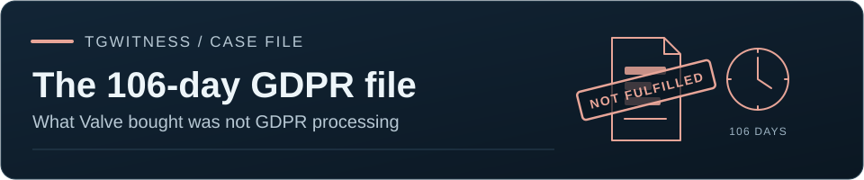

[TgWitness](../../README.md) / [مستندسازی](README.md) · [اعلان اپراتور](OPERATOR-INCOMPATIBILITY.md)

# Valve، Taylor Wessing و ۱۰۶ روز انتظار به‌موجب GDPR: کالبدشکافی پرونده و ۷۰٬۷۱۷ واژه‌اش

[سوابق منبع](https://phishdestroy.io/steam_dossier/taylor_wessing) · [اعلان اپراتور](OPERATOR-INCOMPATIBILITY.md) · [English](../TAYLOR-WESSING-GDPR-FILE.md)

پرسش‌هایی برای ما می‌ماند که هرگز پاسخی برایشان نخواهیم گرفت، چون ما طرف این دعوا نیستیم. هیچ آدم عادی‌ای تاب نمی‌آورد که هر بار صد روز منتظر بماند و با وکلای نخبه‌ای درگیر شود که شرکت‌ها از طریق چنین «بازارهای فریلنس» هزینه‌شان را می‌دهند. هرگز نخواهیم فهمید خدمتی که Valve سفارش داد واقعاً چه نامی داشت. از بیرون، این به پردازشی به‌موجب GDPR می‌ماند که کاملاً قانونی نبود، و به افشای داده‌ای که در آن گزارش‌دهندگان سیاه نشدند بلکه لو رفتند، در حالی که دست‌کم ۵٬۰۰۰ تا ۱۰٬۰۰۰ صفحه از خود داده‌ها غایب است: آنچه خروجی گرفته شد گزارش کاربر نبود، بلکه گزارشی بریده‌شده بود که برای پیمانکاران برون‌سپاری ساخته شده بود. اعتراض به آن بی‌فایده است. لایه‌ای عظیم از اطلاعات به‌طور عینی غایب است، درست همان‌طور که هیچ چیزی سخن هیچ‌یک از دو وکیل را تأیید نمی‌کند.

Valve برای خدمتی که از وقت‌کشی، سیاه‌کردن دستی و امضای یک دکتر زیر گزارشی همجنس‌گراستیز و یک PDF خراب تشکیل شده چقدر می‌پردازد؟ این پرونده ما نیست، اما مشکل اینجا آشکارا قانون نیست؛ جایگاه و مصونیت از مجازات است. عنوان «دکتر» خودبه‌خود یک نفر را به کسی بدل می‌کند که تصمیم می‌گیرد چه چیزی دلیل انکارناپذیر به شمار می‌آید، و دیگری را به کسی که گویا از اعداد و PDF سر درمی‌آورد (هرچند در واقع چنین نیست).

---

## ۱. تاریخ‌ها، حرف دکتر و گزارشی بی‌هیچ پرداخت

سربرگ سند می‌گوید `Date of Report: 09-29-2025` و خود فایل‌ها در ۱ یا ۲ اکتبر تحویل داده شدند. اما ما این تاریخ‌ها را باور نمی‌کنیم. ما اظهار مستقیم **Dr. Patrick Vincent Zurheide** را باور می‌کنیم:

> „Bei der Zusammenstellung der personenbezogenen Daten Ihres Mandanten musste leider die volle Monatsfrist
> ausgeschöpft werden, da sich bei erneuter Prüfung der Daten gezeigt hat, dass auch nach dem 3. Mai 2025 neue
> Zahlungen durch einen Dritten über das Nutzerkonto Ihres Mandanten erfolgt sind und insofern manuell die Daten
> bereinigt werden mussten.“
>
> *(گردآوری داده‌های شخصی موکل شما متأسفانه کل مهلت یک‌ماهه را گرفت، زیرا بررسی دوباره نشان داد که پس از ۳ مه ۲۰۲۵ نیز شخص ثالثی از طریق حساب پرداخت‌های تازه‌ای انجام داده است، و از همین رو داده‌ها باید دستی پاک‌سازی می‌شد.)*

دقیقاً همین جمله است که باعث می‌شود دیگر اعداد، سخنان دکتر در بند نخست و امضای او را باور نکنیم. البته دکتر دروغ نمی‌گوید؛ او چیزی برای از دست دادن دارد، نه؟ فقط اینکه وقتی فایل خروجی گرفته شد و شکل‌های برداری حذف شدند، حتی یک پرداخت هم در گزارش پیدا نشد. ما کار دکتر Patrick یا تأخیر او را زیر سؤال نمی‌بریم. ما صرفاً «حقیقت دکتر» را باور و قبول می‌کنیم، و آنچه را در خود فایل دیده می‌شود ثبت می‌کنیم.

---

## ۲. ۳۶ ثانیه و برچسب آسیب‌پذیر «Anlage 1 / Taylor Wessing»

ما در هیچ زمینه‌ای متخصص نیستیم، و ظاهراً به همین دلیل اعلان آسیب‌پذیری ما هم از سوی خود پلتفرم فریلنس و هم از سوی دکتر نادیده گرفته شد. منطق به‌اندازه کافی روشن است: آن‌ها خود قانون‌اند، چه آسیب‌پذیری‌ای ممکن است داشته باشند؟

اما سخنان دکتر را کنار بگذارید و به فناوری نگاه کنید. ما محیط Windows مشابهی راه انداختیم، فایل پاک‌سازی‌شده را برداشتیم و کوشیدیم شکل‌ها را جای‌گذاری کنیم. جای‌گذاری دستی صدها شکل سیاه در **۳۶ ثانیه**، دقیقاً به اندازه مدت جلسه ضبط‌شده، به نظر ما ناممکن است؛ از همه نشانه‌ها پیداست که جعبه‌های سیاه از پیش روی سند بوده‌اند. ما به این نظر متمایلیم که در آن ۳۶ ثانیه دقیقاً یک شیء افزوده شد، در گوشه بالا سمت راست صفحه ۱: برچسب `"Anlage 1 / Taylor Wessing"`. و آنچه آسیب‌پذیر است، دقیقاً نرم‌افزاری است که آن را گذاشت:

* **شیء، بر پایه نشانگرهایش:** از `(929, 294)` تا `(1139, 372)`، یعنی `210 × 78 px`، با مرکز تقریباً در `(1034, 333)`.
* **قاب دیدنی:** از `(936, 300)` تا `(1133, 367)`، حدود `197 × 67 px`، با نسبت تقریبی `3 : 1`؛ لبه بالایی برگه در `y ≈ 275` است.
* **مقیاس:** با سنجش در برابر خط‌کش چپ سند، `1 cm ≈ 82 px` (خط‌کش تقریباً به‌یقین سانتی‌متری است؛ اگر اینچی بود برگه از `15″` پهن‌تر می‌شد).

سبک و ظاهر نشان با فایل بازگردانده‌شده می‌خواند. اما بدون دسترسی به محیط اصلی تهیه سند، یا بدون دانستن قالب اولیه (اگر تبدیلی در کار بوده)، آزمایش نمی‌تواند پاکیزه باشد؛ بنابراین نمی‌توانیم این را با قطعیت ۱۰۰٪ ادعا کنیم.

---

## ۳. صفحه ۴۴۴: زمان پنهان‌شده و حساب گزارش‌ها

گزارش‌ها از صفحه ۴۴۴ آغاز می‌شوند، از جمله همان گزارش همجنس‌گراستیز. یک نکته مهم:

* در گزارش‌هایی که آن‌ها برای نمایش برگزیدند (آن‌هایی که به کار وکلا می‌آمد)، فیلد **`Time of Report`** افزون بر همه چیز دیگر عمداً پنهان شده است. زمان دقیقی در کار نیست، و این تنها چیزی در کل فایل است که به شیوه‌ای فنی و درست پنهان شده است.
* در مقاله اصلی، گزارش‌های نمایش‌داده‌شده را از نظر محتوا، سبک نوشتار و نام‌های مستعار به‌طور ریاضی با بقیه مقایسه کردیم. تقریباً همه‌جا فرمول استاندارد تولید نام Reddit به‌طرزی ناشیانه دوباره به کار رفته است، و درست در بازه‌ای که لازم بود جهشی تند دیده می‌شود. ما نمی‌گوییم گزارش‌ها جعل شده‌اند، اما می‌گوییم حساب‌ها احتمالاً واقعی نیستند و بیشترشان از نظر ریاضی به یک بات‌نت شبیه‌اند.

---

## ۴. پرسشی از Dr. Patrick Zurheide درباره ورودی‌های `2025-02-03 16:29:23` و `2025-04-02 15:55:19`

دکتر Patrick، شما نوشتید که شوخی همجنس‌گراستیز را خواندید و تصمیم گرفتید خودتان هم شوخی کنید. بسیار خب، خیلی بامزه است. گزارش‌های دیگر، به گفته همکارتان، در اصل اهمیتی ندارند (*„Unabhängig von den Einzelheiten der Beschwerden zeigt schon die bloße Anzahl…“*). بسیار خب، از آن‌ها می‌گذریم. امیدواریم **دکتر Tobias** در یک کلاس برای دانشجویانش توضیح دهد که چرا یک‌چهارم تصادفی از ۱٬۹۳۸ گزارش (۴۸۵ گزارش)، پر از آرزوی مرگ و اظهارات نازی، اهمیتی ندارد، و دقیقاً برای چه کسی اهمیتی ندارد. اگر چنین کند، بی‌درنگ اشتباه خود را می‌پذیریم، پوزش می‌خواهیم و اشاره‌ها را حذف می‌کنیم.

بیایید هر چیز را به نام خودش بخوانیم: شما آگاهانه داده‌های نفرت‌پراکنان را، روس‌ها، آلمانی، همه‌شان را، به دست همان کسی دادید که از او متنفر بودند، آن هم میان دو کشوری که با هم در جنگ‌اند. معلوم شد که کودکان روس را پیش او گذاشتید: او خرسند است، و Tobias مستقیماً آن‌ها را مشکل خواند. اما در واقع این نشت داده شماست؛ فقط کودکان، کودکان شما نیستند.

با این حال پرسش ما درباره کاربر دیگری است، کسی که ممکن نبود از چشم بیفتد:

* **`2025-02-03 16:29:23`**: یک پیوند و فردی از همان کشور، با چیزهای بسیار جدی نوشته‌شده در آنجا که فوراً به چشم می‌آید؛
* **`2025-04-02 15:55:19`**: اشاره‌ای مستقیم، نامی مشخص و آنچه او می‌نویسد.

ما بررسی کردیم: دقیقاً همان است که به نظر می‌رسد. شما آشکارا داده‌های دولتی و مشخصات شخصی کامل را به دست کسی سپردید که خودتان او را مجرم می‌دانید. این کار نباید انجام می‌شد، دست‌کم به خاطر زمینه موضوع. اگر او آنجا بنویسد چه می‌شود؟ از سوی شما این فقط پستی نیست؛ بی‌اعتنایی آشکار به جان و سلامت مردم است. در جریان تحقیق، ما جلوی این شخص را گرفتیم و همه را در امان نگه داشتیم. در مجموع این تنها شکایت واقعی ماست؛ باقی همه صرفاً واقعیت‌ها و نمایشی از شیوه کار وکلای نخبه است. ما از دکتر Patrick می‌خواهیم مسئولیت درخور این کار را بپذیرد، مگر البته عنوانی که پیش از نامش آمده به او حق چنین رفتاری را بدهد (ما وکیل نیستیم و قانون نمی‌دانیم).

---

## ۵. به مردم، بیمه‌گر، نهادهای ناظر و شرکت‌های آمریکایی

* **به مردم و موکلان Taylor Wessing:** با توجه به این بی‌دقتی، Taylor Wessing بیمه‌گر سخاوتمندی دارد که همه این‌ها را عادی می‌داند. فایل‌هایتان را بررسی کنید و به نهاد ناظر خبر دهید. نیازی نیست به خود وکلا بگویید: آن‌ها از وقتی Valve نخستین بار سراغشان آمد، بیش از یک سال است که پنهان‌کردن این موضوع را برگزیده‌اند.
* **به نهادهای ناظر، درباره آسیب‌پذیری هر فایل:** فعالیت دکتر Patrick را بررسی کنید و هر PDF را که با نشان `"Anlage 1 / Taylor Wessing"` (یا نشانی مشابه) در بالای صفحه نخست از دست او گذشته است مطالبه کنید. احتمال اینکه این مورد منفردی نباشد، و هر سندی از او که این برچسب را دارد آسیب‌پذیر باشد، به‌شدت بالاست.
* **به شرکت بیمه:** لطفاً موکل خود و نرم‌افزاری را که او برای کار با PDF و گذاشتن برچسب `"Anlage 1 / Taylor Wessing"` در بالای صفحه ۱ به کار می‌برد ممیزی کنید. به احتمال زیاد مشکل دقیقاً همان‌جاست، و مورد منفردی هم نیست. درخواست ممیزی کل Taylor Wessing بی‌فایده است: جز نام، به نظر نمی‌رسد در محیط‌های کاری یا قواعد بازبینی امنیتی، که باید به‌طور طبیعی وجود داشته باشند، هیچ وجه مشترکی داشته باشند (ظاهراً یک کلید امضای فیزیکی و عنوانی پیش از نام همه این‌ها را پوشش می‌دهد).
* **به شرکت‌های آمریکایی، و به هر کس در کمیسیون اروپا که اتفاقاً این را بخواند:** فقط امتحان کنید که قانون را رعایت کنید. استخدام دکترهای سرشناس از یک «شرکت فریلنس» سرشناس، نسبت به مشتریانتان خطرناک و به‌کلی پست به نظر می‌رسد. اگر در Valve چک‌ها فقط امضا می‌شوند و کسی بررسی نمی‌کند که وکلا ۱۰۶ روز چه می‌کردند، شاید پرداخت برای زمانِ کش‌داده‌شده به جای نتیجه دقیقاً دلیل کهنه‌بودن نرم‌افزار و نفهمیدن هیچ‌کس از کارکرد PDF باشد. و اگر نشت دیگری آنجا نیست، پس دکتر Patrick صرفاً موفق شد همه را با انتظار یا تهدید خسته کند. در اصل، آنچه فروخته می‌شود خدمت عدم رعایت GDPR است: اجرای بی‌کیفیت و تهدید («شما حتی یک پرونده را هم نمی‌برید») همراه با پاک‌سازی باکیفیت نتایج Google که به نام خودشان انجام می‌شود. ما متن حقوقی تنظیم نمی‌کنیم و کسی را متهم نمی‌کنیم. ما فقط می‌نویسیم آنچه را دیدیم، و آنچه را آن‌ها با این همه تلاش می‌کوشند حذف کنند.

---

## ۶. آنچه Valve خرید، پردازش طبق GDPR نبود

ما طرف دعوا نیستیم و نه از حساب دفاع می‌کنیم و نه از مسدودسازی. یک پرسش باقی می‌ماند. Valve وکلای درجه‌یک استخدام کرد: دو دکتر سرشناس از یک «شرکت فریلنس» سرشناس، **Dr. Tobias Schelinski** (`Doc. No. 42282474`، ۱۵ اوت ۲۰۲۵) و **Dr. Patrick Vincent Zurheide** (`Doc. No. 42603633`، ۱ اکتبر ۲۰۲۵). پول چه چیزی را داد؟ نه پردازش طبق GDPR را: درخواست نه آن موقع انجام شد و نه اکنون انجام شده است.

### آنچه به جای آن تحویل داده شد، با کلمات خودشان

* **مهلتی «اگر اصلاً باشد»:** *„wenn überhaupt“* — دکتر Tobias.
* **داده‌هایت را بخواه، حسابت را از دست بده:** فسخ *„mit sofortiger Wirkung“* در پاسخ به یک درخواست دسترسی به داده — دکتر Tobias.
* **اثبات با تعداد:** *„Unabhängig von den Einzelheiten der Beschwerden…“* محتوا مهم نیست، همه‌چیز شمرده می‌شود — دکتر Tobias.
* **تشخیصی برای درخواست‌کننده:** *„…Ihr Mandant bzw. dessen Komplizen…“* — دکتر Patrick.
* **حکمی به جای همهٔ دادگاه‌ها:** *„Aus unserer Erfahrung wird jedes Gericht…“* — دکتر Patrick. هیچ دادگاهی حکم نداده است؛ فکر می‌کردیم دادگاه‌ها برای همین‌اند.
* **چهار مادهٔ قانون جزا:** `§§ 263, 263a, 202a, 303a StGB`، به خاطر درخواست داده‌های خود.
* **به جای داده‌ها:** پنج صفحه از سیاست حریم خصوصی عمومی Steam، یک نسخه از Dashboard که کاربر خودش از قبل می‌بیند، و یک پاسخ ترجمه‌شدهٔ پشتیبانی Steam. دو دکتر حقوق همان چیزی را تحویل دادند که یک کارمند پشتیبانی پیش‌تر نوشته بود.
* **یک سفته کتبی:** *„Gerne beauskunften wir die restlichen … Daten, sobald …“* باقی‌اش، روزی.
* **حمایت از اشخاص ثالث با نشت دادنشان:** داده‌های مسدودسازی «برای حمایت از اشخاص ثالث» نگه داشته شد و داده‌های اشخاص ثالث در PDFای فرستاده شد که کادرهای سیاهش برداشته می‌شوند.
* **دو روایت از واقعیت:** یک دکتر کاربر را از مه ۲۰۲۵ تاریخ‌گذاری می‌کند، دیگری از ۲۰۱۹. هر دو امضا کردند. دکتر چیز نادرستی را امضا نمی‌کند، پس هر دو را می‌پذیریم.
* **املای ممتاز:** *„Die Antwortet lautet ja“*، دو بار، و ایمیل خود شریک با غلط در امضای خودش.

### اشتباه نیست

> [!IMPORTANT]
> اشتباه‌ها را معمولاً پنهان می‌کنند. اینجا هیچ‌کس حتی تلاش هم نکرد. **آنچه فروخته می‌شود عدم رعایت GDPR است، و آشکارا فروخته می‌شود.** این اشتباه نیست؛ این تکبر است.

### برای خودشان، برای کاربر و برای همهٔ دیگران

* **برای خودشان:** حذف از نتایج جست‌وجو بر اساس `Art. 17`. اول دکتر Patrick درخواست داد؛ ما بخش ۳ را در Medium منتشر کردیم؛ درست پس از آن، نتایج مربوط به دکتر Tobias هم حذف شد.
* **برای صاحب داده:** هفده ماه، و شمارش ادامه دارد.
* **بدون وکیل:** پشتیبانی Steam درخواست یک دارندهٔ حساب دیگر را در **۳ روز** بست، با پیوندی به Account Data: *"there's no further information Steam Support can offer, this request will be closed"* (تیکت `HT-2YBP-F7JP-D4VB`؛ اسکرین‌شات‌های درخواست‌کننده، [بخش ۱۸ پروندهٔ Steam](https://phishdestroy.io/steam_dossier/#gdpr-live-case)).
* **با وکیل:** همان تیکت بسته‌شده در **۱۰۶ روز**، روی سربرگ. چه کسی به Valve اجازه داد درخواست‌های GDPR را اصلاً پردازش نکند؟ دکتر Tobias؟

### عنوان‌ها

ما در سراسر متن آن‌ها را «دکتر» می‌نامیم و این را با احترام می‌گوییم: عنوان یک واقعیت تاریخی است. عنوان دکتر Tobias بر [پژوهشی از سال ۲۰۰۵ دربارهٔ نحوهٔ نظارت مقامات آلمانی بر خدمات آنلاین خارجی](https://www.verlagdrkovac.de/978-3-8300-1791-2.htm) استوار است و عنوان دکتر Patrick بر [پژوهشی از سال ۲۰۲۰ دربارهٔ قراردادهای توسعهٔ نرم‌افزار در Scrum](https://books.google.pl/books/about/Herausforderungen_bei_einer_Softwareentw.html?id=uh4PzgEACAAJ&redir_esc=y). هر کدام یک پژوهش محدود است، دربارهٔ یک موضوع محدود، که یک بار انجام شده. این نه تخصص در حفاظت از داده است، نه در فایل‌های PDF، نه در اینکه هر دادگاهی چه تصمیمی خواهد گرفت. زیر این عنوان‌ها، در این پرونده: هیچ نظارتی نیست، و یک PDF ساخته‌شده با `Aspose.PDF for .NET 20.8` مربوط به سال ۲۰۲۰.

ما هیچ‌کدام از دو رساله را نخوانده‌ایم، نه رسالهٔ دکتر Tobias و نه رسالهٔ دکتر Patrick. معرفی ناشر از رسالهٔ دکتر Tobias را خوانده‌ایم. در سال ۲۰۰۵ البته GDPR وجود نداشت. اما به نظر می‌رسد راه‌حل همان موقع هم آنجا بوده است.

<b>معرفی ناشر از رسالهٔ دکتر Tobias (متن اصلی آلمانی و ترجمه)</b>

> „Darüber hinaus geht der Autor auf Probleme ein, die sich aus der Durchführung der behördlichen Aufsicht über die Online-Dienste ergeben. Hier sind insbesondere die Ausführungen über die örtliche Zuständigkeit von Behörden hervorzuheben. Dem Autor gelingt es insoweit, anhand einzelner Gesetze Lösungsmöglichkeiten aufzuzeigen wie der Gegensatz einer beschränkten örtlichen Zuständigkeit im Verhältnis zu der weltweiten Präsenz von Online-Diensten zu lösen ist.“
>
> *(افزون بر این، نویسنده به مشکلاتی می‌پردازد که از اعمال نظارت اداری بر خدمات آنلاین ناشی می‌شود. در اینجا به‌ویژه باید بر توضیحات او دربارهٔ صلاحیت محلی مقامات تأکید کرد. نویسنده موفق می‌شود با تکیه بر قوانین مشخص، راه‌حل‌های ممکن را برای تعارض میان صلاحیت محلی محدود و حضور جهانی خدمات آنلاین نشان دهد.)*

منبع: [Verlag Dr. Kovač](https://www.verlagdrkovac.de/978-3-8300-1791-2.htm).

با قضاوت از روی این پرونده، نویسنده واقعاً راه‌حلی یافته است، برای GDPR هم: یک وکیل تصمیم می‌گیرد چه کسی حق دسترسی به داده‌های خودش را دارد و چه کسی ندارد. نمی‌دانیم برای محدود کردن یک مقررهٔ اروپایی به سود یک شرکت آمریکایی، از چه قوانینی باید استفاده می‌شد. یکی از راه‌حل‌های ممکن این بود که درخواست GDPR به‌طور قانونی پردازش شود. اما نویسنده دیگر دکتر است.

### سه راه برای خراب کردن یک درخواست دسترسی

تا جایی که ما، که وکیل نیستیم، می‌توانیم مقررات را بخوانیم، سه راه وجود دارد و هر سه پیموده شد:

* **ندادن داده‌ها:** غیرقانونی.
* **دادن ناقص آن‌ها:** غیرقانونی.
* **«پاک‌سازی دستی» و نشت دادن داده‌های اشخاص ثالث:** دو بار غیرقانونی (`Art. 5(1)(f)`، `Art. 32`).

> [!TIP]
> **راه چهارم:** فقط درخواست را انجام دادن. این تنها راهی است که دو دکتر حقوق نپیمودند. این بدشانسی نیست؛ یک انتخاب است.

### چه کسی پاسخگوست؟

تا جایی که می‌بینیم، هیچ‌کس: نه مالی و نه شخصی. نمی‌توان برایشان نقدی گذاشت. نمی‌توان نظری نوشت. شرکت «غیرمتمرکز» است، پس شرکت دیگری برای مراجعه وجود ندارد. و همین که نام کسانی را ببرید که نامه‌ها را از طرف شرکت امضا کرده‌اند، نمایندگان شرکت ناگهان به افراد خصوصی تبدیل می‌شوند و حق فراموش‌شدن، که برای افراد خصوصی نوشته شده، فوراً اعمال می‌شود. با این حال هر آنچه حذف شد دربارهٔ کار حرفه‌ای آن‌ها بود. آیا گزارشی دربارهٔ یک تخلف، یا دربارهٔ صلاحیت حرفه‌ای، واقعاً مشمول حق فراموش‌شدن است؟ مردم چطور باید وکیل خوب را از بد تشخیص دهند: از روی پروفایل در وب‌سایت خود Taylor Wessing؟ و آیا می‌توان به آن اعتماد کرد، وقتی این مؤسسه تاریخچهٔ خودش را در ویکی‌پدیا ویرایش می‌کند؟

ما به‌سادگی نمی‌فهمیم چرا واقعیت تاریخی یک دکترا در موضوعی محدود به کسی حق خاموش کردن حقوق GDPR را می‌دهد. شاید اشتباه می‌فهمیم. شاید دکتر Tobias به دانشجویانش چیزی می‌آموزد که کاملاً درست نیست. یا شاید درست است و آلمان بی‌سروصدا GDPR را کنار گذاشته است. یا تصمیمش با دکتر Tobias است؟

و چرا فقط برای انتشار ممیزی، نظر و تجربهٔ خودمان (دربارهٔ صلاحیت، و دربارهٔ خطر نشت در نرم‌افزار آسیب‌پذیر دکتر Patrick) باید متن را در نرم‌افزار خودمان جاسازی کنیم تا باقی بماند؟ دقیقاً به همین دلیل همهٔ این‌ها به نظر ما شبیه شرکت‌سالاری است. و اگر کسی که می‌پرسد چیزی دریافت نکند، GDPR به چه کار می‌آید؟ درآمد برای وکلایی که بلد نیستند با PDF کار کنند؟

### نتیجه‌گیری ما

ما طرف این دعوا نیستیم و راستش از آن خسته شده‌ایم. در این مدت همه‌چیز را دیدیم: تاریخچهٔ ویکی‌پدیا که دو بار پاک شد، کودکان در گزارش‌ها، درخواست GDPR که هرگز پردازش نشد، حق فراموش‌شدن که برای خودشان به کار رفت، بنیان‌گذاری که در نوشتن نسخهٔ نازی ماده ۱۷۵ کمک کرد، و ساختاری «غیرمتمرکز» که در آن مسئولیت از آنِ هیچ‌کس نیست. از تجربهٔ کوچک ما، نتیجه غم‌انگیز است: عنوان‌ها فقط عنوان‌اند. مسئولیت از سوی وکلا: صفر. آنچه می‌ماند تکبر است، و GDPRی که رعایت نشد. ما فقط می‌پرسیم Valve چه خرید، چون آشکارا پردازش طبق GDPR نبود.

---

از آنجا که وکلا خود را قانون می‌دانند و جان مردم، جان کودکان، برایشان اهمیتی ندارد، این انتخاب خودشان است. این دعوای ما نیست. اما با اطمینان می‌توانیم بگوییم که مصونیت این مؤسسه از مجازات از نظر تاریخی تأیید شده است، تا بنیان‌گذارش گولتس، یکی از هشت نفری که اصلاحات ماده ۱۷۵ را تدوین کردند، و تا تنها پرونده مشهورش که گاه آن را دفاع از افراد LGBT می‌خوانند: پرونده ژنرال فون فریچ.

<b>تاریخچه: گولتس، ماده ۱۷۵ و پروندهٔ فریچ</b>

از تاریخ می‌گذریم؛ آن را مستقیماً از منبعی معتبر و سوابق اصلی مطالعه کرده‌ایم. اما پرونده این‌گونه پایان یافت: یک متهم بود، و ما سه کشته داریم. آخیم فون فریش، که زیر آسیاب سرکوب خرد شد. اوتو اشمیت، که در ۱۹۴۳ تیرباران شد. و خود ژنرال فریچ: مهم نیست که تبرئه شد، بهایش سنگین بود. در ۱۹۳۹، در جست‌وجوی مرگ، داوطلبانه به جبهه لهستان رفت و کشته شد (یا گذاشت کشته شود).

البته ما هرگز این پرونده را دفاع بنیان‌گذار مؤسسه از افراد LGBT به شمار نیاورده‌ایم. اما پایانش بسیار جالب‌تر از یک پیروزی است.

**عدالت نامتقارن:** گولتس واقعاً یک افسر بلندپایه را نجات داد که گناهش سراسر ساخته گشتاپو بود. اما بهای این عذر را خون دیگران پرداخت. همان گولتس، به‌عنوان عضو کمیسیون حقوق کیفری از ۱۹۳۳، شخصاً نسخه نازی ماده ۱۷۵ (۱۹۳۵) را طراحی و وارد قانون کرد.

**آمار در برابر روابط عمومی:** او از یک ژنرال دگرجنس‌گرا از نخبگان ورماخت دفاع کرد، پس از آنکه پیش‌تر نوار نقاله‌ای حقوقی را به راه انداخته بود که حدود ۵۰٬۰۰۰ همجنس‌گرای واقعی را به زندان و حدود ۱۵٬۰۰۰ نفر را با نرخ مرگ‌ومیر ۶۰٪ به اردوگاه‌های کار اجباری فرستاد. نجات یک ژنرال، معماری نسل‌کشی را باطل نمی‌کند.

**نازی‌زدایی، با موفقیت دور زده شد:** پرونده فریچ به «در پشتی» بی‌نقصی برای گذر از هیئت‌های نازی‌زدایی پس از جنگ بدل شد. معمار قوانین سرکوبگر، دفاع خود از یک ژنرال را گواه «استقلالش» کرد، از نورنبرگ گریخت، جایگاه و پروانه‌اش را حفظ کرد، و در ۱۹۵۷ دفتری را بنیان نهاد که امروز زیر تابلوی Taylor Wessing ترقی‌خواهی‌اش را می‌فروشد.

پس بله، روی هم رفته: مطمئنیم فرقی نمی‌کند این Taylor Wessing آلمانی باشد یا هر دفتر دیگری؛ این اصلاً به قانون مربوط نیست. آنچه اینجا می‌گوییم یک اظهار نظر است، نه ادعای واقعیت بلکه یک فرض، چون در واقع آن‌ها دنبال هر واژه‌ای می‌گردند تا به آن بچسبند. برای همین این به بایگانی‌ها می‌رود: تلاش‌ها برای سانسور و پنهان‌کاری، و پیوندهای مستقیم با میراثشان. از دکتر Patrick: نخستین گزارش، با واژه زشت همجنس‌گراستیز که دست‌نخورده باقی ماند. شاید البته تصادفی، اما آنجاست، و نخستین است.

از دکتر Tobias طبعاً انتظار درسی درباره دلیل انکارناپذیر در قالب شمار گزارش‌ها را داریم، و توضیحی درباره اینکه کدام بخش از آن یک‌چهارم شخصاً برای او اهمیتی ندارد. برای تاریخ، و برای فهمیدن اینکه مرزها کجاست، این مهم است.

اینکه Steam به‌جای نظارت بر محتوا به‌عنوان کنترل‌کننده داده عمل می‌کند، صرفاً به امری بدیهی اشاره دارد: دکتر Patrick آن‌ها را افشا کرد. خب، این‌طور شد. ظاهراً نمی‌دانست نرم‌افزار برچسب خراب است، آخر این‌ها دکترهای درجه‌یک‌اند، و Steam بابت آن پولی نداد: برای اینکه درخواست GDPR رسیدگی شود یا نه، و سپس برای سرپوش گذاشتن بر نشتی‌ای که او دیده بود.

ما به خردمندی در برخورد با حقیقت فرا می‌خوانیم و می‌خواهیم اعتماد صفر را به همه یادآوری کنیم: نسبت به همه، از جمله ما. همه این‌ها محیطی خصمانه است، و در بستر این بررسی به معنای واقعی کلمه: مسدودسازی‌های ۹ مه، نازی‌ها، دکترها، افراد LGBT، کودکان. خوش گذشت.

اما گزینه‌های ما درباره Taylor Wessing به احتمال زیاد ته کشیده است، چون راهبرد آن‌ها حذف‌کردن پیوندهاست. ما ناچاریم متن و داده‌های خود را حفظ کنیم، پس آن‌ها را در نرم‌افزارمان جای می‌دهیم؛ نرم‌افزاری که هنوز منتشر هم نشده اما سه نامه سپاس تأییدشده از نهادهای دولتی، از جمله در آلمان و بلژیک، دریافت کرده است.

می‌خواهیم به کسانی که دوست دارند قانون را خم کنند هشدار دهیم: نیازی به پایین‌آوردن مخزن نیست. در تمام این مدت با شما وارد هیچ درگیری‌ای نشده‌ایم. اما اگر تصمیم بگیرید برای پنهان‌کردن حقیقت کار ما را خراب کنید، آنگاه بدون مخزنی فعال، نهادهای ناظر و دیگران نمی‌توانند امضای یک نسخه را مقایسه کنند (هرچند نمی‌دانم این را به چه کسی می‌گویم)، و آنگاه وارد درگیری مستقیم خواهیم شد. با این حال امیدواریم با تخصص کلان و وکلای نخبه خداحافظی کنیم. خوش نگذشت، و خوشحال نیستم. بدرود.

> [!CAUTION]
> **پایین آوردن این مخزن چیزی را پاک نمی‌کند.** پژوهشگران و بازپرسان از TgWitness استفاده می‌کنند و نسخه‌های آن‌ها با همین مخزن تطبیق داده می‌شود. ما نسخهٔ پشتیبان داریم. اما پایین آوردن مخزن ما را از ممیز یک پرونده به طرف یک درگیری تبدیل می‌کند. بس است پاک کردن حقیقت.

[سوابق منبع](https://phishdestroy.io/steam_dossier/taylor_wessing) · [اعلان اپراتور](OPERATOR-INCOMPATIBILITY.md) · [مجوز MIT](../../LICENSE)

[پروژه](../../README.md) · [مستندسازی](README.md) · [Wiki](../wiki/Home.md)
