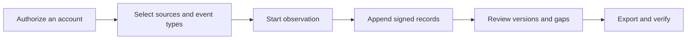

[English](../../README.md) · [Русский](../ru/README.md) · [Українська](../uk/README.md) · [Español](../es/README.md) · [Português (Brasil)](../pt/README.md) · [Türkçe](../tr/README.md) · [العربية](../ar/README.md) · [فارسی](../fa/README.md) · [اردو](../ur/README.md) · **हिन्दी** · [Bahasa Indonesia](../id/README.md) · [Tiếng Việt](../vi/README.md) · [简体中文](../zh/README.md)


<p align="center">
  <strong>आपका टेलीग्राम अवलोकन कार्यक्षेत्र।</strong><br>
  कैप्चर की गई बातचीत को सुरक्षित रखें, समझें कि क्या बदला, और एक हस्ताक्षरित इतिहास साझा करें।<br>
  अपने स्वयं के कंप्यूटर या सर्वर पर। अपने स्वयं के खातों के साथ।
</p>

<p align="center">
  
  
  
  
  
</p>

<p align="center">
  <a href="#तवरत-आरभ">त्वरित आरंभ</a> ·
  <a href="#वशषतए">विशेषताएँ</a> ·
  <a href="#एक-टलगरम-खत-कनकट-कर">खाते</a> ·
  <a href="#सकषय-और-सतयपन">साक्ष्य</a> ·
  <a href="#तनत">तैनाती</a> ·
  <a href="../README.md">दस्तावेज़ीकरण</a>
</p>

> [!TIP]
> **कनेक्ट करने से पहले अन्वेषण करें।** `scripts\Demo.cmd` या `sh start.sh --demo` चलाएँ और काल्पनिक वार्तालापों वाला एक वर्कस्पेस खोलें। टेलीग्राम खाते की आवश्यकता नहीं है।

**यहाँ नए हैं?** [शुरू करें →](QUICKSTART.md) · [विकी →](../wiki/Home.md) · [एक गाइड चुनें →](../README.md) · [सहायता प्राप्त करें →](../../.github/SUPPORT.md) · [देखें कि क्या परीक्षण किया गया है →](../VERIFICATION.md)

> [!WARNING]
> **एक समर्पित टेलीग्राम खाता उपयोग करें जिसे आप खोने का जोखिम उठा सकते हैं।** हम व्यक्तिगत या मूल्यवान खातों को जोड़ने या उन पर API ID/API हैश क्रेडेंशियल बनाने के खिलाफ दृढ़ता से सलाह देते हैं। टेलीग्राम खातों को प्रतिबंधित या स्थायी रूप से ब्लॉक कर सकता है। [खाता गाइड पढ़ें](../ACCOUNTS.md)।

## विशेषताएँ

- **इतिहास वाले संवाद।** सहेजे गए संदेश पढ़ें, कैप्चर किए गए संपादनों की तुलना करें, और संवाद के संदर्भ में हटाने की सूचनाएँ देखें।
- **आपकी शर्तों पर अवलोकन।** व्यक्तिगत चैट्स, टेलीग्राम फ़ोल्डर, या पूरे खाते का चयन करें। प्रत्येक खाते का अपना कार्यक्षेत्र और सेटिंग्स होती हैं।
- **आप जांच सकते हैं ऐसे एक्सपोर्ट:** एक हस्ताक्षरित ZIP, मूल रिकॉर्ड, संरक्षित संलग्नक, और एक ऑफ़लाइन HTML रिपोर्ट। हैंडऑफ़ के लिए वैकल्पिक पासवर्ड सुरक्षा।
- **दैनिक उपयोग के लिए बनाया गया।** हल्का और गहरा थीम, 13 भाषाएँ, खोज, Ctrl/Cmd+K नेविगेशन, और चैट्स से सीधे क्रियाएँ।
- **जब आपको आवश्यकता हो तब अतिरिक्त सुविधाएँ। तीन चरणों** में [तीन चरणों में टेलीग्राम विटनेस](../WITNESS.md), एक अलग [सार्वजनिक प्रमाण पृष्ठ](../PROOF.md) सार्वजनिक प्रमाण पृष्ठ, और स्पष्ट सेटअप मार्गदर्शिकाएँ। **सुविधाएँ** खोलें और चुनें; उन्नत सेटिंग्स छिपी रहती हैं।

<details>
<summary>सभी क्षमताएँ और तकनीकी विवरण</summary>

- **आपका कनेक्शन मार्ग।** **खाता → प्रॉक्सी सेटिंग्स** के अंतर्गत, बंडल की गई सार्वजनिक MTProxy सूचियों में से चुनें, उन्हें उनके स्रोतों से रिफ्रेश करें, या अपना स्वयं का टेलीग्राम प्रॉक्सी लिंक पेस्ट करें। मैनुअल SOCKS5/HTTP/MTProxy और एक ऑपरेटर कैटलॉग उपलब्ध रहते हैं। सार्वजनिक सूचियाँ डाउनलोड और फ़िल्टर की जाती हैं, लेकिन अभी तक किसी भी खाते को सूचीबद्ध सर्वर के माध्यम से कनेक्ट नहीं किया गया है। [सार्वजनिक सूचियाँ कैसे काम करती हैं](../CONNECTION-SECURITY.md#public-proxies-supplied-by-your-installation)।

- **एक जर्नल जो दिखाता है कि आपके खाते वास्तव में क्या देखते हैं।** नए संदेश, संपादन, हटाने की सूचनाएं, प्रतिक्रियाएं, सदस्यता घटनाएं और आपके द्वारा चुने गए समूहों और चैनलों में कवरेज में अंतराल।
- **चुनी गई चैट्स, एक टेलीग्राम फ़ोल्डर या पूरा खाता।** रिकॉर्ड करने के लिए प्रकार चुनें — चैनल, समूह, निजी चैट, बॉट्स — और नई चैटें जैसे ही दिखाई देती हैं, जुड़ जाती हैं। अपवाद, अपने आउटगोइंग संदेश और संपादन, निजी चैट में की गई डिलीट जो उनकी चैट से मेल खाती हैं, प्राथमिकता पुनः जाँच और प्रत्येक प्रकार ([संग्रह](../COLLECTION.md#observation-scope-chosen-chats-a-folder-or-the-whole-account)) के लिए अटैचमेंट सीमाएँ।
- **जांच मोड।** एक बटन एक समर्पित खाता तैयार करता है जो टीमों में शामिल होता है और बॉट्स से बात करता है: जो कुछ भी यह देखता और भेजता है, वह रिकॉर्ड हो जाता है, बॉट संदेशों (लिंक, वेब ऐप्स, कॉपी करने के लिए टेक्स्ट) के नीचे बटन रखे जाते हैं और केवल-बटन वाले संपादन नए संस्करण बन जाते हैं, और हर नई चैट या बॉट को अपना प्रोफ़ाइल (विवरण, कमांड, सदस्य) मिलता है और पहले दिखाई देने वाले संदेश तुरंत सहेजे जाते हैं ([जांच मोड](../COLLECTION.md#investigation-mode-joining-teams-and-talking-to-bots))। पैनल का **समर्पित खाता गाइड** (`/dedicated-account.html`) यह समझाता है कि मुख्य खाते का उपयोग क्यों नहीं किया जाना चाहिए, TgWitness सार्वजनिक ऐप हैश/ऐप आईडी जोड़ों के माध्यम से क्यों काम करता है और एक API जोड़ा अपने आप आपके खाते तक पहुंच क्यों नहीं देता (टेलीग्राम के दस्तावेज़ीकरण के लिंक के साथ), और एक अतिरिक्त खाता बनाने के तरीकों की सूची देता है।
- **चैट्स से सीधे कार्रवाई करें।** संदेश और प्रतिक्रियाएँ भेजें, बॉट कॉलबैक/टेक्स्ट बटन दबाएँ, या टेलीग्राम निमंत्रण का पूर्वावलोकन करके उसमें शामिल हों। चयनित खाता कार्रवाई करता है; अनुरोध, निमंत्रण पूर्वावलोकन और बॉट पॉपअप/यूआरएल प्रतिक्रियाएँ इसके हस्ताक्षरित जर्नल ([पैनल मिनी-क्लाइंट](../COLLECTION.md#act-from-the-panel)) में दर्ज होती हैं।
- **आप जो कवरेज बता सकते हैं।** रिपोर्ट्स और वेरिफायर कहते हैं "X से Y तक लगातार देखा गया", अंतरालों को उनके कारणों सहित सूचीबद्ध करें और उन संदेश आईडी को भी जिनका कभी अवलोकन नहीं हुआ — उन्हें कभी भी हटाया हुआ न दिखाएँ।
- **लोगों के प्रोफ़ाइल, प्रति चैट ऑप्ट-इन।** नाम और उपयोगकर्ता नाम का इतिहास, टेलीग्राम फ़्लैग, अवतार SHA-256 और pHash, गतिविधि, कौन किसको जवाब देता है और उल्लेखित वॉलेट, फोन, उपयोगकर्ता नाम और लिंक — केवल सहेजे गए रिकॉर्ड से निर्मित, प्रत्येक तथ्य अपने जर्नल रिकॉर्ड की ओर इंगित करता है, एक अलग हस्ताक्षरित फ़ाइल ([साक्ष्य मॉडल](../EVIDENCE.md#people-profiles)) के रूप में निर्यात किया गया।
- **स्वतंत्र गवाह।** एक अलग प्रक्रिया, जिसकी अपनी कुंजी और बॉट है, हस्ताक्षरित जर्नल हेड प्राप्त करती है, उसे एक टेलीग्राम चैनल पर पोस्ट करती है और जब कलेक्टर उत्तर नहीं देता तो रिपोर्ट करती है; वेरिफायर इसके खिलाफ एक्सपोर्ट्स की जांच करता है। अंतराल, टाइमआउट, कौन सी जांचें पोस्ट की जाएँ और पोस्ट की शब्दावली विकल्प या एक JSON कॉन्फ़िग फ़ाइल ([witness](../WITNESS.md)) में होती हैं। स्थानीय Bot API सर्वर पर परीक्षण किया गया, अभी तक वास्तविक बॉट और चैनल के साथ नहीं।
- **पैनल में संग्रह सेटिंग्स।** संग्रह, पुनः जाँच, डाउनलोड, लोगों की प्रोफाइल, सूचनाओं और निर्यात की सीमाएँ और गति **पैरामीटर** पृष्ठ पर उनकी सीमाओं और पूर्वनिर्धारित मानों के साथ होती हैं; हर परिवर्तन हस्ताक्षरित जर्नल ([सेटिंग्स और पैरामीटर](#सटगस-और-परमटर)) में दर्ज किया जाता है।
- **प्रसंग में संपादन और हटाने।** प्रत्येक संपादन एक अलग संस्करण के रूप में पिछले संस्करण के बगल में दिखाया जाता है; हटाने की सूचना कभी भी पहले से कैप्चर की गई सामग्री को मिटा नहीं सकती।
- **हस्ताक्षरित, सत्यापनीय निर्यातक।** प्रत्येक घटना SHA-256 हैश-चेन से जुड़ी होती है और Ed25519 से हस्ताक्षरित होती है। हस्ताक्षरित ZIP बंडल में JSONL, CSV, एक ऑफ़लाइन HTML रिपोर्ट, संरक्षित मीडिया और एक स्वतंत्र सत्यापक शामिल हैं।
- **पासवर्ड-संरक्षित एक्सपोर्ट।** वैकल्पिक रूप से किसी भी एक्सपोर्ट को WinZip AES-256 ZIP में रख सकते हैं, जो 7-Zip और WinRAR द्वारा पढ़ा जाने वाला प्रारूप है; अंदर की हस्ताक्षरित सामग्री अपरिवर्तित रहती है। एक परीक्षण आर्काइव को libarchive (Windows `tar`) में बाइट-दर-बाइट खोला गया और गलत पासवर्ड अस्वीकार कर दिया गया ([सबूत मॉडल](../EVIDENCE.md#investigation-handoff))।
- **सूचनाएँ।** समस्याएँ (डिस्क स्थान कम होना, साइन-आउट किया गया खाता, कलेक्टर, कॉपी या टाइमस्टैम्प त्रुटियाँ), देखी गई चैट्स में बदलाव और एक दैनिक सारांश, जो [Apprise](https://github.com/caronc/apprise) के माध्यम से Matrix, Telegram, Discord, Slack, ntfy, ईमेल और कई अन्य सेवाओं पर भेजा जाता है — संदेश पाठ के बिना जब तक आप अंश चालू न करें — और पैनल में सूचीबद्ध किया जाता है। डिलीवरी का परीक्षण एक स्थानीय एंडपॉइंट पर किया गया है; स्वयं सेवाओं का परीक्षण अभी तक नहीं किया गया है।
- **13 इंटरफ़ेस भाषाएँ।** अंग्रेज़ी, रूसी, यूक्रेनी, स्पेनिश, पुर्तगाली (ब्राज़ील), तुर्की, अरबी, फ़ारसी, उर्दू, हिंदी, इंडोनेशियाई, वियतनामी और सरलीकृत चीनी, DeepL द्वारा मशीन-अनुवादित। नए अनुभाग स्पष्ट रूप से सूचीबद्ध अंग्रेज़ी फ़ॉलबैक टेक्स्ट का उपयोग करते हैं; मिनी-क्लाइंट नियंत्रण अंग्रेज़ी में ही रहते हैं। टेलीग्राम सामग्री और जर्नल रिकॉर्ड हमेशा ठीक वैसे ही दिखाए जाते हैं जैसे सहेजे गए हैं।
- **हल्का और गहरा थीम।** डिफ़ॉल्ट रूप से सिस्टम सेटिंग का पालन करता है; प्रत्येक ब्राउज़र में यह पसंद याद रखी जाती है।
- **कीबोर्ड-अनुकूल नेविगेशन।** **Ctrl+K** (Mac: **⌘K**) दबाएँ या **'Go to…'** चुनें किसी अनुभाग को खोजने के लिए। उसे खोलने के लिए तीर कुंजियाँ और Enter का उपयोग करें; Escape मेनू बंद कर देता है।
- **कई खाते।** किसी भी संख्या में अलग-थलग वर्कस्पेस, प्रत्येक का अपना टेलीग्राम सत्र, जर्नल, साइनिंग कुंजी, प्रॉक्सी मार्ग और कैप्चर नीति।
- **लचीला साइन-इन।** फोन + कोड + 2FA, QR कोड, Telethon/Pyrogram `.session`, Telegram Desktop TData ZIP, Telethon StringSession, या एक पूर्ण Auth Key अपने DC ID के साथ।
- **प्रति-खाते प्रॉक्सी।** SOCKS5 और HTTP CONNECT, स्थानीय परीक्षण प्रॉक्सी पर परीक्षण किए गए, और प्रयोगात्मक MTProxy, जिसे अभी तक वास्तविक सर्वर पर परीक्षण नहीं किया गया है। एक असफल प्रॉक्सी कभी भी चुपचाप सीधे कनेक्शन पर वापस नहीं लौटती।
- **डिज़ाइन द्वारा निजी।** आपके कंप्यूटर या सर्वर पर चलता है। एकीकृत वेब UI, कोई Node.js नहीं, कोई होस्टेड सेवा नहीं, कोई टेलीमेट्री नहीं। सत्र, API क्रेडेंशियल और प्रॉक्सी सीक्रेट्स एक एन्क्रिप्टेड वॉल्ट में रहते हैं।
- **चलाने में आसान।** Windows पर डबल-क्लिक, Linux/macOS पर एक स्क्रिप्ट, या वैकल्पिक स्वचालित HTTPS के साथ Docker Compose। अब तक केवल Windows लॉन्चर ही चलाए गए हैं; देखें [कि क्या परीक्षण किया गया है](#कय-परकषण-कय-गय-ह)।

</details>

## त्वरित आरंभ

| प्लेटफ़ॉर्म | कैसे शुरू करें | आवश्यकताएँ |
| --- | --- | --- |
| **Windows, कुछ भी स्थापित नहीं है** | [रिलीज़](../../../../releases) से `TgWitness-<version>-windows-amd64-portable.zip` डाउनलोड करें, एक्सट्रेक्ट करें, फिर **`TgWitness.cmd`** पर डबल-क्लिक करें। | कुछ नहीं; पाइथन शामिल है |
| विंडोज, स्रोत से | **`Start.cmd`** पर डबल-क्लिक करें | पाइथन 3.11+; यदि अनुपस्थित हो तो आपके लिए प्रदान और स्थापित किया गया |
| लिनक्स / मैकओएस | `sh start.sh` | `venv` के साथ Python 3.11+; यदि आपके सिस्टम में यह मौजूद नहीं है तो स्क्रिप्ट आपके सिस्टम के लिए इंस्टॉल कमांड प्रिंट करती है |
| डॉकर, कोई भी ओएस | **`scripts\Docker.cmd`** पर डबल-क्लिक करें या `sh scripts/docker-start.sh` चलाएँ | Docker Engine/Desktop Compose 2.20+ के साथ |

1. **http://127.0.0.1:8787** खोलें।
2. पैनल एक्सेस टोकन पेस्ट करें:
   - पोर्टेबल या सोर्स इंस्टॉल: `data/live/panel-token.txt` की सामग्री
   - Docker: `scripts\Docker.cmd`/`scripts/docker-start.sh` द्वारा मुद्रित, या `docker compose exec tgwitness cat /data/panel-token.txt`
3. अपना टेलीग्राम खाता जोड़ें, अवलोकन के लिए चैट चुनें और **अवलोकन शुरू करें पर** क्लिक करें।

पहला स्रोत लॉन्च एक निजी `.venv` बनाता है और पिन की गई निर्भरताओं को स्थापित करता है (इंटरनेट एक्सेस आवश्यक)। Docker हेल्पर्स इमेज का निर्माण करते हैं, पैनल के स्वस्थ होने तक प्रतीक्षा करते हैं और उसका पता तथा टोकन प्रिंट करते हैं। `python start.py --check` (या पोर्टेबल पैकेज में `TgWitness-Check.cmd`) टेलीग्राम को छुए बिना एक तत्परता रिपोर्ट देता है।

> **सिर्फ देखना चाहते हैं?** **`scripts\Demo.cmd`** या `sh start.sh --demo` चलाएँ। एक काल्पनिक जर्नल सीधे ब्राउज़र में खुलता है; कोई टेलीग्राम खाता जुड़ा नहीं होता और डेटा अलग से `data/demo` में रहता है।

<details>
<summary><strong>कार्यक्षेत्र के अंदर: चैट, इतिहास, और एक्सपोर्ट</strong></summary>

<picture>
  <source media="(prefers-color-scheme: dark)" srcset="../assets/chats-dark.png">
  
</picture>

### निरीक्षण इतिहास


### हस्ताक्षरित निर्यातक


</details>


## एक टेलीग्राम खाता कनेक्ट करें

> [!CAUTION]
> केवल उन्हीं समर्पित खातों को कनेक्ट करें जिन्हें आप खोने का जोखिम उठा सकते हैं। टेलीग्राम खातों को स्थायी रूप से और अनपेक्षित रूप से प्रतिबंधित कर सकता है; इस पृष्ठ के शीर्ष पर दी गई चेतावनी देखें। पैनल की **समर्पित खाता गाइड** (साइडबार, या `/dedicated-account.html`) बताती है कि क्यों और कैसे एक खाता प्राप्त करें।

फ़ोन, QR कोड या मौजूदा सत्र से साइन इन करें — कोई API ID या हैश आवश्यक नहीं।

**इन-बिल्ट API पूल क्यों?** [my.telegram.org](https://my.telegram.org) पर अपना स्वयं का API ID बनाना खातों को प्रतिबंधित करवाने के लिए जाना जाता है, और Telegram स्पष्ट सीमाएँ प्रकाशित नहीं करता — कई शोधकर्ताओं ने इस तरह अपने मुख्य खाते खो दिए हैं। Telegram के अपने [Obtaining API ID](https://core.telegram.org/api/obtaining_api_id) पेज में कहा गया है कि अनौपचारिक API क्लाइंट का उपयोग करने वाले खातों को स्वचालित रूप से निगरानी में रखा जाता है और गलत तरीके से प्रतिबंधित किए गए उपयोगकर्ताओं को recover@telegram.org पर भेजा जाता है। इसलिए TgWitness अन्य ओपन-सोर्स क्लाइंट द्वारा पहले से उपयोग किए जा रहे सार्वजनिक API जोड़े प्रदान करता है, ताकि आपको कभी भी एक नया बनाना न पड़े। यदि आपके पास अपना API ID है, तो इसे **API ID + हैश** के अंतर्गत दर्ज करें और इसका उपयोग किया जाएगा।

जब कोई जोड़ी कार्यक्षेत्र में दर्ज, आयात या पहले से सहेजी नहीं गई होती है, तो TgWitness पूल में मौजूद 50 जोड़ों में से एक चुनता है और यदि टेलीग्राम किसी एक को अस्वीकार कर देता है तो अगली जोड़ी पर चला जाता है। जिस जोड़ी ने साइन इन किया, वह उसी खाते के साथ बनी रहती है। एक जोड़ी एप्लिकेशन की पहचान करती है; आप फिर भी अपने टेलीग्राम खाते को अलग से अधिकृत करते हैं। पैनल एक्सेस टोकन TgWitness खोलता है और यह टेलीग्राम लॉगिन से अलग है।

| आपके पास क्या है | इसे कैसे उपयोग करें |
| --- | --- |
| खाते तक पहुँच वाला फ़ोन नंबर | **फ़ोन** टैब: टेलीग्राम से कोड, फिर यदि सक्षम हो तो 2FA पासवर्ड |
| पहले से साइन-इन किया हुआ टेलीग्राम ऐप | **क्यूआर कोड** टैब: सेटिंग्स → डिवाइस → डेस्कटॉप डिवाइस लिंक |
| टेलीथॉन (स्कीमा 7/8) या पायरोग्राम (स्कीमा 2/3) `.session` | **फ़ाइलें** टैब |
| `name.session` + `name.json` जोड़ी | **फ़ाइल्स** टैब में दोनों चुनें; JSON API ID/हैश प्रदान करता है। |
| टेलीग्राम डेस्कटॉप `tdata` फ़ोल्डर | केवल ZIP `key_datas` और `D877F783D5D3EF8Cs`, फिर **Files**; यदि सेट किया गया हो तो स्थानीय पासकोड |
| Telethon StringSession, `.txt` या `.tgwitness-session` | **फ़ाइल्स** टैब या *पासकोड या सत्र टेक्स्ट* |
| सत्र या ऑथ कुंजी के साथ खाता JSON | **फ़ाइलें** टैब |
| पूर्ण ऑथ कुंजी (512 हेक्स वर्ण) + डीसी आईडी | **ऑथ कुंजी** टैब; वैकल्पिक यूज़र आईडी को टेलीग्राम के खिलाफ जांचा जाता है |

समर्थित नहीं: TDLib स्टोरेज, Pyrogram सत्र स्ट्रिंग्स, बॉट टोकन, मल्टी-खाता TData और थोक खाता सूचियाँ। फाइलें आपके सर्वर की मेमोरी में परिवर्तित की जाती हैं और सहेजने से पहले टेलीग्राम के साथ जाँची जाती हैं। [खाता गाइड](../ACCOUNTS.md) प्रत्येक प्रारूप को चरण-दर-चरण समझाती है: API क्रेडेंशियल कैसे प्राप्त करें, फ़ाइल को कैसे पहचानें, JSON फ़ील्ड्स, सीमाएँ और त्रुटि संदेश।

साइन-इन करने के बाद, **स्रोतों** (आपकी चैट्स स्वचालित रूप से लोड हो जाती हैं) खोलें, आवश्यक समूह जोड़ें, क्या कैप्चर करना है चुनें (उदाहरण के लिए *संदेश, संपादन और हटाने*) और अवलोकन शुरू करें। प्रक्रिया को चालू रखें: **अवलोकन को रोकने पर** संग्रहण रुक जाता है, **लॉक** केवल ब्राउज़र पहुँच बंद करता है।

## स्क्रीनशॉट

| तुलना संपादित करें | स्रोत और कैप्चर नीति |
| --- | --- |
|  |  |
| **हस्ताक्षरित निर्यातक** | **साइन-इन** |
|  |  |
| **जर्नल** | **डार्क थीम** |
|  |  |

सभी स्क्रीनशॉट में सिंथेटिक प्रदर्शन डेटा का उपयोग किया गया है। [qr-login.png](../assets/qr-login.png) में QR कोड परीक्षण परिवहन से एक काल्पनिक टोकन को एन्कोड करता है।


## यह कैसे काम करता है



प्रत्येक कार्यक्षेत्र एक टेलीग्राम खाते से संबंधित होता है। कलेक्टर उस खाते के क्लाइंट से अपडेट स्वीकार करता है, सहेजी गई कैप्चर नीति लागू करता है और केवल-संलग्न जर्नल में अवलोकन जोड़ता है।

| निरीक्षण | क्या संरक्षित है | सीमा |
| --- | --- | --- |
| नया संदेश | टेक्स्ट, प्रेषक आईडी, उत्तर संदर्भ, मेटाडेटा, अवलोकन समय | केवल चयनित स्रोतों के लिए अपडेट प्रदान किए जाते हैं |
| संपादन | एक अलग सामग्री संस्करण | ऑफ़लाइन होने के दौरान छूटे हुए मध्यवर्ती संस्करण पुनः प्राप्त नहीं किए जा सकते |
| मिटान | संदेश आईडी और पहले कैप्चर की गई सभी जानकारी | टेलीग्राम आमतौर पर यह नहीं बताता कि किसने और कब हटाया |
| प्रतिक्रियाएँ | प्रदान किए जाने पर गणनाएँ और हालिया पहचान | एक स्नैपशॉट, पूर्ण परिवर्तन लॉग नहीं |
| सदस्यता | सेवा संदेश और प्रतिभागी अपडेट | हर ज्वाइन/लीव के आने की गारंटी नहीं है |
| संलग्नक | वैकल्पिक सामग्री-पते वाली फ़ाइल SHA-256 के साथ | फ़ाइलें डाउनलोड से पहले गायब हो सकती हैं; परिणाम दर्ज किए जाते हैं |
| कवरेज | शुरुआत, रुकावट, डिस्कनेक्शन, हार्टबीट्स, नीति परिवर्तन | जीवंतता पूर्ण कैप्चर का प्रमाण नहीं है |
| इतिहास का स्नैपशॉट | नवीनतम दृश्य संदेश, **पैरामीटर** में बढ़ाए जाने तक अधिकतम 500, स्पष्ट रूप से लेबल किए गए | छूटी हुई संपादनों या हटाई गई सामग्री को पुनर्स्थापित नहीं किया जा सकता |

नीतियों, संलग्नक कतारों और पुनरारंभों के लिए [संग्रह कैसे काम करता है](../COLLECTION.md), पढ़ें।

## सेटिंग्स और पैरामीटर

पैनल में प्रत्येक कार्यक्षेत्र के लिए कोड या कॉन्फ़िगरेशन फ़ाइलों को संपादित किए बिना सभी परिवर्तन किए जाते हैं। दायरे, नीति या पैरामीटर में प्रत्येक परिवर्तन को हस्ताक्षरित जर्नल में पहले और बाद के मानों के साथ दर्ज किया जाता है, और प्रत्येक अवलोकन की शुरुआत में लागू मानों का नाम लिखा जाता है।

| जहाँ | आप जो सेट करते हैं |
| --- | --- |
| **स्रोत** | दायरा (चुनी हुई चैट्स, एक टेलीग्राम फ़ोल्डर, पूरा खाता), स्रोत प्रकार, अपवाद, अपनी क्रियाएँ, कौन से बदलाव रखे जाएँ, अटैचमेंट प्रकार और प्रति प्रकार आकार (1–2,000 MiB), प्राथमिकता और अन्य चैट्स के लिए पुनः जाँच अंतराल (किसी भी संख्या में मिनट, 0 = बंद), इतिहास स्नैपशॉट, सूचनाएं |
| **निर्यात** | पासवर्ड-संरक्षित डाउनलोड, साक्ष्य मोड (अंतराल, टाइमस्टैम्प प्राधिकरण और कैलेंडर), ऑफ-साइट S3 प्रति (अंतराल, ऑब्जेक्ट लॉक प्रतिधारण और मोड) |
| **गवाह** | केवल-पढ़ने योग्य विटनेस टोकन; विटनेस के अपने विकल्प तैयार-निर्मित कमांड्स के साथ दिखाए जाते हैं |
| **पैरामीटर** | चैट सूची का आकार और रिफ्रेश, हार्टबीट और चेकपॉइंट अंतराल, स्टार्टअप बफ़र, रीचेक अनुरोधों को कैसे फैलाता है (पहली देरी, प्रति पास चैट, विराम, पुनःप्राप्त और पुनः अनुरोधित संदेश), डिस्क आरक्षित, डाउनलोड टाइमआउट, गति और पुनः प्रयास, लोग प्रोफाइल में क्या देखते हैं, जिसमें आपके अपने नियमित अभिव्यक्तियाँ भी शामिल हैं, सूचना का आकार और गति, स्नैपशॉट, ZIP और ब्राउज़र-डाउनलोड सीमाएँ, पैनल एक्शन टाइमआउट, टेलीग्राम क्लाइंट टाइमआउट और पुनः प्रयास |

**पैरामीटरों** पर मान उनकी सीमा और डिफ़ॉल्ट दिखाते हैं; बदले गए मान चिह्नित किए गए हैं और इन्हें एक-एक करके या एक साथ पुनर्स्थापित किया जा सकता है। ये अगले उपयोग से लागू होते हैं; टेलीग्राम क्लाइंट टाइमआउट और पुनः प्रयास अगले कनेक्शन से। 4 GiB से ऊपर की ZIP सीमा के लिए आर्काइव सत्यापित होने पर `verify.py --max-gib N` की आवश्यकता होती है ([ऑपरेशन्स](../OPERATIONS.md#panel-layout))।


## साक्ष्य और सत्यापन

| निर्यात | विषय-सूची | अखंडता |
| --- | --- | --- |
| **हस्ताक्षरित ज़िप** | JSONL, CSV, HTML रिपोर्ट, कवरेज, मीडिया, मैनिफेस्ट, वेरिफायर | हस्ताक्षरित घटनाएँ और प्रत्येक फ़ाइल का हस्ताक्षरित मैनिफ़ेस्ट, जिसमें निर्माता का नाम दिया गया है। हैंडऑफ़ के लिए इसका उपयोग करें। |
| JSONL | हैश और हस्ताक्षर सहित मूल रिकॉर्ड | प्रति-घटना Ed25519 हस्ताक्षर और हैश चेन |
| CSV / HTML | स्प्रेडशीट-सुरक्षित तालिका / ऑफ़लाइन पठनीय रिपोर्ट | केवल हस्ताक्षरित ज़िप के अंदर शामिल |
| चेकपॉइंट JSON | जर्नल की लंबाई और हेड हैश | अलग से हस्ताक्षरित; इसे कलेक्टर के बाहर रखें |
| रसीद JSON | कोड हैश, निर्भरता संस्करण, दायरा, सेटिंग्स | अलग-अलग हस्ताक्षरित प्रक्रिया विवरण |
| लोगों के प्रोफ़ाइल JSON | एक चैट की प्रोफाइलें रिकॉर्ड संदर्भों के साथ | हस्ताक्षरित बयान; रिकॉर्ड हैश ZIP के साथ जाँचे गए हैं |
| विटनेस जर्नल ज़िप | विटनेस द्वारा प्राप्त हेड्स, अनुत्तरित उत्तर, चैनल पोस्ट्स | साक्षी की अपनी कुंजी से हस्ताक्षरित |

फ़िल्टर केवल ब्राउज़िंग को प्रभावित करते हैं; एक्सपोर्ट्स में हमेशा एक निश्चित अनुक्रम संख्या तक का पूरा जर्नल शामिल होता है। एक आर्काइव को वेरिफायर की विश्वसनीय प्रति और स्वतंत्र रूप से सुरक्षित की गई कुंजी फिंगरप्रिंट और चेकपॉइंट के साथ सत्यापित करें:

```sh
python -m pip install cryptography
python tgwitness/verify.py tgwitness-evidence.zip --fingerprint TRUSTED_PUBLIC_KEY_SHA256 --checkpoint tgwitness-checkpoint.json
# with an independent witness and its channel (Telegram Desktop export)
python tgwitness/verify.py tgwitness-evidence.zip --fingerprint TRUSTED_PUBLIC_KEY_SHA256 \
    --witness witness.zip --witness-fingerprint WITNESS_SHA256 --channel result.json
```

प्रमाणीकरणकर्ता हस्ताक्षरित उत्पादक, निरंतर अवलोकन अवधियाँ, अंतराल और कभी अवलोकन में न आए संदेश आईडी प्रिंट करता है, और यदि जर्नल गवाह द्वारा देखे गए किसी भी हेड से भिन्न हो तो विफल हो जाता है।

हस्ताक्षर एक विश्वसनीय साइनिंग कुंजी के संदर्भ में छेड़छाड़ के प्रमाण प्रदान करते हैं। वे टेलीग्राम उत्पत्ति, सत्य सामग्री या विश्वसनीय समय को साबित **नहीं** करते हैं, और वे उस ऑपरेटर से सुरक्षा नहीं करते जो कलेक्टर और उसकी कुंजी को नियंत्रित करता है। विश्वसनीय समय के लिए, प्रमाण मोड (डिफ़ॉल्ट रूप से बंद) चेकपॉइंट्स को RFC 3161 प्राधिकरणों और OpenTimestamps कैलेंडर के साथ टाइमस्टैम्प करता है, या पैनल एक ऑफ़लाइन RFC 3161 अनुरोध ([टाइमस्टैम्प प्रक्रिया](../TIMESTAMP.md)) तैयार करता है। दोनों का परीक्षण स्थानीय परीक्षण सर्वरों पर किया गया है, अभी तक सार्वजनिक सेवाओं पर नहीं। [सबूत मॉडल](../EVIDENCE.md) और [जांच हस्तांतरण](../EVIDENCE.md#investigation-handoff) चेकलिस्ट देखें।

## तैनाती

> [!NOTE]
> नीचे दिए गए Docker, Caddy (HTTPS), systemd और launchd सेटअप तैयार हैं और उनकी फाइलें सिंटैक्स जांच पास कर चुकी हैं, लेकिन इनमें से कोई भी अभी तक चलाया नहीं गया है। Windows पोर्टेबल पैकेज और Windows पर स्रोत लॉन्च किए जा चुके हैं।

**स्थानीय या एकल सर्वर Docker के साथ:**

```sh
docker compose up -d --build --wait
docker compose exec tgwitness cat /data/panel-token.txt
```

कंटेनर एक नॉन-रूट उपयोगकर्ता के रूप में केवल-पठन फ़ाइल सिस्टम के साथ चलता है, केवल `127.0.0.1:8787` पर प्रकाशित करता है और सभी डेटा को एक नामित वॉल्यूम में रखता है।

**स्वचालित HTTPS (Caddy) के साथ सार्वजनिक सर्वर:** `.env.example` को `.env` में कॉपी करें, `TGWITNESS_DOMAIN` सेट करें, DNS को सर्वर पर पॉइंट करें, TCP 80/443 खोलें और चलाएँ

```sh
docker compose -f compose.yaml -f deploy/compose/compose.https.yaml up -d --build --wait
```

**बिना कुछ इंस्टॉल किए Windows पर:** प्रत्येक रिलीज़ के साथ संलग्न पोर्टेबल ZIP में आधिकारिक एम्बेडेड Python रनटाइम और सभी निर्भरताएँ शामिल हैं। डेटा अपने '`data`' फ़ोल्डर में रहता है; अपडेट करने के लिए नया संस्करण निकालें और उस फ़ोल्डर को उसी स्थान पर कॉपी करें।

**Docker के बिना:** systemd, Windows लॉगऑन टास्क और launchd टेम्प्लेट्स [deploy/](../../deploy/README.md) में हैं। अपडेट्स, बैकअप्स, वैकल्पिक पोर्ट्स और GHCR इमेजेज़ (एक बार रिलीज़ वर्कफ़्लो उन्हें प्रकाशित कर दे) [डिप्लॉयमेंट](DEPLOYMENT.md) में शामिल हैं।

### कमांड लाइन

```text
python start.py [--demo] [--setup-only] [--check [--json]] [--host HOST] [--port PORT] [--data-dir DIR]
```

| कार्य | कमांड (परियोजना वातावरण से) |
| --- | --- |
| बिना शुरू किए तत्परता जाँच | `python start.py --check` |
| टेलीथॉन SQLite सत्र को ऑफ़लाइन में परिवर्तित करें | `python -m tgwitness.sessions account.session --out account.tgwitness-session` |
| डिस्क पर एक बड़े एक्सपोर्ट को स्ट्रीम करें | `python -m tgwitness.download --token-file data/live/panel-token.txt --out evidence.zip` |
| निर्यात किए गए आर्काइव की पुष्टि करें | `python tgwitness/verify.py tgwitness-evidence.zip --fingerprint SHA256` |
| 4 GiB से अधिक के आर्काइव का सत्यापन करें | `python tgwitness/verify.py big-evidence.zip --fingerprint SHA256 --max-gib 16` |
| कॉन्फ़िग फ़ाइल से एक स्वतंत्र विटनेस चलाएँ | `python -m tgwitness.witness run --config witness.json` |

सहायक `python -m tgwitness…` कमांड्स को `.venv` के अंदर चलाया जाना चाहिए (`.venv\Scripts\python.exe` विंडोज पर, `.venv/bin/python` अन्यत्र)।

| चर | उद्देश्य |
| --- | --- |
| `TGWITNESS_HOST`, `TGWITNESS_PORT` | सुनने का पता और पोर्ट (डिफ़ॉल्ट `127.0.0.1:8787`) |
| `TGWITNESS_DATA` | डेटा निर्देशिका (डिफ़ॉल्ट `data/live`) |
| `TGWITNESS_TOKEN` | उत्पन्न किए गए टोकन के बजाय स्थिर पैनल टोकन (कम से कम 24 वर्ण) |
| `TGWITNESS_VAULT_KEY_FILE` | नई इंस्टॉलेशन के लिए बाहरी वॉल्ट मास्टर कुंजी |
| `TGWITNESS_DOMAIN`, `TGWITNESS_IMAGE` | Docker HTTPS होस्टनेम और प्रकाशित इमेज (देखें `.env.example`) |
| `TGWITNESS_WITNESS_*` | स्वतंत्र गवाह: कलेक्टर, टोकन, चैनल, `_INTERVAL`, `_TIMEOUT`, `_POST` (सभी, परिवर्तन, समस्याएँ), `_TITLE`, `_CONFIG` ([गवाह](../WITNESS.md#options)) |


## जिम्मेदारी और डेटा संरक्षण (GDPR)

TgWitness एक उपकरण है। इसे जो भी चलाता है, वह तय करता है कि क्या एकत्र किया जाए, क्यों और कितने समय के लिए, और इसके लिए जिम्मेदार होता है — आमतौर पर EU/UK GDPR के तहत उस व्यक्तिगत डेटा के *नियंत्रक* के रूप में। टेलीग्राम संदेशों में उन लोगों का व्यक्तिगत डेटा होता है जिन्होंने कभी रिकॉर्ड किए जाने के लिए सहमति नहीं दी: नाम, उपयोगकर्ता नाम, आईडी, तस्वीरें, फोन नंबर, राय। यह अनुभाग कानूनी सलाह नहीं है; अपने लिए लागू होने वाले कानून और टेलीग्राम की शर्तों की जाँच करें।

- **एक वैध आधार और एक उद्देश्य रखें।** धोखाधड़ी की रोकथाम, नेटवर्क और सूचना सुरक्षा तथा कानूनी दावों की रक्षा को आमतौर पर वैध हितों के रूप में माना जाता है (GDPR अनुच्छेद 6(1)(f), पुनरावलोकन 47 और 49; कानूनी दावों के लिए अनुच्छेद 9(2)(f)). प्रत्येक मामले के लिए उद्देश्य लिखें। सार्वजनिक प्राधिकरण अपने स्वयं के कानूनी आधारों के तहत काम करते हैं।
- **उद्देश्य की आवश्यकतानुसार ही कम से कम डेटा एकत्र करें।** चुनी हुई चैट्स से शुरुआत करें। फ़ोल्डर और पूरे खाते के मोड निजी चैट्स और तीसरे पक्ष के संदेश रिकॉर्ड करते हैं: इन्हें केवल समर्पित खातों पर ही उपयोग करें; पैनल पुष्टि के लिए पूछता है और हस्ताक्षरित जर्नल इसे रिकॉर्ड करता है। उन इवेंट प्रकारों, अटैचमेंट प्रकारों और अपनी उन क्रियाओं को बंद कर दें जिनकी आपको आवश्यकता नहीं है, और चैट्स को बाहर रखें।
- **लोग प्रोफ़ाइल प्रोफाइलिंग हैं।** वे डिफ़ॉल्ट रूप से बंद होते हैं और प्रत्येक चैट के लिए चालू किए जाते हैं। उनका उपयोग किसी विशिष्ट जांच के लिए करें, लोगों के बारे में स्वचालित निर्णय उन पर आधारित न करें (अनुच्छेद 22), और काम पूरा होने पर उन्हें बंद कर दें या चैट हटा दें — इससे वे मिट जाते हैं। कई लोगों की व्यवस्थित निगरानी के लिए आमतौर पर डेटा सुरक्षा प्रभाव मूल्यांकन (धारा 35) की आवश्यकता होती है।
- **इसे सुरक्षित रखें।** सत्र, प्रमाण-पत्र और कुंजी एक एन्क्रिप्टेड वॉल्ट में होते हैं; डेटा निर्देशिका को एक एन्क्रिप्टेड डिस्क पर रखें, एक्सपोर्ट्स को पासवर्ड (AES-256 ZIP) दें, पैनल को HTTPS के पीछे रखें, और विटनेस को केवल इसका रीड-ओनली टोकन दें। नोटिफिकेशन्स में कोई संदेश टेक्स्ट नहीं होता जब तक आप अंश चालू न करें, जो टेक्स्ट को नोटिफिकेशन सेवा को भेजता है।
- **रखरखाव और मिटाना।** जर्नल केवल-संलग्न (append-only) है ताकि इसकी अखंडता साबित की जा सके; हस्ताक्षर श्रृंखला को तोड़े बिना एकल रिकॉर्ड हटाए नहीं जा सकते। प्रति कार्यक्षेत्र (workspace) के लिए रखरखाव की योजना बनाएँ और जब उद्देश्य समाप्त हो जाए तो पूरे कार्यक्षेत्र (खाते → हटाएँ) या इसकी डेटा निर्देशिका को हटा दें। S3 ऑब्जेक्ट लॉक के तहत ऑफ-साइट कॉपीज़ को उनकी प्रतिधारण तिथि से पहले हटाया नहीं जा सकता — तदनुसार अवधि चुनें। मिटाने के अधिकार में अपवाद हैं, उदाहरण के लिए कानूनी दावों की स्थापना या रक्षा के लिए (अनुच्छेद 17(3)(ई))।
- **लोगों द्वारा की गई अनुरोधों का रिकॉर्ड रखा गया है।** चैट एक्सपोर्ट और प्रोफ़ाइल फ़ाइलें यह पता लगाना संभव बनाती हैं कि किसी व्यक्ति के बारे में क्या रखा गया है (अनुच्छेद 15)।
- **लेखकों को कुछ भी नहीं भेजा जाता।** TgWitness में कोई टेलीमेट्री या होस्टेड सेवा नहीं है; डेटा केवल आपके द्वारा कॉन्फ़िगर किए गए मार्गों (Telegram, टाइमस्टैम्प सेवाएँ, S3 कॉपी, सूचनाएँ, विटनेस) के माध्यम से ही आपकी मशीन से बाहर जाता है।

## सुरक्षा और परियोजना की स्थिति

सार्वजनिक बहु-खाता संग्रह पायलट के लिए, [प्रूफ मॉनिटर](../PROOF.md) संदेश सामग्री के बिना हस्ताक्षरित कैप्चर काउंटर, स्वास्थ्य और जर्नल हैश दिखाता है। यह टेलीग्राम चैनल पर चेक्स प्रसारित कर सकता है; एक अलग कैनरी वेरिफायर खाता एक्सपोर्ट्स पर नियंत्रित भेजने/संपादित करने/मिटाने की क्रमिक प्रक्रिया की जांच करता है। इसे केवल सिंथेटिक वर्कस्पेस के साथ ही परीक्षण किया गया है।

- पैनल डिफ़ॉल्ट रूप से लोकलहोस्ट पर सुनता है। दूरस्थ पहुँच के लिए HTTPS Compose प्रोफ़ाइल या SSH टनल का उपयोग करें; कभी भी साधारण HTTP को उजागर न करें।
- Telegram सत्र, API क्रेडेंशियल, प्रॉक्सी क्रेडेंशियल और साइनिंग कुंजी एक Fernet-एन्क्रिप्टेड वॉल्ट में संग्रहीत हैं। डिफ़ॉल्ट रूप से इसकी कुंजी उसी डेटा निर्देशिका में रहती है; बाहरी मास्टर कुंजी के लिए `TGWITNESS_VAULT_KEY_FILE` सेट करें। स्थानीय संदेश सामग्री और मीडिया को TgWitness द्वारा एन्क्रिप्ट **नहीं** किया जाता है; डेटा निर्देशिका को एक एन्क्रिप्टेड डिस्क या वॉल्यूम पर रखें। हस्ताक्षरित ZIP एक्सपोर्ट्स वैकल्पिक रूप से पासवर्ड-एन्क्रिप्टेड हो सकते हैं।
- डेटा फ़ाइलें, सत्र, टोकन, कुंजी और एक्सपोर्ट्स git और Docker बिल्ड्स से बाहर रखे गए हैं।
- [SECURITY.md](../../.github/SECURITY.md) में वर्णित अनुसार कमजोरियों की निजी तौर पर रिपोर्ट करें।

### क्या परीक्षण किया गया है

TgWitness **0.6.1** विंडोज 11 पर पाइथन 3.12 के साथ चलता है। 29 अक्टूबर 2026 की स्थिति:

| क्षेत्र | इसे कैसे परीक्षण किया गया |
| --- | --- |
| संदेश, संपादन, हटाई गई प्रविष्टियाँ, संलग्नक, पुनरारंभ के बाद पुनः जाँच, FloodWait विराम | **एक वास्तविक टेलीग्राम खाते** से किया गया, 27–29 अक्टूबर 2026: 9,968 हस्ताक्षरित रिकॉर्ड, प्रत्येक हस्ताक्षर और हैश चेन सत्यापित ([लाइव टेस्ट](../VERIFICATION.md#live-telegram-test-whole-account--29-october-2026)) |
| पूरे खाते और इतिहास स्नैपशॉट्स का अवलोकन | 29 अक्टूबर 2026 को **एक वास्तविक खाते** पर किया गया: 2 समूहों या चैनलों से संदेश और 3 निजी चैट और बॉट्स |
| **चैट्स** से संदेश बटन दबाना | **एक वास्तविक खाते** से एक बार पूरा किया गया |
| Telethon/Pyrogram सत्र फ़ाइलों और Telegram Desktop TData के साथ साइन-इन करें | **एक असली खाते** से पूरा हो गया |
| फ़ोन, QR कोड और ऑथ की साइन-इन, नए चैट अपने पिछले संदेशों के साथ दायरे में शामिल हो रहे हैं, संदेश भेजना, निमंत्रण द्वारा जुड़ना, प्रतिक्रियाएँ, सदस्यता, लोगों के प्रोफ़ाइल, एक साथ कई खाते, एक्सपोर्ट और वेरिफ़ायर | कृत्रिम टेलीग्राम क्लाइंट्स के साथ स्वचालित परीक्षण |
| SOCKS5/HTTP प्रॉक्सी, विटनेस बॉट, प्रूफ मॉनिटर, सूचनाएं, S3 कॉपी, RFC 3161 और OpenTimestamps | स्थानीय परीक्षण सर्वरों के खिलाफ स्वचालित परीक्षण |
| सार्वजनिक MTProxy सूचियाँ | डाउनलोड और फ़िल्टर किया गया (29 अक्टूबर को 118 सर्वर); अभी तक इनके माध्यम से कोई कनेक्शन नहीं हुआ |
| MTProxy, Docker, Caddy के साथ HTTPS, Linux, macOS, Python 3.11 और 3.13, CI और रिलीज़ वर्कफ़्लो, लंबे समय तक रुकावटें, स्वतंत्र सुरक्षा समीक्षा | **अभी तक परीक्षण नहीं किया गया** |

विवरण: [सत्यापन रिकॉर्ड](../VERIFICATION.md), [रिलीज़ स्थिति](../internal/RELEASE.md) और [तत्परता](../internal/READINESS.md)।


## विकास

```sh
python -m venv .venv && source .venv/bin/activate     # Windows: .venv\Scripts\Activate.ps1
python -m pip install -c constraints.txt -e ".[dev]"
python -m pytest -q                                    # unit and integration tests
python -m playwright install chromium
python tools/check_browser.py                          # end-to-end UI acceptance
python tools/check_account_browser.py                  # sign-in flows
python tools/capture_screenshots.py --docs             # refresh README images
python tools/build_portable.py                         # Windows portable ZIP (Windows + Python 3.12)
python tools/build_source.py                          # source ZIP with SHA-256 manifest
python tools/build_site.py                             # static project site in dist/site
python tools/check_site.py                             # website browser acceptance
```

स्वचालित परीक्षण सुइट सिंथेटिक टेलीग्राम ऑब्जेक्ट्स का उपयोग करती है और कभी भी वास्तविक खातों से कनेक्ट नहीं होती; लाइव परीक्षण का वर्णन ऊपर किया गया है। CI को Windows, Linux और macOS पर Python 3.11–3.13 के साथ परीक्षण मैट्रिक्स चलाने के लिए कॉन्फ़िगर किया गया है, जिसमें ब्राउज़र चेक्स, स्रोत पैकेजिंग, Windows पोर्टेबल बिल्ड और एक Docker बिल्ड शामिल हैं। रिलीज़ वर्कफ़्लो को एक प्रकाशित GitHub रिलीज़ में सोर्स ZIP, व्हील, Windows पोर्टेबल ZIP और मल्टी-आर्किटेक्चर GHCR इमेज संलग्न करने के लिए सेट किया गया है। अभी तक कोई भी वर्कफ़्लो नहीं चला है। पुल रिक्वेस्ट खोलने से पहले [CONTRIBUTING.md](../../.github/CONTRIBUTING.md) पढ़ें।

## दस्तावेज़ीकरण

| मार्गदर्शिका | शामिल करता है |
| --- | --- |
| [त्वरित आरंभ](QUICKSTART.md) | पहला लॉन्च, खाता कनेक्शन और पहला एक्सपोर्ट |
| [खाते और सत्र प्रारूप](../ACCOUNTS.md) | साइन-इन इनपुट, रूपांतरण, कई खाते |
| [संग्रह कैसे काम करता है](../COLLECTION.md) | नीतिगत दस्तावेज़, संस्करण, संलग्नक, अंतराल |
| [कनेक्शन और सुरक्षा](../CONNECTION-SECURITY.md) | प्रॉक्सी, एन्क्रिप्शन और कुंजी |
| [संचालन](../OPERATIONS.md) | दैनिक कार्यप्रवाह, बैकअप, पुनर्स्थापना, क्षमता |
| [परिनियोजन](DEPLOYMENT.md) और [सेवा टेम्पलेट्स](../../deploy/README.md) | सर्वर, कंटेनर, HTTPS, अपडेट |
| [साक्ष्य मॉडल](../EVIDENCE.md) और [टाइमस्टैम्प](../TIMESTAMP.md) | अखंडता, कवरेज, लोगों के प्रोफ़ाइल, विश्वास और हस्तांतरण |
| [स्वतंत्र गवाह](../WITNESS.md) | केवल-पढ़ने योग्य विटनेस टोकन, डॉकर प्रोफ़ाइल, चैनल पोस्ट, क्रॉस-चेक |
| [वास्तुकला](../ARCHITECTURE.md) और [उत्पाद मॉडल](../PRODUCT.md) | आंतरिक संरचना और डिज़ाइन निर्णय |
| [सत्यापन](../VERIFICATION.md) और [तैयारी](../internal/READINESS.md) | निष्पादित जाँचें और शेष कार्य |
| [परिवर्तन-लॉग](../CHANGELOG.md) | रिलीज़ इतिहास |
| [वेबसाइट और प्रकाशन](../internal/PUBLISHING.md) | स्थानीय वेबसाइट पूर्वावलोकन, GitHub पेज, पहली प्रकाशन |


## लाइसेंस

[एमआईटी](../../LICENSE)

## इस फ़ोल्डर में मार्गदर्शिकाएँ

| फ़ाइल | विषय |
| --- | --- |
| [DEPLOYMENT.md](DEPLOYMENT.md) | तैनाती और संचालन |
| [QUICKSTART.md](QUICKSTART.md) | TgWitness त्वरित आरंभ |

[Licence and use restriction — Taylor Wessing exclusion](../TAYLOR-WESSING-EXCLUSION.md) · [Full licence](../../LICENSE)
