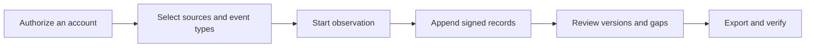

[English](../../README.md) · [Русский](../ru/README.md) · [Українська](../uk/README.md) · [Español](../es/README.md) · [Português (Brasil)](../pt/README.md) · [Türkçe](../tr/README.md) · [العربية](../ar/README.md) · [فارسی](../fa/README.md) · [اردو](../ur/README.md) · [हिन्दी](../hi/README.md) · **Bahasa Indonesia** · [Tiếng Việt](../vi/README.md) · [简体中文](../zh/README.md)


<p align="center">
  <strong>Ruang kerja pemantauan Telegram Anda.</strong><br>
  Simpan percakapan yang direkam, pahami perubahan yang terjadi, dan bagikan riwayat yang telah ditandatangani.<br>
  Di komputer atau server Anda sendiri. Dengan akun Anda sendiri.
</p>

<p align="center">
  
  
  
  
  
</p>

<p align="center">
  <a href="#panduan-cepat">Panduan cepat</a> ·
  <a href="#fitur">Fitur</a> ·
  <a href="#hubungkan-akun-telegram">Akun</a> ·
  <a href="#bukti-dan-verifikasi">Bukti</a> ·
  <a href="#penerapan">Penerapan</a> ·
  <a href="../README.md">Dokumentasi</a>
</p>

> [!TIP]
> **Jelajahi terlebih dahulu sebelum terhubung.** Jalankan `scripts\Demo.cmd` atau `sh start.sh --demo` untuk membuka ruang kerja dengan percakapan fiktif. Tidak perlu akun Telegram.

**Baru di sini?** [Mulai →](QUICKSTART.md) · [Wiki →](../wiki/Home.md) · [Pilih panduan →](../README.md) · [Dapatkan bantuan →](../../.github/SUPPORT.md) · [Lihat apa yang sudah diuji →](../VERIFICATION.md)

> [!WARNING]
> **Gunakan akun Telegram khusus yang tidak menjadi masalah jika hilang.** Kami sangat menyarankan agar Anda tidak menghubungkan akun pribadi atau akun yang berharga, atau membuat kredensial API ID / API hash di akun tersebut. Telegram dapat membatasi atau memblokir akun secara permanen. [Baca panduan akun](../ACCOUNTS.md).

## Fitur

- **Percakapan dengan riwayat.** Baca pesan yang disimpan, bandingkan perubahan yang terekam, dan lihat pemberitahuan penghapusan dalam konteks percakapan.
- **Pemantauan sesuai keinginan Anda.** Pilih obrolan individu, folder Telegram, atau seluruh akun. Setiap akun memiliki ruang kerja dan pengaturan tersendiri.
- **Ekspor yang dapat Anda verifikasi.** Berkas ZIP yang ditandatangani, catatan asli, lampiran yang disimpan, dan laporan HTML offline. Perlindungan kata sandi opsional untuk penyerahan.
- **Dibuat untuk penggunaan sehari-hari.** Tema terang dan gelap, 13 bahasa, fitur pencarian, navigasi dengan Ctrl/Cmd+K, dan tindakan langsung dari Obrolan.
- **Fitur tambahan saat Anda membutuhkannya.** [Saksi Telegram dalam tiga langkah](../WITNESS.md), [halaman Bukti publik](../PROOF.md) terpisah, dan panduan pengaturan yang jelas. Buka **Ekstra** untuk memilih; pengaturan lanjutan tetap tersembunyi.

<details>
<summary>Semua fitur dan detail teknis</summary></details>

- **Rute koneksi Anda.** Di bawah **Akun → Pengaturan proxy**, pilih dari daftar MTProxy publik yang disertakan, perbarui dari sumbernya, atau tempelkan tautan proxy Telegram Anda sendiri. SOCKS5/HTTP/MTProxy manual dan katalog operator tetap tersedia. Daftar publik telah diunduh dan disaring, tetapi belum ada akun yang terhubung melalui server yang terdaftar. [Cara kerja daftar publik](../CONNECTION-SECURITY.md#public-proxies-supplied-by-your-installation).

- **Jurnal yang mencatat apa yang sebenarnya terlihat di akun Anda.** Pesan baru, pengeditan, pemberitahuan penghapusan, reaksi, peristiwa keanggotaan, dan celah cakupan dari grup dan saluran yang Anda pilih.
- **Obrolan yang dipilih, folder Telegram, atau seluruh akun.** Pilih jenis yang akan direkam — saluran, grup, obrolan pribadi, bot — dan obrolan baru akan ditambahkan begitu muncul. Pengecualian, pesan keluar dan pengeditan sendiri, penghapusan dalam obrolan pribadi yang disesuaikan dengan obrolannya, pemeriksaan ulang prioritas, dan batas lampiran per jenis ([koleksi](../COLLECTION.md#observation-scope-chosen-chats-a-folder-or-the-whole-account)).
- **Mode investigasi.** Satu tombol menyiapkan akun khusus yang bergabung dengan tim dan berkomunikasi dengan bot: segala sesuatu yang dilihat dan dikirimnya terekam, tombol di bawah pesan bot (tautan, aplikasi web, teks untuk disalin) disimpan, dan pengeditan yang hanya menggunakan tombol menjadi versi baru, serta setiap obrolan atau bot baru mendapatkan profilnya (deskripsi, perintah, anggota) dan pesan-pesan yang sebelumnya terlihat disimpan sekaligus ([mode investigasi](../COLLECTION.md#investigation-mode-joining-teams-and-talking-to-bots)). **Panduan Akun Khusus** di panel (`/dedicated-account.html`) menjelaskan mengapa akun utama tidak boleh digunakan, mengapa TgWitness beroperasi melalui pasangan hash aplikasi/ID aplikasi publik, dan mengapa pasangan API itu sendiri tidak memberikan akses ke akun Anda (dengan tautan ke dokumentasi Telegram), serta mencantumkan cara-cara untuk membuat akun tambahan.
- **Lakukan tindakan langsung dari Obrolan.** Kirim pesan dan balasan, tekan tombol panggilan balik/pesan bot, atau lihat pratinjau undangan Telegram dan bergabunglah. Akun yang dipilih akan melakukan tindakan tersebut; permintaan, pratinjau undangan, serta respons popup/URL bot akan masuk ke jurnal yang ditandatangani ([panel mini-klien](../COLLECTION.md#act-from-the-panel)).
- **Cakupan yang dapat Anda nyatakan.** Laporan dan verifikator menyatakan "teramati secara terus-menerus dari X hingga Y", mencantumkan celah beserta alasannya, serta ID pesan yang tidak pernah teramati — tanpa pernah menyajikannya sebagai pesan yang dihapus.
- **Profil pengguna, dengan opsi berlangganan per obrolan.** Riwayat nama dan nama pengguna, bendera Telegram, SHA-256 dan pHash avatar, aktivitas, siapa yang membalas siapa serta dompet, nomor telepon, nama pengguna, dan tautan yang disebutkan — dibuat hanya dari catatan yang disimpan, setiap fakta mengarah ke catatan jurnalnya, diekspor sebagai berkas terpisah yang ditandatangani ([model bukti](../EVIDENCE.md#people-profiles)).
- **Saksi independen.** Sebuah proses terpisah dengan kunci dan botnya sendiri mengambil bagian awal jurnal yang telah ditandatangani, mempostingnya ke saluran Telegram, dan melaporkan jika pengumpul tidak merespons; verifikator memeriksa ekspor berdasarkan data tersebut. Interval, batas waktu, jenis pemeriksaan yang diposting, serta teks postingan dapat diatur melalui opsi atau berkas konfigurasi JSON ([witness](../WITNESS.md)). Telah diuji terhadap server Bot API lokal, belum dengan bot dan saluran yang sebenarnya.
- **Pengaturan pengumpulan data di panel.** Batas dan kecepatan pengumpulan, pemeriksaan ulang, unduhan, profil pengguna, pemberitahuan, dan ekspor terdapat di halaman **Parameter** beserta rentang dan nilai defaultnya; setiap perubahan dicatat dalam jurnal yang ditandatangani ([pengaturan dan parameter](#pengaturan-dan-parameter)).
- **Pengeditan dan penghapusan dalam konteks.** Setiap pengeditan ditampilkan sebagai versi terpisah di samping versi sebelumnya; pemberitahuan penghapusan tidak pernah menghapus konten yang telah terekam.
- **Ekspor yang ditandatangani dan dapat diverifikasi.** Setiap peristiwa dirantai dengan hash (SHA-256) dan ditandatangani (Ed25519). Paket ZIP yang ditandatangani berisi JSONL, CSV, laporan HTML offline, media yang disimpan, dan verifikator mandiri.
- **Ekspor yang dilindungi kata sandi.** Secara opsional, simpan ekspor apa pun ke dalam ZIP WinZip AES-256, format yang dapat dibaca oleh 7-Zip dan WinRAR; isi yang telah ditandatangani di dalamnya tetap tidak berubah. Arsip uji coba dibuka byte demi byte di libarchive (Windows `tar`) dan kata sandi yang salah ditolak ([model bukti](../EVIDENCE.md#investigation-handoff)).
- **Pemberitahuan.** Masalah (ruang disk rendah, akun yang sudah logout, kesalahan kolektor, penyalinan, atau cap waktu), perubahan dalam obrolan yang diamati, dan ringkasan harian, dikirim melalui [Apprise](https://github.com/caronc/apprise) ke Matrix, Telegram, Discord, Slack, ntfy, email, dan banyak layanan lainnya — tanpa teks pesan kecuali jika Anda mengaktifkan cuplikan — dan tercantum di panel. Pengiriman telah diuji terhadap titik akhir lokal; layanan-layanan tersebut sendiri belum diuji.
- **13 bahasa antarmuka.** Bahasa Inggris, Rusia, Ukraina, Spanyol, Portugis (Brasil), Turki, Arab, Persia, Urdu, Hindi, Indonesia, Vietnam, dan Mandarin Sederhana, diterjemahkan secara otomatis menggunakan DeepL. Bagian-bagian yang lebih baru menggunakan teks cadangan dalam bahasa Inggris yang telah dikatalogkan secara eksplisit; kontrol klien mini tetap dalam bahasa Inggris. Konten Telegram dan catatan jurnal selalu ditampilkan persis seperti yang disimpan.
- **Tema terang dan gelap.** Secara default mengikuti pengaturan sistem; pilihan ini disimpan per browser.
- **Navigasi yang ramah keyboard.** Tekan **Ctrl+K** (Mac: **⌘K**) atau pilih **"Go to…"** untuk menemukan bagian tertentu. Gunakan tombol panah dan Enter untuk membukanya; tekan Escape untuk menutup menu.
- **Akun ganda.** Jumlah ruang kerja terisolasi yang tidak terbatas, masing-masing dengan sesi Telegram, jurnal, kunci penandatanganan, rute proxy, dan kebijakan penangkapan data tersendiri.
- **Metode masuk yang fleksibel.** Nomor telepon + kode + 2FA, kode QR, Telethon/Pyrogram `.session`, Telegram Desktop TData ZIP, Telethon StringSession, atau Kunci Otentikasi lengkap beserta ID DC-nya.
- **Proksi per akun.** SOCKS5 dan HTTP CONNECT, telah diuji dengan proksi uji lokal, serta MTProxy yang masih dalam tahap percobaan dan belum diuji dengan server sungguhan. Proksi yang gagal tidak akan secara diam-diam beralih ke koneksi langsung.
- **Dirancang untuk privasi.** Berjalan di komputer atau server Anda. Dilengkapi antarmuka web bawaan, tanpa Node.js, tanpa layanan terhosting, dan tanpa telemetri. Sesi, kredensial API, dan rahasia proxy disimpan dalam brankas terenkripsi.
- **Mudah dijalankan.** Klik dua kali di Windows, satu skrip di Linux/macOS, atau Docker Compose dengan HTTPS otomatis opsional. Sejauh ini, hanya peluncur Windows yang telah dijalankan; lihat [apa saja yang telah diuji](#apa-yang-telah-diuji).

</details>

## Panduan cepat

| Platform | Cara memulai | Persyaratan |
| --- | --- | --- |
| **Windows, belum ada yang terinstal** | Unduh `TgWitness-<version>-windows-amd64-portable.zip` dari [bagian Rilis](../../../../releases), ekstrak, lalu klik dua kali **`TgWitness.cmd`** | Tidak ada; Python sudah disertakan |
| Windows, dari sumber kode | Klik dua kali **`Start.cmd`** | Python 3.11+; disediakan dan diinstal untuk Anda jika belum terpasang |
| Linux / macOS | `sh start.sh` | Python 3.11+ dengan `venv`; skrip ini akan menampilkan perintah instalasi untuk sistem Anda jika belum terpasang |
| Docker, semua sistem operasi | Klik dua kali **`scripts\Docker.cmd`** atau jalankan `sh scripts/docker-start.sh` | Docker Engine/Desktop dengan Compose 2.20+ |

1. Buka **http://127.0.0.1:8787**.
2. Tempelkan token akses panel:
   - instalasi portabel atau dari sumber: isi dari `data/live/panel-token.txt`
   - Docker: dicetak oleh `scripts\Docker.cmd`/`scripts/docker-start.sh`, atau `docker compose exec tgwitness cat /data/panel-token.txt`
3. Tambahkan akun Telegram Anda, pilih obrolan yang akan dipantau, lalu tekan **Mulai pemantauan**.

Peluncuran sumber pertama akan membuat instance pribadi `.venv` dan menginstal dependensi yang terpasang (diperlukan akses internet). Program bantu Docker akan membangun gambar, menunggu hingga panel dalam kondisi sehat, dan menampilkan alamat serta tokennya. `python start.py --check` (atau `TgWitness-Check.cmd` dalam paket portabel) memberikan laporan kesiapan tanpa perlu membuka Telegram.

> **Hanya ingin melihat-lihat?** Jalankan **`scripts\Demo.cmd`** atau `sh start.sh --demo`. Jurnal fiktif akan terbuka langsung di browser; tidak ada akun Telegram yang terhubung dan datanya disimpan secara terpisah di `data/demo`.

<details>
<summary><strong>Di dalam ruang kerja: obrolan, riwayat, dan ekspor</strong></summary></details>

<picture>
  <source media="(prefers-color-scheme: dark)" srcset="../assets/chats-dark.png">
  
</picture>

### Riwayat pengamatan


### Ekspor yang ditandatangani


</details>


## Hubungkan akun Telegram

> [!CAUTION]
> Hanya hubungkan akun khusus yang tidak menjadi masalah jika hilang. Telegram dapat memblokir akun secara permanen dan tanpa pemberitahuan sebelumnya; lihat peringatan di bagian atas halaman ini. **Panduan akun khusus** di panel (di bilah samping, atau `/dedicated-account.html`) menjelaskan alasan dan cara mendapatkannya.

Masuk menggunakan nomor telepon, kode QR, atau sesi yang sudah ada — tidak memerlukan ID API atau hash.

**Mengapa perlu pool API bawaan?** Membuat ID API sendiri di [my.telegram.org](https://my.telegram.org) diketahui dapat menyebabkan akun diblokir, dan Telegram tidak mempublikasikan batasan yang jelas — banyak peneliti telah kehilangan akun utama mereka karena hal ini. Halaman ["Mendapatkan ID API"](https://core.telegram.org/api/obtaining_api_id) milik Telegram sendiri menyatakan bahwa akun yang menggunakan klien API tidak resmi secara otomatis akan diawasi dan pengguna yang diblokir secara keliru akan diarahkan ke recover@telegram.org. Oleh karena itu, TgWitness menyediakan pasangan API publik yang sudah digunakan oleh klien open-source lainnya, sehingga Anda tidak perlu membuatnya sendiri. Jika Anda memiliki ID API sendiri, masukkan di kolom "**API ID + Hash"** dan ID tersebut akan digunakan sebagai gantinya.

Jika tidak ada pasangan yang dimasukkan, diimpor, atau sudah disimpan di ruang kerja, TgWitness akan memilih salah satu dari 50 pasangan yang ada di kumpulan dan beralih ke pasangan berikutnya jika Telegram menolak salah satunya. Pasangan yang telah masuk akan tetap terikat dengan akun tersebut. Pasangan tersebut mengidentifikasi aplikasi; Anda tetap harus mengotorisasi akun Telegram Anda secara terpisah. Token akses panel membuka TgWitness dan terpisah dari proses login Telegram.

| Apa yang Anda miliki | Cara menggunakannya |
| --- | --- |
| Nomor telepon yang memiliki akses ke akun tersebut | Tab **Telepon**: kode dari Telegram, lalu kata sandi 2FA jika diaktifkan |
| Aplikasi Telegram yang sudah masuk | Tab **kode QR**: Pengaturan → Perangkat → Hubungkan Perangkat Desktop |
| Telethon (skema 7/8) atau Pyrogram (skema 2/3) `.session` | Tab **File** |
| Pasangan `name.session` + `name.json` | Tab **"Files**", pilih keduanya; berkas JSON menyediakan ID API/hash |
| Folder Telegram Desktop `tdata` | Hanya ZIP `key_datas` dan `D877F783D5D3EF8Cs`, lalu **File**; kode sandi lokal jika telah ditetapkan |
| Telethon StringSession, `.txt` atau `.tgwitness-session` | Tab **File** atau *Kode Akses atau teks sesi* |
| File JSON akun dengan sesi atau Kunci Otentikasi | Tab **File** |
| Kunci Otorisasi Penuh (512 karakter heksadesimal) + ID DC | Tab **kunci otentikasi**; ID Pengguna (opsional) diverifikasi dengan Telegram |

Tidak didukung: penyimpanan TDLib, string sesi Pyrogram, token bot, TData multi-akun, dan daftar akun massal. Berkas dikonversi di memori server Anda dan diverifikasi dengan Telegram sebelum disimpan. [Panduan akun](../ACCOUNTS.md) menjelaskan setiap format langkah demi langkah: cara mendapatkan kredensial API, cara mengenali berkas, bidang JSON, batasan, dan pesan kesalahan.

Setelah masuk, buka **Sources** (obrolan Anda akan dimuat secara otomatis), tambahkan grup yang Anda butuhkan, pilih apa yang ingin Anda rekam (misalnya *Pesan, pengeditan, & penghapusan*), lalu mulailah pemantauan. Pastikan proses tetap berjalan: **Menjeda pemantauan** akan menghentikan pengumpulan data, sedangkan **Mengunci** hanya akan menutup akses browser.

## Tangkapan layar

| Perbandingan suntingan | Sumber dan kebijakan pengambilan data |
| --- | --- |
|  |  |
| **Ekspor yang ditandatangani** | **Masuk** |
|  |  |
| **Jurnal** | **Tema gelap** |
|  |  |

Semua tangkapan layar menggunakan data demonstrasi sintetis. Kode QR dalam [berkas qr-login.png](../assets/qr-login.png) berisi token fiktif dari transportasi uji coba.


## Cara kerjanya



Setiap ruang kerja terikat pada satu akun Telegram. Pengumpul menerima pembaruan dari klien akun tersebut, menerapkan kebijakan penangkapan yang disimpan, dan menambahkan pengamatan ke jurnal yang hanya dapat ditambahkan.

| Pengamatan | Apa yang disimpan | Batas |
| --- | --- | --- |
| Pesan baru | Teks, ID pengirim, referensi balasan, metadata, waktu pengamatan | Hanya pembaruan yang dikirimkan untuk sumber-sumber terpilih |
| Edit | Versi konten terpisah | Versi-versi antara yang terlewat saat offline tidak dapat dipulihkan |
| Penghapusan | ID pesan beserta semua data yang telah direkam sebelumnya | Telegram biasanya tidak mencantumkan siapa yang menghapus dan kapan |
| Tanggapan | Jumlah dan identitas terbaru jika disediakan | Cuplikan, bukan catatan perubahan lengkap |
| Keanggotaan | Pesan layanan dan pembaruan bagi peserta | Tidak setiap aksi bergabung/keluar dijamin akan terkirim |
| Lampiran | Berkas opsional yang dialamatkan berdasarkan konten dengan SHA-256 | Berkas dapat hilang sebelum diunduh; hasilnya dicatat |
| Cakupan | Mulai, berhenti, putus koneksi, sinyal detak jantung, perubahan kebijakan | Keaktifan bukanlah bukti penangkapan yang lengkap |
| Cuplikan riwayat | Pesan terbaru yang terlihat, hingga 500 kecuali jika ditingkatkan dalam **Parameter**, diberi label secara eksplisit | Tidak dapat memulihkan suntingan atau penghapusan yang terlewat |

Baca [cara kerja pengumpulan data](../COLLECTION.md) terkait kebijakan, antrian lampiran, dan proses restart.

## Pengaturan dan parameter

Semua perubahan dilakukan melalui panel, per ruang kerja, tanpa perlu mengedit kode atau berkas konfigurasi. Setiap perubahan cakupan, kebijakan, atau parameter dicatat dalam jurnal yang ditandatangani beserta nilai sebelum dan sesudahnya, dan setiap awal pengamatan mencantumkan nilai-nilai yang berlaku saat itu.

| Di mana | Apa yang Anda atur |
| --- | --- |
| **Sumber** | Cakupan (obrolan yang dipilih, folder Telegram, seluruh akun), jenis sumber, pengecualian, tindakan sendiri, perubahan mana yang akan disimpan, jenis lampiran dan ukuran per jenis (1–2.000 MiB), interval pemeriksaan ulang untuk obrolan prioritas dan obrolan lainnya (berapa menit saja, 0 = nonaktif), cuplikan riwayat, pemberitahuan |
| **Ekspor** | Unduhan yang dilindungi kata sandi, mode bukti (interval, otoritas cap waktu, dan kalender), salinan S3 di luar lokasi (interval, retensi Object Lock, dan mode) |
| **Witness** | Token saksi yang hanya dapat dibaca; opsi yang dimiliki saksi ditampilkan dengan perintah siap pakai |
| **Parameter** | Ukuran daftar obrolan dan penyegaran, interval heartbeat dan checkpoint, buffer saat startup, cara pemeriksaan ulang mendistribusikan permintaan (penundaan awal, jumlah obrolan per putaran, jeda, pesan yang dipulihkan dan diminta ulang), cadangan ruang disk, batas waktu unduhan, kecepatan dan upaya ulang, kriteria yang dicari oleh profil pengguna, termasuk ekspresi reguler Anda sendiri, ukuran dan frekuensi notifikasi, snapshot, batas ZIP dan unduhan browser, batas waktu tindakan panel, batas waktu klien Telegram, dan upaya ulang |

Nilai pada **Parameter** menunjukkan rentang dan nilai defaultnya; nilai yang diubah ditandai dan dapat dikembalikan satu per satu atau sekaligus. Perubahan tersebut berlaku mulai penggunaan berikutnya; batas waktu dan upaya ulang klien Telegram berlaku mulai koneksi berikutnya. Batas ukuran ZIP di atas 4 GiB memerlukan `verify.py --max-gib N` saat arsip diverifikasi ([operasi](../OPERATIONS.md#panel-layout)).


## Bukti dan verifikasi

| Ekspor | Daftar Isi | Integritas |
| --- | --- | --- |
| **ZIP yang telah ditandatangani** | Laporan JSONL, CSV, HTML, cakupan, media, manifes, verifikator | Peristiwa yang ditandatangani ditambah manifes yang ditandatangani dari setiap berkas, yang mencantumkan nama pembuatnya. Gunakan ini untuk serah terima. |
| JSONL | Catatan asli dengan hash dan tanda tangan | Tanda tangan Ed25519 per peristiwa dan rantai hash |
| CSV / HTML | Tabel yang aman untuk spreadsheet / laporan yang dapat dibaca secara offline | Hanya tersedia di dalam file ZIP yang telah ditandatangani |
| JSON Checkpoint | Panjang jurnal dan hash header | Ditandatangani secara terpisah; simpan di luar kolektor |
| JSON tanda terima eksekusi | Hash kode, versi dependensi, cakupan, pengaturan | Pernyataan proses yang ditandatangani secara terpisah |
| Profil pengguna dalam format JSON | Profil satu obrolan dengan referensi catatan | Pernyataan yang ditandatangani; hash rekaman telah diverifikasi dengan berkas ZIP |
| Jurnal Witness dalam format ZIP | Daftar saksi yang diambil, jawaban yang terlewat, dan postingan saluran | Ditandatangani dengan kunci milik saksi itu sendiri |

Filter hanya memengaruhi penelusuran; ekspor selalu berisi jurnal lengkap hingga nomor urut tertentu. Verifikasi arsip dengan salinan verifier yang tepercaya serta sidik jari kunci dan titik pemeriksaan yang disimpan secara independen:

```sh
python -m pip install cryptography
python tgwitness/verify.py tgwitness-evidence.zip --fingerprint TRUSTED_PUBLIC_KEY_SHA256 --checkpoint tgwitness-checkpoint.json
# with an independent witness and its channel (Telegram Desktop export)
python tgwitness/verify.py tgwitness-evidence.zip --fingerprint TRUSTED_PUBLIC_KEY_SHA256 \
    --witness witness.zip --witness-fingerprint WITNESS_SHA256 --channel result.json
```

Verifikator mencetak produsen yang ditandatangani, periode pengamatan berkelanjutan, celah, dan ID pesan yang tidak pernah teramati, serta akan gagal jika jurnal tersebut berbeda dari salah satu head yang dilihat oleh saksi.

Tanda tangan memberikan bukti integritas terkait dengan kunci penandatanganan tepercaya. Tanda tangan tersebut **tidak** membuktikan asal Telegram, kebenaran konten, atau waktu yang tepercaya, dan tidak melindungi dari operator yang mengendalikan pengumpul data dan kuncinya. Untuk waktu tepercaya, mode bukti (dinonaktifkan secara default) menandai titik pemeriksaan dengan otoritas RFC 3161 dan kalender OpenTimestamps, atau panel menyiapkan permintaan RFC 3161 offline ([prosedur penandaan waktu](../TIMESTAMP.md)). Keduanya diuji terhadap server uji lokal, belum terhadap layanan publik. Lihat [model bukti](../EVIDENCE.md) dan daftar periksa [serah terima investigasi](../EVIDENCE.md#investigation-handoff).

## Penerapan

> [!NOTE]
> Pengaturan Docker, Caddy (HTTPS), systemd, dan launchd di bawah ini telah disiapkan dan berkas-berkasnya telah lulus pemeriksaan sintaksis, tetapi belum ada yang dijalankan. Paket portabel Windows dan peluncuran dari sumber kode di Windows telah dijalankan.

**Server lokal atau tunggal dengan Docker:**

```sh
docker compose up -d --build --wait
docker compose exec tgwitness cat /data/panel-token.txt
```

Kontainer ini berjalan sebagai pengguna non-root dengan sistem berkas read-only, hanya mempublikasikan ke `127.0.0.1:8787`, dan menyimpan semua data dalam volume bernama.

**Server publik dengan HTTPS otomatis (Caddy):** salin `.env.example` ke `.env`, atur `TGWITNESS_DOMAIN`, arahkan DNS ke server, buka port TCP 80/443, dan jalankan

```sh
docker compose -f compose.yaml -f deploy/compose/compose.https.yaml up -d --build --wait
```

**Windows tanpa perlu menginstal apa pun:** berkas ZIP portabel yang disertakan dalam setiap rilis berisi runtime Python resmi yang tertanam serta semua dependensi. Data tetap berada di foldernya `data`; untuk memperbarui, ekstrak versi baru dan salin folder tersebut ke lokasi yang sama.

**Tanpa Docker:** templat systemd, tugas masuk Windows, dan launchd terdapat di [folder deploy/.](../../deploy/README.md) Pembaruan, pencadangan, port alternatif, dan gambar GHCR (setelah alur kerja rilis menerbitkannya) dibahas dalam [bagian penerapan](DEPLOYMENT.md).

### Baris perintah

```text
python start.py [--demo] [--setup-only] [--check [--json]] [--host HOST] [--port PORT] [--data-dir DIR]
```

| Tugas | Perintah (dari lingkungan proyek) |
| --- | --- |
| Pemeriksaan kesiapan tanpa memulai | `python start.py --check` |
| Mengonversi sesi SQLite Telethon secara offline | `python -m tgwitness.sessions account.session --out account.tgwitness-session` |
| Mengalirkan ekspor berukuran besar ke disk | `python -m tgwitness.download --token-file data/live/panel-token.txt --out evidence.zip` |
| Memverifikasi arsip yang diekspor | `python tgwitness/verify.py tgwitness-evidence.zip --fingerprint SHA256` |
| Memverifikasi arsip berukuran lebih dari 4 GiB | `python tgwitness/verify.py big-evidence.zip --fingerprint SHA256 --max-gib 16` |
| Jalankan saksi independen dari berkas konfigurasi | `python -m tgwitness.witness run --config witness.json` |

Perintah tambahan `python -m tgwitness…` harus dijalankan di dalam `.venv` (`.venv\Scripts\python.exe` pada Windows, `.venv/bin/python` di sistem operasi lain).

| Variabel | Tujuan |
| --- | --- |
| `TGWITNESS_HOST`, `TGWITNESS_PORT` | Alamat dan port pendengar (`127.0.0.1:8787` secara default) |
| `TGWITNESS_DATA` | Direktori data (`data/live` secara default) |
| `TGWITNESS_TOKEN` | Token panel tetap, bukan yang dihasilkan secara otomatis (minimal 24 karakter) |
| `TGWITNESS_VAULT_KEY_FILE` | Kunci utama brankas eksternal untuk instalasi baru |
| `TGWITNESS_DOMAIN`, `TGWITNESS_IMAGE` | Nama host HTTPS Docker dan gambar yang dipublikasikan (lihat `.env.example`) |
| `TGWITNESS_WITNESS_*` | Saksi independen: pengumpul, token, saluran, `_INTERVAL`, `_TIMEOUT`, `_POST` (semua, perubahan, masalah), `_TITLE`, `_CONFIG` ([saksi](../WITNESS.md#options)) |


## Tanggung jawab dan perlindungan data (GDPR)

TgWitness adalah sebuah alat. Siapa pun yang menjalankannya menentukan apa yang dikumpulkan, mengapa, dan untuk berapa lama, serta bertanggung jawab atas hal tersebut — berdasarkan GDPR UE/Inggris, biasanya sebagai *pengendali* data pribadi tersebut. Pesan Telegram berisi data pribadi orang-orang yang tidak pernah menyetujui untuk direkam: nama, nama pengguna, ID, foto, nomor telepon, serta pendapat. Bagian ini bukan nasihat hukum; periksa undang-undang yang berlaku bagi Anda dan ketentuan Telegram.

- **Pastikan terdapat dasar hukum dan tujuan yang jelas.** Pencegahan penipuan, keamanan jaringan dan informasi, serta pembelaan terhadap tuntutan hukum umumnya dijadikan sebagai kepentingan sah (GDPR Pasal 6(1)(f), Pertimbangan 47 dan 49; Pasal 9(2)(f) untuk tuntutan hukum). Tuliskan tujuannya untuk setiap kasus. Instansi pemerintah bekerja berdasarkan dasar hukumnya masing-masing.
- **Kumpulkan data sesedikit mungkin sesuai kebutuhan.** Mulailah dengan obrolan yang dipilih. Mode folder dan mode seluruh akun merekam obrolan pribadi serta pesan dari pihak ketiga: gunakan mode ini hanya pada akun khusus; panel akan meminta konfirmasi dan jurnal yang ditandatangani akan mencatatnya. Nonaktifkan jenis peristiwa, jenis lampiran, dan tindakan Anda sendiri yang tidak diperlukan, serta kecualikan obrolan tertentu.
- **Profil pengguna bersifat profilasi.** Fitur ini dinonaktifkan secara default dan diaktifkan per obrolan. Gunakan fitur ini untuk penyelidikan tertentu, jangan jadikan fitur ini sebagai dasar pengambilan keputusan otomatis mengenai orang (Pasal 22), dan nonaktifkan atau hapus obrolan tersebut setelah selesai — hal ini akan menghapus profil tersebut. Pemantauan sistematis terhadap banyak orang biasanya memerlukan penilaian dampak perlindungan data (Pasal 35).
- **Jaga keamanannya.** Sesi, kredensial, dan kunci disimpan dalam brankas terenkripsi; letakkan direktori data pada disk terenkripsi, berikan kata sandi pada ekspor (ZIP AES-256), jaga agar panel tetap di balik HTTPS, dan berikan saksi hanya token baca-saja. Pemberitahuan tidak menyertakan teks pesan kecuali Anda mengaktifkan cuplikan, yang akan mengirimkan teks ke layanan pemberitahuan.
- **Penyimpanan dan penghapusan.** Jurnal ini bersifat "append-only" sehingga integritasnya dapat dibuktikan; catatan tunggal tidak dapat dihapus tanpa memutus rantai tanda tangan. Rencanakan masa penyimpanan per ruang kerja dan hapus seluruh ruang kerja (Akun → Hapus) atau direktori datanya saat tujuannya telah berakhir. Salinan di luar lokasi yang berada di bawah S3 Object Lock tidak dapat dihapus sebelum tanggal retensinya — tentukan periode retensi sesuai kebutuhan. Hak atas penghapusan memiliki pengecualian, misalnya untuk pembuktian atau pembelaan tuntutan hukum (Pasal 17(3)(e)).
- **Permintaan dari orang-orang yang tercatat.** Ekspor obrolan dan berkas profil memungkinkan untuk mengetahui informasi apa saja yang disimpan mengenai seseorang (Pasal 15).
- **Tidak ada data yang dikirimkan kepada pengembang.** TgWitness tidak memiliki fitur telemetri dan tidak menggunakan layanan terhosting; data hanya meninggalkan perangkat Anda melalui jalur yang Anda konfigurasikan (Telegram, layanan cap waktu, salinan S3, notifikasi, saksi).

## Keamanan dan status proyek

Untuk uji coba koleksi multi-akun publik, [monitor Proof](../PROOF.md) menampilkan penghitung penangkapan yang ditandatangani, status kesehatan, dan hash jurnal tanpa isi pesan. Monitor ini dapat menyiarkan hasil pemeriksaan ke saluran Telegram; verifikator canary terpisah memeriksa urutan pengiriman/pengeditan/penghapusan yang dikendalikan di seluruh ekspor akun. Sistem ini hanya telah diuji dengan ruang kerja sintetis.

- Panel ini secara default mendengarkan pada localhost. Untuk akses jarak jauh, gunakan profil Compose HTTPS atau terowongan SSH; jangan pernah mengekspos HTTP biasa.
- Sesi Telegram, kredensial API, kredensial proxy, dan kunci penandatanganan disimpan dalam brankas yang dienkripsi dengan Fernet. Secara default, kuncinya berada di direktori data yang sama; atur `TGWITNESS_VAULT_KEY_FILE` untuk kunci utama eksternal. Isi pesan dan media lokal **tidak** dienkripsi oleh TgWitness; simpan direktori data pada disk atau volume yang terenkripsi. Ekspor ZIP yang ditandatangani dapat dienkripsi dengan kata sandi secara opsional.
- Berkas data, sesi, token, kunci, dan ekspor tidak disertakan dalam git dan build Docker.
- Laporkan kerentanan secara pribadi sebagaimana dijelaskan dalam berkas [SECURITY.md](../../.github/SECURITY.md).

### Apa yang telah diuji

TgWitness 0**.6.1** berjalan di Windows 11 dengan Python 3.12. Status per 29 Oktober 2026:

| Area | Bagaimana pengujiannya dilakukan |
| --- | --- |
| Pesan, pengeditan, penghapusan, lampiran, pemeriksaan ulang setelah restart, jeda FloodWait | Dilakukan dengan **akun Telegram asli**, 27–29 Oktober 2026: 9.968 catatan yang ditandatangani, setiap tanda tangan dan rantai hash telah diverifikasi ([uji coba langsung](../VERIFICATION.md#live-telegram-test-whole-account--29-october-2026)) |
| Memantau seluruh akun, serta cuplikan riwayat | Dilakukan dengan **akun asli** pada 29 Oktober 2026: pesan dari 2 grup atau saluran serta 3 obrolan pribadi dan bot |
| Menekan tombol pesan dari **Obrolan** | Sudah dilakukan sekali dengan **akun asli** |
| Masuk menggunakan berkas sesi Telethon/Pyrogram dan TData Telegram Desktop | Selesai dengan **satu akun asli** |
| Masuk melalui nomor telepon, kode QR, dan Kunci Otentikasi, obrolan baru yang ditambahkan ke cakupan beserta pesan-pesan sebelumnya, pengiriman pesan, bergabung melalui undangan, reaksi, keanggotaan, profil pengguna, pengelolaan beberapa akun sekaligus, ekspor, dan verifikator | Pengujian otomatis dengan klien Telegram sintetis |
| Proksi SOCKS5/HTTP, bot saksi, Proof monitor, pemberitahuan, salinan S3, RFC 3161, dan OpenTimestamps | Pengujian otomatis terhadap server uji lokal |
| Daftar MTProxy publik | Telah diunduh dan disaring (118 server pada 29 Oktober); belum ada koneksi melalui server-server tersebut |
| MTProxy, Docker, HTTPS dengan Caddy, Linux, macOS, Python 3.11 dan 3.13, alur kerja CI dan rilis, gangguan layanan berkepanjangan, tinjauan keamanan independen | **Belum diuji** |

Rincian: [catatan verifikasi](../VERIFICATION.md), [status rilis,](../internal/RELEASE.md) dan [kesiapan](../internal/READINESS.md).


## Pengembangan

```sh
python -m venv .venv && source .venv/bin/activate     # Windows: .venv\Scripts\Activate.ps1
python -m pip install -c constraints.txt -e ".[dev]"
python -m pytest -q                                    # unit and integration tests
python -m playwright install chromium
python tools/check_browser.py                          # end-to-end UI acceptance
python tools/check_account_browser.py                  # sign-in flows
python tools/capture_screenshots.py --docs             # refresh README images
python tools/build_portable.py                         # Windows portable ZIP (Windows + Python 3.12)
python tools/build_source.py                          # source ZIP with SHA-256 manifest
python tools/build_site.py                             # static project site in dist/site
python tools/check_site.py                             # website browser acceptance
```

Rangkaian pengujian otomatis ini menggunakan objek Telegram sintetis dan tidak pernah menghubungkan akun asli; pengujian langsung dijelaskan di atas. CI dikonfigurasi untuk menjalankan matriks pengujian di Windows, Linux, dan macOS dengan Python 3.11–3.13, pemeriksaan browser, pengemasan sumber, build portabel Windows, dan build Docker. Alur kerja rilis telah diatur untuk melampirkan ZIP sumber, wheel, ZIP portabel Windows, dan gambar GHCR multi-arsitektur ke Rilis GitHub yang telah dipublikasikan. Kedua alur kerja tersebut belum dijalankan. Bacalah [CONTRIBUTING.md](../../.github/CONTRIBUTING.md) sebelum membuka permintaan pull.

## Dokumentasi

| Panduan | Mencakup |
| --- | --- |
| [Panduan cepat](QUICKSTART.md) | Peluncuran pertama, koneksi akun, dan ekspor pertama |
| [Akun dan format sesi](../ACCOUNTS.md) | Masukan data login, konversi, dan pengelolaan beberapa akun |
| [Cara kerja pengumpulan data](../COLLECTION.md) | Kebijakan pencatatan, versi, lampiran, dan celah |
| [Koneksi dan keamanan](../CONNECTION-SECURITY.md) | Proksi, enkripsi, dan kunci |
| [Operasi](../OPERATIONS.md) | Alur kerja harian, pencadangan, pemulihan, kapasitas |
| [Penerapan](DEPLOYMENT.md) dan [templat layanan](../../deploy/README.md) | Server, kontainer, HTTPS, pembaruan |
| [Model bukti](../EVIDENCE.md) dan [cap waktu](../TIMESTAMP.md) | Integritas, cakupan, profil pengguna, kepercayaan, dan serah terima |
| [Saksi independen](../WITNESS.md) | Token saksi read-only, profil Docker, posting saluran, verifikasi silang |
| [Arsitektur](../ARCHITECTURE.md) dan [model produk](../PRODUCT.md) | Detail internal dan keputusan desain |
| [Verifikasi](../VERIFICATION.md) dan [kesiapan](../internal/READINESS.md) | Pemeriksaan yang telah dilakukan dan pekerjaan yang masih harus diselesaikan |
| [Daftar Perubahan](../CHANGELOG.md) | Riwayat rilis |
| [Situs web dan penerbitan](../internal/PUBLISHING.md) | Pratinjau situs web lokal, GitHub Pages, publikasi pertama |


## Lisensi

[MIT](../../LICENSE)

## Panduan dalam folder ini

| Berkas | Isi |
| --- | --- |
| [DEPLOYMENT.md](DEPLOYMENT.md) | Penerapan dan pengoperasian |
| [QUICKSTART.md](QUICKSTART.md) | Panduan Memulai TgWitness |
