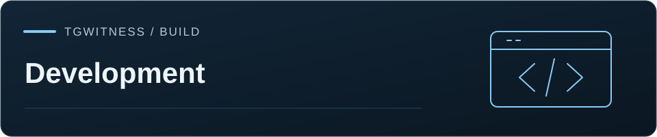

[TgWitness](../../README.md) / [Documentation](../README.md) / [Folder](README.md) · [Development](../ARCHITECTURE.md)

# Live Telegram acceptance procedure

Live runs from 27 October to 10 November 2026 are listed in the
[verification record](../VERIFICATION.md) and the [release notes](RELEASE.md). They covered
authorization and session reuse, observation of groups, channels and private chats, history
snapshots, interrupted and resumed exports, export verification and session-file import.
Steps 4–8, QR confirmation on a phone (step 15), the proxy matrix (step 14) and backup
restore (step 16) have not been run.
Use test groups and accounts you are allowed to record.
Do not use a personal investigation dataset as a release fixture.

1. Start with a new private data directory. Verify that APIs reject a missing token.
2. Authorize a dedicated user account with your API ID/hash, code, and 2FA if enabled.
   Restart and verify session reuse without entering the code again.
3. Select a basic group, a supergroup, and a channel already available to the account.
   Keep an unrelated group unselected and verify its content is not recorded.
4. Send text, Unicode, entities, replies, forwards, albums, and captioned media.
   Compare saved raw metadata with the account-visible Telegram content.
5. Edit a message several times with pauses between edits. Check every delivered
   version and compare text. Confirm editor attribution is not inferred from sender.
6. Delete an already captured message and one deleted before observation starts.
   Verify preserved content only for the former. When Telegram supplies no peer,
   resolve private/basic-group deletions only from previously saved, unambiguous
   account-wide message IDs; otherwise retain an unscoped notice. Delete 2, 9, 10,
   and 15 messages while leaving others present. Confirm each multi-ID update is
   labeled as a deletion batch, with no inferred actor, whole-history clear, or
   deletion for all participants, including when saved outgoing messages are deleted.
7. Add/remove reactions using two accounts. Compare visible counts and available
   recent reactors. Repeat with anonymous/channel reactions. Do not infer a full actor list.
8. Join, leave, invite, remove, and approve a user. Compare service actions and raw
   participant updates under normal-member and administrator visibility.
9. Test media downloads, immediate deletion, missing permissions, and the size cap.
   Verify every saved file's hash and failed/skipped outcomes.
10. Pause, disconnect the network, restore it, terminate the process ungracefully,
    and restart. Check gap boundaries, resume state, and incomplete-coverage labels.
11. Trigger a small bounded history snapshot. Confirm it is labeled separately and
    does not invent deletions or intermediate edits.
12. Download every export. Verify the ZIP using the standalone verifier, a separately
    retained fingerprint, and an earlier checkpoint. Deliberately change a record,
    signature, attachment, manifest, and archive length; confirm the expected failures.
13. Review browser network requests, reverse-proxy logging, file permissions, backups,
    and session removal through Telegram's own active-session management.
14. Repeat authorization and media capture through each intended SOCKS5/HTTP/MTProxy
    provider. Stop the proxy and inspect network traffic: no direct Telegram fallback
    should occur. Check other machine traffic separately; this is not a system VPN.
    Test credential rejection, restart, account switching and expired proxy service.
15. Test the intended Telethon/Pyrogram session, supported TData ZIP, and companion
    JSON through the panel, then verify the resulting account ID. Keep the original
    client stopped. Check wrong passcodes, conflicting files, revoked authorization,
    QR confirmation, QR expiry/cancellation, and QR with 2FA on an actual Telegram app.
    Do not infer support for unreviewed Desktop layouts or arbitrary JSON structures.
16. For an external-key installation, restore a full backup on an isolated machine
    with its master key and salts. Check missing/wrong keys fail closed. Verify OS
    encryption covers the journal, media, temporary exports and backup locations.

Record Telegram client/API versions, group types, account roles, observed delivery
behavior, timestamps, expected versus actual outcomes, and every limitation. A
passing mock suite does not replace this procedure.
