[TgWitness](../../README.md) / [docs](../README.md)

<picture>
  <source media="(max-width: 640px) and (prefers-reduced-motion: reduce)" srcset="../assets/presentation/section-github-mobile-static.svg">
  <source media="(prefers-reduced-motion: reduce)" srcset="../assets/presentation/section-github-static.svg">
  <source media="(max-width: 640px)" srcset="../assets/presentation/section-github-mobile.svg">
  
</picture>

# Maintainer notes

Maintainer-oriented documents for publishing, qualification and engineering review.
For user-facing setup and workflows, start with the
[documentation index](../README.md) or [wiki](../wiki/Home.md).

## Procedures

| Document | Purpose |
| --- | --- |
| [`PUBLISHING.md`](PUBLISHING.md) | Public website preview and publication |
| [`WIKI.md`](WIKI.md) | Build and maintain the separate GitHub Wiki |
| [`RELEASE.md`](RELEASE.md) | Release preparation |
| [`READINESS.md`](READINESS.md) | Release checks |
| [`LIVE_ACCEPTANCE.md`](LIVE_ACCEPTANCE.md) | Live acceptance procedure |
| [`SEO.md`](SEO.md) | Website structure and metadata |
| [`CI-RUNNER.md`](CI-RUNNER.md) | Runner registration, maintenance and recovery |
| [`CI-PARALLELISM.md`](CI-PARALLELISM.md) | Job routing and concurrent checks |
| [`RESEARCH.md`](RESEARCH.md) | Research references and engineering notes |

This directory name is not an access control: the source packager includes Markdown here, so account secrets and real
evidence must not be placed in these documents.
