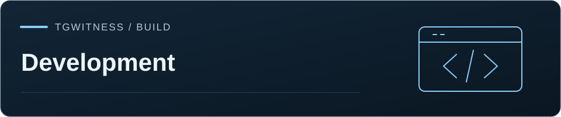

[TgWitness](../../README.md) / [Documentation](../README.md) / [Folder](README.md) · [Development](../ARCHITECTURE.md)

# Version 0.9.2 preview

TgWitness is a self-hosted Telegram observation journal under the
[MIT License](../../LICENSE). Version 0.9.2 is the 9 November 2026 preview candidate; its
contents are listed in the [changelog](../CHANGELOG.md). The release packages are the
Windows portable package, the wheel and the source archive, each with its SHA-256.

## Included in this source tree

- A panel with access tokens, separate account workspaces, light/dark themes and
  Ctrl/Cmd+K search. Choose from 25 languages for the panel and reports.
- Separate personal account exports and investigation workflows, with readable
  offline reports, privacy previews, minimized sharing copies and recipient notes.
- Resumable history loading, archive search and analysis, read-only MCP, optional
  local OCR/transcription and HMAC-signed webhooks.
- Phone/code/2FA, QR sign-in and bounded import of supported Telethon/Pyrogram sessions,
  Telegram Desktop TData ZIP, StringSession and Auth Key inputs.
- Selection of individual chats, a Telegram folder or account-wide scope; capture of visible
  messages, edits, deletion notices, reactions and membership events, plus recorded coverage
  gaps and configurable history/rechecks. Telegram visibility and collection policy limit coverage.
- A panel mini-client for messages, replies, supported bot buttons and invitation joins.
  Each action is attributed to the selected account and recorded in its journal.
- SHA-256 hash chains, Ed25519 signatures, checkpoints, run receipts and JSONL/CSV/HTML/ZIP
  exports, signed PDF reports and an offline report viewer with verified selections. Optional AES-256 ZIP passwords, full-chat exports and coordinated multi-account
  chat exports are available. An independent verifier checks exported records.
- Opt-in people profiles, notification delivery, timestamp tooling, encrypted S3-compatible
  copies and an independently operated witness process.
- Per-account SOCKS5/HTTP CONNECT/experimental MTProxy, encrypted credential vaults and
  optional external vault keys. Journals and local attachments require disk/volume encryption.
- Windows source/portable launchers, Linux/macOS launch scripts, Docker Compose, HTTPS and
  service templates. Demo mode uses synthetic data and does not connect to Telegram.

See [collection](../COLLECTION.md), [accounts](../ACCOUNTS.md), [evidence](../EVIDENCE.md),
[witness](../WITNESS.md) and [security](../../.github/SECURITY.md) for behavior and limits. Parameter ranges
and effective defaults are shown in the panel; avoid relying on limits from older releases.

## Publication and validation

The release workflow checks the version tag, invokes the checks workflow and builds source,
wheel, Windows portable and GHCR packages. Public source and wheel assets use allowlists;
the public site includes only presentation assets. Publication checks and dependency auditing
run in CI. See [publishing](PUBLISHING.md) for commands and deployment steps.

Version 0.9.2 remains a preview. The release workflow publishes the exact Windows
portable artifact tested by the checks workflow, alongside the source archive
and wheel. A final job downloads all three published packages, checks their
SHA-256 sidecars and publishes `SHA256SUMS.txt` and `RELEASE-MANIFEST.json` with
the version, source revision and asset sizes. Existing release assets are not
overwritten. Docker users can also build locally with `scripts/Docker.cmd` or
`scripts/docker-start.sh`.

GitHub-hosted workflow results are confirmed in Actions.

The [verification record](../VERIFICATION.md) describes prior tests and their
limits. Check the release commit's Actions results and published package manifest
for this build's acceptance. Live Telegram coverage and native-platform
qualification are recorded from live runs.

TgWitness has run on a real Telegram account: one supergroup from 27 to 29 October 2026,
1,291 messages, 472 deletions and 12 edits, with the signatures of all 2,385 records
verified. See the [live test](../VERIFICATION.md#live-telegram-test--27-to-29-october-2026).

## Remaining validation

Publication requires the release revision to pass dependency audits, CodeQL and
the container HIGH/CRITICAL gate, including findings without an available fix.
The container audit builds the AMD64 and ARM64 runtime, sealed collector and media
worker from the public source archive. Source-built Tesseract also has a separate
upstream advisory check. Use the release's Actions results for the current findings.

CJK PDFs require a suitable installed font or `TGWITNESS_FONT_DIR`; when PDF rendering
is unavailable, the export keeps its HTML and JSON reports and records the limitation.

- A complete live Telegram matrix covering QR confirmation, roles, update delivery, media,
  rate limits, reconnects and sustained operation.
- Successful checks for this candidate on Linux, Windows and macOS, including the portable package.
  Prior platform results do not qualify a newer revision; use its Actions run and manifest.
- Record independent security reviews and validate each capture mode's acquisition,
  coverage and environment checks against the release revision.

The main panel token controls all workspaces. Issue scoped tokens for reviewers and analysts; see [access and permissions](../ACCESS.md). Keep dedicated
account credentials and collected data out of the repository. See [readiness](READINESS.md)
and [live acceptance](LIVE_ACCEPTANCE.md) for the remaining qualification work.
