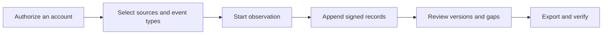

[English](../../README.md) · [Русский](../ru/README.md) · [Українська](../uk/README.md) · [Español](../es/README.md) · **Português (Brasil)** · [Türkçe](../tr/README.md) · [العربية](../ar/README.md) · [فارسی](../fa/README.md) · [اردو](../ur/README.md) · [हिन्दी](../hi/README.md) · [Bahasa Indonesia](../id/README.md) · [Tiếng Việt](../vi/README.md) · [简体中文](../zh/README.md)


<p align="center">
  <strong>Seu espaço de trabalho de observação no Telegram.</strong><br>
  Preserve conversas capturadas, entenda o que mudou e compartilhe um histórico assinado.<br>
  No seu próprio computador ou servidor. Com suas próprias contas.
</p>

<p align="center">
  
  
  
  
  
</p>

<p align="center">
  <a href="#introdução-rápida">Introdução rápida</a> ·
  <a href="#recursos">Recursos</a> ·
  <a href="#conecte-uma-conta-do-telegram">Contas</a> ·
  <a href="#evidências-e-verificação">Evidências</a> ·
  <a href="#implantação">Implantação</a> ·
  <a href="../README.md">Documentação</a>
</p>

> [!TIP]
> **Explore antes de se conectar.** Execute `Demo.cmd` ou `sh start.sh --demo` para abrir um espaço de trabalho com conversas fictícias. Não é necessária uma conta no Telegram.

**É novo aqui?** [Iniciar →](QUICKSTART.md) · [Wiki →](../wiki/Home.md) · [Escolha um guia →](../README.md) · [Obter ajuda →](../../.github/SUPPORT.md) · [Veja o que já foi testado →](../VERIFICATION.md)

> [!WARNING]
> **Utilize uma conta dedicada do Telegram que você possa se dar ao luxo de perder.** Recomendamos enfaticamente que não conecte contas pessoais ou valiosas, nem crie credenciais de API ID/API hash nessas contas. O Telegram pode restringir ou banir permanentemente contas. [Leia o guia de contas](../ACCOUNTS.md).

## Recursos

- **Conversas com histórico.** Leia mensagens salvas, compare edições capturadas e visualize avisos de exclusão no contexto da conversa.
- **Observação nos seus termos.** Escolha conversas individuais, uma pasta do Telegram ou toda a conta. Cada conta possui seu próprio espaço de trabalho e configurações.
- **Exportações que você pode verificar.** Um arquivo ZIP assinado, registros originais, anexos preservados e um relatório HTML offline. Proteção opcional por senha para transferência.
- **Feito para uso diário.** Temas claro e escuro, 13 idiomas, pesquisa, navegação com Ctrl/Cmd+K e ações diretamente a partir dos chats.
- **Recursos adicionais quando você precisar.** Um “[Telegram Witness em três etapas](../WITNESS.md)”, uma página [Página pública de demonstração](../PROOF.md) separada e guias de configuração claros. Abra **a seção “Extras”** para escolher; as configurações avançadas permanecem ocultas.

<details>
<summary>Todos os recursos e detalhes técnicos</summary></details>

- **Sua rota de conexão.** Em **Conta → Configurações de proxy**, escolha entre as listas públicas integradas do MTProxy, atualize-as a partir de suas fontes ou cole seu próprio link de proxy do Telegram. As configurações manuais de SOCKS5/HTTP/MTProxy e um catálogo de operadores continuam disponíveis. As listas públicas são baixadas e filtradas, mas nenhuma conta foi conectada por meio de um servidor listado até o momento. [Como funcionam as listas públicas](../CONNECTION-SECURITY.md#public-proxies-supplied-by-your-installation).

- **Um diário do que suas contas realmente veem.** Novas mensagens, edições, avisos de exclusão, reações, eventos relacionados à participação e lacunas de cobertura dos grupos e canais que você selecionar.
- **Bate-papos selecionados, uma pasta do Telegram ou toda a conta.** Selecione os tipos a serem registrados — canais, grupos, conversas privadas, bots — e novas conversas serão adicionadas assim que surgirem. Exclusões, suas próprias mensagens enviadas e edições, exclusões em conversas privadas correspondentes à respectiva conversa, verificações prioritárias e limites de anexos por tipo ([coleção](../COLLECTION.md#observation-scope-chosen-chats-a-folder-or-the-whole-account)).
- **Modo de investigação.** Um único botão cria uma conta dedicada que entra em equipes e interage com bots: tudo o que ela visualiza e envia é registrado; os botões abaixo das mensagens dos bots (links, aplicativos web, textos para copiar) são mantidos; as edições feitas exclusivamente por meio de botões tornam-se novas versões; e cada novo chat ou bot tem seu perfil (descrição, comandos, membros) e as mensagens visíveis anteriormente salvas de uma só vez ([modo de investigação](../COLLECTION.md#investigation-mode-joining-teams-and-talking-to-bots)). **O guia “Conta dedicada”** do painel (`/dedicated-account.html`) explica por que a conta principal não deve ser utilizada, por que o TgWitness funciona por meio de pares de hash/ID de aplicativo públicos e por que um par de API, por si só, não concede acesso à sua conta (com links para a documentação do Telegram), além de listar formas de criar uma conta adicional.
- **Aja diretamente a partir das conversas.** Envie mensagens e respostas, pressione os botões de retorno de chamada/texto do bot ou visualize um convite do Telegram e participe. A conta selecionada executa a ação; solicitações, visualizações de convites e respostas do bot em pop-ups/URLs são registradas em seu diário assinado ([minicliente do painel](../COLLECTION.md#act-from-the-panel)).
- **Cobertura que o senhor pode declarar.** Os relatórios e o verificador indicam “observado continuamente de X a Y”, listam lacunas com seus motivos e os IDs das mensagens que nunca foram observadas — sem nunca apresentá-las como excluídas.
- **Perfis de usuários, adesão opcional por chat.** Histórico de nomes e nomes de usuário, sinalizadores do Telegram, SHA-256 e pHash do avatar, atividade, quem responde a quem e carteiras, telefones, nomes de usuário e links mencionados — tudo construído exclusivamente a partir de registros salvos, cada fato apontando para seu registro no diário, exportado como um arquivo assinado separado ([modelo de evidência](../EVIDENCE.md#people-profiles)).
- **Testemunha independente.** Um processo separado, com sua própria chave e bot, busca o cabeçalho assinado do diário, publica-o em um canal do Telegram e notifica quando o coletor não responde; o verificador compara as exportações com esse cabeçalho. O intervalo, o tempo limite, quais verificações são publicadas e o texto das publicações são opções definidas em um arquivo de configuração JSON ([witness](../WITNESS.md)). Testado em um servidor local da API do Bot, ainda não com um bot e um canal reais.
- **Configurações de coleta no painel.** Limites e frequência de coleta, novas verificações, downloads, perfis de pessoas, notificações e exportações encontram-se na página **“Parâmetros”,** com seus intervalos e valores padrão; todas as alterações são registradas no diário assinado ([configurações e parâmetros](#configurações-e-parâmetros)).
- **Edições e exclusões em contexto.** Cada edição é uma versão separada exibida ao lado da anterior; um aviso de exclusão nunca apaga o conteúdo que já foi capturado.
- **Exportações assinadas e verificáveis.** Cada evento é encadeado por hash (SHA-256) e assinado (Ed25519). O arquivo ZIP assinado contém JSONL, CSV, um relatório HTML offline, mídia preservada e um verificador independente.
- **Exportações protegidas por senha.** Opcionalmente, é possível compactar qualquer exportação em um arquivo ZIP com criptografia AES-256 do WinZip, formato compatível com o 7-Zip e o WinRAR; o conteúdo assinado no interior permanece inalterado. Um arquivo de teste foi aberto byte a byte no libarchive (Windows `tar`) e uma senha incorreta foi rejeitada ([modelo de evidência](../EVIDENCE.md#investigation-handoff)).
- **Notificações.** Problemas (espaço em disco insuficiente, conta desconectada, erros no coletor, na cópia ou no carimbo de data/hora), alterações nos chats observados e um resumo diário, enviados por meio [do Apprise](https://github.com/caronc/apprise) para o Matrix, Telegram, Discord, Slack, ntfy, e-mail e muitos outros serviços — sem o texto da mensagem, a menos que você ative os trechos — e listados no painel. A entrega é testada em relação a um endpoint local; os próprios serviços ainda não foram testados.
- **13 idiomas de interface:** inglês, russo, ucraniano, espanhol, português (Brasil), turco, árabe, persa, urdu, hindi, indonésio, vietnamita e chinês simplificado, traduzidos automaticamente pelo DeepL. As seções mais recentes utilizam texto alternativo em inglês explicitamente catalogado; os controles do minicliente permanecem em inglês. O conteúdo do Telegram e os registros do diário são sempre exibidos exatamente como foram salvos.
- **Tema claro e escuro.** Por padrão, segue a configuração do sistema; a escolha é lembrada por navegador.
- **Navegação otimizada para teclado.** Pressione **Ctrl+K** (Mac: **⌘K**) ou selecione **“Ir para…”** para localizar uma seção. Use as setas do teclado e a tecla Enter para abri-la; a tecla Escape fecha o menu.
- **Contas múltiplas.** Qualquer número de espaços de trabalho isolados, cada um com sua própria sessão do Telegram, diário, chave de assinatura, rota de proxy e política de captura.
- **Login flexível.** Telefone + código + autenticação de duas etapas (2FA), código QR, Telethon/Pyrogram `.session`, arquivo ZIP do TData do Telegram Desktop, Telethon StringSession ou uma chave de autenticação completa com seu ID de DC.
- **Proxies por conta.** SOCKS5 e HTTP CONNECT, testados com proxies de teste locais, e o MTProxy experimental, ainda não testado com um servidor real. Um proxy com falha nunca recorre silenciosamente a uma conexão direta.
- **Privacidade incorporada por padrão.** Executa-se no seu computador ou servidor. Interface de usuário web integrada, sem Node.js, sem serviço hospedado, sem telemetria. Sessões, credenciais de API e segredos de proxy são armazenados em um cofre criptografado.
- **Fácil de executar.** Clique duas vezes no Windows, execute um script no Linux/macOS ou utilize o Docker Compose com HTTPS automático opcional. Até o momento, apenas os executáveis do Windows foram testados; veja [o que já foi testado](#o-que-foi-testado).

</details>

## Introdução rápida

| Plataforma | Como começar | Requisitos |
| --- | --- | --- |
| **Windows, sem nada instalado** | Baixe `TgWitness-<version>-windows-amd64-portable.zip` da [seção “Lançamentos”](../../../../releases), extraia e clique duas vezes em **`TgWitness.cmd`** | Nada; o Python já está incluído |
| Windows, a partir do código-fonte | Clique duas vezes em **`Start.cmd`** | Python 3.11+; disponibilizado e instalado para você, caso não esteja presente |
| Linux / macOS | `sh start.sh` | Python 3.11+ com `venv`; o script exibe o comando de instalação para o seu sistema, caso esteja ausente |
| Docker, qualquer sistema operacional | Clique duas vezes em **`Docker.cmd`** ou execute `sh docker-start.sh` | Docker Engine/Desktop com Compose 2.20 ou superior |

1. Abra **http://127.0.0.1:8787**.
2. Cole o token de acesso ao painel:
   - instalação portátil ou a partir do código-fonte: o conteúdo de `data/live/panel-token.txt`
   - Docker: gerado por `Docker.cmd`/`docker-start.sh` ou `docker compose exec tgwitness cat /data/panel-token.txt`
3. Adicione sua conta do Telegram, escolha os chats a serem observados e clique em **“Iniciar observação**”.

A primeira execução do código-fonte cria um `.venv` privado e instala as dependências fixadas (é necessário acesso à Internet). Os auxiliares do Docker compilam a imagem, aguardam até que o painel esteja em bom estado e exibem seu endereço e token. `python start.py --check` (ou `TgWitness-Check.cmd` no pacote portátil) fornece um relatório de prontidão sem acessar o Telegram.

> **Está apenas dando uma olhada?** Execute **`Demo.cmd`** ou `sh start.sh --demo`. Um diário fictício é aberto diretamente no navegador; nenhuma conta do Telegram está conectada e os dados ficam armazenados separadamente em `data/demo`.

<details>
<summary><strong>No interior do espaço de trabalho: conversas, histórico e exportações</strong></summary></details>

<picture>
  <source media="(prefers-color-scheme: dark)" srcset="../assets/chats-dark.png">
  
</picture>

### Histórico de observações


### Exportações assinadas


</details>


## Conecte uma conta do Telegram

> [!CAUTION]
> Conecte apenas contas dedicadas que o(a) senhor(a) possa se dar ao luxo de perder. O Telegram pode banir contas permanentemente e de forma imprevisível; consulte o aviso no topo desta página. O **guia de contas dedicadas** do painel (barra lateral ou `/dedicated-account.html`) explica por que e como obter uma.

Faça login por telefone, código QR ou uma sessão existente — não é necessário ID de API nem hash.

**Por que um conjunto de APIs integrado?** Sabe-se que a criação de seu próprio ID de API em [my.telegram.org](https://my.telegram.org) pode levar à restrição de contas, e o Telegram não publica limites claros — muitos pesquisadores perderam suas contas principais dessa forma. A própria página [“Obter ID de API”](https://core.telegram.org/api/obtaining_api_id) do Telegram informa que contas que utilizam clientes de API não oficiais são automaticamente colocadas sob observação e encaminha usuários banidos indevidamente para recover@telegram.org. O TgWitness, portanto, fornece pares de API públicos já utilizados por outros clientes de código aberto, para que o senhor nunca precise criar um. Caso possua seu próprio ID de API, insira-o no campo **“ID de API + Hash”** e ele será utilizado em seu lugar.

Quando nenhum par é inserido, importado ou já está salvo no espaço de trabalho, o TgWitness seleciona um dos 50 pares do banco e passa para o próximo caso o Telegram recuse um. O par que efetuou o login permanece vinculado àquela conta. Um par identifica o aplicativo; o usuário ainda precisa autorizar sua conta do Telegram separadamente. O token de acesso do painel abre o TgWitness e é independente do login no Telegram.

| O que o senhor possui | Como utilizá-lo |
| --- | --- |
| Número de telefone com acesso à conta | Guia **“Telefone**”: código do Telegram e, em seguida, senha de autenticação de duas etapas (2FA), se ativada |
| Um aplicativo do Telegram no qual já se está conectado | Guia **“Código QR**”: Configurações → Dispositivos → Vincular dispositivo de desktop |
| Telethon (esquema 7/8) ou Pyrogram (esquema 2/3) `.session` | Guia **“Arquivos”** |
| Par de imagens: `name.session` + `name.json` | Na guia **“Arquivos”**, selecione ambos; o arquivo JSON fornece o ID/hash da API |
| Pasta do Telegram Desktop `tdata` | Apenas ZIP `key_datas` e `D877F783D5D3EF8Cs`, em seguida, **“Arquivos”**; senha local, se definida |
| Telethon StringSession, `.txt` ou `.tgwitness-session` | Guia **“Arquivos”**, *“Senha”* ou *texto da sessão* |
| Arquivo JSON da conta com uma sessão ou chave de autenticação | Guia **“Arquivos”** |
| Chave de autenticação completa (512 caracteres hexadecimais) + ID do DC | Guia **“Chave de autenticação**”; o ID de usuário opcional é verificado no Telegram |

Não suportado: armazenamento TDLib, strings de sessão do Pyrogram, tokens de bot, TData com múltiplas contas e listas de contas em massa. Os arquivos são convertidos na memória do seu servidor e verificados com o Telegram antes de serem salvos. O [guia de contas](../ACCOUNTS.md) explica cada formato passo a passo: como obter credenciais da API, como reconhecer um arquivo, campos JSON, limites e mensagens de erro.

Após o login, abra **“Fontes”** (seus chats são carregados automaticamente), adicione os grupos necessários, escolha o que deseja capturar (por exemplo*,* *mensagens, edições e exclusões*) e inicie a observação. Mantenha o processo em execução: **a opção “Pausar observação”** interrompe a coleta, enquanto **“Bloquear”** apenas interrompe o acesso pelo navegador.

## Capturas de tela

| Comparação de edições | Fontes e política de captura |
| --- | --- |
|  |  |
| **Exportações assinadas** | **Faça login** |
|  |  |
| **Diário** | **Tema escuro** |
|  |  |

Todas as capturas de tela utilizam dados sintéticos de demonstração. O código QR no [arquivo qr-login.png](../assets/qr-login.png) codifica um token fictício proveniente do transporte de teste.


## Como funciona



Cada espaço de trabalho pertence a uma conta do Telegram. O coletor aceita atualizações do cliente dessa conta, aplica a política de captura salva e acrescenta as observações a um diário no qual só é possível fazer acréscimos.

| Observação | O que é preservado | Limites |
| --- | --- | --- |
| Nova mensagem | Texto, ID do remetente, referência da resposta, metadados, hora da observação | Apenas atualizações fornecidas para fontes selecionadas |
| Editar | Uma versão separada do conteúdo | As versões intermediárias perdidas enquanto o sistema estava offline não podem ser recuperadas |
| Exclusão | ID da mensagem, além de tudo o que foi capturado anteriormente | O Telegram geralmente não informa quem excluiu a mensagem nem quando isso ocorreu |
| Reações | Contagens e identidades recentes, quando fornecidas | Um instantâneo, não um registro completo de alterações |
| Afiliação | Mensagens de serviço e atualizações para os participantes | Não é garantido que todas as entradas/saídas sejam recebidas |
| Anexo | Arquivo opcional com endereçamento por conteúdo e SHA-256 | Os arquivos podem desaparecer antes do download; os resultados são registrados |
| Cobertura | Inicializações, paradas, desconexões, sinais de vida, alterações de política | A ativação não constitui prova de captura completa |
| Instantâneo do histórico | Últimas mensagens visíveis, até 500, a menos que esse número seja aumentado nos **Parâmetros**, explicitamente identificadas | Não é possível reconstruir edições ou exclusões perdidas |

Saiba [como funciona a coleta de dados](../COLLECTION.md) para políticas, filas de anexos e reinicializações.

## Configurações e parâmetros

Todas as alterações são realizadas no painel, por espaço de trabalho, sem a necessidade de editar código ou arquivos de configuração. Cada alteração de escopo, política ou parâmetro é registrada no diário assinado, juntamente com os valores anteriores e posteriores, e cada início de observação indica os valores em vigor.

| Onde | O que o senhor configura |
| --- | --- |
| **Fontes** | Escopo (conversas selecionadas, uma pasta do Telegram, toda a conta), tipos de fontes, exclusões, ações próprias, quais alterações devem ser mantidas, tipos de anexos e tamanho por tipo (1–2.000 MiB), intervalo de verificação para conversas prioritárias e outras (qualquer número de minutos, 0 = desativado), instantâneos do histórico, notificações |
| **Exportações** | Downloads protegidos por senha, modo de evidência (intervalo, autoridades de carimbo de data/hora e calendários), cópia externa no S3 (intervalo, retenção e modo do Object Lock) |
| **Witness** | Tokens de testemunha somente para leitura; as opções do próprio testemunho são exibidas com comandos pré-definidos |
| **Parâmetros** | Tamanho e atualização da lista de conversas, intervalos de heartbeat e checkpoint, buffer de inicialização, como as novas verificações distribuem as solicitações (primeiro atraso, conversas por passagem, pausa, mensagens recuperadas e solicitadas novamente), reserva de disco, tempo limite de download, velocidade e tentativas de repetição, o que os perfis de usuários procuram, incluindo suas próprias expressões regulares, tamanho e frequência das notificações, snapshot, limites de ZIP e de download no navegador, tempo limite de ação do painel, tempos limite e tentativas do cliente do Telegram |

Os valores dos **parâmetros** mostram seu intervalo e valor padrão; os que foram alterados estão marcados e podem ser restaurados um por um ou todos de uma vez. Eles passam a ser aplicados a partir da próxima utilização; os tempos limite e novas tentativas do cliente Telegram a partir da próxima conexão. Um limite de ZIP acima de 4 GiB requer `verify.py --max-gib N` quando o arquivo for verificado ([operações](../OPERATIONS.md#panel-layout)).


## Evidências e verificação

| Exportar | Índice | Integridade |
| --- | --- | --- |
| **Arquivo ZIP assinado** | JSONL, CSV, relatório em HTML, cobertura, mídia, manifesto, verificador | Eventos assinados, além de um manifesto assinado de cada arquivo, indicando o autor. Utilize isso para a transferência. |
| JSONL | Registros originais com hashes e assinaturas | Assinaturas Ed25519 por evento e cadeia de hash |
| CSV / HTML | Tabela compatível com planilhas / relatório legível offline | Informações disponíveis apenas no arquivo ZIP assinado |
| JSON de ponto de verificação | Comprimento do diário e hash do cabeçalho | Assinado separadamente; mantenha-o fora do coletor |
| JSON de recibo de execução | Hashes do código, versões das dependências, escopo, configurações | Declaração de processo assinada separadamente |
| Perfis de pessoas em JSON | Perfis de um chat com referências de registros | Declaração assinada; os hashes do arquivo foram verificados em relação ao ZIP |
| Arquivo ZIP do diário Witness | Número de testemunhas obtidas, respostas perdidas, publicações no canal | Assinado pela própria chave da testemunha |

Os filtros afetam apenas a navegação; as exportações sempre contêm o diário completo até um número de sequência fixo. Verifique um arquivo com uma cópia confiável do verificador e uma impressão digital da chave e um ponto de verificação mantidos de forma independente:

```sh
python -m pip install cryptography
python tgwitness/verify.py tgwitness-evidence.zip --fingerprint TRUSTED_PUBLIC_KEY_SHA256 --checkpoint tgwitness-checkpoint.json
# with an independent witness and its channel (Telegram Desktop export)
python tgwitness/verify.py tgwitness-evidence.zip --fingerprint TRUSTED_PUBLIC_KEY_SHA256 \
    --witness witness.zip --witness-fingerprint WITNESS_SHA256 --channel result.json
```

O verificador exibe o produtor assinado, os períodos de observação contínua, as lacunas e os IDs de mensagens que nunca foram observados, e apresenta falha caso o diário difira de qualquer cabeçalho que a testemunha tenha visto.

As assinaturas fornecem evidência de integridade em relação a uma chave de assinatura confiável. Elas **não** comprovam a origem do Telegram, a veracidade do conteúdo ou a hora confiável, e não oferecem proteção contra um operador que controle o coletor e sua chave. Para a data e hora confiáveis, o modo de evidência (desativado por padrão) carimba os pontos de verificação com autoridades RFC 3161 e calendários OpenTimestamps; ou o painel prepara uma solicitação RFC 3161 offline ([procedimento de carimbo de data e hora](../TIMESTAMP.md)). Ambos são testados em servidores de teste locais, ainda não nos serviços públicos. Consulte o [modelo de evidência](../EVIDENCE.md) e a lista de verificação [para transferência de investigação](../EVIDENCE.md#investigation-handoff).

## Implantação

> [!NOTE]
> As configurações do Docker, Caddy (HTTPS), systemd e launchd apresentadas abaixo estão preparadas e seus arquivos passaram nas verificações de sintaxe, mas nenhuma delas foi executada ainda. O pacote portátil para Windows e a versão de código-fonte no Windows já foram executados.

**Servidor local ou único com Docker:**

```sh
docker compose up -d --build --wait
docker compose exec tgwitness cat /data/panel-token.txt
```

O contêiner é executado como um usuário não root com um sistema de arquivos somente leitura, publica apenas em `127.0.0.1:8787` e mantém todos os dados em um volume nomeado.

**Servidor público com HTTPS automático (Caddy):** copie `.env.example` para `.env`, configure `TGWITNESS_DOMAIN`, aponte o DNS para o servidor, abra as portas TCP 80/443 e execute

```sh
docker compose -f compose.yaml -f deploy/compose/compose.https.yaml up -d --build --wait
```

**No Windows, sem necessidade de instalação:** o arquivo ZIP portátil anexado a cada versão contém o ambiente de execução oficial do Python e todas as dependências. Os dados permanecem na pasta `data`; para atualizar, extraia a nova versão e copie essa pasta para o local correspondente.

**Sem o Docker:** os modelos para o systemd, a tarefa de logon do Windows e o launchd estão na pasta [deploy/.](../../deploy/README.md) Atualizações, backups, portas alternativas e imagens do GHCR (assim que forem publicadas pelo fluxo de trabalho de lançamento) são abordados na seção de [implantação](DEPLOYMENT.md).

### Linha de comando

```text
python start.py [--demo] [--setup-only] [--check [--json]] [--host HOST] [--port PORT] [--data-dir DIR]
```

| Tarefa | Comando (a partir do ambiente do projeto) |
| --- | --- |
| Verificação de prontidão sem iniciar o sistema | `python start.py --check` |
| Converta uma sessão do Telethon SQLite para o modo offline | `python -m tgwitness.sessions account.session --out account.tgwitness-session` |
| Transfira uma exportação de grande volume para o disco | `python -m tgwitness.download --token-file data/live/panel-token.txt --out evidence.zip` |
| Verifique um arquivo exportado | `python tgwitness/verify.py tgwitness-evidence.zip --fingerprint SHA256` |
| Verifique um arquivo com mais de 4 GiB | `python tgwitness/verify.py big-evidence.zip --fingerprint SHA256 --max-gib 16` |
| Execute um testemunho independente a partir de um arquivo de configuração | `python -m tgwitness.witness run --config witness.json` |

Os comandos auxiliares `python -m tgwitness…` devem ser executados dentro de `.venv` (`.venv\Scripts\python.exe` no Windows, `.venv/bin/python` nas demais plataformas).

| Variável | Objetivo |
| --- | --- |
| `TGWITNESS_HOST`, `TGWITNESS_PORT` | Endereço e porta de escuta (padrão `127.0.0.1:8787`) |
| `TGWITNESS_DATA` | Diretório de dados (padrão `data/live`) |
| `TGWITNESS_TOKEN` | Token de painel fixo em vez do gerado (pelo menos 24 caracteres) |
| `TGWITNESS_VAULT_KEY_FILE` | Chave mestra externa do cofre para novas instalações |
| `TGWITNESS_DOMAIN`, `TGWITNESS_IMAGE` | Nome de host HTTPS do Docker e imagem publicada (consulte `.env.example`) |
| `TGWITNESS_WITNESS_*` | Testemunha independente: coletor, tokens, canal, `_INTERVAL`, `_TIMEOUT`, `_POST` (todos, alterações, problemas), `_TITLE`, `_CONFIG` ([testemunha](../WITNESS.md#options)) |


## Responsabilidade e proteção de dados (RGPD)

O TgWitness é uma ferramenta. Quem o opera decide o que é coletado, por que motivo e por quanto tempo, e é responsável por isso — nos termos do GDPR da UE/Reino Unido, geralmente na qualidade de *controlador* desses dados pessoais. As mensagens do Telegram contêm dados pessoais de pessoas que nunca consentiram em ser registradas: nomes, nomes de usuário, IDs, fotos, números de telefone, opiniões. Esta seção não constitui aconselhamento jurídico; verifique a legislação aplicável ao seu caso e os termos de uso do Telegram.

- **É necessário dispor de uma base legal e de uma finalidade.** A prevenção de fraudes, a segurança de redes e informações e a defesa contra ações judiciais são comumente invocadas como interesses legítimos (RGPD, Art. 6(1)(f), Considerandos 47 e 49; Art. 9(2)(f) para ações judiciais). Registre a finalidade para cada caso. As autoridades públicas atuam com base em suas próprias bases legais.
- **Colete apenas o necessário para o objetivo pretendido.** Comece com os chats selecionados. Os modos “pasta” e “conta inteira” registram chats privados e mensagens de terceiros: utilize-os apenas em contas dedicadas; o painel solicita confirmação e o diário assinado registra a ação. Desative os tipos de eventos, tipos de anexos e ações próprias desnecessárias, e exclua chats.
- **Os perfis de pessoas são uma forma de análise de perfis.** Eles estão desativados por padrão e são ativados por conversa. Utilize-os para uma investigação específica, não baseie decisões automatizadas sobre pessoas neles (Art. 22) e desative-os ou remova a conversa quando terminar — isso os exclui. O monitoramento sistemático de muitas pessoas geralmente exige uma avaliação de impacto sobre a proteção de dados (Art. 35).
- **Mantenha a segurança.** Sessões, credenciais e chaves estão armazenadas em um cofre criptografado; coloque o diretório de dados em um disco criptografado, proteja as exportações com uma senha (ZIP com AES-256), mantenha o painel protegido por HTTPS e forneça ao testemunho apenas seu token de leitura exclusiva. As notificações não contêm texto de mensagem, a menos que você ative os trechos, o que envia o texto para o serviço de notificações.
- **Retenção e apagamento.** O diário é do tipo “somente adição”, de modo que sua integridade possa ser comprovada; registros individuais não podem ser removidos sem quebrar a cadeia de assinaturas. Planeje a retenção por espaço de trabalho e exclua todo o espaço de trabalho (Contas → Excluir) ou seu diretório de dados quando a finalidade for encerrada. Cópias externas sob o S3 Object Lock não podem ser excluídas antes de sua data de retenção — escolha o período adequadamente. O direito ao apagamento tem exceções, por exemplo, para o estabelecimento ou defesa de reivindicações legais (Art. 17(3)(e)).
- **Solicitações das pessoas registradas.** As exportações de bate-papos e os arquivos de perfil permitem identificar quais informações são mantidas sobre uma pessoa (Art. 15).
- **Nada é enviado aos autores.** O TgWitness não possui telemetria nem serviço hospedado; os dados saem da sua máquina apenas pelas rotas que o senhor configurar (Telegram, serviços de registro de data e hora, cópia no S3, notificações, witness).

## Segurança e status do projeto

Para um projeto-piloto público de coleção de múltiplas contas, o [monitor Proof](../PROOF.md) exibe contadores de capturas assinadas, indicadores de integridade e hashes do diário, sem o conteúdo das mensagens. Ele pode transmitir verificações para um canal do Telegram; um verificador “canary” separado verifica uma sequência controlada de envio/edição/exclusão nas exportações das contas. O sistema foi testado apenas com espaços de trabalho sintéticos.

- O painel escuta no localhost por padrão. Para acesso remoto, utilize o perfil Compose via HTTPS ou um túnel SSH; nunca exponha o HTTP simples.
- As sessões do Telegram, as credenciais da API, as credenciais do proxy e a chave de assinatura são armazenadas em um cofre criptografado com Fernet. Por padrão, sua chave fica no mesmo diretório de dados; defina `TGWITNESS_VAULT_KEY_FILE` para uma chave mestra externa. O conteúdo das mensagens locais e as mídias **não** são criptografados pelo TgWitness; mantenha o diretório de dados em um disco ou volume criptografado. As exportações em ZIP assinadas podem, opcionalmente, ser criptografadas com senha.
- Arquivos de dados, sessões, tokens, chaves e exportações estão excluídos das compilações do Git e do Docker.
- Relate vulnerabilidades de forma confidencial, conforme descrito no arquivo [SECURITY.md](../../.github/SECURITY.md).

### O que foi testado

O TgWitness 0**.6.1** é executado no Windows 11 com Python 3.12. Situação em 29 de outubro de 2026:

| Área | Como foi testado |
| --- | --- |
| Mensagens, edições, exclusões, anexos, novas verificações após reinicializações, pausas do FloodWait | Realizado com **uma conta real do Telegram**, de 27 a 29 de outubro de 2026: 9.968 registros assinados, todas as assinaturas e a cadeia de hashes verificadas ([teste ao vivo](../VERIFICATION.md#live-telegram-test-whole-account--29-october-2026)) |
| Observação de toda a conta e instantâneos do histórico | Realizado com **uma conta real** em 29 de outubro de 2026: mensagens de 2 grupos ou canais e 3 conversas privadas e bots |
| Ao clicar no botão de uma mensagem na seção **“Conversas”** | Realizado uma vez com **uma conta real** |
| Faça login com os arquivos de sessão do Telethon/Pyrogram e o TData do Telegram Desktop | Realizado com **uma conta real** |
| Login por telefone, código QR e chave de autenticação; novas conversas que entram no escopo com suas mensagens anteriores; envio de mensagens; participação por convite; reações; adesão; perfis de usuários; várias contas simultaneamente; exportações e o verificador | Testes automatizados com clientes sintéticos do Telegram |
| Proxies SOCKS5/HTTP, bot Witness, monitor Proof, notificações, cópia no S3, RFC 3161 e OpenTimestamps | Testes automatizados em servidores de teste locais |
| Listas públicas do MTProxy | Baixado e filtrado (118 servidores em 29 de outubro); ainda não foi estabelecida conexão por meio deles |
| MTProxy, Docker, HTTPS com Caddy, Linux, macOS, Python 3.11 e 3.13, fluxos de trabalho de CI e lançamento, interrupções prolongadas, análise de segurança independente | **Ainda não testado** |

Detalhes: [registro de verificação](../VERIFICATION.md), [status da versão](../internal/RELEASE.md) e [prontidão](../internal/READINESS.md).


## Desenvolvimento

```sh
python -m venv .venv && source .venv/bin/activate     # Windows: .venv\Scripts\Activate.ps1
python -m pip install -c constraints.txt -e ".[dev]"
python -m pytest -q                                    # unit and integration tests
python -m playwright install chromium
python tools/check_browser.py                          # end-to-end UI acceptance
python tools/check_account_browser.py                  # sign-in flows
python tools/capture_screenshots.py --docs             # refresh README images
python tools/build_portable.py                         # Windows portable ZIP (Windows + Python 3.12)
python tools/build_source.py                          # source ZIP with SHA-256 manifest
python tools/build_site.py                             # static project site in dist/site
python tools/check_site.py                             # website browser acceptance
```

O conjunto de testes automatizados utiliza objetos sintéticos do Telegram e nunca se conecta a contas reais; o teste em ambiente real está descrito acima. A integração contínua (CI) está configurada para executar a matriz de testes no Windows, Linux e macOS com Python 3.11–3.13, as verificações de navegador, o empacotamento do código-fonte, a compilação portátil para Windows e uma compilação no Docker. O fluxo de trabalho de lançamento está configurado para anexar o ZIP de código-fonte, o wheel, o ZIP portátil para Windows e a imagem GHCR para múltiplas arquiteturas a um lançamento publicado no GitHub. Nenhum dos fluxos de trabalho foi executado ainda. Leia [o arquivo CONTRIBUTING.md](../../.github/CONTRIBUTING.md) antes de abrir uma solicitação de pull.

## Documentação

| Guia | Capas |
| --- | --- |
| [Introdução rápida](QUICKSTART.md) | Primeira inicialização, conexão da conta e primeira exportação |
| [Formatos de contas e sessões](../ACCOUNTS.md) | Dados de login, conversão, contas múltiplas |
| [Como funciona a coleta](../COLLECTION.md) | Políticas de captura, versões, anexos, lacunas |
| [Conexão e segurança](../CONNECTION-SECURITY.md) | Proxies, criptografia e chaves |
| [Operações](../OPERATIONS.md) | Fluxo de trabalho diário, backup, restauração e capacidade |
| [Implantação](DEPLOYMENT.md) e [modelos de serviço](../../deploy/README.md) | Servidores, contêineres, HTTPS, atualizações |
| [Modelo de evidências](../EVIDENCE.md) e [registros de data e hora](../TIMESTAMP.md) | Integridade, cobertura, perfis de pessoas, confiança e transferência de responsabilidade |
| [Testemunha independente](../WITNESS.md) | Tokens de testemunha somente para leitura, perfil do Docker, publicações no canal, verificações cruzadas |
| [Arquitetura](../ARCHITECTURE.md) e [modelo de produto](../PRODUCT.md) | Funcionamento interno e decisões de projeto |
| [Verificação](../VERIFICATION.md) e [preparação](../internal/READINESS.md) | Verificações realizadas e tarefas pendentes |
| [Registro de alterações](../CHANGELOG.md) | Histórico de versões |
| [Site e publicação](../internal/PUBLISHING.md) | Visualização do site local, GitHub Pages, primeira publicação |


## Licença

[MIT](../../LICENSE)

## Guias nesta pasta

| Arquivo | Conteúdo |
| --- | --- |
| [DEPLOYMENT.md](DEPLOYMENT.md) | Implantação e operações |
| [QUICKSTART.md](QUICKSTART.md) | Introdução rápida ao TgWitness |
