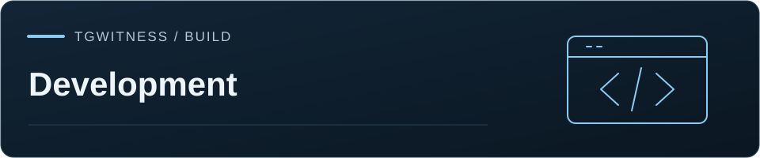

[TgWitness](../../README.md) / [Документация](../README.md) / [Папка](README.md)

[English](../ARCHITECTURE.md) · **Русский**

# Архитектура

Один процесс Python обслуживает панель FastAPI и любое количество изолированных рабочих областей, каждая из которых содержит клиент аккаунта пользователя Telethon. В базе данных SQLite хранится подписанный журнал событий, доступный только для добавления, а также изменяемые операционные настройки. В зашифрованном хранилище находятся учетные данные API, объект StringSession и ключ подписи. Фронтенд представляет собой простой пакет HTML/CSS/JavaScript: не требуется сборка на Node, использование CDN или загрузка фронтенда во время выполнения.

Дополнительные средства записи действий в браузере и AyuGram работают в <strong>отдельных процессах или контейнерах</strong>.

Пакет <code>tgwitness_capture</code> Пакет содержит собственный формат событий, ключи, артефакты, API контрольных точек, независимый свидетель и автономный верификатор. Он входит в состав основного пакета wheel, а также может быть установлен отдельно из <code>addons/capture</code>, без импорта сборщика. На главной панели <code>capture_api.py</code> и <code>capture_connections.py</code> предоставляют доступные только администратору средства управления в пределах рабочей области в рамках <code>/api/capture</code>; токены подключения хранятся в зашифрованном хранилище. Ни один рекордер или исходящий запрос не запускается из основного процесса. Каждая явная команда проверяет новый челлендж по закреплённому ключу рекордера. Экспортированные данные проверяются перед загрузкой и сохраняют свою исходную подпись; они не превращаются в события сообщений Telegram. Сеансы сбора данных и маршруты прокси остаются у каждого клиента. См. <a href="OPTIONAL-CAPTURE.md">руководство по независимому сбору данных</a> на английском языке для получения информации о развёртывании и границах доверия.

| Модуль | Ответственность |
| --- | --- |
| collector.py | Авторизация, выбор диалога, обновления, моментальные снимки, очередь медиафайлов, мониторинг соединений |
| interactions.py / telegram_client.py | Явные действия панели, подписанные квитанции, постоянные идентификаторы запросов и политика повторных попыток обратного вызова/присоединения на уровне задачи |
| message_content.py | Сравнение наблюдаемых сообщений с исключением метаданных доступа к транспортному уровню |
| workers.py | Ожидание завершения работы процессов экспорта файлов перед очисткой при отмене |
| distributed_export.py / distributed_pages.py | Параллельные задания чата, резервирование по аккаунтам, подписанные контрольные точки и очистка после проверки архива |
| distributed_takeout.py / export_timing.py | Возобновляемые сеансы Takeout и временные параметры для каждого запуска или возобновления |
| store.py | Транзакции WAL, упорядоченная цепочка событий, фильтры запросов, операционные настройки |
| fulltext.py | Производный полнотекстовый индекс (формы слов, BM25), привязанный к вершине журнала, подписанного; никогда не экспортируется |
| security.py | Создание частных файлов, зашифрованное хранилище, подпись Ed25519, блокировка одного процесса |
| evidence.py | Экспорт полного журнала, производные, контрольные точки, проверка вложений |
| verify.py | Автономный верификатор, доступный только для чтения (stdlib + криптография): архивы, охват, журналы свидетелей и сообщения каналов, файлы профилей |
| app.py | Аутентифицированный API, жизненный цикл, проверка запросов, статическая панель |
| profiles.py | Сборщики нескольких аккаунтов, контроллер совместного доступа, жизненный цикл для каждой рабочей области |
| access.py | Предоставления прав в определённой области, проверка разрешений, ограничения по IP-адресам, ограничения сеансов и консоль администратора |
| proxy_catalog.py | Снимки общедоступных каналов, проверки транспортных протоколов, общий пул прокси-серверов и выбор на основе работоспособности |
| provenance.py | Подписанная идентификация цикла сбора данных, измерения кода и зависимостей |
| network.py | Проверенные маршруты для каждой рабочей области; отредактированный статус и доказательства; параметры транспорта Telethon |
| sessions.py | Автономное преобразование прошедших проверку схем Telethon в формате SQLite в режим «только для чтения» |
| account_import.py | Обнаружение и нормализация поддерживаемых файлов аккаунтов и JSON в памяти |
| tdata.py | Ограниченный современный считыватель ZIP-файлов TData, проверка контрольных сумм и дешифрования, без извлечения данных |
| doctor.py | Проверка локальной готовности без сбора данных, входа в систему или установки пакетов |
| download.py | Загрузка данных с аутентификацией в режиме потоковой передачи с ограниченным объёмом чтения и без перезаписи |
| monitoring.py | Проверенная политика событий для каждой рабочей области и правила вложений для каждого типа, общие для обработчиков, статуса и подписанных квитанций |
| scope.py | Область наблюдения (выбранные чаты, папка Telegram, Весь аккаунт), типы источников, исключения, уровни повторной проверки |
| dossier.py | Профили пользователей по каждому чату, сформированные на основе сохраненных записей: факты со ссылками на записи, SHA-256/pHash аватаров, извлечение упоминаний |
| witness_api.py | Токены свидетелей, доступные только для чтения, и подписанная вершина журнала, которую они могут получить |
| witness.py | Независимый процесс свидетеля: собственный ключ и журнал, проверка заголовков, подписанные сообщения канала, экспорт |
| оповещения.py | Уведомления Apprise и список уведомлений панели |
| logging_config.py | Ведение журнала консоли и ротационная диагностика сервера при запуске без графического интерфейса |
| static/ | Адаптивный интерфейс, шлюз локального доступа, фильтры, подробная информация, экспорт данных, настройка аккаунта |
| demo.py | Чётко маркированный синтетический журнал, изолированный от реального сбора данных |

Обработчики наблюдений регистрируются до установления соединения. Сбор данных в режиме реального времени ограничивается идентификатором активного клиента, явным состоянием выполнения, включенными источниками или областью наблюдения (режимы «папка» или «весь аккаунт» добавляют новый чат в качестве источника при его первом обновлении), а также политикой событий. Отклоненные и замещенные клиенты не могут предоставлять обновления в режиме реального времени. Необработанные реакции и обновления членства сохраняют ограничения видимости. Содержимое входящего сообщения и соответствующие медиафайлы для сохранения в долгосрочном хранилище фиксируются одновременно. Задания сохраняют исходный дескриптор TL и привязывают его хеш к подписанному наблюдению за сообщением. Семантика отправителя, редактора и удаляющего лица разделена.

Каждая рабочая область принимает один аккаунт и имеет собственный каталог и идентификатор для подписи. Главная рабочая область остается в корневом каталоге в целях совместимости; дополнительные рабочие области находятся в каталоге profiles/<id>/. Один токен-носитель управляет всей установкой; рабочие области не являются отдельными субъектами авторизации. Блокировки процессов защищают каталоги; блокировки базы данных обеспечивают последовательную вставку событий. Каждое добавление фиксируется синхронно в журнале WAL базы данных SQLite в режиме FULL. Триггеры обновления/удаления событий предотвращают обычные изменения со стороны приложений; администраторы файловой системы остаются в пределах границы доверия.</id>

Авторизация через API осуществляется с помощью токена «bearer». Операции входа в систему сериализуются и ограничены по времени. При загрузке аккаунтов применяется специальный лимит в 12 MiB для кодированного тела запроса и 8 MiB для декодированного файла; для обычных запросов API сохраняется лимит в 16 KiB. Преобразование выполняется в рабочем потоке, сохраняет загружаемые данные в памяти и возвращает нормализованные входные данные в авторизованный браузер. Вход с помощью QR-кода предусматривает кандидатный идентификатор для каждой рабочей области, кратковременный идентификатор, задачу ожидания и явную отмену. Только авторизованный клиент становится активным. Функция Telegram FloodWait возвращает значение Retry-After; учетные данные и исходные сообщения об ошибках RPC не раскрываются в ошибках API. Экспорт журналов выполняется вне асинхронного цикла событий и сериализуется для каждой рабочей области. При этом обеспечивается потоковая передача стабильного моментального снимка чтения наряду с продолжающейся записью в WAL. Задания по сбору данных из чатов могут выполняться одновременно на отдельных аккаунтах; каждый аккаунт остаётся зарезервированным до тех пор, пока его задание не завершится. Приостановленное или завершившееся с ошибкой задание сохраняет свои контрольные точки. Успешная проверка архива позволяет очистить его рабочие файлы, оставив ZIP-архив, подписанный план и статус. Сборщики рабочих областей используют общий цикл обработки процессов и событий.

Текущие моментальные снимки истории и оперативные обновления могут пересекаться. Оба представляют собой отдельные наблюдения, помеченные источником; дубликаты не сворачиваются автоматически. Не реализовано никаких выводов на основе отсутствующих идентификаторов, сфабрикованного удалённого текста, принудительного перечисления участников или автоматического присоединения к группе.

Объяснение, предназначенное для операторов, см. в разделах [Как работает сбор данных](COLLECTION.md) и [Форматы аккаунтов и сеансов](ACCOUNTS.md).

Сетевая конфигурация хранится в зашифрованном хранилище. Применение маршрута приводит к закрытию старых клиентов и отмене незавершённых входов в систему; последующие подключения используют этот маршрут без прямого перехода на резервный вариант. При новой установке с использованием внешнего ключа ключ Fernet для каждой рабочей области вычисляется с помощью алгоритма HKDF-SHA256 на основе файла мастер-ключа и сохраненного случайного солевого значения. Это обеспечивает защиту секретных данных отдельно от каталога данных, а не содержимого журналов или медиафайлов в виде открытого текста.

Локальный демо-доступ использует отдельно сгенерированную способность процесса, а не настроенный токен панели. Для выдачи и принятия требуется явный демо-режим, синтетический корневой узел без дополнительных рабочих областей или авторизованных сеансов, пеер/хост с обратной связью, отсутствие заголовков прокси-переадресации и отсутствие междоменных запросов браузера. Активные API сохраняют аутентификацию по носителю и отклоняют изменения в коллекции в демо-режиме.
