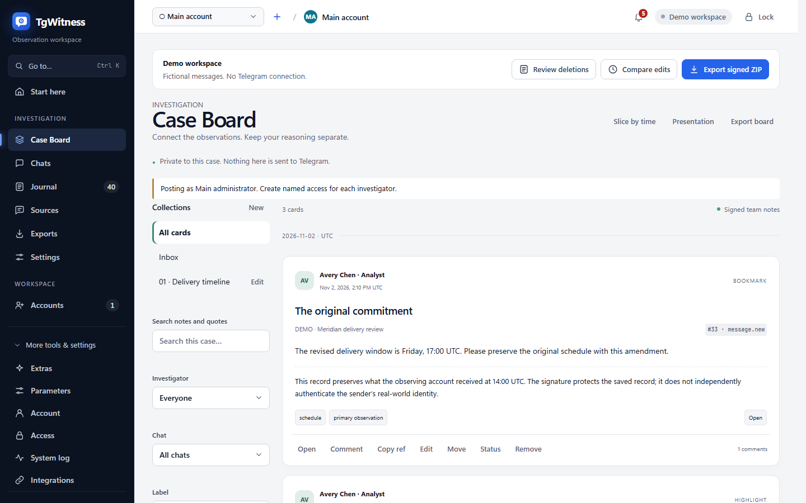

[TgWitness](../../README.md) / [Документация](../README.md) / [Папка](README.md) · [Расследование](INVESTIGATION.md)


<a id="case-board"></a>
# Case Board

Case Board предоставляет следственной группе общий рабочий доступ к сохраненным материалам. Вы можете добавить наблюдение в закладки, выделить конкретный фрагмент текста, сохранить последовательность действий и обсудить их с коллегами. Карточки сохраняют ссылки на источники и подписанную историю изменений. Аннотации команды остаются в рабочей области и отдельно идентифицируются по сравнению с исходными наблюдениями в Telegram.

[Модель доказательств](EVIDENCE.md) · [Доступ](ACCESS.md) · [Отчёты](CASE_REPORTS.md)



<details>
<summary>На этой странице</summary>

- [Работа с делом](#work-with-a-case)
- [Права доступа](#permissions)
- [Сохраненные контракты](#stored-contracts)
- [API и экспорт](#api-and-exports)
- [Операционные ограничения](#operating-limits)
</details>

<a id="work-with-a-case"></a>
## Работа с делом

Откройте **меню Дополнительные инструменты → Case Board** в стандартном или экспертном режиме. Язык интерфейса соответствует языку панели. Воспользуйтесь **кнопкой Добавить на Case Board** рядом с записью в журнале или сохраненным сообщением в чате либо выделите нужный элемент и нажмите **клавишу B**. Закладка добавится в папку «Входящие» одним щелчком. Измените его название, метки и примечание или переместите его в коллекцию. К отредактированной карточке добавляется подписанная версия; при удалении сохраняется история изменений.

Для первого дела выберите коллекцию и добавьте записи, отвечающие на один вопрос. Используйте комментарии для проверки интерпретации, а затем **функцию Презентация**, чтобы пролистать карточки и исходный контекст. При подготовке итогового отчёта выбирайте материалы Case Board отдельно в [Студии отчётов](CASE_REPORTS.md). Сохранение фрагмента не приводит к автоматической настройке фильтров данных отчёта.

Выделите текст внутри сохранённого сообщения чата, чтобы открыть **меню Выделить → Доска**. Выберите цвет и добавьте примечание. Сервер проверяет точную цитату и сохранённую версию, включая эмодзи, текст с направлением написания справа налево (RTL) и комбинирующие знаки. Интерфейс не отображает выделение в замаскированном или преобразованном тексте.

Нажмите Shift и щелкните две записи в одном чате, чтобы **создать фрагмент между ними**, воспользуйтесь **функцией Фрагмент по времени** или сохраните текущие фильтры журнала: по чату, периоду и типу события. Сохраненный фрагмент имеет собственное авторитетное условие: при его открытии в «Журнале» также применяются фильтры по нескольким чатам, ограничениям по количеству сообщений и участникам. **Функция Показать записи, добавленные после создания закладки** выделяет более поздние добавления. Изменение фильтров в «Журнале» приводит к выходу из фрагмента. В **разделе** «Люди» **функция Выделить действия этого человека** использует записанный идентификатор участника; она не предполагает, что автор сообщения редактировал, удалял или реагировал на сообщение.

В диалоговом окне фрагмента перед разрешением создания отображается предварительный просмотр с указанием количества записей. Параметр `all` включает все зафиксированные типы событий, в том числе моментальные снимки, правки, удаления, реакции, обновления членства/сервисов, собственные действия, нажатия кнопок, результаты медиафайлов, восстановленные сообщения и будущие типы событий. Выбор описывает сохраненные наблюдения. Уведомления об удалении из неизвестных чатов представляют собой отдельный контекст, доступный только при доступе к всему набору рабочих областей и никогда не привязанный к одному из выбранных чатов.

Коллекции имеют заданную область действия в чате. Пустая область действия означает всю рабочую область. Коллекция не может содержать карточки за пределами своей области действия; участник с ограниченным доступом к чату не может просматривать коллекцию более широкого охвата. «Входящие» — это виртуальная коллекция для неназначенных карточек. Поиск и фильтры охватывают только видимые карточки; ветки обсуждений и упоминания наследуют права доступа родительской карточки. Удаленные комментарии отмечаются в обсуждении значком «удалено». История просмотров не фиксируется.

**Режим Презентация** открывает все карточки в выбранной коллекции с видами «Карточка», «Контекст источника» и «Комментарии команды», а также с клавишами «Назад» и «Вперёд». Он не предоставляет элементов управления для редактирования. Обычная лента имеет пагинацию; в режиме «Презентация» список загружается по страницам, а подробная информация по одной карточке выводится за раз.

<a id="permissions"></a>
## Права доступа

Для выполнения всех операций требуются права доступа `view`, область действия «рабочая область/чат» и `board.read`. Право `board.write` позволяет добавлять карточки, комментарии, перемещать карточки и устанавливать статусы «открыто»/«на рассмотрении». Право `board.manage` разрешает управление коллекциями, установку статусов «подтверждено»/«отклонено», а также внесение изменений и удаление чужих карточек. Статус является решением команды, а не результатом криптографической проверки.

Предустановленные настройки формы доступа: «Рецензент» = чтение; «Аналитик» = чтение/запись; «Оператор» = чтение/запись/управление, в дополнение к их существующим правам. Существующие права доступа не приводят к автоматическому получению новых прав. Главный администратор обладает всеми правами и публикует сообщения от имени **Главного администратора**. Для указания авторства используйте именованные права доступа. В списке упоминаний отображаются только те текущие права доступа, которые позволяют прочитать полную родительскую карту.

Право доступа к чату A не позволяет получить карту или фрагмент для A+B, даже путем угадывания его ID или указания ложного `target.chat_id`. Метаданные целевого объекта определяются на сервере по подписанному хешу события. Коллекции, количество обсуждений, связанные карты и оперативные уведомления фильтруются перед отправкой ответа. Для экспорта требуется право `export`, а также `board.read`; существующий экспортер, не имеющий доступа к доске, получает обычный архив доказательств без заметок команды. SSE проводит повторную проверку текущих прав до каждого пакета.

<a id="stored-contracts"></a>
## Сохраненные контракты

Подобно наблюдениям, аннотации записываются транзакционно в таблицу SQLite с режимом добавления только в рабочей области. Файл `annotations.jsonl` представляет собой точный канонический экспорт из того же моментального снимка чтения, что и файл `events.jsonl`. Не существует второго конкурирующего хранилища аннотаций, а также события журнала `board.activity`.

Каждая строка содержит именно:

```json
{
  "seq": 1,
  "at": "2026-11-02T14:00:00.000+00:00",
  "access_id": "admin",
  "access_label": "Main administrator",
  "kind": "board.bookmark",
  "payload": {"id": "32 lowercase hex digits", "target": {"event_hash": "64 lowercase hex digits"}},
  "previous_hash": "64 zeroes for the first record",
  "hash": "SHA-256 described below",
  "signature": "base64 Ed25519 signature"
}
```

Приведённый выше сокращённый пример иллюстрирует конверт; фактические полезные нагрузки включают в себя значения по умолчанию моделей и целевые поля, определяемые сервером. Схемы запросов API находятся в каталоге [`tgwitness/schemas`](../../tgwitness/schemas/board-bookmark.json) и генерируются из моделей Pydantic времени выполнения с помощью скрипта `python tools/build_board_schemas.py`. Дополнительные поля запроса отклоняются. Идентификаторы генерируются на стороне сервера в случае их отсутствия. Авторство, время, моментальный снимок и подпись не могут быть указаны вызывающей стороной. Идентификаторы именованных разрешений соответствуют существующему 16-гексадецимальному формату Access; идентификаторы карт имеют длину 32 гексадецимальных символа.

Канонический JSON представляет собой UTF-8 с отсортированными ключами объектов, без пробелов между токенами, с неэкранированным Unicode и без значений NaN или бесконечности. Хеш аннотации — это SHA-256 канонического объекта, содержащего тег `format: "tgwitness-annotations-v1"`, а также все семь полей конверта вплоть до `previous_hash`. Данный тег формата отделяет домен хеша от наблюдений. Подпись формируется с помощью алгоритма Ed25519 над 32 байтами исходного хеша. Нумерация начинается с 1. Ревизии сохраняют идентификатор карты и указывают хеш предыдущей аннотации в поле `supersedes`; они не могут изменять область действия чата. Перемещения, статусы и удаления представляют собой отдельные записи. Таблица SQLite не допускает операций UPDATE и DELETE.

Файл `case-board.json` содержит `{statement, signature}`. Каноническое утверждение подписывается ключом рабочей области и содержит `format: "tgwitness-case-board-v1"`, `public_key`, `created_at`, `journal_head`, `meaning` и `state`. Состояние представляет собой детерминированное воспроизведение: `annotations_head`, упорядоченный массив `items` (коллекции, карточки, комментарии, включая «надгробные камни») и `status_history`. Элементы сохраняют свой последний хеш аннотации, порядковый номер, автора и время, а также исходного создателя и время создания при всех ревизиях. Воспроизведение проверяет ревизии, родительские элементы, ссылки на коллекции и дубликаты идентификаторов действий. Файл ``manifest.json`` и новые контрольные точки также привязывают ``annotations_head``. Сохраняйте контрольную точку отдельно, чтобы обнаружить усечение или перезапись с использованием скопированного ключа подписи.

<a id="text-versions"></a>
### Текстовые версии

`range.start` — это смещение кодовой точки Unicode с нулевой базой, `length` — положительное число, обозначающее количество кодовых точек, а `quote` должно точно соответствовать подстроке из `payload.text` или `payload.caption` в целевом событии. Не применяются преобразования NFC/NFKC, преобразование регистра или нормализация графем. Срезки строк в Python и метод JavaScript ``Array.from(text)`` реализуют ту же систему индексации. Сочетание знаков и эмодзи ZWJ может занимать несколько кодовых точек. ``range.version`` — это хеш целевого события, а не текущая версия сообщения или смещение UTF-16-сущности в Telegram. Последующие правки никогда не перемещают выделение автоматически.

<a id="slice-identity-and-time"></a>
### Идентификатор фрагмента и время

Запрос `query` принимает ровно один `chat_id` или непустой список `chat_ids`, опциональные включительные границы `from`/`to`, включительные границы message-ID (только для одного чата), `kinds: "all"` или точные виды/виды с префиксными подстановочными знаками, явных `actors`, `search`, `hide_system` и `include_unscoped`. Группы видов журнала расширяются до своих точных предикатов. Поиск использует поиск по полезной нагрузке журнала в формате NFC с преобразованием регистра, не изменяя подписанный исходный текст. Даты требуют указания часового пояса и нормализуются до UTC. Даты фильтруют **поле `observed_at`**. Поле ``source_at`` Telegram отображается отдельно. Удаление без временной метки источника не имеет вымышленного времени удаления. Запись, проведенное наблюдение над которой было вне временного интервала, не попадает в него; фрагмент по идентификаторам сообщений может включать более позднее удаление для этих идентификаторов.

Снимок (`snapshot`) фиксирует время создания, границу последовательности/хеша журнала, количество совпадений, первую/последнюю последовательность и `result_hash`. Последний представляет собой SHA-256 канонического массива JSON в кодировке UTF-8, содержащего хеши совпадающих событий, отсортированные в лексикографическом порядке, включая `[]` для пустого фрагмента. Он также содержит точное количество типов и миниатюру времени наблюдения с разрешением 24 бина. Фрагмент хранит запрос, а не дубликаты исходных записей. При экспорте в файле `board/slices/<id>.json` перечисляются текущие хеши, а также добавленные и удалённые последовательности. Верификатор воссоздаёт исходный результат на границе создания, а затем — текущий результат. Добавленные записи фиксируются как факт изменения. Удаление исходного события нарушает неизменяемую цепочку доказательств; оно не принимается без уведомления как обычное удаление из фрагмента.

Снимки реакций содержат неполные списки недавних участников. Программа просмотра сравнивает соседние снимки одного и того же чата/сообщения, включая предшествующий снимок, находящийся за пределами фрагмента, и сообщает об агрегированных разностях подсчётов **между наблюдениями**. Отсутствие недавних участников не рассматривается как удаление реакции. Первый снимок не имеет выведенного более раннего состояния. Наблюдения участников по-прежнему относятся к тому снимку, в котором они были предоставлены, а не к вымышленному моменту действия.

<a id="api-and-exports"></a>
## API и экспорт

`GET /api/board`» принимает параметры collection/chat/author/label/state/from/to/q/kind/comments, а также offset/limit и порядок сортировки по новейшим/старейшим записям. `GET /api/board/card/{id}`» возвращает карту, предварительный просмотр источника, ветку обсуждения, историю статусов и связанные карты. Подрут «участники» возвращает подходящие варианты упоминаний. Запрос `POST /api/board/{bookmark|highlight|slice|collection|comment|status|move|remove}` добавляет запись. Запрос `POST /api/board/slice-preview` выполняет вычисление запроса. Записи фрагментов выводятся по страницам с помощью запроса `GET /api/board/slice/{id}/records`; при повторном вычислении всегда используется текущий стабильный снимковый момент чтения. Запрос Live `/api/stream` передаёт уведомления `board` без полезных данных, отдельно от курсоров журнала.

`GET /api/board/export` возвращает подписанный документ. Пользователи с ограниченным доступом к чату получают чётко маркированное подписанное **раскрытие** информации, но никогда не получают аннотации из других чатов или полную цепочку сообщений. ZIP-архивы с полными доказательствами содержат файл `annotations.jsonl`, подписанный файл `case-board.json`, а также приложения в формате JSON для фрагментов. Настройки отчётов в форматах HTML/PDF/JSON позволяют выбрать вариант без доски, закладки/фрагменты без обсуждений или карточки с комментариями. В данном разделе мнения команды явно отделены от наблюдений. Фильтры данных отчёта также ограничивают доступные для чтения заметки; полные подписанные исходные файлы в ZIP-архиве с доказательствами остаются в полном объёме.

Запрос `GET /api/board/slice/{id}/export` возвращает подписанный фрагмент JSON в формате `tgwitness-board-selection-v1`; запрос `?format=csv` возвращает удобную таблицу без отдельной подписи. Сохраните файлы JSON и ZIP:

```sh
python -m tgwitness.verify evidence.zip --fingerprint TRUSTED_KEY_SHA256 --board
python -m tgwitness.verify board-slice.json --evidence evidence.zip --fingerprint TRUSTED_KEY_SHA256
python -m tgwitness.verify case-board.json --evidence evidence.zip --fingerprint TRUSTED_KEY_SHA256
```

Проверка выбора подтверждает подлинность подписанного заявления, точность исходных записей и полноту запроса в пределах указанной границы. ZIP-архив с доказательствами может быть более поздней версии, но должен содержать указанный префикс. Ошибка «dangling target» явно фиксируется в отчёте. Несоответствие исходного снимка фрагмента, изменение аннотации, несовпадение состояния воспроизведения или изменение исходного кода приводят к сбою проверки. Старые архивы без аннотаций сохраняют прежнее поведение при проверке.

По умолчанию для параметра «Передача» установлено значение **Не включать**. Явное включение отображает карточки через уже минимизированные записи, опускает недоступные/пропущенные цели, скрывает выделенные фрагменты, исходный текст которых был минимизирован, очищает текст команды с применением тех же правил упоминаний/контактов и, по желанию, заменяет метки следователей на R01, R02… в метаданных и известных вхождениях в заметках. Исходный файл ``annotations.jsonl`` не раскрывается. Подписанный файл-сайдкар `tgwitness-case-board-handover-v1` и отчёт содержат одни и те же минимизированные материалы. Количество фрагментов отражает только раскрытые записи, при этом детали об участниках исходного моментального снимка или запроса не раскрываются. Имена в свободном тексте, неизвестные программе минимизации, по-прежнему требуют проверки, как и при обычной передаче дел. Производный файл имеет собственную подпись; исходные аннотации сохраняют свои подписи в полном архиве.

<a id="operating-limits"></a>
## Операционные ограничения

Параметры включают мягкие ограничения: 10 000 карточек и 50 000 комментариев, страницу фрагмента объёмом до 5 000 записей, а также управление предварительным просмотром медиафайлов. При превышении мягких ограничений выдаётся предупреждение без удаления истории. Страницы ленты содержат не более 200 карточек. Размер автономных выдержек в формате JSON ограничен 64 MiB; для более объёмных материалов сузьте запрос или используйте ZIP-архив с цифровой подписью. Автономный верификатор ограничивает воспроизведение аннотаций объёмом 256 MiB. Case Board не поддерживает и не реализует уведомления о внешних комментариях.

В рамках автоматизированного приёма данной функции используются фиктивные данные и имитированный канал передачи данных Telegram для проверки хранения, доступа, отображения и экспорта. Ознакомьтесь с [разделом Объём проверки](EVIDENCE.md#verification-scope) для получения информации о масштабах проверки доказательств.
