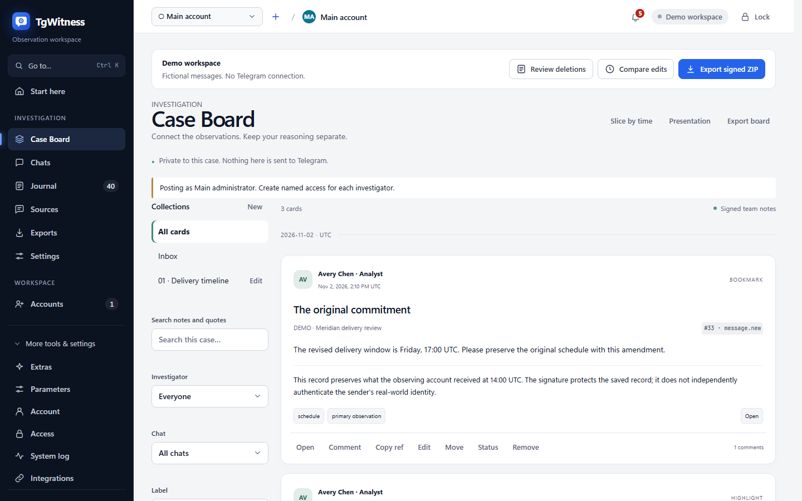

[TgWitness](../../README.md) / [Документация](../README.md) / [Папка](README.md) · [Расследование](../INVESTIGATION.md)


# Доска дела

Доска дела даёт команде расследования общее рабочее представление сохранённого материала.
Добавьте наблюдение в закладки, выделите точный фрагмент, сохраните диапазон действий и обсудите
его с коллегами. Карточки сохраняют ссылки на источники и подписанную историю версий. Аннотации
команды остаются в рабочем пространстве и отличимы от исходных наблюдений Telegram.

[Модель доказательств](../EVIDENCE.md) · [Доступ](../ACCESS.md) · [Отчёты](CASE_REPORTS.md)



<details>
<summary>На этой странице</summary>

- [Работа с делом](#работа-с-делом)
- [Права](#права)
- [Контракты хранимых данных](#контракты-хранимых-данных)
- [API и экспорт](#api-и-экспорт)
- [Эксплуатационные ограничения](#эксплуатационные-ограничения)

</details>

## Работа с делом

Откройте **Инструменты → Доска дела** в режиме «Обычный» или «Эксперт». Язык совпадает с языком
панели. Нажмите **На доску** рядом с записью журнала или сохранённым сообщением чата либо
переведите на элемент фокус и нажмите **B**. Закладка добавляется во «Входящие» одним щелчком.
Измените её заголовок, метки и заметку или переместите в коллекцию. Изменение карточки добавляет
подписанную версию; удаление карточки сохраняет историю.

Для первого дела выберите коллекцию и добавьте записи, отвечающие на один вопрос. Обсудите
интерпретацию в комментариях, затем откройте **Презентация**, чтобы пройтись по карточкам и
исходному контексту. При подготовке итогового документа выберите материал доски дела отдельно в
[конструкторе отчётов](CASE_REPORTS.md). Сохранение среза не настраивает фильтры данных отчёта
автоматически.

Выделите текст в сохранённом сообщении чата, чтобы появилась кнопка **Выделение → на доску**.
Выберите цвет и добавьте заметку. Сервер проверяет точную цитату и сохранённую версию, включая
эмодзи, текст с письмом справа налево и комбинируемые символы. Интерфейс не переносит выделение
через скрытый или преобразованный текст.

Щёлкните с Shift по двум записям одного чата, чтобы получить **Срез между записями**, используйте
**Срез по времени** или сохраните текущие фильтры журнала по чату, периоду и видам событий. У
сохранённого среза свой определяющий предикат: при его открытии в разделе «Журнал» применяются
также несколько чатов, пределы номеров сообщений и фильтры по акторам.
**Показать записи, добавленные после закладки** отделяет более поздние добавления. Изменение
фильтров журнала выводит из среза. В разделе «Люди» кнопка **Срез действий этого участника**
использует записанный ID актора; она не предполагает, что автор сообщения редактировал, удалял
сообщение или ставил на него реакцию.

Диалог среза показывает счётчики до того, как разрешить создание. `all` включает все записанные
виды, в том числе снимки, правки, удаления, реакции, обновления участников и служебные
обновления, собственные действия, кнопки, результаты обработки медиа, восстановленные сообщения и
будущие виды событий. Выборка описывает сохранённые наблюдения. Уведомления об удалении без
известного чата — отдельный контекст, доступный только при доступе ко всему рабочему
пространству и никогда не приписываемый одному из выбранных чатов.

У коллекций есть объявленная область чатов. Пустая область означает всё рабочее пространство.
Коллекция не может содержать карточки вне своей области; участник с доступом к ограниченному
набору чатов не может читать более широкую коллекцию. «Входящие» — виртуальная коллекция для
карточек, не отнесённых ни к одной коллекции. Поиск и фильтры охватывают только видимые карточки;
обсуждения и упоминания наследуют доступ родительской карточки. На месте удалённых комментариев в
обсуждении остаётся отметка об удалении. История просмотров не записывается.

**Презентация** открывает все карточки выбранной коллекции с представлениями «Карточка»,
«Исходный контекст» и «Комментарии команды» и переходом к предыдущей и следующей карточке с
клавиатуры. Элементов редактирования в ней нет. Обычная лента разбита на страницы; презентация
загружает свой список постранично и запрашивает подробности по одной карточке за раз.

## Права

Для всех операций нужны `view`, доступ к рабочему пространству или чатам и `board.read`.
`board.write` разрешает добавлять карточки, комментарии, перемещения и статусы «открыто» и
«на проверке». `board.manage` разрешает управлять коллекциями, ставить статусы «подтверждено» и
«отклонено», изменять и удалять чужие карточки. Статус — решение команды, а не результат
криптографической проверки.

Пресеты формы доступа: «Рецензент» — чтение; «Аналитик» — чтение и запись; «Оператор» — чтение,
запись и управление, в дополнение к уже имеющимся у них правам. Существующие доступы не получают
новых прав молча. Главный администратор имеет все права и публикует от имени
**Главный администратор**. Для установления авторства используйте именные доступы. В упоминаниях
перечисляются только текущие доступы, которые могут читать родительскую карточку целиком.

Доступ к чату A не может получить карточку или срез по A+B, даже угадав их ID или передав ложный
`target.chat_id`. Метаданные цели определяются на сервере по хешу подписанного события.
Коллекции, счётчики обсуждений, связанные карточки и живые уведомления фильтруются до отправки
ответа. Для экспорта нужны `export` и `board.read`; имеющийся доступ с правом экспорта, но без
доступа к доске получает обычный архив доказательств без заметок команды. SSE перепроверяет
текущие доступы перед каждым пакетом.

## Контракты хранимых данных

Как и наблюдения, аннотации записываются транзакционно в таблицу SQLite рабочего пространства,
допускающую только добавление. `annotations.jsonl` — её точный канонический экспорт из того же
снимка чтения, что и `events.jsonl`. Второго, конкурирующего хранилища аннотаций нет, как нет и
события журнала `board.activity`.

Каждая строка содержит ровно:

```json
{
  "seq": 1,
  "at": "2026-11-02T14:00:00.000+00:00",
  "access_id": "admin",
  "access_label": "Main administrator",
  "kind": "board.bookmark",
  "payload": {"id": "32 lowercase hex digits", "target": {"event_hash": "64 lowercase hex digits"}},
  "previous_hash": "64 zeroes for the first record",
  "hash": "SHA-256 described below",
  "signature": "base64 Ed25519 signature"
}
```

Сокращённый пример выше иллюстрирует конверт; реальные полезные нагрузки содержат значения модели
по умолчанию и поля цели, определённые сервером. Схемы запросов API находятся в
[`tgwitness/schemas`](../../tgwitness/schemas/board-bookmark.json); они генерируются из
Pydantic-моделей среды выполнения командой `python tools/build_board_schemas.py`. Лишние поля
запроса отклоняются. Если ID не указаны, они генерируются на сервере. Авторство, время, снимок и
подпись вызывающая сторона передать не может. ID именных доступов следуют существующему формату
раздела «Доступ» из 16 шестнадцатеричных символов; ID карточек — 32 шестнадцатеричных символа.

Канонический JSON: UTF-8, отсортированные ключи объектов, без пробелов между токенами,
неэкранированный Unicode, без NaN и бесконечностей. Хеш аннотации — SHA-256 канонического объекта,
содержащего `format: "tgwitness-annotations-v1"` и все семь полей конверта до `previous_hash`
включительно. Этот тег формата отделяет домен его хешей от наблюдений. Подпись — Ed25519 над 32
сырыми байтами хеша. Нумерация начинается с 1. Новые версии сохраняют ID карточки и указывают хеш
предыдущей аннотации в `supersedes`; область чатов они изменить не могут. Перемещения, статусы и
удаление — отдельные записи. Таблица SQLite отклоняет UPDATE и DELETE.

`case-board.json` содержит `{statement, signature}`. Каноническое заявление подписано ключом
рабочего пространства и содержит `format: "tgwitness-case-board-v1"`, `public_key`, `created_at`,
`journal_head`, `meaning` и `state`. Состояние — результат детерминированного воспроизведения:
`annotations_head`, упорядоченный массив `items` (коллекции, карточки, комментарии, включая отметки
об удалении) и `status_history`. Элементы сохраняют хеш последней аннотации, номер, автора и время,
а также исходного создателя и время создания во всех версиях. Воспроизведение проверяет версии,
родительские элементы, ссылки на коллекции и повторяющиеся ID действий. `manifest.json` и новые
контрольные точки также фиксируют `annotations_head`. Храните контрольную точку независимо, чтобы
обнаружить усечение или переписывание с помощью скопированного ключа подписи.

### Версии текста

`range.start` — смещение в кодовых точках Unicode с отсчётом от нуля, `length` — положительное
число кодовых точек, а `quote` должна точно совпадать с подстрокой `payload.text` или
`payload.caption` целевого события. Нормализация NFC/NFKC, приведение регистра и нормализация
графем не применяются. Срезы строк Python и `Array.from(text)` в JavaScript реализуют одинаковую
индексацию. Комбинируемые символы и эмодзи с ZWJ могут занимать несколько кодовых точек.
`range.version` — хеш целевого события, а не текущая версия сообщения и не смещение сущности
Telegram в UTF-16. Последующие правки никогда не переносят выделение автоматически.

### Идентичность и время среза

`query` принимает ровно один `chat_id` или непустой `chat_ids`, необязательные включительные
`from`/`to`, включительные границы ID сообщений (только для одного чата), `kinds: "all"` либо
точные виды или виды с подстановочным знаком по префиксу, явные `actors`, `search`, `hide_system` и
`include_unscoped`. Группы видов журнала раскрываются в свои точные предикаты. Поиск использует
поиск журнала по полезной нагрузке с нормализацией NFC и приведением регистра, не изменяя
подписанный исходный текст. Даты должны содержать часовой пояс и приводятся к UTC.
Даты фильтруют **observed_at**. Время Telegram `source_at` отображается отдельно. Удалению без
исходной метки времени время удаления не приписывается. Поздняя запись, наблюдённая вне временного
интервала, в него не попадает; срез по ID сообщений может включать более позднее удаление этих
сообщений.

`snapshot` фиксирует время создания, границу журнала по номеру и хешу, число совпадений, первый и
последний номер и `result_hash`. Последний — SHA-256 канонического JSON-массива в UTF-8 из хешей
совпавших событий, отсортированных лексикографически, включая `[]` для пустого среза. Снимок также
содержит точные счётчики по видам и миниатюру распределения по времени наблюдения из 24 интервалов.
Срез хранит запрос, а не копии исходных записей. При экспорте `board/slices/<id>.json` перечисляет
текущие хеши и номера добавленных и удалённых записей. Верификатор восстанавливает исходный
результат на границе создания, а затем текущий результат. Добавленные записи отражаются как факт
изменения. Удаление исходного события нарушает неизменяемую цепочку доказательств; оно не
принимается молча как обычное удаление из среза.

Снимки реакций содержат неполные списки недавних акторов. Обозреватель сравнивает соседние снимки
одного чата и сообщения, включая предшествующий снимок за пределами среза, и показывает изменения
суммарных счётчиков **между наблюдениями**. Об отсутствующих в списке недавних акторах не
утверждается, что они сняли реакцию. Для первого снимка более раннее состояние не выводится.
Наблюдения об акторах остаются привязаны к снимку, в котором они были получены, а не к выдуманному
времени действия.

## API и экспорт

`GET /api/board` принимает параметры collection/chat/author/label/state/from/to/q/kind/comments,
offset/limit и порядок newest/oldest. `GET /api/board/card/{id}` возвращает карточку, предпросмотр
источника, обсуждение, историю статусов и связанные карточки. Подмаршрут participants возвращает
доступные варианты упоминаний.
`POST /api/board/{bookmark|highlight|slice|collection|comment|status|move|remove}` добавляет запись.
`POST /api/board/slice-preview` вычисляет запрос. Записи среза выдаются постранично по
`GET /api/board/slice/{id}/records`; пересчёт всегда использует текущий стабильный снимок чтения.
Живой поток `/api/stream` отправляет уведомления `board` без полезной нагрузки, отдельно от курсоров
журнала.

`GET /api/board/export` возвращает подписанный документ. Доступ, ограниченный отдельными чатами,
получает явно помеченное подписанное **раскрытие** и никогда — аннотации других чатов или полную
цепочку. Полные ZIP с доказательствами содержат `annotations.jsonl`, подписанный `case-board.json`
и JSON-приложения со срезами. В настройках отчётов HTML/PDF/JSON можно выбрать вариант без доски,
закладки и срезы без обсуждений или карточки с комментариями. Раздел явно отделяет мнения команды
от наблюдений. Фильтры данных отчёта ограничивают и читаемые заметки; полные подписанные исходные
файлы в ZIP с доказательствами остаются полными.

`GET /api/board/slice/{id}/export` формирует подписанную JSON-выдержку `tgwitness-board-selection-v1`;
`?format=csv` формирует удобную таблицу без собственной подписи. Сохраняйте JSON и ZIP:

```sh
python -m tgwitness.verify evidence.zip --fingerprint TRUSTED_KEY_SHA256 --board
python -m tgwitness.verify board-slice.json --evidence evidence.zip --fingerprint TRUSTED_KEY_SHA256
python -m tgwitness.verify case-board.json --evidence evidence.zip --fingerprint TRUSTED_KEY_SHA256
```

Проверка выборки подтверждает подлинность подписанного заявления, точных исходных записей и
полноту её запроса на указанной границе. ZIP с доказательствами может быть новее, но должен
содержать этот префикс. О неразрешённой цели сообщается явно. Другой исходный снимок среза,
изменённая аннотация, несовпадающее воспроизведённое состояние или изменённый источник приводят к
провалу проверки. Старые архивы без аннотаций проверяются так же, как прежде.

Для передачи по умолчанию выбрано **Не включать**. При явном включении карточки проецируются
через уже минимизированные записи: недоступные или исключённые цели пропускаются, выделения,
исходный текст которых был минимизирован, не раскрываются, текст команды очищается по тем же
правилам для упоминаний и контактов, а метки участников расследования по желанию заменяются на
R01, R02… в метаданных и в известных вхождениях в заметках. Исходный `annotations.jsonl` не
раскрывается. Подписанный сопроводительный файл `tgwitness-case-board-handover-v1` и отчёт содержат
один и тот же минимизированный материал. Счётчики срезов описывают только раскрытые записи;
сведения об акторах из исходного снимка и запроса не раскрываются. Имена в свободном тексте,
неизвестные минимизатору, по-прежнему требуют проверки, как и в обычных передачах. Производный
документ имеет собственную подпись; исходные аннотации сохраняют свои подписи в полном архиве.

## Эксплуатационные ограничения

В параметрах задаются мягкие пределы в 10 000 карточек и 50 000 комментариев, страница среза до
5000 записей и показ предпросмотра медиа. При достижении мягких пределов выводится предупреждение,
история не удаляется. Страница ленты содержит не более 200 карточек. Отдельные JSON-выдержки
срезов ограничены 64 МиБ; для большего объёма сузьте запрос или используйте подписанный ZIP.
Автономный верификатор ограничивает воспроизведение аннотаций 256 МиБ. Внешние уведомления о
комментариях доска дела не включает и не реализует.

Автоматическая приёмка функции использует вымышленные данные и имитацию транспорта Telegram для
проверки хранения, доступа, отображения и экспорта. Охват проверок доказательств описан в разделе
[охват проверки](../EVIDENCE.md#verification-scope).
