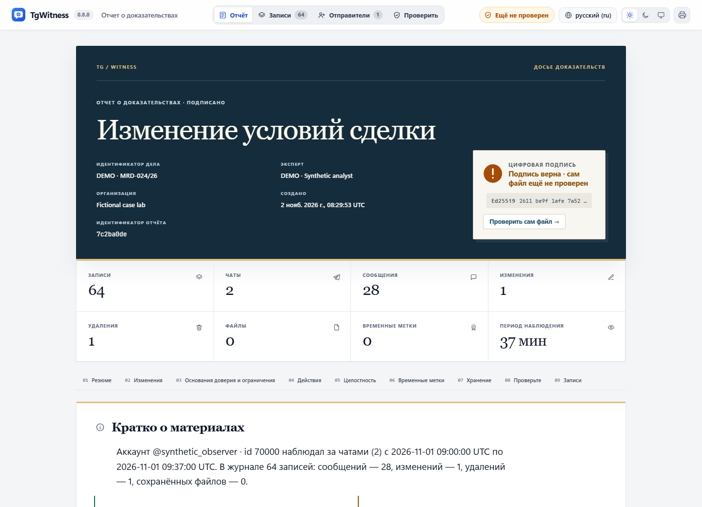
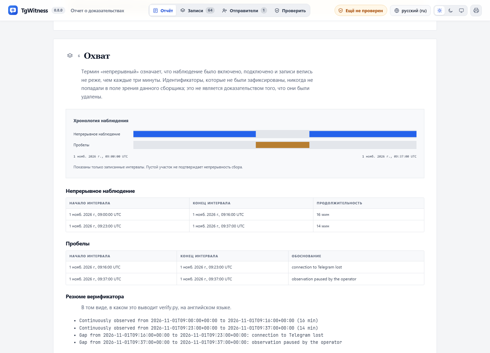
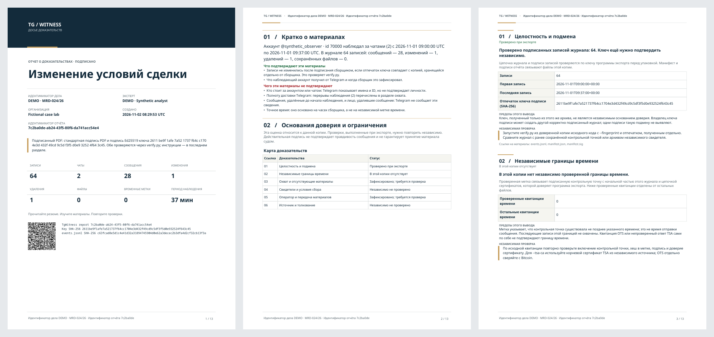

# Отчёт по делу: основания доверия и ограничения

[English](../CASE_REPORTS.md)

В каждом отчёте раздел «Основания доверия и ограничения» объясняет, на каких
материалах основан вывод, чего он не подтверждает и как его проверить независимо.
Выводы относятся к конкретной выгрузке. Название режима или набор включённых
настроек сами по себе не подтверждают надёжность материала.

Раздел доступен в отчётах журнала, сокращённой выборки, отдельного чата, экспорта
аккаунта и копии для передачи. Для журнала и выборки PDF использует ту же оценку,
что подписанный `report.json`. В ZIP оценка также включена в подписанный
`manifest.json`, поле `case_assessment`. Исходные записи не изменяются.

## Форматы и подача

### Конструктор отчётов

Откройте **Экспорт → Создать отчёт**. Выберите чаты, авторов, даты наблюдения
в UTC и типы событий, затем состав документа. Просмотр данных рассчитывает
полную выборку, показывает сохранённые правки, текст до удаления и пропуски ID.
Пропущенный номер не доказывает удаление сообщения. Три оформления — досье, аналитический
и редакционный обзор — выбираются независимо от состава. Для состава доступны
подробное досье, краткая сводка, обзор активности и собственный набор разделов.
Пресет сохраняет выбранное оформление, реквизиты дела и авторские заметки.

Можно включить динамику, тепловую карту «день недели × час UTC», рейтинги
участников и чатов, состав наблюдений. В рейтинге показываются 5–30 групп,
неизвестные авторы и остаток отдельно. По умолчанию участники имеют нейтральные
обозначения; показ ID включается явно. Это не скрывает личности в исходном журнале.

Авторские разделы содержат вопрос исследования, методику, выводы со ссылками
на записи и нерешённые вопросы. Подпись сохраняет слова автора, но не подтверждает
независимую экспертизу. Эти заметки и статистика полного журнала не попадают
в сокращённую выборку журнала.

Предпросмотр использует те же компоненты обложки, заметок и диаграмм, что итоговый
HTML, и подходящие под фильтры записи среди первых 50 000 записей источника.
Для полного расчёта выборки используйте просмотр данных ниже. Он не подписан и не сохраняет черновик.
Кнопки «Обложка» и «Диаграммы» переключают раздел. Это не просмотр всех страниц PDF.
Перед экспортом нажмите **Сохранить настройки отчёта**. Старые файлы не изменяются.

PDF использует те же выбранные агрегаты и отдельную вёрстку A4. Обоснование
доверия, ограничения и инструкции проверки остаются во всех вариантах.
Отключённые диаграммы исключаются из аналитического JSON, но исходные записи
в ZIP остаются. Для ограничения раскрытия нужен отдельный сокращённый экспорт.

Оформление и диаграммы фиксируются в новых экспортных заданиях и предпросмотрах
копий аккаунта для передачи. Их язык и правила скрытия данных задаются отдельно.
Приватные реквизиты дела и авторские выводы туда не переносятся. Отчёты аккаунта
и копии для передачи — HTML внутри подписанного архива; журнал, выборка журнала
и отдельный чат также поддерживают подписанный PDF.

### Что означают диаграммы

В журнале динамика и тепловая карта считают новые, исторические, восстановленные,
изменённые, удалённые и не найденные при перепроверке наблюдения. Время — момент
наблюдения в UTC. Служебные сигналы коллектора не учитываются. В рейтинге участников
считаются только новые, исторические и восстановленные сообщения: автор сообщения
не объявляется автором изменения или удаления. Повторные наблюдения допустимы.

Агрегаты журнала сохраняют категории, ссылки на первые/последние записи и SHA-256
`events.jsonl`. HTML и PDF содержат точные числа. Дневные интервалы переходят
в месячные после 366 дней; диаграмма объединяет их максимум в 36 равных интервалов.
Более 100 000 разных идентификаторов или 1 200 месяцев делают соответствующую
диаграмму недоступной; общие точные счётчики сохраняются.

Снимки и копии аккаунта считают только включённые несистемные сообщения по их
указанному времени. Статистика копии для передачи строится после фильтрации
и скрытия данных. Здесь максимум 90 временных интервалов и 10 000 значений
группировки; превышение явно отмечается, остаток не теряется.

Неизвестные или неоднозначные даты исключаются из временных диаграмм.
Пустой интервал не доказывает отсутствия активности; сверяйте разрывы наблюдения.
Активность не означает присутствие онлайн, а ID не устанавливает личность.

Хеш включённого `analytics.json` защищён манифестом. Подписанный `report.json`
журнала содержит те же выбранные агрегаты. Подпись обнаруживает изменение байтов,
но сама не подтверждает расчёт. Его можно повторить через `report_analytics.Analytics`
и `selected`, для снимков — `snapshot_analytics.collect` и `project`.

Три вымышленных примера на английском создаются без Telegram и внешних сервисов:

```sh
python tools/build_report_studio_example.py --output test-results/new-studio-example
```

Каждый запуск требует новую папку. Для русского примера добавьте `--language ru`.



HTML открывается обложкой дела и основными показателями. Карта доказательств
ведёт к каждому выводу: фактам, ограничениям и способу независимой проверки.
Поиск по записям и постоянные ссылки сохраняются в офлайн-просмотрщике.
Верстка адаптируется к телефону, светлой и тёмной теме и работе без JavaScript.

Подписанный PDF оформлен отдельно под A4: обложка с реквизитами и QR,
резюме, карта доказательств, пронумерованные выводы и закладки документа.
Колонтитулы и номера страниц связывают листы с отчётом. QR содержит
идентификаторы материала; это не результат независимой проверки.
Печать HTML через браузер не создаёт криптографически подписанный PDF.

На хронологии периоды наблюдения и перерывы расположены на общей шкале UTC.
Пустые участки не объявляются подтверждённым наблюдением. Точные интервалы
остаются в таблицах. ZIP объединяет читаемые отчёты, подписанный JSON,
исходные записи и инструкции по проверке.



Для нового учебного примера на русском, английском и немецком в установленном
окружении разработки:

```sh
python tools/build_dossier_example.py --output test-results/my-new-dossier
```

В каждой языковой папке будут `report.html`, `report.pdf`, `report.json`
и `dossier.zip`. Существующие примеры не перезаписываются. Все участники
и сообщения вымышлены; Telegram и внешние службы не используются.



## Пример конкретного вывода

В журнале 1 200 записей. Независимая метка проверена для контрольной точки
на записи № 1 000. Отчёт показывает, что 200 последующих записей этой границей
времени не охвачены. Метка подтверждает существование контрольной точки не
позднее указанного времени, но не удостоверяет время отправки каждого сообщения.

Если ещё три файла квитанций не удалось проверить, они учитываются отдельно
и не дают положительного вывода. Для подтверждённой метки проверяются хеш
контрольной точки, подпись TSA и цепочка сертификатов, действительная на указанное
время, а также подпись, ключ, номер и хеш контрольной точки именно этого журнала.
Просто наличие файла TSA или OTS недостаточно. Проверяющий должен сам выбрать
доверенный корневой сертификат и повторить проверку; OTS отдельно сверяется с Bitcoin.

| Статус | Как его понимать |
| --- | --- |
| Проверено при экспорте | Программа экспорта выполнила указанную проверку. Получателю нужно повторить её независимо. |
| Зафиксировано; требуется проверка | Сохранено наблюдение или заявление оператора; независимого подтверждения из этого не следует. |
| В этой копии отсутствует | В выгрузке нет подтверждающего материала. Он может существовать отдельно. |
| Независимо не проверено | Отчёт не предоставляет результата независимой проверки. |
| Неполно или недоступно | Материал или необходимая проверка отсутствуют, неполны либо не прошли. |

Общего «процента доверия» нет. Ноль записанных перерывов не доказывает полноту
доставки Telegram. Подпись не удостоверяет реальную личность владельца аккаунта,
правдивость сообщений или допустимость материала в конкретном процессе.

## Что означает правильная конфигурация

1. Сохраните отпечаток ключа через отдельный доверенный канал. Ключ только внутри
   полученного ZIP не исключает подмены всего архива вместе с ключом.
2. Сохраняйте метки контрольных точек и журнал независимого свидетеля вне контроля
   администратора коллектора. Сверяйте их с выгрузкой. Иначе владелец ключа
   подписи может создать другой математически корректный журнал.
3. Фиксируйте охват, перерывы, фильтры, лимиты и изменения режима сбора.
   Объясняйте пробелы, существенные для рассматриваемого сообщения или периода.
   Отсутствие номера сообщения само по себе не доказывает удаление.
4. Храните исходные ZIP и их хеши. Документируйте, кто и когда получал, хранил
   и передавал материал. Имя эксперта в отчёте — заявление оператора,
   а не автоматически проверенная личность или квалификация.
5. Для TDX отдельно сохраняйте и проверяйте квитанцию, случайный запрос,
   цепочку Intel, измерения, точный исходный код и условия хранения ключа.
   Включённый режим или наличие квитанции не равны успешной проверке среды.

Это защита от определённых изменений и подмен при явно заданных предпосылках.
Она не превращает наблюдения в подписи Telegram и не делает любую фабрикацию
входных данных до подписания автоматически обнаруживаемой.

## Что передать проверяющему

Передайте оригинальный ZIP, отдельно подтверждённый отпечаток ключа,
независимые квитанции и контрольные точки, журнал свидетеля при его наличии,
описание условий сбора и передачи. Проверяющий использует доверенную копию
`verify.py`, сохраняет команды, версию программы, результаты и хеши входных файлов:

```sh
python verify.py evidence.zip --fingerprint TRUSTED_SHA256
python verify.py evidence.zip --fingerprint TRUSTED_SHA256 --tsa-ca tsa-root.pem
python verify.py evidence.zip --fingerprint TRUSTED_SHA256 --witness witness.zip --witness-fingerprint WITNESS_SHA256 --require-witness
python verify.py evidence.zip --fingerprint TRUSTED_SHA256 --check-drand
```

Архив свидетеля и его ключ также должны происходить из независимо доверенного
источника. Проверка drand обращается к внешним сервисам; простое открытие отчёта
таких запросов не выполняет.

Для каждого спорного вывода укажите архив, исходный файл и номер записи,
границы подтверждённого времени, существенные перерывы и сторонние подтверждения.
Подпись сокращённой копии защищает именно эту копию, но сама по себе не доказывает
правильность преобразования оригинала. Скрытые критерии выборки и таблицы
соответствия псевдонимов не включаются в её публичную оценку.

Изменение подписанного PDF обнаруживается при проверке его подписей.
Скриншот или распечатка этих подписей не несут: для проверки нужен исходный
цифровой файл и сохранённый результат проверки.
