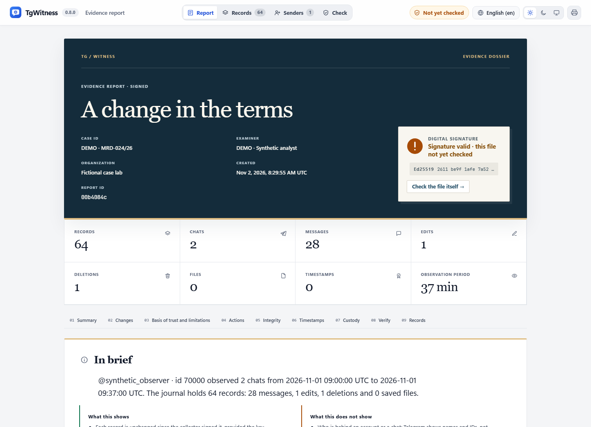
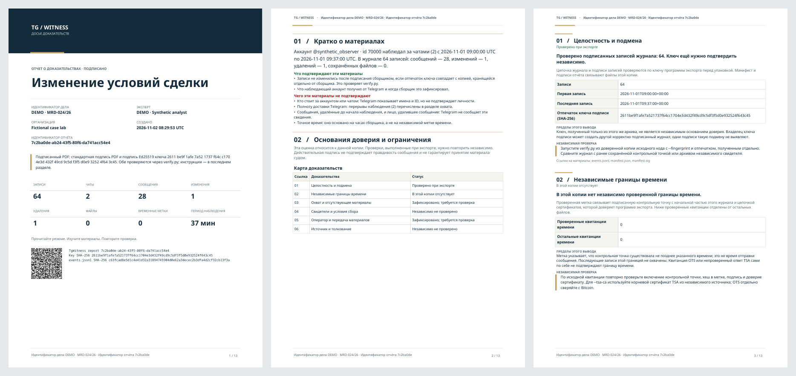

[TgWitness](../../README.md) / [Документация](../README.md) / [Папка](README.md) · [Расследование](INVESTIGATION.md)


<a id="case-reports-contents-design-and-verification"></a>
# Отчёты по делам: содержание, оформление и проверка

Превратите выбранные наблюдения в удобочитаемый отчёт о случае: его постановку, объем, сохраненные изменения, диаграммы, выводы и ссылки на источники. Каждый отчёт предоставляет получателю возможность проверить предоставленный материал и оценить полноту охвата данных.

Раздел **Основа доверия** отображается в отчётах журнала, передачи дел, чата, аккаунтов и обмена данными. PDF-файлы журнала и передачи дел используют ту же оценку, что и их подписанный файл `report.json`. ZIP-манифесты содержат поле `case_assessment` в подписанном манифесте. Эта оценка передаётся вместе с экспортированными материалами. Исходные наблюдения сохраняют свои существующие подписи.

<a id="document-formats-and-reading-order"></a>
## Форматы документов и порядок чтения

<a id="report-studio"></a>
### Студия отчётов

Откройте **Экспорт → Настройка и предварительный просмотр**. Перейдите по пути **Данные → Дизайн и содержание → Предварительный просмотр**:

1. Используйте всю рабочую область или выберите чаты, авторов, даты наблюдений в формате UTC и типы событий. Загрузите каталог для поиска чатов и авторов или введите их Telegram-идентификаторы. Фильтры по авторам сопоставляются с записанными идентификаторами отправителей; уведомление об удалении без указания отправителя не соответствует фильтру по авторам.
2. Выберите дизайн страницы, затем выберите диаграммы, метки участников, стенограмму и ваши письменные выводы. При изменении дизайна эти настройки сохраняются.
3. Сформируйте предварительный просмотр. В нём отображаются фактические показатели, активность, участники, примеры записей, сохранённые изменения и диапазоны пропущенных номеров сообщений. Изменение какого-либо параметра приводит к тому, что предварительный просмотр становится устаревшим. Сохраните данные перед загрузкой в формате HTML, подписанного PDF, подписанного JSON или ZIP-архива с доказательствами.

В предварительном просмотре данных учитывается полный стабильный префикс журнала, а не начальная выборка. Ограничению подвергаются только отображаемые строки выборки и длинные списки; показаны их пропущенные значения. При последующем экспорте создаётся новый стабильный снимок, поэтому продолжающийся сбор данных может привести к увеличению показателей. Объём, количество и идентификация источника включаются в подписанный отчёт. Открытие или просмотр формы не приводит к её сохранению.

**Руководство по юрисдикции.** В разделе «Сведения о документе» откройте **Руководство по юрисдикции (необязательно)**, чтобы выбрать юрисдикцию и гражданско-коммерческую или уголовную процедуру. В приложении приведены правовые основания, ссылки на источники, примечания по подготовке и статус исследования. Резюме на местном языке и пояснения по мерам защиты данных являются необязательными. По умолчанию юрисдикция не выбрана. Эти настройки относятся к рабочей области и не включаются в сохраненные конфигурации макета, а также в настройки по умолчанию для неявного совместного доступа и копирования. См. [настройки по умолчанию, поддерживаемые отчеты и ограничения исследования](JURISDICTION_GUIDANCE.md).

**Выберите копию для получателя.** В диаграммах и стенограмме используются выбранные записи. Показатели целостности, хранения и охвата описывают полный журнал источника. ZIP-архив с доказательствами содержит исходные записи и вложения. Используйте [минимизированную передачу,](EVIDENCE.md#handover-extract) если получателю необходимо предоставить только выбранные, разрешённые данные.

<a id="read-edits-deletions-and-missing-ids"></a>
### Просмотр правок, удалений и отсутствующих идентификаторов

Редактирование отображает сохраненный текст **До** и **После** и выделяет измененные слова. Удаление показывает последнюю версию, сохраненную до уведомления. Если более раннее содержимое не было зафиксировано, в отчете об этом указывается. При выборе только редактирований или удалений предыдущие версии остаются доступными в качестве явно помеченного контекста вне фильтров. Несвязанные сообщения не добавляются в эти истории.

**Неотслеженные идентификаторы сообщений** представляют собой пробелы между известными номерами в выбранных чатах и диапазоном идентификаторов, определяемым по дате. Каждая известная исходная запись проверяется перед тем, как номер будет признан неотслеженным: отфильтровывание другого автора, типа события или даты не может привести к появлению ложного пробела. Смежные сохраненные сообщения помечаются как контекст. Отсутствующий номер обозначает ненаблюдаемую позицию; уведомления об удалении и неудачные повторные проверки регистрируются как отдельные типы событий.

<a id="choose-a-design"></a>
### Выберите дизайн

Для отчётов в формате HTML (для журнала и отдельного чата) и в формате PDF с подписью доступно девять вариантов оформления страниц. Они используют одни и те же записи и расчёты, но отличаются обложками, типографикой, заголовками разделов, таблицами и интервалом между строками.

| Дизайн | Стиль чтения |
| --- | --- |
| Классический | Традиционный доклад с тёмной обложкой и пронумерованными разделами. |
| Редакционный | Титульный лист с заглавием в рамке и засечками, широкие поля и узкая полоса с указанием глав. |
| Информационный | Компактная обложка с темно-синим корешком, краткими заголовками и плотно расположенными таблицами. |
| Аналитика | Обложка в стиле опроса, модульные графические таблицы и рисунки с фиксированным шагом. |
| Технический | Реестр с линовкой, пронумерованная линия ориентира и точные сравнительные таблицы. |
| Обзор | Панорамная обложка, просторное расположение текста и выделенные сводные диаграммы. |
| Серия материалов для чтения | Разделительная линия и сгруппированные разделы для результатов, объёма работы, изменений и журнала наблюдений. |
| Основной блок и поля | Пронумерованные главы с широкими полями, точные таблицы диаграмм и отдельная стенограмма сообщений. |
| Обзор профиля | Ключевые показатели, профили в процессе наблюдения и разделы с возможностью поиска, содержащие ссылки на записи чата. |

Дизайн сохраняется для каждой рабочей области и фиксируется в подписанном манифесте экспорта. HTML работает в автономном режиме, поддерживает светлую и тёмную темы, а также адаптируется к узким экранам и языкам с направлением письма справа налево. Нативные PDF-файлы используют встроенные шрифты; дизайн «Редакционный» включает шрифт Noto Serif в соответствии с прилагаемой лицензией SIL Open Font License. Серии для чтения, а также «Реестр и поля» применимы к обзорам аккаунтов, чатам аккаунтов и копиям для обмена.

Для PDF-файлов на китайском, японском и корейском языках дополнительно требуется подходящий шрифт на сервере, например Noto Sans CJK, установленный в системе или размещённый в каталоге `TGWITNESS_FONT_DIR`. При его отсутствии в ZIP-архиве сохраняются отчёты в форматах HTML и JSON.

Эти два варианта оформления включают удобный для чтения журнал, не требующий JavaScript. При экспорте больших объемов данных этот вид содержит до 500 полных записей в пределах лимита в 8 MiB; в отчете указывается этот лимит и предоставляются ссылки на полную версию просмотра и исходные записи. Каталог учетных записей и индекс взаимосвязей описывают именно этот образец для чтения, а не всех участников. Диаграммы полного журнала сохраняют свой отдельно указанный объем.

<a id="choose-the-contents"></a>
### Выберите содержание

| Предустановленное содержание | Включено по умолчанию |
| --- | --- |
| Досье дела (рекомендуется) | Деятельность, время наблюдений, участники, чаты и стенограмма записи. |
| Брифинг | Обзор мероприятия без рейтинга участников и стенограммы. |
| Анализ мероприятия | Мероприятие, время наблюдения, участники, чаты и состав группы, с указанием источников и точных цифр. |
| Индивидуальный отчет | Ваша собственная комбинация диаграмм, стенограммы и предварительных просмотров. |

При изменении предустановки сохраняются ваш макет, детали случая и письменный анализ. Проверки целостности, охват, заметки по чтению и инструкции по верификации остаются в каждом макете. Исходные записи в ZIP-архиве остаются неизменными, даже если диаграмма или стенограмма скрыты.

Дополнительные **Заметки об обследовании** содержат вопрос, метод, результаты и вывод, составленные автором отчёта. В результатах указываются ссылки на исходный файл и номера записей. Подпись сохраняет эти авторские заявления наряду с отчётом; исходные наблюдения и интерпретация автора остаются идентифицируемыми. В сокращённых отчётах эти конфиденциальные примечания и полные диаграммы из журнала исключаются. Параметры выбора диаграмм и обследований применяются к отчётам из журнала.

Выберите активность во времени, тепловую карту по дням недели и часам по UTC, рейтинги участников, рейтинги чатов и состав записей. Выберите от 5 до 30 ранжированных групп и нейтральные псевдонимы участников или идентификаторы аккаунтов. Неизвестные отправители и остальные участники отображаются в отдельных строках. Псевдонимы влияют только на диаграммы; исходные записи по-прежнему содержат их идентификационные данные.


Предварительный просмотр дизайна обновляется на основе несохранённого черновика с использованием компонентов обложки, анализа и диаграмм, ограниченных совпадениями в пределах первых 50 000 исходных записей. Предварительный просмотр данных ниже рассчитывает полный набор данных. Он явно не подписан и не сохраняет внесенные изменения. Кнопки «Обложка» и «Диаграммы» переключают соответствующие разделы. Это не является полным предварительным просмотром PDF-файла. Функция **Сохранить настройки отчёта** применяет выбранные параметры к будущим экспортам; существующие подписанные файлы остаются неизменяемыми. В PDF-файле используются выбранная обложка, типографика, макет глав и те же агрегированные данные, что и в HTML-файле и подписанном JSON-файле.

Инструкции по оценке доверия, охвату и проверке остаются доступными. Скрытие диаграмм или читаемой стенограммы не приводит к удалению авторитетных исходных строк из архива ZIP. Отключенные серии диаграмм исключаются из аналитического JSON; используйте минимизированный экспорт, чтобы ограничить раскрытие исходных записей.

Фильтры выбора данных применяются к отчётам журнала; экспорт данных аккаунтов и обмен данными сохраняют собственные рамки сбора и раскрытия информации. Выбор может охватывать целые чаты, авторов, даты в формате UTC, типы записей и отдельные сообщения. Сообщения, выбранные в чате с помощью функции **Выбрать,** отображаются как **Выбранные сообщения**; отчёт затем охватывает записи этих сообщений и любого выбранного полностью чата, а также перечисляет номера выбранных сообщений в разделе **Выбранные данные**. Отсутствующие номера сообщений и соседние с ними записи указываются в отчёте только для чатов, выбранных полностью. **Добавление номеров сообщений** под списком чатов позволяет добавлять сообщения без открытия чата: по одной строке на каждый чат с указанием идентификатора чата, двоеточия и номеров сообщений или ссылок `t.me/c/…` на отдельные сообщения.

Общие настройки дизайна и диаграмм сохраняются при экспорте новых чатов и аккаунтов, а также при предварительном просмотре общих аккаунтов. Языковые настройки аккаунта и общих аккаунтов, а также настройки конфиденциальности остаются независимыми; личные заметки по делам и материалы экспертизы не копируются в эти экспортированные файлы. Отчёты по аккаунтам и общим аккаунтам остаются в формате HTML, защищённом подписанным манифестом архива. Журнал, сводка свернутого журнала и наборы для отдельных чатов также предоставляются в виде подписанных PDF-файлов.

<a id="what-the-charts-count"></a>
### Что учитывается в диаграммах

Активность в журнале и тепловые карты учитывают новые, исторические, восстановленные, отредактированные, удалённые и отсутствующие при повторной проверке **наблюдения** в соответствии со временем сбора данных в формате UTC. Сигналы о подключении и квитанции о получении вложений исключаются. В рейтингах участников учитываются только новые, исторические и восстановленные наблюдения за сообщениями: отправитель не считается редактором или лицом, удалившим сообщение. Повторные наблюдения могут относиться к одному и тому же сообщению в Telegram.

Аналитика журнала сохраняет подсчёты по типу, ссылки на первую/последнюю запись и исходный файл `events.jsonl` с хэшем SHA-256. Цифры включают точные значения в форматах HTML и PDF. Ежедневные интервалы переключаются на месяцы после 366 зарегистрированных дней; графики объединяют их в не более чем 36 интервалов одинаковой ширины. При наличии более 100 000 уникальных идентификаторов или 1 200 месяцев соответствующий график становится недоступным, однако точные общие подсчёты остаются доступными.

В диаграммах «Снимки» и «Совместный доступ к аккаунтам» учитываются только строки, содержащие сообщения, не относящиеся к услуге, с использованием времени отправки этих сообщений. Агрегированные данные по совместному доступу рассчитываются после редактирования и фильтрации. В этих диаграммах используется не более 90 интервалов даты в формате UTC одинаковой ширины и сохраняется до 10 000 значений группировки; избыточные подсчёты явно указываются и согласовываются. Последний интервал может быть короче. Неизвестные или неопределённые даты не включаются в временные диаграммы.

Пустой интервал означает отсутствие включённых наблюдений; для выявления пробелов обратитесь к данным об охвате. Данные диаграммы отражают сохранённую активность. Неизвестные отправители остаются отдельной категорией, и каждая проверка отражается в отчёте индивидуально.

При включении файл `analytics.json` защищён подписанными хешами файлов архива. Журнал `report.json` содержит те же выбранные агрегированные данные. Проверка подписи выявляет измененные байты. Для проверки цифр пересчитайте агрегированные данные журнала с помощью `report_analytics.Analytics` и `selected` или агрегированные данные моментальных снимков с помощью `snapshot_analytics.collect` и `project`.

<a id="anomaly-indicators"></a>
### Индикаторы аномалий

**Предварительный просмотр.** Отчёты о доказательствах содержат раздел **Индикаторы аномалий**, вычисляемый зарегистрированными процессорами (`tgwitness/metrics/`, по одному файлу на каждый показатель). В отчёте указаны все запущенные процессоры с указанием их версий, а под таблицей приводится описание используемого метода, что позволяет повторить вычисления на основе файла `events.jsonl` с помощью `tgwitness.metrics.run`.

| Процессор | Что отображается |
| --- | --- |
| `first_time_posters_over_time`, версия 1 | Количество пользователей, впервые оставивших сообщение, и количество сообщений за день по UTC. Для установки флага требуется наличие не менее пяти таких пользователей и объём сообщений, не превышающий 1,5-кратной медианы. В качестве базового значения используется не менее семи дней наблюдений из предыдущих 14 календарных дней после семидневного периода подготовки. Пользователь, впервые опубликовавший сообщение в нескольких чатах, учитывается один раз в каждом из них, поэтому ежедневный показатель может превышать количество отправителей. |
| `service_vs_message_ratio`, версия 1 | Количество уникальных сохраненных сообщений в каждом чате и доля, приходящаяся на служебные сообщения. Данный показатель отражает общее количество; он не объясняет отсутствие конкретного числа. |
| `join_leave_per_month`, версия 1 | Число вступлений, выходов, удалений или банов в месяц — по одному на человека, чат, изменение и день. |
| `pinned_per_month`, версия 1 | Закрепление служебных сообщений, снятие закрепления уведомлений, а также добавление или удаление закреплённых сообщений между моментальными снимками состояния чата, в расчёте на месяц. |

**Дополнительные инструменты → Параметры → Показатели отчёта** позволяют выбрать процессоры и количество отображаемых строк, в том числе в отфильтрованных отчётах. Ежедневные и ежемесячные таблицы отображают последние строки, а таблицы доли сервисных сообщений ранжируют чаты по количеству сохраненных сообщений. Итоговые значения охватывают каждую строку.

Из исходного репозитория скомпилируйте все девять перечисленных выше макетов на основе одного и того же вымышленного журнала:

```sh
python tools/build_report_styles.py --output test-results/report-styles
```

Откройте полученный файл `index.html`, чтобы сравнить полные HTML-отчёты, подписанные PDF-файлы и ZIP-архивы. Каждый макет использует один и тот же исходный журнал. Используйте новый каталог вывода для каждого запуска, чтобы сохранить ранее подписанные примеры.



HTML-файл открывается обложкой дела и ключевыми показателями. Пронумерованная карта доказательств содержит ссылки на каждый вывод, подтверждающие его факты, ограничения и результаты независимой экспертизы. Записи с возможностью поиска и стабильные ссылки на записи остаются доступными в автономном просмотрщике. Дизайн адаптируется к узким экранам, различным темам и браузерам без поддержки JavaScript.

Подписанный PDF-файл содержит специальную обложку формата A4, ссылку на отчет и QR-код, краткое изложение, карту доказательств, пронумерованные выводы и закладки в документе. Заголовки и нижние колонтитулы страниц идентифицируют отчет. QR-код идентифицирует материал; он не является результатом независимой проверки. Распечатки из браузера не связаны с этим криптографически подписанным PDF-файлом.

На временной шкале наблюдений зафиксированные периоды наблюдения и перерывы отображаются на одной оси в формате UTC. Пустое пространство не означает предполагаемый охват; в подробных таблицах сохранены точные интервалы. Архив ZIP содержит отчеты в читаемом виде, подписанный файл JSON, исходные записи и инструкции по проверке.

Создайте новое вымышленное досье на английском, русском или немецком языках с помощью установленной среды разработки:

```sh
python tools/build_dossier_example.py --output test-results/my-new-dossier
```

Каждый языковой каталог содержит файлы `report.html`, `report.pdf`, `report.json` и `dossier.zip`. Существующие каталоги с примерами никогда не перезаписываются. Для создания досье не используются ни аккаунт Telegram, ни внешний сервис временных меток, ни сетевое соединение.



<a id="reading-a-concrete-case"></a>
## Анализ конкретного случая

Для журнала, содержащего 1 200 записей с проверенной меткой времени в записи № 1 000, отчёт выявляет 200 более поздних записей, выходящих за пределы диапазона этой метки времени. Временная метка устанавливает верхний предел времени существования контрольной точки; каждое сообщение сохраняет собственное время отправки из Telegram. Если три других файла с временными метками не проходят проверку или не поддаются проверке, они учитываются отдельно и не могут служить основанием для положительного заключения.

Пригодная к использованию временная метка должна удовлетворять всем следующим проверкам: её отпечаток совпадает с контрольной точкой, её подпись цепочкой ведёт к доверенному корню TSA на момент простановки метки, а подпись, ключ, счётчик и заголовок контрольной точки точно соответствуют префиксу журнала. Простого анализа временной метки или наличия квитанции OTS недостаточно. Читатель должен самостоятельно выбрать доверенный корневой сертификат TSA и повторить проверку. Для OTS требуется отдельная проверка подтверждения в сети Биткойн.

| Статус отчёта | Значение |
| --- | --- |
| Проверено во время экспорта | Экспортер выполнил указанную проверку; по-прежнему требуется независимое повторение. |
| Зарегистрировано; требуется проверка | Соответствующее наблюдение или заявление оператора зафиксировано; это не является независимым подтверждением. |
| Не включено в данную копию | В данной копии отсутствуют подтверждающие материалы по данному утверждению. Это не означает, что таких материалов нет в других источниках. |
| Не проверено независимо | В отчёте не приводятся результаты независимой проверки. |
| Неполнота или недоступность | Материалы или необходимая проверка отсутствуют, являются неполными или не дали результата. |

Проверьте каждую проверку отдельно, сопоставляя её с зафиксированным охватом коллекции.

<a id="what-a-strong-configuration-must-preserve"></a>
## Что должна обеспечивать надёжная конфигурация

1. Прежде чем полагаться на сбор данных, сохраните отпечаток ключа сборщика через отдельный доверенный канал. Сравните этот эталон с ключом подписи экспорта.
2. Сохраняйте контрольные точки с независимыми временными метками и, при необходимости, журнал свидетельств, находящийся вне административного контроля сборщика. Сравните их с экспортированным журналом, чтобы проверить его пределы в прошлом.
3. Зафиксируйте объем сбора данных, пробелы, фильтры, ограничения и изменения в процессе сбора. Объясните отсутствующие периоды, имеющие отношение к фактической претензии, четко разграничивая неотслеженные идентификаторы сообщений, уведомления об удалении и неудачные повторные проверки.
4. Сохраняйте исходные ZIP-архивы и их хеши. Регистрируйте каждого владельца, передачу, дату и цель. Сохраняйте вместе с ними приписанные заявления оператора и примечания по делу.
5. В случае конфиденциальных виртуальных машин сохраните и независимо проверьте котировку, запрос на аутентификацию, цепочку сертификатов Intel, измерения, точный источник и условия обращения с ключами. Храните результат проверки аттестации вместе с проверенными артефактами.

См. [раздел Объём проверки](EVIDENCE.md#verification-scope) для ознакомления с процедурами проверки процесса сбора, целостности архива, временных параметров и полноты охвата сбора в каждом режиме.

<a id="recipient-review"></a>
## Проверка получателем

Используйте надежную установку TgWitness и независимо полученный отпечаток:

```sh
python -m tgwitness.verify evidence.zip --fingerprint TRUSTED_SHA256
python -m tgwitness.verify evidence.zip --fingerprint TRUSTED_SHA256 --tsa-ca tsa-root.pem
python -m tgwitness.verify evidence.zip --fingerprint TRUSTED_SHA256 --witness witness.zip --witness-fingerprint WITNESS_SHA256 --channel https://t.me/s/WITNESS_CHANNEL --require-witness
python -m tgwitness.verify evidence.zip --fingerprint TRUSTED_SHA256 --check-drand
```

Вторая и третья команды могут соответствовать минимальным требованиям к доказательствам: проверенная временная метка или даты, установленные Telegram в сообщениях свидетеля, обеспечивают внешнее время для последней записи. ZIP-архив свидетеля должен поступать из независимого доверенного источника; сохраните также его ключ и информацию о происхождении. Сохраните команды, версию инструмента, результаты вывода, проверенные хеши входных данных и нерешённые вопросы. Проверка маяков представляет собой отдельную онлайн-проверку; программа визуализации отчётов никогда не связывается с сервисом исключительно для отображения отчёта.

В случае спора по конкретному сообщению укажите ссылку на архив, авторитетный файл и ссылку на запись, а затем опишите соответствующий временной диапазон, пробелы в охвате, выборку и подтверждающие материалы. В случае копии для обмена также проверьте зафиксированное преобразование и его ссылки на исходный архив. Частные фильтры и сопоставления идентификаторов остаются за пределами публичной оценки.

Верификация подписанного PDF-файла позволяет обнаружить изменения в охваченных байтах. Храните исходный цифровой файл и результат верификации вместе со скриншотами или распечатанными экземплярами для ознакомления.
