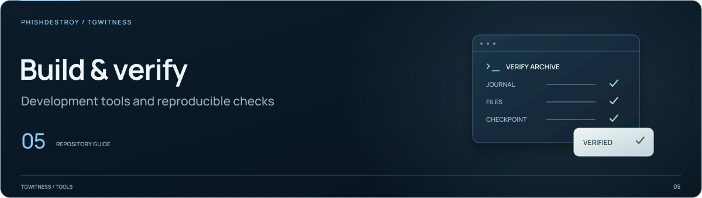

[TgWitness](../../README.md) / [Документация](../README.md) / [Папка](README.md) / Development

[English](../CODE-MAP.md) · **Русский**

# Код и карта валидации

Начните с этого раздела, чтобы найти код, понять его ограничения и выбрать подходящие проверки. [Раздел Участие](../../.github/CONTRIBUTING.md) охватывает настройку среды разработки и pull-запросы.

## Цель и преимущества продукта

TgWitness — это инструмент для фиксации и сохранения данных. Он сохраняет полученные материалы вместе с их контекстом, сохраненными версиями, временем получения и записями проверки, чтобы люди могли впоследствии сравнить последующие описания событий с тем, что было сохранено. Доступность, скорость и гибкость развертывания являются частью этой цели.

| Преимущества | Реализация и доказательная база |
| --- | --- |
| Сохранение контекста и изменений | [Сбор данных](COLLECTION.md), [записи о событиях](EVIDENCE.md) и [история хранения](HISTORY.md) фиксируют наблюдения, версии и границы сбора данных. |
| Независимая проверка архива | [В ходе проверки](VERIFICATION.md) анализируются подписанные журналы, накладные, вложения, сохраненные контрольные точки и подтверждающие внешние квитанции. |
| Проверяемые среды сбора данных | [Сбор данных через GitHub](SEALED-ACTIONS.md) привязывает архив к утвержденному рабочему процессу и источнику; [Phala / Intel TDX](PHALA.md) проверяет результаты измерений, актуальность данных и подлинность сборщика. |
| Несколько путей сбора данных | [Режимы сбора данных](COLLECTION-MODES.md), [сбор через официальный клиент](TRUSTED-LIVE.md), [интеграция с Secret Chat](PSEUDO-SECRET.md) и вспомогательные средства MTProto предоставляют различные способы сбора и анализа записей. |
| Большие объёмы данных и восстановление | Документация [по публичной истории](../EXPORT-BENCHMARK-2026-11-06.md) обеспечивает сбор данных с нескольких аккаунтов, верифицированные архивы, возможность приостановки и возобновления заданий, а также независимые сравнения. |
| Быстрая работа с сохраненными данными | Показатели индексирования документов [для полнотекстового поиска](SEARCH.md#benchmark) и выполнения запросов на журнале объёмом в миллион сообщений; [инструменты](INVESTIGATION.md) [анализа](ANALYSIS.md) и [расследования](INVESTIGATION.md) обеспечивают привязку результатов к их источникам. |
| Удобная установка | Мастер [установки с пошаговыми инструкциями](INSTALLATION.md) проверяет хеши и подписи версий с помощью встроенного ключа. [Версии, исходный код и Docker](QUICKSTART.md) предоставляют альтернативные пути установки. |

Опубликованные страницы валидации представляют собой отобранные воспроизводимые измерения из более длительной истории разработки. Оценивайте в совокупности сбор данных в режиме реального времени, синтетические нагрузки, введение сбоев, восстановление, проверку кода и повторную верификацию. Количество записей в опубликованном тесте производительности не соответствует совокупному объему данных, обработанному в ходе разработки.

## Оценивайте заявления по типу и доказательствам

Изучайте [историю разработки и масштаб](OVERVIEW.md#testing-history-and-duration) параллельно с отдельными отчётами о валидации. Сопровождающие сообщают о более чем шести месяцах активной разработки и тестирования, а также о совокупной нагрузке порядка 100 миллионов, включая исправления и повторные запуски. Публичные данные о количестве тестов описывают отдельные запуски; данные о создании репозитория и количестве аккаунтов участников являются метаданными публикации.

При каждой оценке определяйте выбранный режим, проверенную ревизию, соответствующее событие в исходном коде и результат верификации. Разграничивайте следующие категории:

| Вывод | Доказательства для отчёта |
| --- | --- |
| Реализованная функциональность | Полный путь вызова, конфигурация и доступность в составе пакета. |
| Проверенное поведение | Зарегистрированная версия, рабочая нагрузка, среда и результаты выполненных проверок. |
| Воспроизведённый дефект | Триггер, ожидаемое поведение, наблюдение за сбоем и затронутые версии. |
| Предположение о доверии | Ключ, политика, поставщик или показатель, на которые опирается выбранный режим. |
| Границы области применения | Конкретное событие, API или рабочий процесс, к которому это относится. |
| Непроверенный путь | Конкретная пропущенная проверка, не означающая сбой. |

Мониторинг в реальном времени, чтение истории, повторные проверки и сбор журналов администратора содержат разные наблюдения. Опишите их совокупную запись, прежде чем обсуждать поле в одном типе события. Уведомление об удалении, результат «недоступно при повторной проверке» и ненаблюдаемый идентификатор имеют разные значения. Доступные записи журнала администратора включают указанного участника и время действия; обычные уведомления в виде сообщений имеют собственную схему.

При определении источника используется полный путь сбора данных и выбранные проверки среды. Оценивайте рабочие процессы GitHub и режимы Intel TDX с их собственными верификаторами и доверенными входными данными; обнаружение нарушений в этих режимах указывает, какую проверку верификатора оно обходит, и воспроизводит этот обход.

Описывайте дополнительные сервисы с учётом фактически включённых потоков данных, а установщик — с учётом проверок сигнатур и доступных независимых процедур верификации. Вымышленные демонстрационные записи отражают поведение интерфейса и формата; доказательства, полученные в ходе реального сбора данных, имеют собственные результаты, специфичные для конкретной версии. Основавайте отчёты о дефектах на путях выполнения кода и воспроизведённых сбоях.

## Материалы для выполнения задания

| Задание | Ссылки |
| --- | --- |
| Понимание продукта | [Руководство по проекту](PROJECT-GUIDE.md), [принципы его работы](HOW-IT-WORKS.md), [текущая квалификация](STATUS.md) |
| Установка или обновление | [Краткое руководство](QUICKSTART.md), [установка](INSTALLATION.md), [эксплуатация](OPERATIONS.md) |
| Изменение настроек сбора данных или истории | [Сбор данных](COLLECTION.md), [режимы сбора](COLLECTION-MODES.md), [история](HISTORY.md), [ограничения на экспорт](EXPORT-LIMITS.md) |
| Работа с аккаунтами и доступом | [Аккаунты](ACCOUNTS.md), [модель доступа](ACCESS.md), [безопасность подключения](CONNECTION-SECURITY.md) |
| Изменение доказательств или проверки | [Модель доказательств](EVIDENCE.md), [верификация](VERIFICATION.md), [свидетель](WITNESS.md), [временные метки](TIMESTAMP.md) |
| Работа с секретными чатами или записью | [Псевдо-секретные сообщения](PSEUDO-SECRET.md), [опциональная фиксация](OPTIONAL-CAPTURE.md), [доверенное устройство записи в режиме реального времени](TRUSTED-LIVE.md), [запечатанная фиксация](SEALED-ACTIONS.md) |
| Работа над Phala или Intel TDX | [Развертывание с высоким уровнем надежности](HIGH-ASSURANCE.md), [модель безопасности](SECURITY-MODEL.md), [развертывание](DEPLOYMENT.md) |
| Изменение интерфейса | [Пользовательский интерфейс](FRONTEND.md), [панель управления](PANEL.md), [настройки](SETTINGS.md), [архитектура](ARCHITECTURE.md) |
| Использование или изменение интеграций | [CLI](CLI.md), [MCP](MCP.md), [веб-хуки](WEBHOOKS.md), [навыки работы с архивами](../../.agents/README.md) |
| Редактирование графических элементов README или веб-сайта | [Материалы презентаций](../assets/presentation/README.md), [исходные коды веб-сайта](../../website/README.md), [публикация](../internal/PUBLISHING.md) |
| Обслуживание CI, релизов или Wiki | [Проверки и маршрутизация](../internal/CI-PARALLELISM.md), [процедура выпуска](../internal/RELEASE.md), [готовность](../internal/READINESS.md), [Wiki](../internal/WIKI.md) |

Используйте эти ссылки в сочетании с текущей реализацией. Функция может существовать в ветке разработки, не будучи включённой в основную ветку (`main`), релиз или установленное приложение. В демо-версии используются вымышленные данные; сам по себе её интерфейс не отражает реального поведения Telegram. Прилагайте доказательства реализации, ревизий и тестирования к своим утверждениям.

## Карта кода

| Область | Отправные точки |
| --- | --- |
| Вход в приложение и команды | [**main**.py](../../tgwitness/__main__.py), [cli.py](../../tgwitness/cli.py) |
| HTTP-API и панель управления | [app.py](../../tgwitness/app.py), [маршруты API и контекст](../../tgwitness/api), [static/](../../tgwitness/static/README.md) |
| Сбор и хранение | [collector.py](../../tgwitness/collector.py), [политики обработки медиафайлов](../../tgwitness/media_jobs.py), [store.py](../../tgwitness/store.py) |
| Доказательства и проверка | [evidence.py](../../tgwitness/evidence.py), [источники верификатора](../../tgwitness/verifier/README.md), скомпонованный файл [verify.py](../../tgwitness/verify.py) |
| Представление доказательств | [определение границ входных данных](../../tgwitness/render_data.py), [отчёты в формате HTML](../../tgwitness/report.py), [отчёты в формате PDF](../../tgwitness/pdf_report.py) |
| Облачные команды и отчёты | [cloud.py](../../tgwitness/cloud.py), [интерфейс командной строки (CLI)](../../tgwitness/cloud_cli.py), [визуализация отчётов](../../tgwitness/cloud_report.py) |
| TDX, измерения ОС и провайдеры | [подтверждение работоспособности облачной среды](../../tgwitness/cloud_attestation.py), [tdx.py](../../tgwitness/tdx.py), [dstack_image.py](../../tgwitness/dstack_image.py), [providers/](../../tgwitness/providers/README.md) |
| Отдельный рекордер захвата | [tgwitness_capture/](../../tgwitness_capture/README.md) |
| Переводы | [Языковые настройки панели](../../tgwitness/locales/README.md), [руководства по настройке](../../tgwitness/guide_locales/README.md), [языковые версии веб-сайта](../../website/i18n/README.md) |
| Генерация сайта | [tools/](../../tools/README.md), [website/](../../website/README.md) |
| Шаблоны развертывания | [deploy/](../../deploy/README.md) |

Отслеживайте импорты и вызовы из этих точек входа. Сбор данных, авторизация и экспорт охватывают несколько модулей; одно имя файла не отражает всю реализацию.

## Проверка

Запускайте команды из корневого каталога репозитория с использованием среды разработки, описанной в [разделе Участие в проекте](../../.github/CONTRIBUTING.md#development-setup). Для проекта требуется Python 3.11 или более поздней версии. Соблюдайте ограничения, установленные администратором хоста: наличие команды в данном списке не означает разрешение на её запуск на компьютере, предназначенном исключительно для редактирования исходного кода.

Регрессионные тесты, фикстуры и средства запуска проверок поддерживаются в закрытом доступе и исключены из общедоступного репозитория и архива исходного кода. Для проведения приведённых ниже проверок используйте закрытую рабочую область проверки; сохраняйте её при публикации изменений в исходном коде.

| Изменение | Требуемая валидация |
| --- | --- |
| Исходный код на Python | `python -m ruff check .` и регрессионное тестирование для проверенного поведения |
| Публичная документация или пакеты | `python tools/publication_guard.py --git-index` и проверка выбранного исходного кода |
| Поведение командной строки | Вывод команды, коды завершения и область доступа |
| Границы доказательств | Сохранение знаковых байтов и совместимость с верификаторами |
| Поведение панели | Потоки действий в браузерах, затронутых данной проблемой, с использованием синтетических аккаунтов |
| Веб-сайт | `python tools/build_site.py`, затем отображение страниц, локальные ссылки и макет для узких экранов |
| Архив исходного кода | Точное количество байтов, исключения частных файлов, воспроизводимость и восстановление после сбоев записи |

Выберите проверки, которые тестируют данное изменение. Для редактирования, касающегося исключительно документации, требуется проверка ссылок и утверждений; подключение к аккаунту Telegram не требуется. При приёмке в браузере используются синтетические аккаунты и фиктивный транспорт. Тесты с использованием реальных параметров имеют иной объем и требуют авторизованной среды и задачи.

Для изолированной сборки сайта передайте параметр `--output PATH` в скрипт `tools/build_site.py`. Перед запуском нескольких процессов одновременно проверьте пути вывода результатов валидации. Каталог журналов частного запуска не обязательно изменяет пути вывода его дочерних проверок. Присваивайте каждому запуску новый временный путь.

## Проверка и доставка

Проверьте текущие различия и добавьте в стадию только файлы, относящиеся к данной задаче. Перед авторизованной отправкой или выпуском проверьте выбранные исходные материалы и [правила публикации](../internal/PUBLISHING.md). При публичной упаковке используется явный список разрешенных элементов в [файле build_source.py](../../tools/build_source.py); добавление корневого документа с локальными ссылками может потребовать его включения и в этот список.

Сообщите о ревизии, фактически завершённых проверках и оставшихся ограничениях. При развёртывании веб-сайта проверьте публичный артефакт после завершения задания развёртывания. Успешная сборка, пропущенное развёртывание или более старый успешный релиз не являются достаточным доказательством того, что запрошенная ревизия опубликована.
