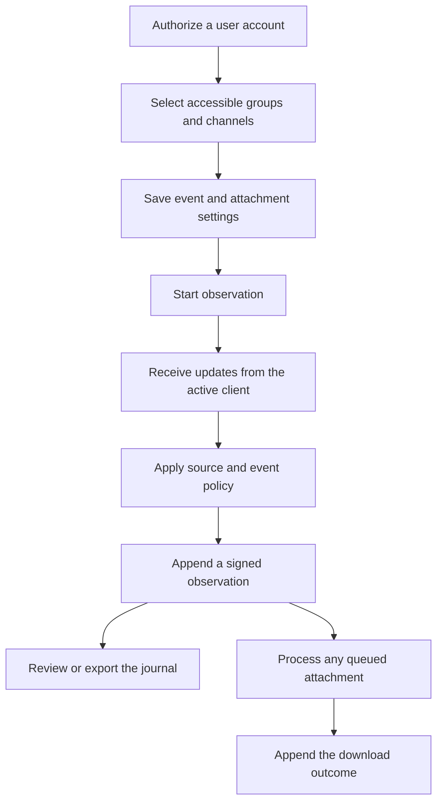

[TgWitness](../../README.md) / [Документация](../README.md) / [Папка](README.md) · [Collection](../COLLECTION-MODES.md)

[English](../COLLECTION.md) · **Русский**

# Как работает коллекция

TgWitness фиксирует все, что наблюдает подключенный аккаунт Telegram. Мониторинг в режиме реального времени
сохраняет сообщения, зафиксированные правки, уведомления об удалении и вложения с
указанием времени наблюдения и контекста источника. Просмотры истории, повторные проверки и доступные
записи журнала администратора добавляют к этой записи отдельно идентифицированные наблюдения.

На этой странице

- [От входа в систему до дневника](#from-login-to-a-journal)
- [Область наблюдения: выбранные чаты, папка или весь аккаунт](#observation-scope-chosen-chats-a-folder-or-the-whole-account)
- [Выбор области и событий](#scope-and-event-selection)
- [Свои действия](#own-actions)
- [Режим расследования: вступление в команды и общение с ботами](#investigation-mode-joining-teams-and-talking-to-bots)
— [Повторная проверка уровней](#recheck-tiers)
— [История сообщений и их авторство](#message-history-and-attribution)
— [Снимки истории](#history-snapshots)
— [Работа с вложениями](#attachment-handling)
— [Пауза, блокировка, отключение и перезапуск](#pause-lock-disconnect-and-restart)
— [Изоляция и верификация аккаунта](#account-isolation-and-verification)

## От входа в систему до журнала

Информацию о самоуничтожающихся фотографиях и файлах см. в разделе [Самоуничтожающиеся медиафайлы](../EPHEMERAL-MEDIA.md).
Там объясняются приоритетный рабочий процесс, результаты «сохранено» и «недоступно», а также ограничения
блокировки подтверждений о прочтении в API-коллекторе.

Авторизация, доступ к источнику, работающий сборщик и полная доставка — это
разные вопросы. Успешный вход не даёт доступа ко всем группам.
Доставка отслеживается отдельно: записи об охвате, восстановление пропущенных обновлений и повторные проверки
показывают, что именно было доставлено.

## Область наблюдения: выбранные чаты, папка или весь аккаунт

**Дополнительные инструменты → Источники → Область действия** — здесь определяется, какие чаты будут записываться в рабочей среде.

Новая настройка начинается с пункта **Выбрать чаты**. Существующие сохраненные настройки остаются без изменений. При выборе
**Все чаты** в мастере настройки запрашивается подтверждение, если загруженный список содержит
более 50 чатов; оценка объема по-прежнему выполняется отдельно на основе выборки.

| Режим | Записи | Новые чаты |
| --- | --- | --- |
| Избранные чаты (по умолчанию) | Только те чаты, которые вы добавляете вручную | Никогда не добавляется автоматически |
| Папка Telegram | Чаты в одной из папок аккаунта: чаты, включённые по названию, плюс категории данной папки (контакты, неконтакты, группы, каналы, боты), минус исключённые чаты и, если это указано в настройках папки, заархивированные чаты | Соответствующие чаты добавляются, как только они становятся активными; чаты, которые вы добавляете в папку в Telegram, добавляются в течение часа |
| Весь отчет | Каждый чат, который видит этот аккаунт | Каждый новый чат, группа, личный чат или бот добавляется сразу же после поступления первого обновления |

- **Типы источников** (каналы, группы, личные чаты, боты) ограничивают работу в режимах «папка» и
  «весь аккаунт». Выбранные чаты могут быть любого типа, включая личные чаты и ботов;
  типы источников никогда не блокируют чаты, добавленные вручную. Отключение типа, исключение или
  переход к выбранным чатам останавливает автоматически добавленные источники сразу после сохранения, до того как
  список источников пересчитается, а также в случае, когда Telegram недоступен: их новые
  сообщения, история переписки, история новых чатов, настройки собеседников и просмотры профилей.
- **Чаты, добавленные вручную**, остаются в списке в режимах «папка» и «весь аккаунт», даже если они
  находятся вне папки; их может остановить только *Исключить*, *Удалить* или приостановка. Чаты, добавленные
  системой (*автоматически*), следуют за папкой: тот, кто покидает её, приостанавливается при следующем пересчёте.
- **Исключённые чаты** никогда не фиксируются, в любом режиме. В режимах «Папка» и «Вся учётная запись»
  *Исключить* и *Удалить* в источнике помещают его в этот список, чтобы область действия не добавляла его снова.
  Повторный выбор чата вручную (в разделе «Источники», из списка «Чаты» или в «Настройки» → **Какие чаты?**)
  удаляет его из списка. Список вмещает до 5 000 чатов; при превышении этого лимита команда *Удалить* отклоняется, и
  вместо этого чат можно приостановить.
- **Собственные действия** (включено по умолчанию): сообщения, отправляемые этой учётной записью, её правки и
  нажатия кнопок клавиатуры при ответе. Если функция отключена, исходящие сообщения и правки пропускаются.
- При переключении на папку или всю учётную запись запрашивается подтверждение: в этих режимах записываются
  личные чаты и сообщения третьих лиц и должны использоваться только в специальной учётной записи.
  Подтверждение и каждое изменение области действия фиксируются в записях `scope.changed`. В учётной записи,
  настроенной как основная, форма выбора области действия и функция «Расследование» отклоняют выбор папки или всей
  учётной записи, как и при запуске; использовать их можно только для однократной копии без записи.
- Чаты, добавленные в область действия, отображаются как источники с пометкой *auto* и записываются как `scope.applied`
  (при запуске и ежечасно) или `source.discovered` (новый чат во время наблюдения). Переключение обратно
  на выбранные чаты сразу приостанавливает все автоматически добавленные источники, без повторного чтения
  списка чатов аккаунта. Исключённый чат перестаёт записываться, как только область действия
  сохраняется, и его источник приостанавливается, даже если Telegram не возвращает список чатов. Во время
  наблюдения сохранение области действия приводит к её повторному применению, даже если значения не изменились.

Область применения этих режимов:

- **Секретные чаты** используют встроенную [интеграцию «Псевдо-секрет»](../PSEUDO-SECRET.md),
  с модулем протокола, устанавливаемым через панель, и переключателем включения для каждой учетной записи. Облачная история
  и функция «Takeout» используют отдельный канал получения данных.
- **Периоды офлайн.** После перезапуска TgWitness возобновляет работу с сохраненной позиции обновления, запрашивает
  у Telegram пропущенные обновления и повторно проверяет чаты. Telegram хранит ограниченный запас данных, поэтому после
  длительного перебоя в работе отчёты и `verify.py` отображают оставшийся интервал как пробел (см. [охват](../EVIDENCE.md#coverage-continuity-gaps-and-unobserved-ids)).
- При запуске отображаются только первые 1 000 диалогов (ограничение можно настроить в разделе **Дополнительные инструменты → Параметры**); более старые
  чаты добавляются, когда они в следующий раз становятся активными. Более ранняя история добавленного чата не загружается — сделайте
  снимок истории или полный экспорт чата, когда это понадобится.
- Условия папок, которые постоянно меняются (заглушенные, прочитанные), не применяются: такие чаты
  остаются под наблюдением.
- **Встроенные (обратные вызовы) кнопки бота**, нажатые в другом приложении, невидимы для второй
  сессии; ответ или редактирование бота фиксируются. Нажатия клавиш ответа поступают как исходящие
  сообщения и помечаются как `button_press`.
- Больше чатов — больше запросов. Telegram ограничивает аккаунты за объем, который считает
  чрезмерным, что является ещё одной причиной использовать выделенные аккаунты.

### Чат-комнаты с строгим отбором участников

**Строго: читать только выбранные чаты** отображается под разделом **«Выбранные чаты»** и по умолчанию отключен. Этот параметр предназначен для
предоставления доступа исключительно к выбранным чатам. Когда он включен:

- Уведомления сервиса Telegram (777000) не считываются: ни при начале, ни при завершении наблюдения, а также не каждую
  минуту в ходе наблюдения. Записи `session.security_baseline` и `account.security_event` не записываются.
- Список сеансов учётной записи не считывается: ни при начале, ни при остановке наблюдения (вопрос панели о
  других сеансах для **Доказательств по делу** и режимах защиты доказательств также пропускается), ни каждые две
  минуты во время наблюдения, ни при установке соединения, ни при проверке соединения, в которой запись *Current
  авторизация* отображается как пропущенная. Статус двухэтапной аутентификации, используемый проверкой перехвата, также не
  считывается. Таким образом, `account.sessions`, `session.concurrent_at_start` и `session.takeover_risk` не записываются,
  а сеанс, завершённый с другого устройства, не регистрируется как `session_revoked_externally`.
- Хотя это единственная сессия учетной записи (**Оставить только этот сеанс** или её автоматическая версия),
  список сессий по-прежнему считывается каждые две минуты во время наблюдения и при открытии соединения, так что
  `session.exclusive_ended` регистрируется при появлении другой сессии. 777000 остаётся непрочитанным в этот период, хотя
  запись `session.exclusive_from` свидетельствует о том, что уведомления о входе в Telegram продолжают регистрироваться.
- Уведомления об удалении сравниваются с проверкой сеансов только в том случае, если такая проверка выполнялась в течение последних 10 минут (пока это
  единственный сеанс или после открытия **Сеансы аккаунта**). В противном случае, если только последняя проверка прав не показывает, что
  эта учетная запись не могла удалить сообщение (что никогда не происходит в приватных чатах и обычных группах), отображается следующее: *Кто
  его удалил, неизвестно: это могла сделать сама эта учетная запись, из другой сессии или с другого устройства.*
- Если сессионный ключ был импортирован, нигде в журнале не указывается время входа в эту сессию до тех пор, пока
  не будет прочитан список сессий (например, в разделе **Сеансы аккаунта**). До этого момента при экспорте чатов и **Авто**
  экспорте учётной записи используется обычная сессия вместо Takeout с указанием причины `session_age_unknown`.
- Включение чата не приводит к считыванию его предыдущих сообщений. Без переключателя каждый включённый чат (в разделе «Источники», в
  «Чаты», при входе через панель или в мастере настройки) получает один снимок `baseline` своих последних сообщений,
  в пределах значения **Дополнительные инструменты → Параметры → Максимальный размер снимка истории** (по умолчанию 500), когда запуск наблюдения произойдет в следующий раз.
  Ожидающий снимок, срок которого истекает при включенном переключателе, отбрасывается. В чате, к которому вы присоединились с панели,
  последние сообщения также не считаются новыми (счётчик **При появлении нового чата или бота**, по умолчанию 100),
  а при открытии выбранного чата без сохраненных сообщений в разделе «Чаты» последние 100 сообщений не загружаются автоматически.
  **Загрузить историю** и снимки, которые вы запускаете самостоятельно, по-прежнему считывают историю.
- Настройка конфиденциального контента аккаунта не считывается и не изменяется. Без включения переключателя вход в систему и каждое новое
  подключение включают её, если она выключена, и Telegram разрешает это изменение (`account.content_settings`); этот параметр
  принадлежит аккаунту и применяется во всех приложениях Telegram. Контент, который Telegram помечает как конфиденциальный, может оставаться скрытым.
- Обновления телефонных звонков не записываются как `account.phone_call`.
- При остановке наблюдения записывается только отпечаток ключа сеанса; список сеансов и 777000 не считываются.

Это не ограничивает объем данных, отправляемых Telegram: обновления всех чатов по-прежнему поступают в эту сессию, а записываются только выбранные
чаты. Список чатов аккаунта (до **чатов, считываемых из списка аккаунта**) и его папки
по-прежнему считываются при запуске, а также повторно при сохранении области действия во время наблюдения, чтобы найти выбранные чаты. Уведомления
об удалении без указания чата (`deletion.unscoped`) по-прежнему записываются: они содержат только идентификаторы сообщений и могут относиться к
выбранному частному чату или обычной группе. Проверка замороженных аккаунтов (`help.getAppConfig`), другие проверки подключения
и функции, которые вы включаете самостоятельно (автоматическое завершение других сессий, проверка свидетелей,
псевдо-секретные чаты, **Сеансы аккаунта**, а также список Telegram устройств, на которых выполнен вход, в разделе **Ещё
свидетели**, который считывает список сеансов при каждом проходе временной метки и который отмечает настройки для целей **Следить за чатами**
и **Доказательства по делу**) продолжают работать.

Включите эту функцию перед входом в систему; в противном случае при входе в систему происходит проверка текущих прав доступа и включается отображение конфиденциального
содержимого. Каждое изменение представляет собой подписанную запись `scope.changed`, а `observation.started` передаёт значение в виде
`scope.strict`. Переход в папку или к общей учетной записи отключает эту функцию.

## Область применения и выбор событий

Каждая рабочая область имеет свои собственные источники. TgWitness не вступает в группы, не принимает
приглашения и не перечисляет всех участников автоматически. Источники должны быть уже
доступны для учетной записи. При запуске сборщик сверяет выбранные источники
с видимыми диалогами учетной записи; проверяются первые 1 000 диалогов, если только
**«Дополнительные инструменты → Параметры → Чаты, считываемые из списка учетной записи»** не указывает иное.
Отсутствующий источник помечается как **доступ не подтвержден**; не предполагается, что вас удалили из него.

| Настройки | Сборник | Поведение при отключении |
| --- | --- | --- |
| Новые сообщения | Обычные доставленные сообщения | При последующих правках или удалениях может не остаться ранее сохраненного текста для сравнения. |
| Изменения | Переданные отредактированные версии сообщений | Промежуточные изменения впоследствии не восстанавливаются. |
| Удаления | Уведомления об удалении с указанием области действия и уведомления на уровне учетной записи без указания области действия | Уведомления об удалении не добавляются в журнал. |
| Реакции | Снимки реакций | Отдельные сообщения о ходе реакции не добавляются. |
| Членство | Рассылка сообщений о предоставлении услуг для членов и обновлений для участников | Эти замечания членов не добавляются. |

Настройки применяются ко всем выбранным источникам в рабочей области. Сохраните форму, чтобы применить
изменения; изменения фиксируются с указанием подписанных значений «до» и «после». Отключение категории
не приводит к удалению более ранних записей. Повторное включение категории не приводит к восстановлению пропущенных обновлений.

Операционные записи и другие события, связанные с обслуживанием групп, остаются отдельными от этих
коммутаторов. Сообщения службы членства могут создавать записи сообщений, когда функция членства
включена, даже если обычный захват новых сообщений отключен. Захваченные объекты Telegram
сохраняют встроенные метаданные; коммутатор не является правилом редактирования.

**Удаления в личных чатах и обычных группах** отображаются в виде идентификаторов сообщений без указания чата.
Эти чаты используют одну общую для всего аккаунта последовательность идентификаторов сообщений, поэтому, если сообщение с данным идентификатором было
сохранено ранее, его чат известен: удаление фиксируется в этом чате с помощью
`chat_resolution`, объясняющего, как это произошло. Идентификаторы, которые никогда не сохранялись, остаются **удалениями без привязки к чату** с
явно неразобранным чатом. Это уведомления Telegram об удалении, сохраняемые даже
тогда, когда их чат ещё не может быть соотнесён. Схема уведомления содержит идентификаторы;
журнал добавляет время получения и любой сохраненный контекст сообщения, включая
тег `deleted_message_was_outgoing`. Доступные записи в журнале администратора предоставляют отдельный
источник информации о действии, исполнителе и времени совершения.

## Свои действия

Сообщения, отправленные наблюдаемым аккаунтом, помечаются тегом `outgoing`. При редактировании исходящего
сообщения следует учитывать, что в личных чатах и группах его может редактировать только автор, тогда как сообщения в каналах
могут редактироваться другими администраторами. Если исходящее сообщение повторяет текст кнопки
из самой последней сохраненной клавиатуры ответов в этом чате, оно содержит тег `button_press` со ссылкой на
запись этой клавиатуры.

Исключение собственных действий также распространяется на фоновую перепроверку и автоматическое обновление истории новых чатов.
Пропущенные исходящие сообщения сдвигают позицию перепроверки вперед, чтобы они не могли заблокировать последующие входящие
сообщения. Явные действия на панели и снимки истории, запрошенные вручную, по-прежнему сохраняются.

## Режим расследования: вступление в команды и общение с ботами

**Дополнительные инструменты → Источники → Область действия → Режим расследования** настраивает область действия для специальной
учетной записи, которая присоединяется к командным чатам, запускает ботов и отправляет им сообщения: вся учетная запись, каждый
тип источника, собственные действия, а также для каждого появляющегося чата или бота — его профиль и последние
200 видимых сообщений. Проверьте форму и нажмите **Сохранить область действия**; при переключении на всю
учётную запись потребуется обычное подтверждение.

- **Кнопки.** Кнопки, расположенные под сообщением, сохраняются вместе с ним и отображаются в разделе **«Чаты»**: ссылки, веб-
  приложения, ссылки для входа, текст для копирования, данные для обратного вызова, встроенные запросы, запросы на указание номера телефона
  или местоположения. Ссылки отображаются в виде текста и никогда не открываются панелью. Когда бот
  изменяет только кнопки (новая ссылка для оплаты), это считается новой версией сообщения как
  при оперативных обновлениях, так и при повторной проверке.
- **Новые чаты и боты.** В режимах «Папка» и «Весь аккаунт» **при появлении нового чата или бота
  ** сразу же после появления сохраняются:
  - его профиль в виде записи `source.profile`: описание бота и команды, текст «О себе»
    пользователя, группы или канала, участники, связанный чат и ссылка для приглашения, если Telegram
    её возвращает;
  - его последние видимые сообщения (до 1 000) в виде моментального снимка истории, помеченного `new_chat`:
    ранее отправленные сообщения в групповом чате, к которому только что присоединились, или то, что сказал бот до того, как наблюдатель
    заметил этот чат. Сообщения, уже сохраненные в режиме реального времени, не дублируются.

  Вновь выбранные чаты используют эти настройки при применении области действия, включая чаты,
  уже присутствующие в списке диалогов учетной записи. Первоначальная загрузка профиля и истории
  осуществляется одновременно для не более чем трех чатов; операции с одним и тем же чатом выполняются по порядку.
  Каждый этап обработки истории/профиля использует настроенный таймаут операции, поэтому застрявшие запросы
  освобождают своего рабочего процесса. История сохраняется до опционального чтения профиля; сбой при чтении профиля
  не препятствует сбору этой истории. Неудавшиеся этапы повторяются через 5 секунд,
  удваиваясь до максимум 5 минут, не занимая рабочий процесс во время задержки.
  Идентификаторы ожидающих задач, сроки повторных попыток и завершённые этапы сохраняются локально. При перезапуске возобновляются
  только незавершённые этапы; повторная попытка чтения профиля не повторяет уже завершённое чтение истории.
  Источники, отключённые до наступления их очереди, пропускаются. В обзоре активные, ожидающие
  и повторяющиеся загрузки чатов отображаются отдельно от загрузок вложений.
  FloodWait приостанавливает эту работу, которая возобновляется после этого; сбои регистрируются, а
  запись чата в режиме реального времени продолжается. Сюда входят ожидания при определении
  идентификатора нового чата: задача по профилю/истории, находящаяся в ожидании, сохраняется для повторной попытки, а существующее
  более длительное ожидание на уровне аккаунта не сокращается. Рабочие процессы разделяют это ожидание; параллелизм
  не обходит ограничения Telegram на количество запросов.
- **Профили по запросу.** **Чаты → Профиль → Сохранить профиль сейчас** сохраняет текущий профиль
  любого источника; самый новый отображается над сообщениями.
- **Снимки состояния чата (предварительный просмотр).** Состояние вне потока сообщений изменяется без
  сообщения: снятие закрепления с любого сообщения не оставляет следа на уровне сообщения, администратор теряет
  права, подарок скрывается, конвертируется, повышается в классе или возвращается. Во время наблюдения каждый включённый
  источник периодически считывается и сохраняется в виде подписанной записи `chat.state`: название, имена пользователей,
  описание, количество участников и администраторов, связанный чат, медленный режим, ID закреплённых сообщений
  (до 100), администраторы с их правами и званиями, а также подарки, отображаемые в каналах и
  профилях пользователей (до 100). В каждой записи перечисляются отличия от предыдущего моментального снимка:
  изменённые поля с указанием значений «до» и «после», закреплённые сообщения, добавленные или удалённые, администраторы и
  подарки, добавленные, изменённые или больше не указанные в списке.
  - Часть, которую Telegram отклоняет (например, список администраторов канала для участника,
    не являющегося администратором), обозначена в `errors`; её предыдущее значение сохраняется и указано
    в `carried_forward`, но никогда не отмечается как удалённое.
  - Запись, в которой единственными изменениями являются подсчёты, а также проверка, не выявившая изменений, относится к
    последнему полному состоянию с `state_seq` и кумулятивному `state_overrides`. Полное состояние записывается
    не реже, чем раз в семь дней, а также всякий раз, когда изменяется что-либо, кроме подсчётов.
  - `parts_complete` отмечает ограниченные списки. Для добавления требуется полный предыдущий список,
    для удаления — полный текущий список, а явные пустые значения фиксируют очистку записей.
  - **Дополнительные инструменты → Параметры → Состояние чата** устанавливает интервал (по умолчанию 12 часов, 0 отключает создание снимков
    отключаются), паузу между источниками, какие части читаются, а также записываются ли проверки, не обнаружившие
    изменений. `FLOOD_WAIT` и `FLOOD_PREMIUM_WAIT` останавливают оставшиеся
    запросы на снимки, сохраняют любой более длительный срок действия для всей учётной записи и оставляют
    прерванный чат доступным для повторной попытки после этого ожидания.
- **Не отображается.** Кнопки в тексте сообщения (с обратным вызовом), нажатые в другом приложении Telegram, всплывающее окно или
  ссылка, которой бот отвечает на такое нажатие, а также ссылки для приглашения, используемые в другом приложении, не поступают в
  TgWitness. То, что бот отправляет или редактирует после этого, фиксируется.

### Действие с панели

**Чаты** теперь включает мини-клиент, использующий аккаунт Telegram выбранной рабочей среды:

- Напишите сообщение в виде простого текста или выберите **Ответить** под сохраненным сообщением. Возвращаемое исходящее
  сообщение фиксируется даже в том случае, если в настройках исключены исходящие обновления.
- Нажмите **Нажмите кнопку** под текущей кнопкой обратного вызова или текстовой кнопкой. Сервер заново извлекает
  сообщение и отклоняет действие, если текст отличается от сохраненной версии.
  Квитанции обратного вызова сохраняют всплывающий текст Telegram, флаг оповещения и URL; ответ также отображается
  под перепиской. URL-адреса остаются выделяемым текстом и не открываются автоматически.
- Нажмите **+** → **Открыть ссылку в Telegram**, введите `@username`, публичную ссылку `https://t.me/name`,
  `https://t.me/+invite` / `joinchat/invite` или ссылку на бота с `?start=parameter` и нажмите
  **Сохранить предварительный просмотр**. Исходная ссылка и превью Telegram подписываются перед добавлением.
  Команда **Присоединиться / открыть и наблюдать** присоединяет пользователя к группе/каналу или открывает пользователя/бота, добавляет
  чат в качестве включённого источника и отправляет боту `/start`, включая его стартовый параметр.
  Запрос на присоединение, ожидающий одобрения администратора, регистрируется как «в ожидании», а не как членство.

Включите функцию **«Начать наблюдение»**, чтобы фиксировать входящие ответы в режиме реального времени. Действия участников панели работают, пока
наблюдение приостановлено; после этого панель сохраняет их прямые ответы, а наблюдение в режиме реального времени
фиксирует остальную часть разговора.
Вновь добавленные источники используют настроенные параметры профиля/истории при запущенном наблюдении.
Если источник приостановлен, включите его в разделе **Дополнительные инструменты → Источники** перед отправкой или нажатием его кнопок.

`interaction.preview`, `interaction.requested` и `interaction.result` — это обычные подписанные
события журнала, включаемые в экспорт данных. Запросы идентифицируют аккаунт, сообщение/кнопку
или запись предварительного просмотра, а также указывают, выполнялось ли наблюдение. Квитанции различают успешное выполнение,
отказ, ожидание одобрения и неизвестный результат. Прерванный запрос мог дойти до
Telegram: проверьте чат, прежде чем начинать новое действие. Повторное использование идентификатора запроса позволяет получить его
сохраненное подтверждение без повторного выполнения действия, в том числе после перезапуска. Панель сохраняет
идентификатор после неоднозначного ответа на одно и то же действие в течение текущей сессии страницы.
Она также сохраняет этот идентификатор, если обновление вида не удалось после успешного выполнения действия: подтверждение
остается видимым, и повторное нажатие позволяет его получить. RPC-вызовы обратного вызова и присоединения имеют одну попытку
в приложении; чтения с возможностью повторной попытки сохраняют настроенную политику повторных попыток. Немедленное переключение чатов
очищает черновик и адресата ответа и отключает отправку до тех пор, пока не загрузится новый разговор.

Этот мини-клиент обрабатывает текстовые кнопки и кнопки обратного вызова. Кнопки мини-приложений имеют функцию **«Открыть мини-приложение»**,
которая запускает приложение в изолированном браузере ([Мини-приложения](../MINI-APPS.md)). Для входа в систему,
запросов номера телефона и местоположения, платежей, встроенных запросов и вложений по-прежнему требуется клиент Telegram;
сохраненные метаданные кнопок остаются видимыми. В новых элементах управления используется текст на английском языке.

## Повторно проверить уровни

При повторной проверке Telegram запрашивается еще раз на наличие пропущенных сообщений, изменений и сообщений, которые он больше не возвращает.
Источники, отмеченные звёздочкой, являются **приоритетными** и по умолчанию перепроверяются каждые 15 минут;
все остальные источники — каждые 6 часов. Выбранные чаты изначально являются приоритетными, а чаты, добавленные через
папку или из всего аккаунта, — обычными. За один проход перепроверяется не более 30 источников, а
остальные ждут следующей минуты; после повторного подключения приоритетные источники проверяются в первую очередь. Оба
интервала настраиваются в разделе **Дополнительные инструменты → Источники → Запись → Перепроверка** (значение 0 отключает уровень) и
записываются как `recheck.changed`.

Пропущенные сообщения загружаются, начиная с того места, где остановился предыдущий проход, но не более
**Дополнительные инструменты → Параметры → Количество восстанавливаемых пропущенных сообщений на чат и проход** (по умолчанию — 1 000). Поэтому после длительной остановки
повторная проверка заполняет весь пробел, даже если сообщения, поступившие позже, чем этот пробел, были сохранены
в первую очередь. Чат, который всё ещё находится в процессе восстановления, проверяется повторно в следующую минуту, а не
после истечения интервала его уровня; `recheck.completed` отображает `continues_after` до завершения процесса.

Сравнение охватывает текст сообщения, объекты, клавиатуры (включая их удаление) и
содержимое/идентификаторы вложений. Изменение только хешей доступа к файлам или ссылок на файлы не считается
редактированием, как и то, что Telegram заполняет самостоятельно: загрузка предварительного просмотра ссылки, просмотры историй, платные
медиафайлы, разблокированные этой учетной записью, получение счета-фактуры. Каждая сохраненная версия в чатах содержит ссылку на полную запись в журнале, включая метаданные медиафайлов.

## История сообщений и указание авторства

Предположим, что сборщик данных фиксирует сообщение «Встреча в 10:00», затем видит «Встреча в 11:00»,
а после этого получает уведомление об удалении. Он добавляет три отдельных записи.
Исходный текст сохраняется, отредактированная версия хранится отдельно, а в уведомлении фиксируется, что
было зафиксировано удаление.

Если сбор данных начался после исчезновения первой версии, этот текст недоступен.
Если во время работы в автономном режиме было выполнено несколько изменений, сохранить можно только те версии,
которые были зафиксированы позже. Уведомление об удалении не позволяет восстановить контент, который никогда не был зафиксирован.

В этой записи объединены данные из нескольких источников:

| Источник | Сохраненная информация |
| --- | --- |
| Отправить сообщение в режиме реального времени или отредактировать обновление | Идентификатор сообщения, метаданные отправителя, версия записи, время получения и указанная дата отправки/редактирования сообщения в Telegram. |
| Уведомление об удалении в режиме реального времени | Идентификаторы сообщений, время получения, исходный текст уведомления и ссылки на ранее сохраненный контент. |
| Доступный журнал администратора | Действие, участник, дата источника и содержание переданного сообщения, прочитанного учетной записью, обладающей необходимыми правами. |
| Взаимодействие с панелями | Запрошенное действие и его зарегистрированный результат для выбранной учетной записи. |
| Повторно проверить | Текущий ответ Telegram по сравнению с ранее сохраненным сообщением. |

`observed_at`
— это время записи в часах коллектора, которое
увеличивается с `seq`
. Записи, сделанные во время обработки оперативного обновления, также содержат
`received_at`
— время, когда обновление достигло коллектора, и
`processing_delay_ms`
— время от получения до записи; обновления, удерживаемые во время
начала наблюдения, обрабатываются в порядке поступления раньше более поздних. `source_at`
сохраняет дату источника, если она указана в данном событии. Наблюдения со смещением по часам телеграммы,
записи о разрывах в часах и [внешние проверки времени](../TIMESTAMP.md)
обеспечивают
соответствующий контекст синхронизации. Поля обычного уведомления о сообщении описывают
само это уведомление; записи журнала администрирования и взаимодействия сохраняют свои собственные атрибуты.

## Снимки истории

Снимок запрашивает последние видимые сообщения из включенного источника, максимум
500 на один запрос. Результаты помечаются как наблюдения в истории. Ручные снимки
выполняются параллельно с наблюдениями. Повторные наблюдения
сохраняются как отдельные записи. При включении источника также создаётся один `baseline` его снимок, если только
не включена опция [strict chosen chats](#strict-chosen-chats).

Создание моментальных снимков прерывается, если источник отключается во время чтения. Ответы должны относиться к
запрашиваемому чату и содержать строго убывающие положительные идентификаторы сообщений, расположенные ниже запрашиваемого
предела. Недопустимый ответ прерывает создание моментального снимка до сохранения этого сообщения;
уже сохраненные сообщения остаются в подписанном журнале вместе с записью о прерывании.

Снимки соответствуют политике вложений, но не связаны с переключениями в режиме реального времени.
Они не восстанавливают удаленные сообщения или пропущенные промежуточные версии. Вы можете
запросить снимок во время паузы; любые вложения, помещенные в очередь, ожидают начала наблюдения
и запуска модуля загрузки.

Запуск **«История»** представляет собой отдельную эксклюзивную задачу: он считывает выбранные источники и
последовательно загружает входящие в очередь вложения, не запуская мониторинг.
Нажатие кнопки «Пауза» освобождает аккаунт; нажатие кнопки «Возобновить» продолжает сохраненный запуск. Информацию о фильтрах по дате, языку
и ответам для нескольких неактивных аккаунтов см. в разделе [Распределенный экспорт чата](../DISTRIBUTED-EXPORT.md).

## Работа с вложениями

Загрузка вложений включена по умолчанию и приостанавливается, если на диске осталось менее 1 ГиБ свободного места. Коллектор фиксирует
наблюдение за сообщением и задание на загрузку одновременно. Задание сохраняет исходный дескриптор мультимедиа
и политику размера, поэтому вложение, отредактированное позже, не заменяется автоматически.

Загрузки выполняются после захвата сообщения. По завершении загрузки создаётся запись `media.saved`
с указанием SHA-256 и количества байтов. Пропущенные, завершившиеся с ошибкой, повторенные и прерванные
операции имеют отдельные результаты; файл считается сохранённым, если существует его запись `media.saved`.
Завершённый файл также должен соответствовать количеству байтов, указанному в исходном дескрипторе вложения.
Короткий или неожиданно длинный ответ не регистрируется как сохраненный медиафайл.

Файл и запись о его папке записываются на диск до того, как будет записан тег `media.saved`. Если предыдущий процесс коллектора
завершился без упорядоченной остановки, при следующем запуске считываются все файлы, которые были отмечены как сохраненные во время того прогона. Файл,
которого нет или байты которого отличаются от записанного SHA-256, получает запись `media.missing_after_restart`, его
загрузка снова ставится в очередь, а отличающиеся байты перемещаются в `media-damaged/`. Файлы, перемещённые во внешнее хранилище,
не считываются.

В пределах одного рабочего пространства параллельные задания в очереди, относящиеся к одному и тому же представлению вложения,
ожидают завершения активной передачи, а затем повторно проверяют сохраненные байты перед повторным использованием. Каждое задание хранит
свой собственный результат со знаком и ссылку на предыдущую запись о сохраненном файле. Отмена
ожидающего задания не приводит к отмене активной передачи; если эта передача завершится сбоем или будет отменена,
следующее задание сможет повторить попытку. Различные вложения могут загружаться одновременно.

Задания с одинаковыми учетными данными, типом представления, ожидаемым размером и действием захвата остаются
в очереди, пока выполняется одно соответствующее задание. Они не занимают слоты для загрузки, поэтому
загрузка других файлов может начаться даже в том случае, если в начале очереди находится много копий одного медленно загружаемого файла.
Завершение попытки «разбуждает» очередь. Приоритетные каналы, сохраненные задержки повторных попыток и
принадлежность по истории по-прежнему действуют; каждое наблюдение получает свой собственный результат.

При экспорте через чат также используется общий канал передачи для повторного представления файлов в пределах
одного и того же каталога экспорта. Каждое сообщение сохраняет ссылку на вложение, и для повторного использования
требуется новая проверка размера и SHA-256. Различные файлы можно проверять параллельно
без удержания общей блокировки передачи. Временные пути загрузки и копирования являются уникальными
для каждой операции; при отмене операция ожидает завершения работы любого активного локального средства чтения файлов перед очисткой.
Индекс файлов экспорта сериализует только доступ к метаданным, а не хеширование файлов или их загрузку.

Чтение хэшей на сервере для различных вложений также выполняется параллельно, используя три
слота клиента для запросов файлов совместно с загрузкой байтов. При повторном чтении одного и того же представления
используется только полный кэшированный результат. Чтение файлов не занимает места в обычной очереди запросов;
сохраненные сроки FloodWait проверяются заново, когда запрос получает слот.

Ограничения устанавливаются **для каждого типа**: фотографии, видео, GIF-файлы и анимация, круглые видеосообщения,
голосовые сообщения, музыка и аудио, стикеры и файлы. Каждый тип можно отключить, и для него установлено
собственное ограничение по размеру от 1 до 2 000 MiB; в новых рабочих пространствах изначально установлено 20 MiB для фотографий,
100 MiB для видео, 50 MiB для файлов, аудио и круглых видео, 20 MiB для голосовых сообщений и GIF-файлов и
5 MiB для стикеров. В новых рабочих пространствах GIF-файлы и стикеры отключены до тех пор, пока их не включат. В рабочих пространствах
с политиками, сохраненными до введения ограничений по типам, все типы включены и сохраняют единое
ограничение для каждого типа. *Максимальный размер файла* устанавливается для всех типов сразу. Отключение типа приводит к созданию
записи `media.skipped`; файлы неизвестного размера или превышающие лимит не загружаются. Для загрузки больших файлов
требуется дополнительное время, зависящее от их размера и базовой скорости 256 КиБ/с. Задания сохраняются
при перезапуске, но просроченные ссылки, утраченный доступ или удаленные файлы по-прежнему могут препятствовать восстановлению.
Ожидающие задания сохраняют установленный для них лимит, поэтому увеличение лимита применяется только к новым файлам.
Отключение типа или снижение его лимита также приводит к пропуску ожидающих файлов, которые он исключает, для каждого из которых создаётся
запись `media.skipped`; отключение загрузок приостанавливает работу очереди до тех пор, пока их не включат снова.

## Приостановка, блокировка, отключение и перезапуск

| Действие или состояние | Эффект |
| --- | --- |
| Переключить рабочую область | Изменяет вид панели; состояние остальных коллекторов сохраняется. |
| Заблокировать панель или закрыть вкладку | Сервер и процесс наблюдения продолжают работу. |
| Приостановить наблюдение | Останавливает этот сборщик и сохраняет задачи присоединения, находящиеся в очереди. |
| Отключить источник | Прекращает будущий захват в рамках области видимости; задания обработки мультимедиа, стоящие в очереди для этой области, приостанавливаются на время её отключения. |
| Удалить источник | Он игнорирует его как источник и удаляет профили пользователей из него; уже сохраненные записи остаются в журнале, доступном только для добавления. Вложения, которые все еще находятся в очереди, фиксируются как неудачные (`source_removed`). В режимах «папка» и «вся учетная запись» он также исключается. |
| Изменить маршрут подключения | Требует паузы, закрывает старые клиенты и отменяет незавершённый вход в систему. |
| Остановить процесс Python | Останавливает работу всех рабочих пространств; пока они находятся в автономном режиме, наблюдения не проводятся. |
| Перезапуск после активного наблюдения | Пытается возобновить работу в сохраненном контексте с помощью сохраненной сессии. Принудительная пауза сбрасывает это намерение. |

Коллектор регистрирует обнаруженные обрывы соединения, повторные попытки, ошибки, запуски/остановки и
сигналы проверки работоспособности. Кратковременные обрывы могут быть пропущены при периодической проверке подключения.
После перезапуска пропущенные обновления запрашиваются, начиная с сохраненной позиции обновления, а
отслеживаемые чаты периодически перепроверяются; см. [формат доказательств](../EVIDENCE.md#durable-collection-and-process-receipts-02). Снимок добавляет текущее состояние
в качестве контекста, а пробел остаётся зафиксированным.

## Изоляция и проверка аккаунтов

Каждая рабочая область имеет собственный журнал, авторизацию, ключ подписи, политику и очередь.
Только активный клиент данной рабочей области может вносить текущие наблюдения. Клиенты, чьи данные были отклонены, находятся в ожидании,
заменены или проходят тестирование соединения, не могут записывать текущие обновления в журнал данной рабочей области.
Различные аккаунты могут наблюдать за одной и той же группой, но их журналы остаются отдельными.

Каждое событие содержит предыдущий хэш и подпись Ed25519. Экспорт охватывает
весь журнал рабочей области до фиксированного порядкового номера. Панельные фильтры не фильтруют
экспорт; сбор данных может продолжаться за пределами его границ во время подготовки экспорта.

Функция **«Проверить журнал»** проверяет цепочку событий и подписи в пределах отображаемого
диапазона. Её результаты сбрасываются при смене рабочей области, и панель выделяет
новые записи, добавленные после проверки. При экспорте в формат ZIP также производится проверка собранных медиафайлов.

Храните отпечатки пальцев и контрольные точки отдельно. См. раздел
[объем проверки](../EVIDENCE.md#verification-scope) для проверки сбора данных в каждом режиме,
а также раздел [ежедневные операции](../OPERATIONS.md) для планового сбора данных.
