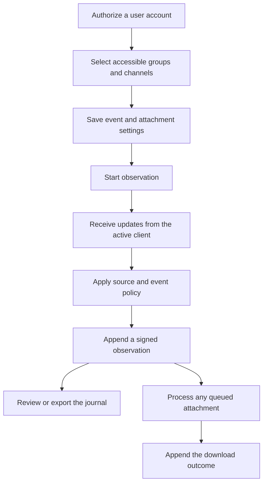

[TgWitness](../../README.md) / [Документация](../README.md) / [Папка](README.md) · [Сбор данных](COLLECTION-MODES.md)

[English](../COLLECTION.md) · **Русский**

# Как работает коллекция

TgWitness фиксирует всё, что наблюдается в подключённом аккаунте Telegram. В режиме живого мониторинга сохраняются сообщения, зафиксированные правки, уведомления об удалении и вложения с указанием времени наблюдения и исходного контекста. Просмотр истории, повторные проверки и доступные записи журнала администратора добавляют к данной записи отдельно идентифицированные наблюдения.

На этой странице

- [От входа в систему до журнала](#from-login-to-a-journal)
- [Область наблюдения: выбранные чаты, папка или весь аккаунт](#observation-scope-chosen-chats-a-folder-or-the-whole-account)
- [Выбор области действия и событий](#scope-and-event-selection)
- [Собственные действия](#own-actions)
- [Режим расследования: вступление в команды и общение с ботами](#investigation-mode-joining-teams-and-talking-to-bots)
- [Уровни повторной проверки](#recheck-tiers)
- [История сообщений и атрибуция](#message-history-and-attribution)
- [Снимки истории](#history-snapshots)
- [Обработка вложений](#attachment-handling)
- [Приостановка, блокировка, отключение и перезапуск](#pause-lock-disconnect-and-restart)
- [Изоляция и проверка аккаунтов](#account-isolation-and-verification)

## От входа в систему до журнала

Информацию о самоуничтожающихся фотографиях и файлах см. в разделе [Самоуничтожающиеся медиафайлы](EPHEMERAL-MEDIA.md). В нём объясняются приоритетный рабочий процесс, результаты «сохранено» и «недоступно», а также ограничения блокировки уведомлений о прочтении в сборщике API.

Авторизация, доступ к источнику, запущенный сборщик и полная доставка — это отдельные вопросы. Успешный вход в систему не предоставляет доступ ко всем группам. Доставка отслеживается отдельно: записи об охвате, восстановление пропущенных обновлений и повторные проверки показывают, что именно было доставлено.

## Область наблюдения: выбранные чаты, папка или весь аккаунт

**Дополнительные инструменты → Источники → Область наблюдения** определяет, какие чаты регистрирует рабочая область.

Новая настройка начинается с пункта **Выбрать чаты**. Существующие сохраненные настройки сохраняются. При выборе пункта **Все чаты** в мастере настройки запрашивается подтверждение, если загруженный список содержит более 50 чатов; оценка объёма остаётся отдельной операцией, основанной на выборке.

| Режим | Записи | Новые чаты |
| --- | --- | --- |
| Выбранные чаты (по умолчанию) | Только те чаты, которые вы добавляете вручную | Никогда не добавляются автоматически |
| Папка Telegram | Чаты, находящиеся в одной из папок аккаунта: чаты, включённые по названию, плюс категории папки (контакты, неконтакты, группы, каналы, боты), минус исключённые из неё чаты и, если это указано в настройках папки, заархивированные чаты | Соответствующие чаты добавляются, как только они становятся активными; чаты, которые вы добавляете в папку в Telegram, добавляются в течение часа |
| Весь аккаунт | Все чаты, доступные в аккаунте | Каждый новый чат, группа, личный чат или бот добавляется в момент поступления первого обновления |

- **Типы источников** (каналы, группы, личные чаты, боты) сужают диапазон в режимах «папка» и «Весь аккаунт». Выбранные чаты могут быть любого типа, включая личные чаты и ботов; типы источников никогда не блокируют чат, добавленный вами вручную. Отключение типа, исключение или переход в режим «Выбранные чаты» останавливает автоматическое добавление источников сразу после сохранения настроек, до пересчёта списка источников, а также в случае отсутствия доступа к Telegram: это касается новых сообщений, истории общения, истории новых чатов, настроек собеседников и наблюдений за профилями.
- **Чаты, добавленные вручную,** остаются в списке источников в режимах «папка» и «Весь аккаунт» даже в том случае, если они находятся за пределами папки; их действие приостанавливается только *с помощью функций Исключить*, *Удалить* или при приостановке. Чаты, добавленные системой (*автоматически*), следуют за папкой: тот, кто покидает её, приостанавливается при следующем пересчёте.
- **Исключённые чаты** никогда не сохраняются ни в одном из режимов. В режимах «По папкам» и «Весь аккаунт» действия *Исключить* и *Удалить* в отношении источника помещают его в этот список, чтобы система не добавляла его повторно. Повторный выбор чата вручную (в разделе «Источники», из списка «Чаты» или в меню «Настройки» → **Какие чаты?**) удаляет его из списка. Список вмещает до 5 000 чатов; при превышении этого лимита *команда Удалить* не выполняется, и вместо этого чат можно приостановить.
- **Собственные действия** (включены по умолчанию): сообщения, отправляемые этим аккаунтом, его правки и нажатия кнопок клавиатуры при ответе. При отключении исходящие сообщения и правки пропускаются.
- При переключении на папку или весь аккаунт запрашивается подтверждение: эти режимы записывают личные чаты и сообщения третьих лиц и должны использоваться исключительно в специальной учетной записи. Подтверждение и каждое изменение области действия фиксируются в подписанных записях `scope.changed`. В аккаунте, настроенном в качестве основного, форма области действия и функция «Расследование» не допускают выбор папки или всего аккаунта, как и при запуске; использовать их можно только для однократной копии без записи.
- Чаты, добавленные в область действия, отображаются как источники с пометкой *auto* и записываются как `scope.applied` (при запуске и ежечасно) или `source.discovered` (новый чат во время наблюдения). Переход обратно к выбранным чатам сразу приостанавливает все автоматически добавленные источники, без повторного считывания списка чатов аккаунта. За исключённый чат перестаёт вестись запись, как только область применения сохраняется, и его источник приостанавливается даже в том случае, если Telegram не возвращает список чатов. Во время наблюдения сохранение области применения приводит к её повторному применению, даже если значения не изменились.

Область действия этих режимов:

- **Секретные чаты** используют встроенную [интеграцию Pseudo-secret](PSEUDO-SECRET.md) с модулем протокола, устанавливаемым через панель, и переключателем включения для каждого аккаунта. Облачная история и Takeout используют отдельный путь сбора данных.
- **Периоды офлайн-режима.** После перезапуска TgWitness возобновляет работу с сохраненной позицией обновления, запрашивает у Telegram пропущенные обновления и проводит повторную проверку чатов. Telegram хранит ограниченный объём накопившихся данных, поэтому после длительного перерыва отчёты и скрипт `verify.py` указывают оставшийся интервал как пробел (см. [раздел Покрытие](EVIDENCE.md#coverage-continuity-gaps-and-unobserved-ids)).
- При запуске отображаются только первые 1 000 диалогов (ограничение настраивается в разделе **Дополнительные инструменты → Параметры**); более старые чаты добавляются при их следующей активации. Более ранняя история добавленного чата не загружается — при необходимости создайте моментальный снимок истории или выполните полный экспорт чата.
- Условия папок, которые постоянно меняются (заглушенные, прочитанные), не применяются: такие чаты остаются под наблюдением.
- **Кнопки бота, встроенные** в другое приложение **(с обратным вызовом),** невидимы для второго сеанса; ответ или редактирование бота фиксируются. Нажатия клавиш ответа поступают в виде исходящих сообщений и помечаются как `button_press`.
- Большее количество чатов означает больше запросов. Telegram ограничивает аккаунты при объёме, который считает чрезмерным, что является ещё одной причиной для использования специальных аккаунтов.

### Строгий режим выбранных чатов

**Параметр Строго: читать только выбранные чаты** отображается в разделе **Выбранные чаты** и по умолчанию отключён. Он предназначен для разрешения, охватывающего только выбранные чаты. Когда он включён:

- Уведомления сервиса Telegram (777000) не считываются: ни при начале, ни при остановке наблюдения, ни каждую минуту во время наблюдения. Не записываются записи `session.security_baseline` или `account.security_event`.
- Список сеансов аккаунта не считывается: ни при начале, ни при остановке наблюдения (также пропускается вопрос панели о других сеансах для **Доказательств по делу** и режимов защиты доказательств), ни каждые две минуты во время наблюдения, ни при установке соединения, ни при проверке соединения, где запись *Текущая авторизация* отображается как пропущенная. Статус двухэтапной аутентификации, используемый проверкой на перехват, также не считывается. Таким образом, записи `account.sessions`, `session.concurrent_at_start` и `session.takeover_risk` не записываются, а сеанс, завершённый с другого устройства, не регистрируется как `session_revoked_externally`.
- Хотя это единственный сеанс учетной записи (**укажите Сделать этот сеанс единственным** или его автоматическую версию), список сеансов по-прежнему считывается каждые две минуты во время наблюдения и при установке соединения, так что при появлении другого сеанса регистрируется значение `session.exclusive_ended`. В течение этого периода значение 777000 остаётся непрочитанным, хотя запись ``session.exclusive_from`` свидетельствует о том, что уведомления о входе в Telegram продолжают регистрироваться.
- Уведомления об удалении сравниваются с результатами проверки сеанса только в том случае, если такая проверка проводилась в течение последних 10 минут (пока это единственный сеанс или после открытия **сеансов данного аккаунта**). В противном случае, если только последняя проверка прав не показывает, что данный аккаунт не мог удалить сообщение (что никогда не происходит в личных чатах и обычных группах), отображается следующее: *Неизвестно, кто удалил сообщение: его мог удалить и сам этот аккаунт, и с другого сеанса, и с другого устройства.*
- В случае импортированного ключа сеанса ничто в журнале не указывает время входа в данный сеанс до тех пор, пока не будет прочитан список сеансов (например, в разделе **Сеансы этого аккаунта**). До этого момента при экспорте чатов и **автоматическом** экспорте аккаунта используется обычный сеанс вместо Takeout с указанием причины `session_age_unknown`.
- Включение чата не приводит к считыванию его более ранних сообщений. Без включения этого параметра каждый включённый чат (в разделе «Источники», в разделе «Чаты», при входе из панели или в мастере настройки) получает один базовый снимок (`baseline`) своих последних сообщений — в объёме, не превышающем значение параметра **Дополнительные инструменты → Параметры → Максимальный размер снимка истории** (по умолчанию — 500), — при следующем запуске наблюдения. Снимок, ожидающий обработки и срок которого истекает при включенном переключателе, отбрасывается. В чате, к которому вы присоединились с панели, последние сообщения также не считываются как в новом чате (по счетчику **При появлении нового чата или бота**, по умолчанию — 100), а при открытии выбранного чата без сохраненных сообщений в разделе «Чаты» последние 100 сообщений не загружаются автоматически. **При загрузке истории** и снимков, которую вы запускаете самостоятельно, история по-прежнему считывается.
- Настройка конфиденциального контента аккаунта не считывается и не изменяется. Без включения этого переключателя вход в систему и каждое новое подключение активируют его, если он выключен, и Telegram разрешает такое изменение (`account.content_settings`); данная настройка относится к аккаунту и применяется во всех приложениях Telegram. Контент, который Telegram помечает как конфиденциальный, может оставаться скрытым.
- Обновления о телефонных звонках не записываются в поле `account.phone_call`.
- При прекращении наблюдения записывается только отпечаток ключа сеанса; список сеансов и 777000 не считываются.

Это не ограничивает объем данных, отправляемых Telegram: обновления всех чатов по-прежнему поступают в данный сеанс, а записываются только выбранные чаты. Список чатов аккаунта (вплоть до **чатов, считываемых из списка аккаунта**) и его папки по-прежнему считываются при запуске, а также повторно при сохранении области действия во время наблюдения, чтобы найти выбранные чаты. Уведомления об удалении без указания чата (`deletion.unscoped`) по-прежнему регистрируются: они содержат только идентификаторы сообщений и могут относиться как к выбранному личному чату, так и к обычной группе. Проверка замороженных аккаунтов (`help.getAppConfig`), другие проверки подключения, а также функции, которые вы включаете самостоятельно (автоматическое завершение других сеансов, проверка свидетелей, псевдо-секретные чаты, **сеансы данного аккаунта**, а также список устройств, на которых выполнен вход в Telegram, в разделе **Дополнительные свидетели**, который считывает список сеансов при каждом проходе временных меток и который устанавливает отметки для целей **Отслеживать чаты** и **Доказательства по делу**) продолжают работать.

Включите эту функцию перед входом в систему; в противном случае сам процесс входа проверит текущую авторизацию и включит контент, требующий особой защиты. Каждое изменение представляет собой подписанную запись `scope.changed`, а `observation.started` передаёт значение в качестве `scope.strict`. Переход в папку или на весь аккаунт отключает эту функцию.

## Выбор области действия и событий

Каждая рабочая область имеет собственные источники. TgWitness не присоединяется к группам, не принимает приглашения и не перечисляет всех участников автоматически. Источники должны быть уже доступны для аккаунта. При запуске сборщик сверяет выбранные источники с видимыми диалогами аккаунта; проверяются первые 1 000 диалогов, если в разделе **Дополнительные инструменты → Параметры → Чаты, считываемые из списка аккаунта** не указано иное. Отсутствующий источник помечается как **доступ не подтверждён**, а не как «вас, вероятно, удалили».

| Настройка | Сбор данных | Поведение при отключении |
| --- | --- | --- |
| Новые сообщения | Обычные доставленные сообщения | При последующем редактировании или удалении может не оказаться ранее сохраненного текста для сравнения. |
| Изменения | Доставленные отредактированные версии сообщений | Промежуточные изменения впоследствии не восстанавливаются. |
| Удаления | Уведомления об удалении в пределах области действия и уведомления на уровне аккаунта без ограничения области действия | Уведомления об удалении не добавляются в журнал. |
| Реакции | Снимки доставленных реакций | Отдельные обновления реакций не добавляются. |
| Членство | Доставленные сообщения службы членства и обновления о участниках | Данные наблюдения по членству не добавляются. |

Настройки применяются ко всем выбранным источникам в рабочей области. Сохраните форму, чтобы применить изменения; изменения фиксируются с указанием подписанных значений «до» и «после». Отключение категории не приводит к удалению более ранних записей. Повторное включение не приводит к восстановлению пропущенных обновлений.

Операционные записи и другие события группового обслуживания остаются независимыми от этих переключателей. Сообщения службы членства могут создавать записи сообщений при включенном членстве, даже если обычный захват новых сообщений отключен. Захваченные объекты Telegram сохраняют встроенные метаданные; переключатель не является правилом редактирования.

**Удаления в личных чатах и обычных группах** поступают в виде идентификаторов сообщений без указания чата. Эти чаты используют одну общую для всего аккаунта последовательность идентификаторов сообщений, поэтому, если сообщение с данным идентификатором было сохранено ранее, его чат известен: удаление фиксируется в этом чате с указанием в поле ``chat_resolution``, как именно это произошло. Идентификаторы, которые никогда не сохранялись, остаются **удалениями без определённой области действия** с явно неустановленным чатом. Это уведомления Telegram об удалении, сохраняемые даже в тех случаях, когда их чат ещё не удаётся соотнести. Схема уведомления содержит идентификаторы; журнал добавляет время получения и любой сохраненный контекст сообщения, включая атрибут `deleted_message_was_outgoing`. Доступные записи журнала администратора служат отдельным источником информации о действии, исполнителе и времени происхождения.

## Собственные действия

Сообщения, отправленные наблюдаемым аккаунтом, помечаются как `outgoing`. При редактировании исходящего сообщения отмечается, что в личных чатах и группах его может редактировать только автор, тогда как сообщения в каналах могут редактироваться другими администраторами. Когда исходящее сообщение повторяет текст кнопки из самой последней сохраненной клавиатуры ответов в данном чате, оно содержит поле `button_press` со ссылкой на запись этой клавиатуры.

Исключение собственных действий также распространяется на фоновые повторные проверки и автоматическую историю новых чатов. Пропущенные исходящие сообщения сдвигают позицию повторной проверки вперёд, чтобы они не могли блокировать последующие входящие сообщения. Явные действия на панели и вручную запрашиваемые снимки истории по-прежнему фиксируются.

## Режим расследования: вступление в команды и общение с ботами

**Дополнительные инструменты → Источники → Область действия → Режим расследования** настраивает область действия для специальной учетной записи, которая присоединяется к командным чатам, запускает ботов и отправляет им сообщения: весь аккаунт, все типы источников, собственные действия, а также для каждого чата или бота — его профиль и последние 200 видимых сообщений. Просмотрите форму и нажмите **Сохранить область**; при переходе к весму аккаунту потребуется обычное подтверждение.

- **Кнопки.** Кнопки, расположенные под сообщением, сохраняются вместе с ним и отображаются в **разделе Чаты**: ссылки, веб-приложения, ссылки для входа, текст для копирования, данные обратного вызова, встроенные запросы, запросы на указание номера телефона или местоположения. Ссылки отображаются в виде текста и никогда не открываются панелью. Если бот изменяет только кнопки (например, добавляет новую ссылку для оплаты), это считается новой версией сообщения как при оперативном обновлении, так и при повторной проверке.
- **Новые чаты и боты.** В режимах «Папка» и «Весь аккаунт» **появление нового чата или бота** сохраняется сразу же после его появления:
  - его профиль в виде записи `source.profile`: описание бота и команды, текст «О себе» пользователя, группы или канала, участники, связанный чат и ссылка для приглашения, если Telegram её возвращает;
  - его последние видимые сообщения (до 1 000) в виде моментального снимка истории с меткой `new_chat`: ранние сообщения в групповом чате, к которому только что присоединились, или то, что бот сказал до того, как система наблюдения заметила этот чат. Сообщения, уже сохраненные в режиме реального времени, не дублируются.

Вновь выбранные чаты используют эти настройки при применении области действия, включая чаты, уже присутствующие в списке диалогов аккаунта. Первоначальная загрузка профилей и истории выполняется одновременно для не более чем трёх чатов; последующие операции с одним и тем же чатом выполняются по порядку. На каждом этапе обработки истории/профиля используется настроенный таймаут операции, поэтому застрявшие запросы освобождают своего рабочего процесса. История сохраняется до опционального чтения профиля; сбой при чтении профиля не препятствует сбору этой истории. Неудавшиеся этапы повторяются через 5 секунд, при этом интервал между попытками удваивается до максимального значения в 5 минут, не занимая рабочий процесс во время задержки. Идентификаторы ожидающих задач, сроки повторных попыток и завершённые этапы сохраняются локально. При перезапуске возобновляются только незавершённые этапы; повторная попытка чтения профиля не повторяет уже завершённое чтение истории. Источники, отключённые до наступления их очереди, пропускаются. В обзоре загрузки чатов активные, ожидающие и повторяемые задачи отображаются отдельно от загрузки вложений. FloodWait приостанавливает эту работу, которая возобновляется после его завершения; сбои регистрируются, а запись чата в режиме реального времени продолжается. Сюда входят периоды ожидания при определении идентификатора нового чата: задача по профилю/истории, находящаяся в ожидании, сохраняется для повторной попытки, а существующее более длительное ожидание на уровне аккаунта не сокращается. Рабочие процессы совместно используют это время ожидания; параллелизм не позволяет обойти ограничения Telegram на количество запросов.
- **Профили по запросу. В разделе** **Чаты → Профиль → Сохранить профиль теперь** сохраняется текущий профиль любого источника; самый новый профиль отображается над сообщениями.
- **Снимки состояния чата (предварительный просмотр).** Состояние вне потока сообщений изменяется без появления сообщений: снятие закрепления с любого сообщения не оставляет следа на уровне сообщения; администратор теряет права; подарок скрывается, конвертируется, обновляется или возвращается. В процессе наблюдения каждый включённый источник периодически считывается и сохраняется в виде заверенной записи `chat.state`: название, имена пользователей, описание, количество участников и администраторов, связанный чат, режим замедления, идентификаторы закреплённых сообщений (до 100), администраторы с их правами и званиями, а также подарки, отображаемые в каналах и профилях пользователей (до 100). В каждой записи перечисляются отличия от предыдущего моментального снимка: изменившиеся поля с указанием значений «до» и «после», закреплённые сообщения, добавленные или удалённые, а также администраторы и подарки, добавленные, изменённые или больше не указанные в списке.
  - Часть данных, доступ к которой Telegram отказывает (например, список администраторов канала для участника, не являющегося администратором), указывается в поле `errors`; её предыдущее значение сохраняется и перечисляется в поле `carried_forward`, при этом оно никогда не указывается как удалённое.
  - Запись, в которой единственными изменениями являются счётчики, а также проверка, не выявившая никаких изменений, ссылается на последнее полное состояние с помощью `state_seq` и кумулятивного `state_overrides`. Полное состояние записывается не реже одного раза в семь дней, а также всякий раз, когда изменяется что-либо, кроме счётчиков.
  - `parts_complete` отмечает ограниченные списки. Для добавления требуется полный предыдущий список, для удаления — полный текущий список, а явные пустые значения фиксируют очистку записей.
  - **Дополнительные инструменты → Параметры → Состояние чата** позволяет настроить интервал (по умолчанию — 12 часов; значение 0 отключает создание моментальных снимков), паузу между источниками, какие части подлежат считыванию, а также определять, следует ли фиксировать проверки, не выявившие изменений. `FLOOD_WAIT` и `FLOOD_PREMIUM_WAIT` приостанавливают оставшиеся запросы на создание моментальных снимков, сохраняют любой более длительный срок действия для всего аккаунта и позволяют прерванному чату повторить попытку по истечении этого времени ожидания.
- **Не отображается.** Кнопки в тексте сообщения (с обратным вызовом), нажатые в другом приложении Telegram, всплывающее окно или ссылка, с помощью которой бот отвечает на такое нажатие, а также ссылки для приглашения, используемые в другом приложении, не поступают в TgWitness. То, что бот отправляет или редактирует впоследствии, фиксируется.

### Действия с панели

**В разделе Чаты** теперь доступен мини-клиент, использующий аккаунт Telegram выбранной рабочей области:

- Напишите сообщение в виде простого текста или выберите **Ответить** под сохраненным сообщением. Возвращаемое исходящее сообщение фиксируется даже в том случае, если область действия исключает исходящие обновления.
- Нажмите **кнопку Нажать** под текущей кнопкой обратного вызова или текстовой кнопкой. Сервер повторно загрузит сообщение и отклонит действие, если ввод с клавиатуры отличается от сохраненной версии. Квитанции обратного вызова сохраняют текст всплывающего окна Telegram, флаг оповещения и URL-адрес; ответ также отображается под диалогом. URL-адреса остаются выделяемым текстом и не открываются автоматически.
- Нажмите **+** → **Открыть ссылку Telegram**, введите `@username`, публичную ссылку `https://t.me/name`, `https://t.me/+invite` / `joinchat/invite` или ссылку на бота с параметром `?start=parameter`, а затем нажмите **Сохранить предварительный просмотр**. Исходная ссылка и предварительный просмотр Telegram подписываются перед присоединением. Команда **Присоединиться / открыть и провести наблюдение** присоединяет пользователя к группе/каналу или открывает пользователя/бота, добавляет чат в качестве активного источника и отправляет боту команду `/start` с указанием его начального параметра. Запрос на присоединение, ожидающий одобрения администратора, регистрируется как «на рассмотрении», а не как членство.

Включите функцию **Начать наблюдение**, чтобы фиксировать входящие ответы в режиме реального времени. Действия панели работают, пока наблюдение приостановлено; затем панель сохраняет свои прямые ответы, а наблюдение в режиме реального времени фиксирует остальную часть разговора. Вновь добавленные источники используют настроенный профиль или историю при вводе данных, когда наблюдение запущено. Если источник приостановлен, включите его в разделе **Дополнительные инструменты → Источники** перед отправкой сообщений или нажатием его кнопок.

`interaction.preview`, `interaction.requested` и `interaction.result` — это обычные подписанные события журнала, включаемые в экспорт доказательств. Запросы идентифицируют аккаунт, сообщение/кнопку или запись предварительного просмотра, а также указывают, работало ли наблюдение. Квитанции различают успешное выполнение, отказ, ожидание одобрения и неизвестный результат. Прерванный запрос мог дойти до Telegram: проверьте чат, прежде чем начинать новое действие. Повторное использование идентификатора запроса позволяет извлечь сохранённую квитанцию без повторного выполнения действия, в том числе после перезапуска. Панель сохраняет идентификатор после получения неоднозначного ответа на одно и то же действие в течение текущего сеанса страницы. Она также сохраняет этот идентификатор, если обновление окна не удаётся после успешного выполнения действия: квитанция остаётся видимой, и повторное нажатие позволяет её извлечь. RPC-вызовы с обратным вызовом и присоединением имеют одну попытку выполнения; запросы на чтение с возможностью повторной попытки сохраняют настроенную политику повторных попыток. Переключение между чатами немедленно очищает черновик и адресата ответа и отключает отправку до тех пор, пока не загрузится новый разговор.

Этот мини-клиент обрабатывает текстовые поля и кнопки обратного вызова. Кнопки мини-приложений запускают **функцию Открыть мини-приложение**, которая запускает приложение в изолированном браузере ([Мини-приложения](MINI-APPS.md)). Для входа в систему, запросов на номер телефона и местоположение, платежей, встроенных запросов и вложений по-прежнему требуется клиент Telegram; сохраненные метаданные кнопок остаются видимыми. В новых элементах управления используется текст на английском языке.

## Уровни повторной проверки

Повторная проверка запрашивает у Telegram пропущенные сообщения, правки и сообщения, которые он больше не возвращает. Источники, помеченные звёздочкой, являются **приоритетными** и по умолчанию проверяются каждые 15 минут; все остальные источники — каждые 6 часов. Выбранные чаты изначально считаются приоритетными, а чаты, добавленные через папку или для всего аккаунта, — обычными. За один проход проводится повторная проверка не более 30 источников, остальные ожидают следующего прохода; после восстановления соединения приоритетные источники проверяются в первую очередь. Оба интервала настраиваются в разделе **Дополнительные инструменты → Источники → Запись → Повторная проверка** (значение 0 отключает уровень), и их изменения фиксируются в событии `recheck.changed`.

Пропущенные сообщения извлекаются, начиная с того места, где остановился предыдущий цикл, в количестве не более, указанном в разделе **Дополнительные инструменты → Параметры → Количество восстановленных пропущенных сообщений на чат и цикл** (по умолчанию — 1 000). Таким образом, после длительной остановки повторная проверка заполняет весь пробел, даже если в первую очередь были сохранены текущие сообщения, более свежие, чем пробел. Чат, который всё ещё находится в процессе наверстывания, подвергается повторной проверке в течение следующей минуты, а не в ожидании наступления интервала своего уровня; показатель `recheck.completed` отображает значение `continues_after` до завершения процесса.

Сравнение включает текст сообщений, сущности, клавиатурные вводные данные (включая удаления) и содержание/идентификаторы вложений. Само по себе изменение хешей доступа к файлам или ссылок на файлы не считается редактированием, равно как и то, что Telegram заполняет самостоятельно: загрузка предварительного просмотра ссылки, просмотры историй, платные медиафайлы, разблокированные данным аккаунтом, получение квитанции. Каждая сохранённая версия в разделе «Чаты» содержит ссылку на полную запись журнала, включая метаданные медиафайлов.

## История сообщений и атрибуция

Предположим, что сборщик зафиксировал сообщение «Встреча в 10:00», позже увидел «Встреча в 11:00», а затем получил уведомление об удалении. В этом случае добавляются три отдельных наблюдения: исходный текст сохраняется, редактирование представляет собой отдельную версию, а уведомление фиксирует факт обнаружения удаления.

Если сбор данных начался после исчезновения первой версии, этот текст недоступен. Если несколько правок произошли в то время, когда процесс находился в автономном режиме, могут быть сохранены только версии, зафиксированные впоследствии в результате наблюдения. Уведомление об удалении не позволяет восстановить контент, который никогда не был зафиксирован.

Запись объединяет несколько источников:

| Источник | Сохраненная информация |
| --- | --- |
| Текущее сообщение или обновление редактирования | Идентификатор сообщения, метаданные отправителя, сохраненная версия, время получения и указанная дата сообщения/редактирования в Telegram. |
| Уведомление об удалении в режиме реального времени | Идентификаторы сообщений, о которых поступили уведомления, время получения, исходный текст уведомления и ссылки на ранее сохраненный контент. |
| Доступный журнал администратора | Действие, исполнитель, дата источника и предоставленное содержание сообщения, прочитанного аккаунтом, обладающим необходимыми правами. |
| Взаимодействие с панелью | Запрошенное действие и его зафиксированный результат в рамках выбранного аккаунта. |
| Повторная проверка | Текущий ответ Telegram в сравнении с ранее сохраненным сообщением. |

`observed_at` — это время записи в часах сборщика, которое увеличивается вместе с `seq`. Записи, созданные при обработке оперативного обновления, также содержат `received_at` — время поступления обновления в сборщик — и `processing_delay_ms` — время от получения до записи; обновления, удерживаемые на момент начала наблюдения, обрабатываются в порядке поступления до более поздних. `source_at` сохраняет дату источника, если данное событие её предоставляет. Наблюдения за смещением часов Telegram, записи о разрывах в работе часов и [проверки внешнего времени](TIMESTAMP.md) обеспечивают соответствующий контекст синхронизации. Поля обычного уведомления о сообщении описывают само это уведомление; записи журнала администрирования и взаимодействий сохраняют свои собственные атрибуты.

## Снимки истории

Снимок запрашивает последние видимые сообщения из включённого источника, до 500 на один запрос. Результаты обозначаются как наблюдения за историей. Ручные снимки выполняются параллельно с наблюдением. Повторные наблюдения сохраняются в виде отдельных записей. При включении источника также создаётся один базовый снимок (`baseline`), если не включена опция [только выбранные чаты](#strict-chosen-chats).

Создание моментальных снимков прекращается, если источник отключается во время чтения. Ответы должны относиться к запрошенному чату и содержать строго убывающие положительные идентификаторы сообщений, находящиеся ниже запрошенного предела. Недопустимый ответ прерывает создание моментального снимка до сохранения данного сообщения; уже сохраненные сообщения остаются в подписанном журнале вместе с записью о прерывании.

Снимки соответствуют политике вложений, но остаются отдельными от переключателей «живых» событий. Они не восстанавливают удалённые сообщения или пропущенные промежуточные версии. Вы можете запросить снимки во время паузы; любые вложения, помещённые в очередь, ожидают до начала наблюдения и запуска модуля загрузки.

Запуск **Истории** представляет собой отдельную эксклюзивную задачу: он считывает выбранные источники и последовательно загружает их входящие в очередь вложения, не запуская мониторинг. Приостановка освобождает аккаунт; возобновление продолжает сохраненный запуск. Информацию о фильтрах по дате, языку и ответам для нескольких неактивных аккаунтов см. в разделе [Распределённый экспорт чатов](DISTRIBUTED-EXPORT.md).

## Обработка вложений

Загрузка вложений включена по умолчанию и приостанавливается при объёме свободного места на диске менее 1 ГБ. Сборщик фиксирует наблюдение за сообщениями и задание на загрузку одновременно. Задание сохраняет исходный дескриптор медиафайла и политику размера, поэтому вложение, отредактированное позднее, не заменяется незаметно.

Загрузка выполняется после захвата сообщения. По завершении загрузки создаётся запись ``media.saved`` с указанием SHA-256 и количества байтов. Пропущенные, завершившиеся с ошибкой, повторенные и прерванные задания имеют отдельные результаты; файл считается сохраненным, если существует запись `media.saved` для него. Завершённый файл также должен соответствовать количеству байтов, указанному в исходном дескрипторе наблюдаемого вложения. Короткий или неожиданно длинный ответ не регистрируется как сохраненный медиафайл.

Файл и запись о его папке сбрасываются на диск до записи записи `media.saved`. Если предыдущий процесс сборщика завершился без упорядоченной остановки, при следующем запуске считываются все файлы, зарегистрированные как сохраненные во время того цикла работы. Файл, который отсутствует или байты которого отличаются от записанного SHA-256, получает запись `media.missing_after_restart`, его загрузка вновь ставится в очередь, а несовпадающие байты перемещаются в папку `media-damaged/`. Файлы, перемещённые во внешнее хранилище, не считываются.

В пределах одной рабочей области параллельные задания в очереди для одного и того же представления вложения ожидают завершения активной передачи, а затем проводят повторную проверку сохраненных байтов перед повторным использованием. Каждое задание хранит собственный подписанный результат и ссылку на запись о ранее сохраненном файле. Отмена ожидающего задания не приводит к отмене активной передачи; если эта передача завершится сбоем или будет отменена, следующее задание сможет повторить попытку. Различные вложения могут загружаться одновременно.

Задания с одинаковыми аккаунтами, представлением, ожидаемым размером и действием захвата остаются в очереди, пока выполняется одно соответствующее задание. Они не занимают слоты для загрузки, поэтому загрузка других файлов может начаться даже в том случае, если в начале очереди находится много копий одного медленно загружаемого файла. Завершение попытки активирует очередь. По-прежнему действуют приоритетные каналы, сохраненные задержки повторных попыток и принадлежность к истории; каждое наблюдение получает свой собственный результат.

Экспорт из чата также использует активную передачу для повторных представлений файлов в пределах одного каталога экспорта. Каждое сообщение сохраняет ссылку на своё вложение, и для повторного использования требуется проверка текущего размера и контрольной суммы SHA-256. Различные файлы можно проверять параллельно без удержания общей блокировки передачи. Временные пути загрузки и копирования являются уникальными для каждой операции; при отмене операция ожидает завершения работы любого активного локального средства чтения файлов перед очисткой. Индекс экспортируемых файлов сериализует только доступ к метаданным, а не хеширование файлов или их загрузку.

Чтение серверных хешей для различных вложений также выполняется одновременно, совместно используя три слота клиентских запросов на файлы с байтовыми загрузками. При повторном чтении одного и того же представления повторно используется только полный кэшированный результат. Чтение файлов не занимает места в обычной очереди запросов; сохраненные сроки FloodWait проверяются повторно, когда запрос получает слот.

Ограничения устанавливаются **для каждого типа**: фотографии, видео, GIF-файлы и анимации, видеосообщения «Round», голосовые сообщения, музыка и аудио, стикеры и файлы. Каждый тип можно отключить, и для него установлено собственное ограничение по размеру от 1 до 2 000 MiB; новые рабочие области начинают с 20 МБ для фотографий, 100 МБ для видео, 50 МБ для файлов, аудио и круговых видео, 20 МБ для голосовых сообщений и GIF-файлов и 5 МБ для стикеров. В новых рабочих областях GIF-файлы и стикеры по умолчанию отключены до тех пор, пока их не включат. В рабочих областях, политики которых были сохранены до введения ограничений по типам, все типы остаются включенными и сохраняют единое ограничение для каждого типа. *Максимальный размер файла* устанавливается для всех типов одновременно. Отключение того или иного типа приводит к созданию записи `media.skipped`; файлы неизвестного размера или превышающие ограничение не загружаются. Для загрузки больших файлов выделяется дополнительное время в зависимости от их размера и базовой скорости 256 КиБ/с. Задания сохраняются после перезапуска, однако истекшие ссылки, утраченный доступ или удаленные файлы по-прежнему могут препятствовать восстановлению. Задания, находящиеся в режиме ожидания, сохраняют установленный для них лимит, поэтому увеличение лимита применяется только к новым файлам. Отключение типа или снижение его лимита также приводит к пропуску ожидающих файлов, которые он исключает; для каждого из них создаётся запись `media.skipped`; отключение загрузок приостанавливает работу очереди до тех пор, пока их не включат снова.

## Приостановка, блокировка, отключение и перезапуск

| Действие или условие | Результат |
| --- | --- |
| Переключение рабочей области | Изменяет вид панели; остальные сборщики сохраняют своё состояние. |
| Блокировка панели или закрытие вкладки | Сервер и наблюдение продолжают работу. |
| Приостановить наблюдение | Останавливает работу данного сборщика и сохраняет задачи вложений, находящиеся в очереди. |
| Отключить источник | Останавливает будущий захват в рамках определённого диапазона; задания по прикреплению медиафайлов, находящиеся в очереди для данного источника, приостанавливаются на время его отключения. |
| Удаление источника | Источник удаляется из списка источников, а профили пользователей, связанные с ним, удаляются; уже сохраненные записи остаются в журнале, доступном только для добавления. Вложения, которые все еще находятся в очереди, регистрируются как неудачные (`source_removed`). В режимах «папка» и «весь аккаунт» источник также исключается. |
| Изменение маршрута подключения | Требует приостановки, закрывает старые клиенты и отменяет незавершённый вход в систему. |
| Остановка процесса Python | Останавливает все рабочие области; пока система находится в автономном режиме, наблюдения не проводятся. |
| Перезапуск после активного наблюдения | Предпринимается попытка возобновить сохраненный диапазон с использованием сохраненного сеанса. Ручная пауза отменяет эту попытку. |

Сборщик регистрирует обнаруженные обрывы соединения, повторные попытки, ошибки, запуски/остановки и сигналы проверки работоспособности. Кратковременные перебои могут быть пропущены при периодической проверке подключения. После перезапуска запрашиваются пропущенные обновления, начиная с сохраненной позиции обновления, а наблюдаемые чаты проводятся повторные проверки; см. [формат доказательств](EVIDENCE.md#durable-collection-and-process-receipts-02). Снимок добавляет текущее состояние в качестве контекста, а пробел остаётся зафиксированным.

## Изоляция и проверка аккаунтов

Каждая рабочая область имеет собственный журнал, авторизацию, ключ подписи, политику и очередь. Только её активный клиент может вносить данные наблюдений в режиме реального времени. Клиенты, которые были отклонены, находятся в ожидании, заменены или проходят тест подключения, не могут записывать обновления в режиме реального времени в её журнал. Различные аккаунты могут наблюдать за одной и той же группой, но их журналы остаются раздельными.

Каждое событие содержит предыдущий хеш и подпись Ed25519. Экспорт охватывает весь журнал рабочей области посредством фиксированного порядкового номера. Фильтры панели не фильтруют экспорт; сбор данных может продолжаться за пределами его границ во время подготовки.

**Проверка журнала** анализирует цепочку событий и подписи в пределах отображаемого диапазона. Её результаты очищаются при изменении рабочей области, и панель выявляет новые записи, добавленные после проверки. Экспорт в формате ZIP также проверяет собранные медиафайлы.

Храните отпечатки и контрольные точки независимо друг от друга. Ознакомьтесь с [областью проверки](EVIDENCE.md#verification-scope) для проверок сбора данных в каждом режиме, а также с [ежедневными операциями](OPERATIONS.md) для планового сбора.
