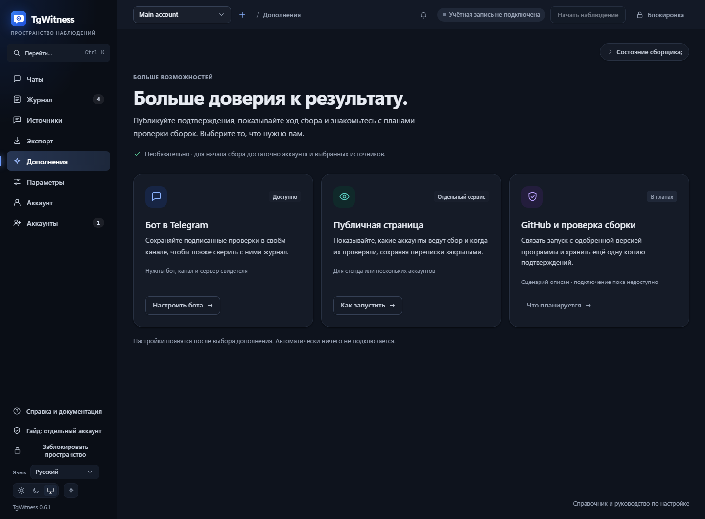

# Дополнения — когда нужны

Для начала работы достаточно подключить аккаунт, выбрать источники и включить
наблюдение. Дополнения открываются отдельно в боковом меню: выбираете карточку,
видите короткие шаги, раскрываете технические детали по необходимости.

| Хочу | Что выбрать | Что понадобится |
| --- | --- | --- |
| Сохранять подписанные проверки в своём Telegram-канале | **Бот в Telegram → Настроить бота** | Бот от BotFather, канал и компьютер или сервер для свидетеля |
| Показать, как работают несколько аккаунтов, сохранив переписки закрытыми | **Публичная страница → Как запустить** | Сервис Proof, токены чтения выбранных аккаунтов и свой HTTPS-адрес |
| Связать работу с одобренной версией софта и хранить подтверждения в GitHub | **GitHub и проверка сборки → Что планируется** | Пока только описание сценария; подключение ещё не реализовано |

## Бот: три шага

1. **Доступ к проверкам.** Выберите нужный аккаунт, назовите подключение и создайте
   токен чтения. Нажмите **Сохранить файл доступа**. Этот токен не открывает переписки
   и не позволяет управлять сбором.
2. **Канал и частота.** Укажите канал, периодичность и доступный свидетелю адрес
   коллектора. Нажмите **Сохранить настройки**. Публикация каждой проверки включена
   по умолчанию; форма показывает примерное число постов в сутки.
3. **Запуск.** Раскройте третий шаг, перенесите файлы на сервер свидетеля, добавьте
   токен от BotFather и выполните команды. Убедитесь, что первая подписанная
   публикация появилась в канале.

Политику публикаций, прокси и адрес Bot API можно изменить в **Дополнительно ·
публикация и сеть**. Ранее созданные подключения находятся под отдельным раскрывающимся
пунктом в первом шаге. Переключение между карточками сохраняет заполненную форму;
смена аккаунта и блокировка панели очищают временный токен и настройки.

Подписанная проверка помогает сверить последующий экспорт с ранее наблюдавшимся
журналом. Для независимости лучше другой сервер и другой оператор. Скачанный файл
настроек ещё не означает, что свидетель запущен.

[Подробная настройка и свои прокси](WITNESS.md) ·
[Проверка подписей и публикаций](../WITNESS.md#verify)

## Публичная страница

На ней видны состояние сбора, счётчики сообщений и подписанные проверки. Посетители
не получают тексты переписок, сессии аккаунтов или управление коллектором. Настройка
запускается отдельно; карточка объясняет, что подготовить, и открывает встроенную
инструкцию без перехода на внешний сайт.

Токен чтения создаётся в первом шаге настройки бота — это общий доступ к проверкам.
Для самой публичной страницы заводить бота и канал не нужно.

Для доказательства доставки конкретных событий нужен ещё контрольный сценарий:
отправить, изменить и удалить уникальное сообщение с другого аккаунта в своей
тестовой группе, затем сверить экспорты.

## GitHub

Карточка **В планах** описывает будущий путь: выбрать свой форк и версию,
проверять установленную сборку, сохранять подписанные подтверждения через свидетеля.
Поля для GitHub-токена пока нет. Сам токен даёт доступ к репозиторию, а проверку
соответствия программы и непрерывности наблюдения выполняют отдельные механизмы.

[Технический план и критерии готовности](TRUST-ROADMAP.md)
