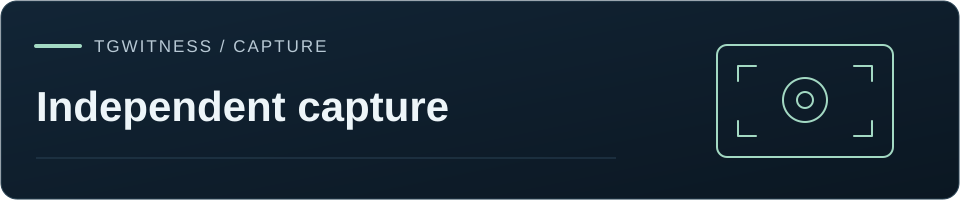
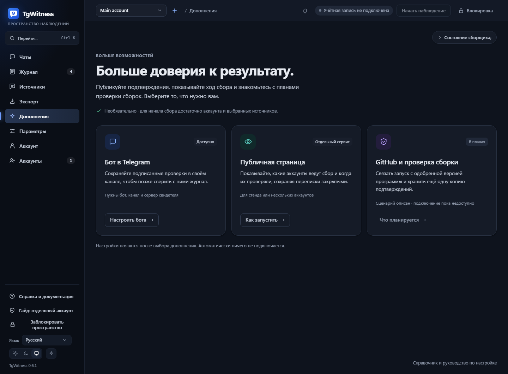

[TgWitness](../../README.md) / [Documentation](../README.md) / [Folder](README.md) · [Independent capture](../OPTIONAL-CAPTURE.md)

# Дополнения — когда нужны

Для начала работы достаточно подключить аккаунт, выбрать источники и включить
наблюдение. Дополнения открываются отдельно в боковом меню, в разделе
**Инструменты → Дополнительно** (уровень интерфейса «Эксперт»): выбираете карточку,
видите короткие шаги, раскрываете технические детали по необходимости.

| Хочу | Что выбрать | Что понадобится |
| --- | --- | --- |
| Сохранять подписанные проверки в своём Telegram-канале | **Независимый свидетель → Настройте** | Бот от BotFather, канал и компьютер или сервер для свидетеля |
| Показать, как работают несколько аккаунтов, сохранив переписки закрытыми | Отдельной карточки нет: команда `python -m tgwitness.proof` ([инструкция](WITNESS.md#public-proof-page-for-several-workspaces)) | Сервис Proof, токены чтения выбранных аккаунтов и свой HTTPS-адрес |
| Связать работу с одобренной версией софта и хранить подтверждения в GitHub | **Проверка кода → Настройте** | Публичный репозиторий GitHub, токен не нужен; результат сохраняется в журнале, хранение подтверждений в GitHub не реализовано |

## Бот: три шага

1. **Доступ к проверкам.** Выберите нужный аккаунт, назовите подключение и создайте
   токен чтения. Нажмите **Сохраните файл доступа**. Этот токен не открывает переписки
   и не позволяет управлять сбором.
2. **Канал и частота.** Укажите канал, периодичность и доступный свидетелю адрес
   коллектора. Нажмите **Сохраните конфигурацию**. Публикация каждой проверки включена
   по умолчанию; форма показывает примерное число постов в сутки.
3. **Запуск.** Раскройте третий шаг, перенесите файлы на сервер свидетеля, добавьте
   токен от BotFather и выполните команды. Убедитесь, что первая подписанная
   публикация появилась в канале.

Политику публикаций, прокси и адрес Bot API можно изменить в **Расширенные настройки ·
публикация и сеть**. Ранее созданные подключения находятся под отдельным раскрывающимся
пунктом в первом шаге. Переключение между карточками сохраняет заполненную форму;
смена аккаунта и блокировка панели очищают временный токен и настройки.

Подписанная проверка помогает сверить последующий экспорт с ранее наблюдавшимся
журналом. Для независимости лучше другой сервер и другой оператор. Скачанный файл
настроек ещё не означает, что свидетель запущен.

[Подробная настройка свидетеля](WITNESS.md) ·
[Проверка подписей и публикаций](../WITNESS.md#verify)

## Публичная страница

На ней видны состояние сбора, счётчики сообщений и подписанные проверки. Посетители
не получают тексты переписок, сессии аккаунтов или управление коллектором. Страница
запускается отдельно командой `python -m tgwitness.proof`; отдельной карточки в панели
для неё нет, настройка описана в [инструкции](WITNESS.md#public-proof-page-for-several-workspaces).

Токен чтения создаётся в первом шаге настройки бота — это общий доступ к проверкам.
Для самой публичной страницы заводить бота и канал не нужно.

Для доказательства доставки конкретных событий нужен ещё контрольный сценарий:
отправить, изменить и удалить уникальное сообщение с другого аккаунта в своей
тестовой группе, затем сверить экспорты.

## GitHub

Карточка **Проверка кода** сверяет установленную программу с опубликованной версией:
укажите репозиторий GitHub (официальный подставлен) и тег, ветку или коммит, затем нажмите
**Проверить сейчас**. Результат со списком изменённых, лишних и отсутствующих файлов
сохраняется в журнале записью `source.checked`. Токен не нужен, работают только публичные
репозитории. Сохранение подписанных подтверждений через свидетеля пока не реализовано.
Сам токен даёт доступ к репозиторию, а проверку
соответствия программы и непрерывности наблюдения выполняют отдельные механизмы.

[Технический план и критерии готовности](TRUST-ROADMAP.md)
