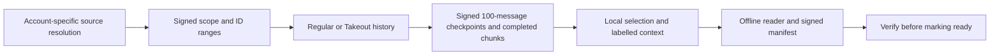

[TgWitness](../../README.md) / [Документация](../README.md) / [Папка](README.md) · [Сбор данных](COLLECTION-MODES.md)

# Более быстрый сбор данных при сохранении пределов доказательной базы

Механизм сбора данных должен использовать один и тот же подписанный план, хранилище и верификатор как для обычного транспорта, так и для транспорта Takeout. Выбор транспорта не должен изменять содержание подписи. Снимок фиксирует то, что аккаунт получил в рамках указанной области; он не восстанавливает всё, что существовало до сбора данных.

## Текущая реализация

[Распределённый Takeout](DISTRIBUTED-EXPORT.md#history-acquisition) теперь устраняет дополнительную задержку итератора истории Telethon при экспорте данных из общего чата. Он повторно использует существующий обертку запроса Takeout, сохраняет фиксированное значение FloodWait для всего аккаунта и проверяет дескриптор экспорта и диапазон разделения Telegram при возобновлении. Дескрипторы остаются конфиденциальными. Общий канал истории допускает до трёх запросов, находящихся в обработке, на один аккаунт; отдельные рабочие процессы сохраняют последовательные курсоры и общее расстояние между запросами.

Для разреженных числовых диапазонов можно использовать более широкие блоки — до 100 000 идентификаторов. Область с указанием знака по-прежнему содержит все запланированные идентификаторы. Это оптимизация количества запросов, не зависящая от анализа удалений. Количество записей во всей истории, используемое для выбора ширины блока, является приблизительной оценкой, а не подсчётом для выбора с фильтрацией по дате.

Синтетические тесты протокола проверяют работу установленного итератора Telethon: 201 сообщение генерирует одинаковые идентификаторы, при этом итератор автоматически входит в режим ожидания при использовании стандартного транспорта и не входит в него при использовании Takeout. Редкий набор из 500 000 идентификаторов, содержащий четыре сообщения, требует пяти запросов к истории при использовании расширенного плана, в отличие от 250 фиксированных задач по 2 000 идентификаторов. Эти данные отражают локальное поведение, а не измеренное ускорение работы Telegram или устойчивую квоту.

Новые планы также создают контрольные точки внутри диапазона. Данные сохраняются до их получения; каждое подтверждение получения связывает неизменяемый план, наблюдатель, курсор и предыдущая квитанция. Прерванный диапазон остаётся в пределах исходной учетной записи и возобновляется после проверенного префикса. Старые планы сохраняют формат целых блоков. Автономный верификатор может проверять остановленный рабочий каталог без учетных данных сеанса. Эти локальные пакеты декодированных сообщений не являются необработанными наблюдениями страниц RPC. См. [подробности о восстановлении](DISTRIBUTED-EXPORT.md#chunking-and-continuation).

Протокольный тест из 201 сообщения, прерванный после 100 сообщений, возобновляется с двумя запросами истории для оставшихся 101 сообщения, сохраняя исходный подписанный префикс. Тесты на сбои охватывают неподписанные концы, фактический выход подпроцесса до получения, сбой записи квитанции, исчерпание свободного места, отмену во время записи, несанкционированное вмешательство и изменения во время наблюдения. Создание контрольных точек добавляет локальную работу по подписанию и синхронизации; это снижает объём повторного чтения после прерываний, а не увеличивает скорость передачи данных по сети без прерываний.

В рамках более масштабного автономного сравнения использовалось 10 000 декодированных сообщений в плане с 500 000 идентификаторами, состоящем из пяти блоков по 100 000 идентификаторов и без вложений. Прерывание первого диапазона после 25 успешных запросов истории позволило сохранить 2 500 сообщений с контрольными точками, в то время как при предыдущем подходе с целыми фрагментами их количество составило ноль. Для возобновления потребовалось 80 запросов истории вместо 105. При непрерывных прогонах в обоих режимах использовалось по 105 запросов. Все четыре прогона дали идентичные канонические хеши записей сообщений и прошли локальную проверку получения квитанций. Это синтетические ответы RPC, прошедшие через реальный итератор Telethon и путь хранения. Они демонстрируют поведение при восстановлении, а не пропускную способность сети, устойчивые квоты Telegram или рекомендации по размерам сервера/аккаунта. Дополнительные затраты на подпись и синхронизацию по-прежнему необходимо измерить с учётом реальной задержки в сети и изолированной нагрузки на диск.

## Следующие изменения в порядке зависимости

1. **Общий контракт для декодированных записей.** Захват в реальном времени сохраняет больше декодированных полей, чем предполагает текущая модель распределённого экспорта. Сохраняйте безопасные исходные поля с явной политикой редактирования/схемы и указанием версии библиотеки/уровня. Оставляйте отображение и повторный синтаксический анализ в качестве производных операций. Не утверждайте, что повторно сериализованные объекты являются исходными байтами передачи или что неизвестный конструктор TL может быть декодирован универсальным образом.
2. **Ограниченное перекрытие сетевых и локальных операций.** Пока одна зафиксированная страница индексируется или визуализируется, следующую следует загружать в ограниченную очередь. Механизм обратного давления приостанавливает чтение, когда хранилище не успевает обрабатывать данные. Загрузка и обязательная подпись должны опережать опциональные операции: PDF, OCR, перевод и аналитику. Не допускается неограниченная история в памяти.
3. **Право владения Takeout на уровне пакета.** В случае подписанного плана с несколькими чатами и совместимыми флагами области действия один аккаунт может сохранять право владения Takeout для данного пакета. Проверяйте каждый повторно используемый дескриптор и привязывайте каждую страницу к её источнику и аккаунту. Закрывайте доступ по окончании обработки пакета; никогда не используйте частный дескриптор другого задания неявно.
4. **Выверенное планирование задач по аккаунтам.** Разделите обнаружение имен пользователей, историю и рабочие нагрузки участников. Сохраняйте локальные для учетной записи кэши одноранговых узлов и общие сроки выполнения. Увеличивайте параллелизм только посредством ограниченных сравнений с идентичной областью действия и доступом к учетной записи, используя пропускную способность подтвержденных сообщений, включая ожидания. Сохраняйте недоступные источники и незавершённую работу вместо замены аккаунтов с целью обхода ожидания. Рекомендация по количеству аккаунтов требует измеренного объёма работы.

Пронумерованные пункты представляют собой последующие этапы проектирования, а не готовые функции. Надежная запись выполняется в освобожденном рабочем потоке, однако чтение по-прежнему ожидает каждой контрольной точки; пока отсутствует перекрытие сетевых операций и записи в очереди.

## Критерии приёмки

- Подписанный план и идентификатор аккаунта не могут изменяться при возобновлении работы.
- Дубликаты, данные, выходящие за пределы допустимого диапазона, измененные или подделанные повторно используемые данные отклоняются; пустой ответ относится только к конкретному наблюдателю и запросу, а не означает всеобщее отсутствие данных.
- Обычные и Takeout-запуски с фиксированным синтетическим источником должны давать одинаковые записи. Различия в реальных условиях должны оставаться под наблюдением, а не устраняться в процессе нормализации.
- Новые метаданные транспорта не раскрывают дескрипторы Takeout, хеши доступа или ключи.
- Ошибка прерывания, ошибка «диск заполнен», длительное ожидание FloodWait, недействительный запрос Takeout и измененный диапазон разделения сохраняют проверенный прогресс с явным статусом.
- Старые архивы остаются поддающимися проверке. Новые форматы страниц требуют тестирования на совместимость старых и новых версий, а также сохранения наблюдений, допускающих только добавление данных.
- Отдельно сообщайте об обнаружении, получении, стойкой записи, отборе и упаковке данных. Измеряйте пиковое использование памяти и дискового пространства, количество запросов по методам и пропускную способность по фиксированным сообщениям. Одного счетчика, работающего только по сети, недостаточно.

Существующий объем тестирования, ограниченный только текстовыми данными, остаётся без изменений. Байты вложений и перечисление участников представляют собой отдельные рабочие нагрузки и должны указываться явно.
