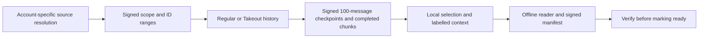

[TgWitness](../../README.md) / [Документация](../README.md) / [Папка](README.md) · [Collection](../COLLECTION-MODES.md)

[English](../FAST-ACQUISITION.md) · **Русский**

# Более быстрое получение данных при неизменных границах доказательной базы

Механизм сбора данных должен использовать один и тот же подписанный план, хранилище и верификатор как для
обычных, так и для Takeout-транспортов. Выбор транспорта не должен изменять то, что
указывается в подписи. Снимок фиксирует то, что учетная запись получила в рамках указанной
области; он не восстанавливает всего, что существовало до сбора данных.

## Текущая реализация

[Distributed Takeout](../DISTRIBUTED-EXPORT.md#history-acquisition)] теперь устраняет
дополнительную задержку итератора истории Telethon при экспорте данных из общего чата. Он повторно использует
существующий обертку запроса Takeout, сохраняет постоянное значение FloodWait для всей учетной записи и
проверяет дескриптор экспорта и диапазон разделения Telegram при возобновлении. Дескрипторы остаются
частными. Общий канал истории допускает до трёх активных запросов на одну учётную запись;
отдельные рабочие процессы сохраняют последовательные курсоры и общее расстояние между запросами.

Для разреженных числовых диапазонов можно использовать более широкие блоки — до 100 000 идентификаторов. Область со знаком
по-прежнему содержит все запланированные идентификаторы. Это оптимизация по количеству запросов, не зависящая
от анализа удалений. Количество записей за всю историю, используемое для выбора ширины блока, является
оценкой, а не подсчётом для выбора с фильтрацией по дате.

Тесты синтетического протокола проверяют работу установленного итератора Telethon: 201 сообщение
генерирует одинаковые идентификаторы, при этом итератор автоматически входит в режим ожидания при использовании обычного транспорта и не входит в него
при использовании Takeout. Редкий фикст с 500 000 идентификаторами, содержащий четыре сообщения, требует пяти запросов
истории при расширенном плане, в отличие от 250 фиксированных задач по 2 000 идентификаторов. Они определяют
локальное поведение, а не измеренное ускорение Telegram или устойчивую квоту.

Новые планы также фиксируются внутри диапазона. Данные сохраняются до их получения; каждое
получение связывает неизменяемый план, наблюдатель, курсор и предыдущее получение.
Прерванный диапазон остается в пределах исходной учетной записи и возобновляется после проверенного
префикса. Старые планы сохраняют формат целых блоков. Автономный верификатор может проверять
неработающий рабочий каталог без учетных данных сеанса. Эти локальные пакеты
декодированных сообщений не являются необработанными наблюдениями страниц RPC. См. [подробности восстановления](../DISTRIBUTED-EXPORT.md#chunking-and-continuation).

Протокольный фикстур, состоящий из 201 сообщения, прерванный после 100 сообщений, возобновляет работу с двумя
запросами истории для оставшихся 101 сообщения, сохраняя исходный подписанный префикс.
Тесты на сбои охватывают неподписанные конечные части, реальный выход подпроцесса до получения подтверждения,
сбой записи подтверждения, исчерпание свободного места, отмену во время записи, несанкционированное вмешательство и
изменения со стороны наблюдателя. Создание контрольных точек добавляет локальную работу по подписанию/синхронизации; оно сокращает повторное чтение
после прерываний, а не увеличивает скорость работы сети без прерываний.

В более масштабном офлайн-сравнении использовалось 10 000 декодированных сообщений в плане на 500 000 идентификаторов,
состоящем из пяти блоков по 100 000 идентификаторов и без вложений. Прерывание первого диапазона после
25 успешных ответов с историей позволило сохранить 2 500 сообщений с контрольными точками, в то время как
при предыдущем подходе с обработкой целых фрагментов их количество составило ноль. Для возобновления потребовалось 80 запросов к истории вместо
105. При непрерывном выполнении в обоих режимах использовалось 105 запросов. Все четыре прогона дали
идентичные канонические хеши записей сообщений и прошли локальную проверку получения.
Это синтетические RPC-ответы, проходящие через реальный итератор Telethon и путь хранения
. Они демонстрируют поведение при восстановлении, а не пропускную способность сети, устойчивые
квоты Telegram или рекомендации по размерам сервера/аккаунта. Дополнительные затраты на подпись и синхронизацию
все еще необходимо измерить с учетом реальной задержки в сети и изолированной нагрузки на диск.

## Следующие изменения в порядке зависимости

1. **Контракт с общими декодированными записями.** При захвате в реальном времени сохраняется больше декодированных полей,
   чем в текущей проекции распределенного экспорта. Сохраняйте безопасные исходные поля с
   явно указанной политикой редактирования/схемы и версией библиотеки/слоя. Сохраняйте отображение и
   повторный синтаксический анализ в качестве производных данных. Не утверждайте, что повторно сериализованные объекты являются исходными
   байтами или что неизвестный конструктор TL может быть декодирован универсально.
2. **Ограниченное перекрытие сетевых и локальных операций.** Пока одна зафиксированная страница
   индексируется/рендерится, загружайте следующую в ограниченную очередь. Обратное давление останавливает чтение,
   когда хранилище не успевает обрабатывать данные. Загрузка и обязательная подпись опережают
   опциональные операции: PDF, OCR, перевод и аналитику. Никакой неограниченной истории в памяти.
3. **Право владения Takeout на уровне пакета.** Для подписанного плана с несколькими чатами и совместимыми
   флагами области действия одна учетная запись может сохранять Takeout для данного пакета. Проверяйте каждый
   повторно используемый дескриптор и привязывайте каждую страницу к её источнику и учетной записи. Закрывайте в конце
   пакета; никогда не используйте частный дескриптор другого задания неявно.
4. **Выверенное планирование по аккаунтам.** Разделяйте обнаружение имен пользователей, историю и
   рабочие нагрузки участников. Сохраняйте локальные для учетной записи кэши одноранговых узлов и общие сроки выполнения.
   Увеличивайте параллелизм только посредством ограниченных сравнений с идентичной областью действия и
   доступом к учетной записи, используя пропускную способность подтверждённых сообщений, включая ожидания. Сохраняйте
   недоступные источники и незавершённую работу вместо замены аккаунтов с целью
   обхода ожидания. Рекомендация по количеству аккаунтов требует выверенного объёма работы.

Пункты с номерами представляют собой последующие этапы разработки, а не готовые функции. Текущий
маршрут «Takeout/checkpoint» не проходил тестирования в реальных условиях, поскольку тестовые аккаунты находятся в состоянии
ожидания с постоянным ограничением скорости. Операции постоянной записи выполняются в освобожденном рабочем потоке, но операции чтения
по-прежнему ожидают завершения каждой контрольной точки; пока отсутствует перекрытие сетевых операций и записи в очереди.

## Контрольные пункты

- Подписанный план и идентификатор учетной записи не могут изменяться при возобновлении.
- Дубликаты, данные, выходящие за пределы диапазона, измененные или подделанные повторно используемые данные отклоняются; пустой
  ответ относится только к конкретному наблюдателю и запросу, а не означает всеобщее отсутствие данных.
- Обычный запуск и запуск Takeout с фиксированным синтетическим источником дают одинаковые записи.
  Различия в режиме реального времени должны оставаться наблюдаемыми, а не устраняться путём нормализации.
- Новые метаданные транспорта не раскрывают дескрипторы Takeout, хэши доступа или ключи.
- Ошибка прерывания, ошибка «диск заполнен», длительное ожидание FloodWait, недействительный Takeout и измененный диапазон разделения
  сохраняют проверенный прогресс с явным статусом.
- Старые архивы остаются поддающимися проверке. Новые форматы страниц требуют тестов на совместимость старых и новых версий
  и сохранения наблюдений, доступных только для добавления.
- Отдельно отчитывайтесь об обнаружении, получении, стойкой записи, отборе и упаковке.
  Измеряйте пиковое использование памяти, дискового пространства, количество запросов по методам и пропускную способность по фиксированным сообщениям.
  Одного счетчика, работающего только по сети, недостаточно.

Существующий объем тестирования, ограниченный только текстом, остается без изменений. Байты вложений и
перечисление участников представляют собой отдельные рабочие нагрузки и должны указываться явно.
