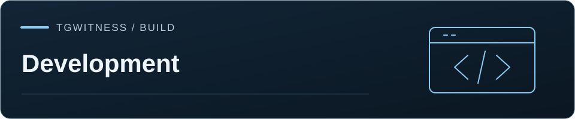

[TgWitness](../../README.md) / [Документация](../README.md) / [Папка](README.md) · [Development](../ARCHITECTURE.md)

[English](../FRONTEND.md) · **Русский**



<a id="panel-development"></a>
# Разработка панелей

Нативные модули ES и обычный DOM, без этапа сборки фронтенда. Тег `python start.py` запускает панель
локально; проверки браузера создают собственные временные рабочие пространства и никогда не затрагивают Telegram.

После обновления ресурсов панели или словарей переводов перезапустите приложение. При запуске
`panel_assets.PanelFiles` формирует страницу и метаданные целостности её подресурсов,
а конечная точка локализации кэширует сгенерированные словари. Замена файлов в
работающей установке не приводит к обновлению этих метаданных.

<details>

<summary>
На этой странице</summary>

- [Язык](#language)
- [Модули](#modules)
- [Навигация и запросы](#navigation-and-requests)
- [Формы](#forms)
- [Ещё предстоит извлечь](#still-to-extract)
- [Проверки](#checks)

</details>

<a id="language"></a>
## Язык

Сначала напишите новый текст интерфейса, инструкции и примечания к выпуску на английском языке. Английские строки являются
ключами для перевода и служат в качестве резервного варианта. Сохраняйте выбранный пользователем язык при перезагрузке страницы, используйте
настройки браузера, пока пользователь не выберет язык самостоятельно.

<a id="modules"></a>
## Модули

| Местоположение | Владеет |
| --- | --- |
| `tgwitness/static/app.js` | Bootstrap, границы сеанса, адаптеры для старых контроллеров |
| `static/router.js` | Пути, запрос рабочей области, фильтры журнала, прямые ссылки, «Назад»/«Вперед» |
| `static/core/view-host.js` | Активный просмотр, отмена запроса, сохраненные корни |
| `static/core/time.js` | Отображение времени в формате UTC/местном, относительное время |
| `static/views/` | Источники, параметры, аккаунты, доступ, системный журнал, экспорт, список чатов |
| `static/components/` | Здоровье, уведомления, ведение журналов, черновики, отзывы о подключении |

Контроллерам передаются их API, функции перевода и управления правами доступа. Не обращайтесь к
форме другого контроллера и не предполагайте, что глобальные переменные classic-script сохраняются в элементе `window`.

В документе находится только корневой элемент активного представления, остальное хранится в памяти, поэтому черновики и
слушатели сохраняются. Пока это не настоящий разбиение кода: элемент `index.html` по-прежнему содержит исходную разметку,
а элемент `app.js` — старые контроллеры.

<a id="navigation-and-requests"></a>
## Навигация и запросы

- `/?ws=default` открывает представление по умолчанию. Маршруты: `/chats`, `/chats/:chatId`, `/journal`,
  `/journal/event/:seq`, `/sources`, `/parameters`, `/accounts`, `/access`,
  `/integrations`, `/exports`, `/extras/:card`.
- Маршрут — это всего лишь представление, он не предоставляет никаких прав. API каждый раз проверяет разрешения и область действия.
- В статическом демо используется параметр запроса `route`, поскольку GitHub Pages не может обрабатывать пути к панелям.
  Отсутствующие пути к API и ресурсам ни в коем случае не должны переключаться на HTML.
- `enter(context)` получает сигнал прерывания и защиту `current()`. Прекращайте чтение при выходе из системы и
  проверяйте запрос и генерацию рабочей области перед применением ответа.
- Скрытые вкладки приостанавливают периодическое чтение. Повторные попытки повторяют только чтение статуса, никогда не отправляя POST после
  неясной сетевой ошибки.
- При запуске одновременно осуществляется чтение доступа и списка рабочих пространств, затем считывается статус для
  установленного рабочего пространства. Используется результат первоначального профилирования. Обнаружение экспорта чата ожидает
  выбора чата и передаёт свой текущий запрос; опрашиваются только активные задания.

<a id="forms"></a>
## Формы

Обновляйте данные в фоновом режиме, не изменяя строки на месте. Ни в коем случае не перестраивайте форму, не перехватывайте фокус и не теряйте несохраненные
значения. При сохранении сравнивайте отправленный снимок с текущим черновиком и сохраняйте более поздние изменения.
Очищайте учетные данные, доступные только для записи, из поля и отбрасывайте базовую версию. Токены и учетные данные
никогда не попадают в хранилище браузера, за исключением токена входа в панель в элементе `sessionStorage`
, действующего в пределах вкладки (очищается при блокировке).

Черновики мастера и настройки внешнего вида задерживают сохранение на 400 мс. Каждая очередь хранит
последнюю полную полезную нагрузку, допускает только одну запись за раз и синхронизирует всех вызывающих
объединенного сохранения. Сброс рабочей области отменяет неотправленные задачи; завершённые старые запросы
должны пройти проверку владельца/поколения перед изменением состояния пользовательского интерфейса. О сбоях записи
сообщается вызывающим функциям, и они никогда не повторяются автоматически.

Используйте `tr()` для текста пользовательского интерфейса. Обеспечьте поддержку динамических меток в `tools/i18n_keys.py`. Новые файлы модулей
следует поместить в папку «wheel», список демонстрационных ресурсов и архив исходного кода.

Панель считывает только подписанные записи. Группировка, фильтры, история загрузок и черновики не являются
изменениями в журнале.

Ежедневная навигация и область чтения должны оставаться компактными. Информация о состоянии коллекции должна находиться в
меню состояния, операции, связанные с чатом, — в разделе «Действия в чате», а дополнительные фильтры дневника
— в соответствующем раскрывающемся меню. Свернутый элемент управления должен оставаться доступным с помощью
клавиатуры. Обеспечьте видимость выбранных фильтров журнала за пределами раскрывающегося меню, сохраняйте
черновики при навигации и сбрасывайте меню действий при смене рабочей области или маршрута.
`components/layout.css` предоставляет общий макет и адаптивные настройки.

Элемент `components/polish.css` загружается последним и отвечает за глубину, анимацию, плитки значков, диалоговые окна и
отображение уведомлений. На странице запрещено использование встроенных стилей, поэтому размеры диаграмм задаются с помощью
объектной модели CSS и атрибутов SVG. Счётчики и диаграммы в элементе `views/pulse.js` получают
данные о состоянии счётчиков и список чатов, расположенный рядом с обзором из элемента `views/home.js`.
Этапы работы в Studio Reports находятся в элементе
`views/report-selection.js`, а макет редактора — в элементе `views/report-editor.js`.

<a id="still-to-extract"></a>
## Ещё предстоит извлечь

1. Перенести хелперы в `core/api.js`, сохранив их поведение при отмене, истечении таймаута и возникновении ошибок.
   По одному контроллеру за раз запускать тесты на устаревшие ответы.
2. Перенести состояние сессии/рабочей области в `core/store.js` с помощью узких подписок, без глобального перерисовывания.
3. Остальные контроллеры чата, журнала и интеграции — вне `app.js`. Не вместе с изменениями на бэкенде.
4. Лентивная загрузка шаблонов представления, как только не потребуется предварительная разметка.

<a id="checks"></a>
## Чеки

```sh
python -m ruff check .
python tools/publication_guard.py --git-index
```

Используйте регрессионные тесты в режиме приватного просмотра для проверки маршрутизации, устаревших ответов на опросы, выбора источника,
отображения журналов, элементов управления и черновиков, доступных только для записи. Используйте синтетические данные;
не добавляйте в Git сгенерированные журналы, сессии и скриншоты реальных аккаунтов.
