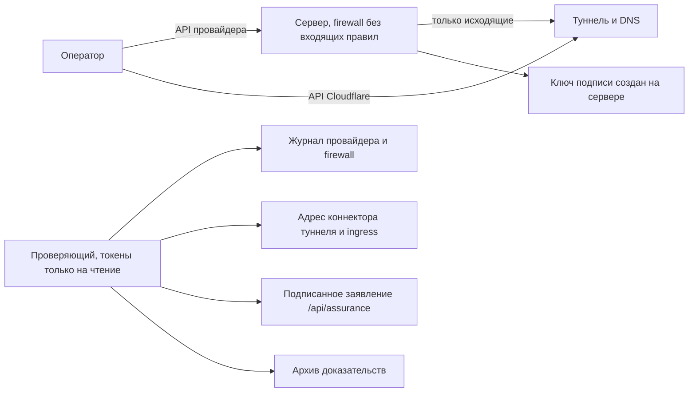

[English](../HIGH-ASSURANCE.md) · **Русский**

# Развёртывание с повышенной доказуемостью

Подписанный журнал доказывает, что записи не меняли **после** подписи. В серьёзных делах
следующий вопрос — мог ли кто-то повлиять на данные **до** подписи: кто запускал
коллектор, на какой машине и заходил ли на неё кто-нибудь. Этот необязательный режим
разворачивает коллектор так, чтобы третья сторона могла это проверить по записям
облачного провайдера и Cloudflare, а не на слово оператора.

Обычный локальный запуск и Docker не меняются. Режим работает только при развёртывании через
`python -m tgwitness.cloud`, а коллектор измеряет свой хост только при заданной
переменной `TGWITNESS_ASSURANCE`.



## Что может проверить третья сторона

| Утверждение | Как проверяется | Кто хранит запись |
| --- | --- | --- |
| Сервер создан через API провайдера в известное время | Объект сервера и его создание в журнале самого провайдера | Провайдер |
| Пути доступа провайдера не использовались | Журнал: запрос консоли, rescue, сброс пароля, переустановка, ISO, образы, бэкапы | Провайдер |
| К серверу нельзя было подключиться | У firewall провайдера нет входящих правил; SSH замаскирован с первой загрузки | Провайдер (firewall), хост (SSH) |
| Панель доступна только через туннель | Ingress туннеля ведёт только в панель; коннектор работает с адреса сервера | Cloudflare |
| Работает именно этот код | Подписанный хеш дерева исходников равен хешу чекаута развёрнутого коммита | Коллектор, сверка с Git |
| Ключ подписи создан на этом сервере | Ключ подписывает заявление с ID сервера у провайдера и хешем полученного cloud-init | Коллектор, сверка с провайдером |
| Журнал относится к этому ключу и серверу | Каждый запуск процесса в архиве несёт замер хоста этого сервера | Архив доказательств |

Замеры хоста (SSH-слушатели и процессы, текущие сессии, входы в `wtmp`, загрузка) сообщает
сам коллектор и подписывает их в каждом событии запуска и в записях `host.state` при любом
изменении. Root на сервере мог бы их подделать, поэтому они дополняют записи провайдера и
Cloudflare, но не заменяют их.

## Провайдеры

| `--provider` | Доступ для развёртывания | Доступ проверяющего (только чтение) | Журнал провайдера | Срок хранения |
| --- | --- | --- | --- | --- |
| `hetzner` | `HCLOUD_TOKEN` | Read-токен того же проекта | Действия над сервером и firewall | Пока ресурсы существуют |
| `digitalocean` | `DIGITALOCEAN_TOKEN` | Read-only personal access token | Действия над Droplet | Пока Droplet существует |
| `linode` | `LINODE_TOKEN` | Права `linodes`, `firewall`, `events` только на чтение | События аккаунта, версии правил firewall | 90 дней |
| `vultr` | `VULTR_API_KEY` | Пользователь с чтением и правом `activity_logs` | Журнал активности (метод, путь, кто) | 30 дней, дольше с подпиской на audit logs |
| `aws` | `AWS_ACCESS_KEY_ID`, `AWS_SECRET_ACCESS_KEY` | `ec2:DescribeInstances`, `ec2:DescribeSecurityGroups`, `cloudtrail:LookupEvents` | История событий CloudTrail | 90 дней |
| `generic` | не нужен | не нужен | нет: **self-attested** | – |

Для каждого дела берите отдельный проект, команду, аккаунт или субаккаунт: тогда доступ
проверяющего на чтение покажет только это развёртывание. Ключи читаются из
`--provider-token-file` или переменной окружения, никогда из командной строки. Для AWS файл
содержит `ACCESS_KEY_ID SECRET_ACCESS_KEY [SESSION_TOKEN]`, регион задаётся `--location`.

Чего не показывают записи конкретного провайдера, перечисляется в каждом отчёте. Коротко:
Hetzner пишет в журнал запрос консоли. Recovery Console у DigitalOcean, Lish/Glish у Linode и
веб-консоль Vultr в журнале как таковые не видны. Поэтому root блокируется при первой
загрузке: для входа через консоль пришлось бы сбросить пароль или изменить загрузку, а это
в журнале видно. Vultr отдаёт адрес консоли любому ключу, который может читать инстанс;
ни запись развёртывания, ни отчёт его не сохраняют.

## Что нужно заранее

1. Зона в Cloudflare, ID аккаунта и API-токен с правами **Cloudflare Tunnel Edit**,
   **Zone Read** и **DNS Edit**; токен передаётся через `--cloudflare-token-file` или
   `CLOUDFLARE_API_TOKEN`. Для проверяющего: **Cloudflare Tunnel Read**, **DNS Read**, а для
   журнала аудита — **Account Settings Read**. Без домена
   [быстрому туннелю](#быстрый-туннель-без-домена) ничего из этого не нужно.
2. Ключ провайдера с правом записи в отдельный проект; тот же ключ нужен для `lock`:
   - Hetzner: API-токен с правом Read & Write;
   - DigitalOcean: personal access token с правом записи;
   - Linode: personal access token с правами `linodes`, `firewall` и `events` на чтение и запись;
   - Vultr: API-ключ отдельного аккаунта или субаккаунта;
   - AWS: IAM-ключи с разрешёнными `ec2:DescribeVpcs`, `ec2:DescribeImages`,
     `ec2:CreateSecurityGroup`, `ec2:AuthorizeSecurityGroupIngress`, `ec2:RunInstances`,
     `ec2:CreateTags`, `ec2:DescribeInstances`, `ec2:DescribeSecurityGroupRules` и
     `ec2:RevokeSecurityGroupIngress`.
3. Коммит, который будет работать. Тег релиза один раз превращается в коммит через
   `git ls-remote`; на сервер попадает только 40-символьный коммит.

## Из панели

На своём компьютере **Дополнения → Server 24/7** запускает тот же `deploy` для Hetzner в три
шага: выберите Европу или США, вставьте токен Hetzner (Read & Write), затем проверьте тип
сервера, цену в месяц, адрес и версию, которые панель нашла по этому токену. До подтверждения
ничего не создаётся. Панель показывает каждый шаг так, как о нём сообщает `deploy`, а в конце —
адрес, токен панели и отпечаток ключа подписи. Без домена сервер получает
[быстрый туннель](#быстрый-туннель-без-домена); после перезапуска его адрес снова находит
**Ваши серверы → Найти текущий адрес**. Для постоянного адреса под своим доменом откройте
**Необязательно · свой домен** и добавьте токен Cloudflare (подготовленная ссылка сразу выбирает
Zone Read, DNS Edit и Cloudflare Tunnel Edit).

Токены идут с каждым запросом из вкладки браузера в TgWitness на том же компьютере и нигде не
записываются; запись о развёртывании, cloud-init без секретов, токен панели и, для быстрого
туннеля, ключ адреса лежат в `deployments/NAME` внутри папки данных. Панель предлагает это
только главному администратору при прямом подключении к `127.0.0.1` (без заголовков прокси или
туннеля); панель, открытая по сети, показывает вместо этого команды. Версия по умолчанию — тег
релиза работающей панели, коммит берётся через API GitHub. Локация, тип сервера и цена берутся
из API Hetzner: `cpx22`, если он доступен, иначе самый дешёвый тип x86 с памятью от 2 ГБ.

## Быстрый туннель без домена

`--quick-tunnel` заменяет `--zone`, `--cloudflare-account` и `--panel-host`; аккаунт и токен
Cloudflare не нужны:

```sh
python -m tgwitness.cloud deploy --provider hetzner --name case-2026-11 --server-type cpx22 \
    --ref 0123456789abcdef0123456789abcdef01234567 --quick-tunnel --provider-token-file hetzner.token
```

На сервере cloudflared открывает к панели
[быстрый туннель](https://developers.cloudflare.com/tunnel/get-started/quick-tunnels/): случайный
адрес `https://….trycloudflare.com`, который меняется при каждом перезапуске cloudflared или
сервера. Небольшая служба на сервере публикует каждый адрес в случайный топик ntfy.sh с подписью
HMAC-SHA256 ключом, который есть только в папке развёртывания (`address-key.txt`), и повторяет
публикацию раз в три часа, потому что ntfy.sh хранит сообщения 12 часов. `deploy` и
**Найти текущий адрес** принимают только подписанные сообщения, поэтому поддельное сообщение не
отправит вас и ваш токен панели на чужой адрес. Топик есть в записи о развёртывании и в
опубликованном cloud-init: кто их видит, может узнать текущий адрес, но панель всё равно спросит
токен. Входящих портов на сервере нет и в этом режиме.

Чем за это платите: ни один аккаунт Cloudflare не ведёт записей о быстром туннеле, поэтому
`verify` отмечает проверку туннеля, коннектора и DNS как недоступную, и итог в лучшем случае
`incomplete`; записи провайдера, firewall, подписанное заявление, измерения хоста и сравнение
установщика проверяются как обычно. Побайтовое сравнение с эталонным установщиком требует
развёрнутого коммита, который уже знает `--quick-tunnel`; checkout 0.7.0 собирает установщик для
домена и показывает расхождение. Cloudflare не гарантирует доступность быстрых туннелей,
допускает 200 одновременных запросов и не пропускает Server-Sent Events, поэтому живые
обновления панели (в версиях после 0.7.0) через такой туннель могут не приходить и вид придётся
обновлять; это ещё не проверялось. Для дела, которое должно выдержать проверку, используйте свой
домен.

## Развёртывание

Сначала посмотрите всё, что будет отправлено. `plan` не делает запросов к провайдеру и Cloudflare:

```sh
python -m tgwitness.cloud plan --provider hetzner --name case-2026-11 --server-type cpx22 \
    --ref 0123456789abcdef0123456789abcdef01234567 --zone example.org \
    --cloudflare-account CLOUDFLARE_ACCOUNT_ID --panel-host case.example.org
```

Затем то же самое с ключами:

```sh
python -m tgwitness.cloud deploy --provider hetzner --name case-2026-11 --server-type cpx22 \
    --ref 0123456789abcdef0123456789abcdef01234567 --zone example.org \
    --cloudflare-account CLOUDFLARE_ACCOUNT_ID --panel-host case.example.org \
    --witness-host case-witness.example.org \
    --provider-token-file hetzner.token --cloudflare-token-file cloudflare.token
```

Типы серверов для начала: `cpx22` (Hetzner), `s-1vcpu-2gb` (DigitalOcean), `g6-standard-1`
(Linode), `vc2-1c-2gb` (Vultr), `t3.small` (AWS). `--location` и `--image` по умолчанию —
Ubuntu 24.04 соответствующего провайдера в европейском регионе.

`--repository` берёт коммит из другого Git-репозитория по https, без учётных данных в адресе
(по умолчанию `https://github.com/phishdestroy/TgWitness.git`). У `deploy` есть ещё `--out` —
другой каталог развёртывания (по умолчанию `deployments/NAME`; каталог, где уже есть
развёртывание, не принимается) — и `--wait`, сколько минут ждать подписанное заявление
коллектора: от 1 до 240, по умолчанию 20, для `generic` — 60.

Команда:

1. создаёт туннель Cloudflare: имя панели ведёт в панель, а имя свидетеля (если задано) —
   только на `/api/witness/head` и `/api/assurance`;
2. создаёт проксируемые CNAME-записи и отказывается работать с уже занятыми именами;
3. создаёт firewall провайдера без входящих правил и сервер за ним: без SSH-ключа, без
   бэкапов, без агента консоли, с cloud-init, который маскирует SSH, блокирует root,
   ставит `cloudflared`, забирает ровно этот коммит, проверяет его и запускает TgWitness
   как защищённую службу systemd;
4. ждёт подписанное заявление коллектора и проверяет, что в нём этот сервер и хеш этого cloud-init.

В `deployments/case-2026-11/` появятся:

| Файл | Содержимое | Передавать? |
| --- | --- | --- |
| `deployment.json` | ID, хеши, сделанные вызовы API (метод, путь, статус) и первое подписанное заявление | Да, проверяющему |
| `cloud-init.redacted.yaml` | Точный cloud-init, два секрета заменены на `REDACTED` | Да |
| `panel-token.txt` | Токен панели | Нет |

Root-пароль провайдера, токен туннеля и токен панели в `deployment.json` не попадают.
Отпечаток ключа коллектора, выведенный в конце, опубликуйте по каналу, который вы не
контролируете единолично: в канале свидетеля или в сообщении получателю.

Вход в Telegram — через `https://case.example.org` с токеном панели, как в
[инструкции по аккаунтам](../ACCOUNTS.md). Действия в панели пишутся в подписанный журнал и
не являются SSH-сессиями. [Свидетель](WITNESS.md) может опрашивать `https://case-witness.example.org`.

SSH нет: если bootstrap не отработал, коллектор не ответит. Удалите сервер и разверните
заново либо найдите причину через отладочное развёртывание.

### Секреты в user data

В cloud-init два секрета: токен панели и токен туннеля Cloudflare. Ключа подписи среди них
нет, он создаётся на сервере. Hetzner, DigitalOcean и Linode не отдают user data через API.
Vultr отдаёт его любому ключу, который может читать инстанс, а EC2 — через
`DescribeInstanceAttribute`. Поэтому в AWS давайте проверяющему только три действия из таблицы,
но не `ec2:Describe*`. В Vultr исходите из того, что ключ проверяющего может прочитать оба токена.
С токеном туннеля можно запустить второй коннектор: `verify` показывает любой коннектор не с
сервера. Подделать заявления коллектора так нельзя, потому что каждое подписывает свежий запрос.
С `--quick-tunnel` вторым секретом вместо токена туннеля идёт ключ адреса: кто его прочитает,
сможет опубликовать ложный адрес, который панель примет.

Публичное заявление коллектора не содержит адрес сервера и источники входов; они остаются в
подписанном журнале.

## Отладочное развёртывание и блокировка

`--debug-ssh-key KEY --debug-ssh-from 198.51.100.4` оставляет SSH для одного ключа с одного
адреса или небольшой сети, не шире /24 для IPv4 и /48 для IPv6. `KEY` уже должен быть у
провайдера: имя или ID SSH-ключа в проекте Hetzner, ID или отпечаток SSH-ключа в команде
DigitalOcean, имя пользователя Linode, SSH-ключи из профиля которого добавляются root, ID
SSH-ключа в аккаунте Vultr или имя EC2 key pair в регионе. К `generic` эти параметры не
применяются. Такое развёртывание записывается как `debug` и **никогда** не
проходит как high-assurance. Закончив, выполните `sudo tgwitness-lock` последней командой в
последней SSH-сессии, затем:

```sh
python -m tgwitness.cloud lock --record deployments/case-2026-11/deployment.json --provider-token-file hetzner.token
```

Firewall теряет все входящие правила. В отчёте видно, когда SSH был разрешён и когда закрыт;
это окно не скрывается.

## Удаление развёртывания

`destroy` удаляет сервер и его firewall (они ищутся по метке развёртывания, поэтому удаляются и
остатки развёртывания, упавшего на полпути), затем DNS-записи, указывающие на его туннель, и сам
туннель. Журнал и ключ подписи на сервере удаляются вместе с ним: сначала экспортируйте
доказательства. Запись остаётся с отметкой `removed` и списком API-вызовов удаления.

```sh
python -m tgwitness.cloud destroy --record deployments/case-2026-11/deployment.json --confirm case-2026-11 \
    --provider-token-file hetzner.token --cloudflare-token-file cloudflare.token
```

Удаление через API реализовано для Hetzner. Для других провайдеров `destroy` останавливается до
любого удаления и называет метку, по которой ресурсы удаляются в консоли провайдера. У сервера,
установленного вручную (`generic`), удаляются только туннель и DNS-записи. Для развёртывания с
быстрым туннелем токен Cloudflare не нужен: туннель исчезает вместе с сервером, а его сообщения
в ntfy.sh истекают в течение 12 часов.

## Любой сервер (self-attested)

`--provider generic` — для сервера, купленного или установленного вручную. `deploy` создаёт
туннель и DNS, пишет `install.sh` (не публиковать) и `install.redacted.sh` (публиковать) и ждёт.
Скопируйте `install.sh` на свежеустановленный Ubuntu 24.04 и запустите:

```sh
sudo bash install.sh
```

Скрипт фиксирует состояние хоста до установки (входы, учётные записи, `authorized_keys`,
слушающие порты, службы, задания cron, пакеты), ставит коммит, включает firewall на хосте,
удаляет сам себя, маскирует SSH и завершает сессию. Отчёт по такому серверу в лучшем случае
**SELF-ATTESTED**: у того, кто запускал установщик, до него был root, а записей провайдера у
проверяющего нет. Это всё равно лучше, чем сервер без объяснений: инвентаризация, хеш
установщика и каждый последующий вход подписаны.

## Проверка

Проверяющему нужны `deployment.json`, опубликованный установщик, ключи только на чтение и
желательно чекаут коммита и архив доказательств:

```sh
git clone -c core.autocrlf=false https://github.com/phishdestroy/TgWitness.git checkout
git -C checkout checkout 0123456789abcdef0123456789abcdef01234567
python -m tgwitness.cloud verify --record deployment.json \
    --provider-token-file read-only.token --cloudflare-token-file cloudflare-read.token \
    --fingerprint COLLECTOR_FINGERPRINT --cloud-init cloud-init.redacted.yaml \
    --source checkout --evidence tgwitness-evidence.zip --report report.md
```

Все значения провайдера и Cloudflare проверяющий запрашивает сам в момент проверки; запись
развёртывания даёт только ID, о которых спрашивать. Код выхода: 0 — **PASS**, 1 — **FAIL**,
2 — **REVIEW**, **INCOMPLETE** или **SELF-ATTESTED**. `--fingerprint` должен прийти по
независимому каналу; без него ключ сверяется только с записью оператора. Сам архив
по-прежнему проверяет `python verify.py`, см. [формат доказательств](../EVIDENCE.md).

Действия провайдера классифицируются: создание и запуск в первые 30 минут проходят;
консоль, rescue, сброс пароля, переустановка, ISO, образы, снапшоты, бэкапы, Systems
Manager, EC2 Instance Connect и открытие firewall — провал; действия с питанием и всё
неожиданное помечаются для проверки. Неизвестное действие никогда не проходит молча.

## Отчёт для передачи улик

`--report report.md` пишет отчёт в Markdown и рядом `report.json`:

1. итог, отпечаток ключа коллектора, развёртывание, провайдер, коммит, сервер, firewall, туннель;
2. все проверки со статусом и источником (API провайдера, API Cloudflare, заявление
   коллектора, архив доказательств);
3. журнал провайдера с оценкой каждого действия и, если провайдер это пишет, исполнителем;
4. адреса API Cloudflare с подключениями, конфигурацией и журналом аудита туннеля;
5. подписанное заявление коллектора;
6. что отчёт доказывает и чего не доказывает;
7. команды для повторения проверки и SHA-256 каждого переданного файла.

Передавайте отчёт, `report.json`, `deployment.json`, опубликованный установщик и архив
доказательств. Делайте отчёт сразу: журналы провайдеров хранятся ограниченное время.

## Cloudflare как внешний свидетель

Здесь всё является необязательным. Даже без учётной записи Cloudflare сервер по-прежнему
работает, и на сегодняшний день функционируют два таких сервера:

| Что | Что это показывает | В TgWitness |
| --- | --- | --- |
| «Quick Tunnel» или туннель вашего домена | До панели можно добраться только через туннель | мастер настройки сервера, см. выше |
| реле drand `drand.cloudflare.com` | записи, сделанные после того или иного раунда, более поздние, чем эта: журнал велся по мере событий | режим доказательств, **Дополнительные свидетели**, без учетной записи ([формат](../EVIDENCE.md#optional-records-in-evidence-mode-drand-and-telegram-devices)) |
| Уведомления о состоянии туннелей | когда туннель был отключен — по электронной почте или через веб-хук от Cloudflare | настройте их в панели управления Cloudflare |
| Gateway DNS (`--gateway-dns` или **Cloudflare Gateway DNS** в мастере) | каждое имя, запрос на которое обрабатывал сервер, отвечал Cloudflare по протоколу TLS; брандмауэр Hetzner не допускает, чтобы DNS обращался к каким-либо другим ресурсам; возможно ли, чтобы политика Gateway переопределяла ответы | Hetzner — бесплатный тарифный план «Zero Trust» без домена; `verify` проверяет брандмауэр, местоположение, ведение журналов, политики, запросы сервера и журнал аудита; в режиме доказательств журнал копируется в архив |
| Gateway с клиентом Cloudflare One на сервере, брандмауэр исходящего трафика, пропускающий только трафик Cloudflare | каждое соединение, установленное сервером, а не только DNS | ещё не построено |
| Доступ спереди панели | кто и когда вошёл в панель управления | не реализовано: требуется собственный домен |
| Ведение журнала команд SSH | каждая команда в сеансе отладки | ещё не построено |

Функция Logpush, которая обеспечивает хранение собственной копии Cloudflare в R2, относится к
категории «Enterprise»: в рамках бесплатного тарифного плана Cloudflare использует режим
`logpush is not enabled for this account`. Журнал Gateway хранится там в течение 24 часов,
поэтому в режиме доказательств его копия переносится в подписанный журнал (**Журнал
DNS-запросов данного сервера, составленный Cloudflare Gateway** — токен, доступный только для
чтения, с правом «Account Analytics Read»).

Без плана «Zero Trust» у учетной записи имеется одно местоположение DNS. Когда Cloudflare
отклоняет другое, сервер использует существующее, и его запросы различаются по адресу; для
этого фильтра также требуется доступ к личным данным в рамках «Zero Trust», и `destroy`
покидает общее местоположение. Один запрос журнала охватывает не более трёх часов, поэтому
копия и `verify` считывают данные за день с интервалом в три часа.

DNS-сервер Gateway охватывает системный резолвер. Запросы DNS по протоколу HTTPS на порту 443,
направляемые к другому резолверу, а также соединения с адресами, для которых поиск не был
выполнен нигде (например, с дата-центрами Telegram), не фиксируются в его журнале.

Cloudflare не имеет доступа к внутренней структуре шифрования Telegram, к другим устройствам,
привязанным к учетной записи Telegram (список устройств в режиме доказательств фиксирует их со
стороны Telegram), а также к гипервизору провайдера.

1 ноября 2026 года Gateway DNS был протестирован на реальной учетной записи Hetzner Cloud и
бесплатной учетной записи Cloudflare: Hetzner принял правила исходящего трафика, на сервере
была установлена версия v0.7.0, при этом каждый запрос проходил через Gateway по протоколу
TLS, быстрый туннель работал через этот брандмауэр, а `verify` считал 19 имен сервера из
Cloudflare (зеркала Ubuntu и Hetzner, GitHub, PyPI, NTP, туннель, ntfy.sh). Участники сессии
скопировали 36 запросов из восьми окон в журнал, и `verify.py` обобщил их без пропусков;
`destroy` удалил сервер и брандмауэр и покинул общее рабочее пространство.

## Чего режим не доказывает

- Провайдер и его сотрудники управляют гипервизором, дисками и сетью.
- Замеры хоста сообщает сам коллектор.
- Прежнее содержимое правил firewall есть не в каждом журнале; версии правил хранит только Linode.
- О подлинности сообщений Telegram режим ничего нового не говорит; см. [формат доказательств](../EVIDENCE.md).

## Что проверено

Логика развёртывания, блокировки и проверки покрыта автотестами на имитациях API Hetzner,
DigitalOcean, Linode, Vultr, EC2/CloudTrail и Cloudflare по их опубликованным спецификациям;
подпись запросов AWS сверена с опубликованными примерами AWS. `tools/check_cloud_wizard.py` так
же прогоняет мастер сервера в панели — с доменом и с быстрым туннелем.

1 ноября 2026 года путь с быстрым туннелем прогнан на настоящем **Hetzner Cloud** (Нюрнберг,
`cpx22`, TgWitness v0.7.0), настоящих ntfy.sh и GitHub — из панели и из кода:

- проверка цены, затем создание кнопками панели: сервер запущен через 13 секунд, подписанное
  заявление с совпадающими ID сервера и хешами установщика — примерно через две минуты;
- собственная панель сервера открылась по адресу trycloudflare.com и приняла токен панели;
  без токена отвечает 401;
- после перезагрузки через API Hetzner сервер опубликовал новый подписанный адрес,
  **Найти текущий адрес** нашёл его, старый адрес перестал отвечать, ключ подписи остался тем
  же; неподписанное сообщение в топике ntfy.sh было проигнорировано;
- `verify` по API Hetzner: сервер, firewall без входящих правил, заявление, привязка, измерения
  хоста, загрузка и хеш исходников checkout v0.7.0 прошли; проверки Cloudflare недоступны, как
  описано выше; установщик отличается от того, что собирает v0.7.0, и побайтово совпадает с тем,
  что собирает код этой версии;
- удаление из панели убрало ровно тот сервер и firewall, что были помечены развёртыванием;
  другие серверы и firewall в том же проекте не тронуты.

На реальных аккаунтах **ещё не запускались**: развёртывание под своим доменом (туннель и DNS
Cloudflare), другие провайдеры, отладочное развёртывание и `lock`, аккаунт Telegram на таком
сервере и живые обновления поздних версий через быстрый туннель. Перед использованием в деле
проверьте первое развёртывание у каждого провайдера через `plan`, отладочное развёртывание и
`verify`.
