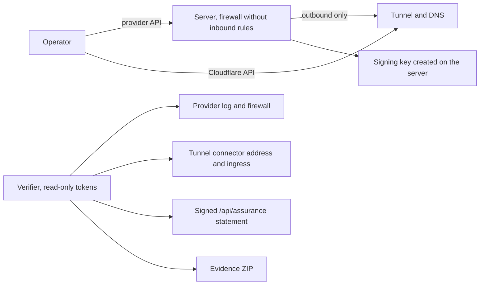

[TgWitness](../../README.md) / [Документация](../README.md) / [Папка](README.md) · [Уровни доказательности](https://phishdestroy.github.io/TgWitness/docs/assurance-levels/)


<a id="verified-server"></a>
# Проверенный сервер

Проверенный сервер — это обычный VPS, который TgWitness создаёт через API провайдера, чтобы кто-либо мог проверить, как он был построен, и убедиться, что впоследствии никто не получал к нему доступ. Верификатор читает записи провайдера и Cloudflare с помощью токенов только для чтения; никому не приходится полагаться на слова оператора.

Обычное использование в локальной среде и в Docker остаётся без изменений. Здесь ничего не запускается, пока вы не выполните развёртывание с помощью команды ``python -m tgwitness.cloud``, а сборщик данных считывает данные о своём хосте только в том случае, если при развёртывании установлен флаг ``TGWITNESS_ASSURANCE``.

[Анимированное руководство](https://phishdestroy.github.io/TgWitness/docs/verified-server/) шаг за шагом описывает процесс развертывания. Следующий уровень: [конфиденциальная виртуальная машина на Phala Cloud](PHALA.md).



<details>
<summary>На этой странице</summary>

- [Что может проверить верификатор](#what-a-verifier-can-check)
- [Как управляется облачный сервер и что может остаться незамеченным](#how-a-cloud-server-is-controlled-and-what-can-go-unseen)
- [Провайдеры, один за другим](#providers-one-by-one)
- [Перед началом](#before-you-start)
- [Из панели управления](#from-the-panel)
- [Быстрый туннель без домена](#quick-tunnel-without-a-domain)
- [Развертывание](#deploy)
- [Отладочное развертывание и блокировка](#debug-deployment-and-lock)
- [Удаление развертывания](#remove-a-deployment)
- [Любой сервер (самосертифицированный)](#any-server-self-attested)
- [Проверка](#verify)
- [Отчёт о передаче доказательств](#report-for-evidence-handover)
- [Cloudflare в качестве независимого свидетеля](#cloudflare-as-an-outside-witness)
- [Анализ результатов развертывания](#reading-the-deployment-result)
</details>

<a id="what-a-verifier-can-check"></a>
## Что может проверить верификатор

| Заявление | Как это проверяется | Хранится |
| --- | --- | --- |
| Сервер был создан с помощью API провайдера в известный момент времени | Объект «Сервер» и запись о его создании в собственном журнале провайдера | Провайдер |
| Никто не использовал пути доступа провайдера | Журнал консольных запросов, восстановления, сброса пароля, перестроения, ISO, образов, резервных копий | Провайдер |
| Ничто не смогло подключиться к нему | В брандмауэре провайдера отсутствуют правила входящего трафика; доступ по SSH заблокирован с момента первой загрузки | Провайдер (брандмауэр), хост (SSH) |
| Доступ к панели возможен только через туннель | Входящий трафик через туннель перенаправляется исключительно на панель управления; коннектор запускается с адреса сервера | Cloudflare |
| Используется именно это программное обеспечение | Подписанный хеш исходного дерева сборщика совпадает с результатом проверки развернутого коммита | Сборщик, проверенный по Git |
| Ключ подписи был создан на данном сервере | Ключ подписывает заявление, в котором указаны идентификатор сервера провайдера и хеш полученного им файла cloud-init | Сборщик, проверенный по отношению к провайдеру |
| Журнал принадлежит данному ключу и серверу | Каждый запуск процесса в ZIP-архиве с доказательствами содержит данные об измерении хоста для данного сервера | Архив ZIP с доказательствами |
| Ключ Telegram был создан в ходе заверенного запуска | Записи `account.authorized` содержат `key_origin: "created"` | Архив доказательств |

Сборщик фиксирует состояние SSH, сеансы, историю входов и информацию о загрузке в подписанных записях о запуске процесса и <code>host.state</code> записях. На обычной виртуальной машине это локальные инвентарные записи, которые эксперт по проверке сравнивает с независимыми записями провайдера.

В случае аттестованного развёртывания сбор данных не производится на основе импортированного ключа сеанса. Войдите с помощью телефона или QR-кода либо используйте файл сеанса для независимого входа: в любом случае ключ авторизации Telegram создаётся в рамках аттестованного запуска, а в журнале фиксируется
<code>key_origin: "created"</code>, а также <code>python -m tgwitness.cloud verify</code> проходит
<code>account_key</code>Журнал с импортированным ключом не проходит эту проверку.

<a id="how-a-cloud-server-is-controlled-and-what-can-go-unseen"></a>
## Как управляется облачный сервер и что может остаться незамеченным

<a id="what-a-cloud-server-physically-is"></a>
### Что представляет собой облачный сервер с физической точки зрения

Облачный сервер — это не отдельная машина. Провайдер управляет физическими хостами, на каждом из которых установлены Linux и гипервизор **KVM**. Каждый клиентский сервер на хосте представляет собой отдельный **процесс QEMU** на этом хосте:

- **память** сервера представляет собой память данного процесса на хосте;
- **диск** сервера представляет собой файл или том на хосте или в кластере хранения провайдера;
- **сетевое** соединение сервера проходит через виртуальный коммутатор хоста;
- **часы** сервера синхронизируются с часами хоста.

Один хост могут совместно использовать десятки серверов, принадлежащих разным клиентам (компаниям, банкам, государственным органам, частным лицам).

<a id="two-ways-to-reach-a-server"></a>
### Существует два способа доступа к серверу

**1. Управляющая плоскость клиента: API и веб-консоль.** Все действия, которые можете выполнить вы или любой пользователь, обладающий вашим токеном API, осуществляются через API провайдера: создание, запуск, остановка, доступ к консоли, восстановление, сброс пароля, переустановка, ISO, создание моментального снимка, резервное копирование, изменения в настройках брандмауэра. Эти действия фиксируются в **журнале провайдера вашего аккаунта**. Рецензент самостоятельно просматривает этот журнал, и проверка (`verify`) завершается сбоем при любом действии, которое может привести к открытию доступа к серверу.

**2. Инфраструктура провайдера: сами хосты.** Инженеры провайдера, обладающие административным доступом к физическому хосту, работают ниже уровня плоскости управления клиента. Имея права root на хосте, они могут приостановить работу отдельного сервера, прочитать или изменить его память, скопировать или изменить его диск либо переместить его на другой хост. Эти операции **затрагивают только данный сервер**: соседние серверы на том же хосте продолжают работать и ничего не замечают. Они **не фиксируются в журнале вашего аккаунта**. Решение о том, фиксирует ли провайдер эти действия внутренне, остается за ним и не доступно ни вам, ни рецензенту.

Именно этот второй путь не может быть исключён ни одним журналом аудита, доступным клиентам.

<a id="who-can-use-the-second-path"></a>
### Кто может воспользоваться вторым способом

Не обычный злоумышленник. Для доступа к нему требуется одно из следующих условий:

- **собственный персонал провайдера,** имеющий доступ к производственному хосту;
- **государственный орган**, который обязывает провайдера действовать, например, посредством законного перехвата или судебного постановления в юрисдикции провайдера;
- **злоумышленник, который взломал саму инфраструктуру провайдера.**

Здесь важны «соседи», но не потому, что вмешательство в работу одного сервера может им помешать. Тот же доступ к хосту, который позволяет получить доступ к вашему серверу, открывает доступ и ко всем другим серверам на этом хосте: банкам, компаниям, государственным службам. Поэтому провайдеры строго ограничивают, контролируют и проверяют доступ к хосту; например, компания Hetzner сертифицирована по стандарту ISO/IEC 27001. Злоумышленник, обладающий таким доступом, имеет чрезвычайно ценную возможность, которая раскрывается каждый раз при её использовании. Тайное применение этой возможности в отношении одного сервера, содержащего доказательства, — это решение, принимаемое на государственном уровне, а не обычным противником.

Публично задокументированные вмешательства на уровне провайдеров вписываются в эту картину. В 2023 году трафик на сайт jabber.ru, размещённый на хостингах Hetzner и Linode, был перехвачен на уровне провайдера — по имеющимся данным, в рамках законного перехвата по запросу немецких властей. Это был **сетевой перехват**. Нам не известно ни об одном публичном случае, когда провайдер изменял бы данные внутри виртуальной машины клиента.

Обычный злоумышленник может похитить ваш токен API. Каждое действие, которое он совершает с его помощью, фиксируется в журнале провайдера, и сервис `verify` сообщает об этом.

<a id="what-each-layer-can-and-cannot-do-to-the-evidence"></a>
### Что каждый уровень может и не может делать с доказательствами

| Субъект | Путь | Что он может сделать | Обнаружено? |
| --- | --- | --- | --- |
| Вы или любой пользователь, имеющий ваш токен API | Площина управления клиентом | Консоль, восстановление, пересоздание, создание моментального снимка, открытие портов брандмауэра | **Да**: журнал провайдера, сбой проверки (`verify`) |
| Любой пользователь, обладающий токеном туннеля | Второй коннектор Cloudflare | Перенаправление трафика панели маршрутизации в другое место | **Да**: Cloudflare сообщает, что коннекторы отсутствуют на сервере |
| Сетевой перехватчик (включая законный перехват) | Сеть провайдера | Блокировка или задержка трафика. **Невозможно изменить содержимое Telegram**: ключ сеанса создаётся на сервере, а протокол MTProto фиксирует ключи сервера Telegram | Блокировка отображается в виде **пробелов** в журнале |
| Персонал провайдера или веские государственные причины | Хост / гипервизор | Считывание содержимого памяти, включая ключ подписи сборщика; изменение данных до их подписания; изменение времени | **Не отражается в журналах, доступных клиенту** |

<a id="limits-of-a-host-level-attacker"></a>
### Ограничения злоумышленника, действующего на уровне хоста

Даже при наличии доступа к хосту возможности изменения прошлых событий ограничены тем, что уже покинуло сервер:

- **Контрольные точки, опубликованные независимым свидетелям,** не могут быть перезаписаны. Всё, что уже было зафиксировано свидетелями, остаётся неизменным.
- **Временные метки RFC 3161 и OpenTimestamps** фиксируют момент существования каждой контрольной точки. Часы хоста не могут изменить эти значения.
- **Сама Telegram** по-прежнему хранит сообщения. Любая подделка может быть опровергнута другой записью того же чата.

Таким образом, реальный риск заключается в манипуляциях **в момент сбора данных**, а не в незаметном перезаписывании архива впоследствии.

<a id="raising-the-bar"></a>
### Повышение планки

| Показатель | Что устраняется |
| --- | --- |
| Развёртывание на проверенных серверах (эта страница) | Вас, как оператора, из круга доверия |
| Cloudflare в качестве второго свидетеля | Опора исключительно на записи провайдера |
| Два сборщика данных у разных провайдеров в разных юрисдикциях, сравнивающие сообщения одно за другим | Влияние одного провайдера или одного штата |

**Наша оценка:** проверенного развертывания сервера достаточно, если только Ваш оппонент не сможет принудить провайдера к сотрудничеству или тайно добиться его, что на практике означает наличие возможностей на государственном уровне. Если такая ситуация представляется вероятной, используйте двух провайдеров в разных юрисдикциях или перейдите на следующий уровень защиты.

<a id="providers-one-by-one"></a>
## Провайдеры, один за другим

Каждый из перечисленных ниже провайдеров использует одинаковую конфигурацию: брандмауэр без правил входящего трафика, сервер без SSH, туннель к Cloudflare. Они различаются тем, что фиксируется в их собственных журналах, и именно эти журналы верификатор анализирует, чтобы определить, достиг ли кто-либо сервера через данного провайдера. То, как `verify` интерпретирует каждое действие, задается в папке [`tgwitness/providers/`](../../tgwitness/providers)

| Провайдер | Ведение журнала | Имена участников | Консоль в журнале | Изменения в брандмауэре | Мастер панели управления |
| --- | --- | --- | --- | --- | --- |
| Hetzner Cloud | Пока сервер существует | Нет | Да | Зарегистрировано; предыдущие правила не сохраняются | Да |
| Amazon EC2 | 90 дней | Да | Пути доступа агента и ключей: Instance Connect, Systems Manager, последовательная консоль | Регистрируется | Нет, командная строка |
| Akamai (Linode) | 90 дней | Да | Нет | Сохраняются все версии правил | Нет, командная строка |
| DigitalOcean | Пока существует Droplet | Нет | Нет | Не регистрируется | Нет, командная строка |
| Vultr | 30 дней | Да | Не определено | Зарегистрировано | Нет, командная строка |

Если консоль отсутствует в журнале, учетная запись root блокируется при первом запуске системы: для входа через консоль сначала потребуется сброс пароля или изменение параметров загрузки, а эти действия фиксируются в журнале.

Используйте отдельный проект, команду, аккаунт или суб-аккаунт для каждого случая: тогда у верификатора, имеющего доступ только для чтения, будет отображаться только данное развёртывание. Учетные данные считываются из файла `--provider-token-file` или из указанной выше переменной, но ни в коем случае не из командной строки. Для AWS файл содержит `ACCESS_KEY_ID SECRET_ACCESS_KEY [SESSION_TOKEN]`; регион указывается с помощью параметра `--location`.

Карточка для каждого провайдера с интерактивным журналом, информацией о Cloudflare, уровне безопасности, стоимости и развёртывании: [providers](https://phishdestroy.github.io/TgWitness/docs/verified-server/#providers).

Каждый провайдер выставляет счета с почасовой или секундной тарификацией в пределах своей месячной стоимости, поэтому тестовое развертывание, удалённое через час, обойдётся в несколько центов. Туннель, быстрый туннель, Gateway DNS в рамках бесплатного тарифного плана Zero Trust от Cloudflare, ретранслятор drand и ntfy.sh предоставляются бесплатно; для туннеля под вашим собственным именем требуется домен в Cloudflare. Мастер показывает текущую цену Hetzner, включая НДС для вашего аккаунта, до того, как что-либо будет создано.

<a id="before-you-start"></a>
## Перед началом

1. Зона Cloudflare, её идентификатор аккаунта и токен API с правами **Cloudflare Tunnel Edit**, **Zone Read** и **DNS Edit**, указанный с помощью параметра `--cloudflare-token-file` или переменной `CLOUDFLARE_API_TOKEN`. Для верификатора: права **Cloudflare Tunnel Read**, **DNS Read** и, для журнала аудита, **Account Settings Read**. Без домена для [быстрого туннеля](#quick-tunnel-without-a-domain) ничего из этого не требуется.
2. Учетные данные провайдера с правом записи в выделенный проект; для команды `lock` используются те же данные:
   - Hetzner: токен API с правами чтения и записи;
   - DigitalOcean: личный токен доступа с правом записи;
   - Linode: личный токен доступа с областями доступа `linodes`, `firewall` и `events` для чтения и записи;
   - Vultr: ключ API выделенного аккаунта или субсчета;
   - AWS: учетные данные IAM, допускающие выполнение операций `ec2:DescribeVpcs`, `ec2:DescribeImages`, `ec2:CreateSecurityGroup`, `ec2:AuthorizeSecurityGroupIngress`, `ec2:RunInstances`, `ec2:CreateTags`, `ec2:DescribeInstances`, `ec2:DescribeSecurityGroupRules` и `ec2:RevokeSecurityGroupIngress`.
3. Кит, который необходимо запустить. Тег релиза однократно сопоставляется с соответствующим китом с помощью команды ``git ls-remote``; сервер всегда получает только 40-символьный кит.

<a id="from-the-panel"></a>
## Из панели управления

На вашем компьютере в разделе **Дополнительные инструменты → Экстра → Server 24/7** выполняется тот же процесс развёртки (`deploy`) для Hetzner в три этапа: выберите Европу или США, вставьте токен Hetzner (с правами чтения и записи), а затем проверьте тип сервера, ежемесячную стоимость, адрес и версию, которые панель определила по данному токену. Ничто не создаётся до тех пор, пока вы не подтвердите действие. Панель отображает каждый шаг в том виде, в каком его сообщает сервис `deploy`, а затем — адрес, токен панели и отпечаток ключа подписи. Без домена серверу назначается [временный туннель](#quick-tunnel-without-a-domain); в **разделе Ваши серверы → Найти текущий адрес адрес** будет заново определён после перезапуска. Для получения фиксированного адреса под собственным доменом откройте **раздел Дополнительно · Ваш собственный домен** и добавьте токен Cloudflare (по предоставленной ссылке выбираются параметры «Чтение зоны», «Редактирование DNS» и «Редактирование туннеля Cloudflare»).

Токены передаются с каждым запросом из вкладки браузера в TgWitness на том же компьютере и никуда не записываются; запись о развертывании, отредактированный файл cloud-init, токен панели и, в случае быстрого туннеля, ключ адреса хранятся в папке `deployments/NAME` внутри каталога «data». Панель предоставляет эту возможность только главному администратору при прямом подключении по лупбэку (`127.0.0.1`, без прокси или заголовков туннеля); панель, доступ к которой осуществляется через сеть, вместо этого отображает команды. По умолчанию в качестве версии используется тег выпуска запущенной панели, определяемый через API GitHub. Местоположение, тип сервера и цена получаются из API Hetzner: `cpx22`, если такая опция доступна; в противном случае выбирается самый дешёвый сервер типа x86 с объёмом памяти не менее 2 ГБ.

<a id="quick-tunnel-without-a-domain"></a>
## Быстрый туннель без домена

Параметр `--quick-tunnel` заменяет параметры `--zone`, `--cloudflare-account` и `--panel-host`; аккаунт или токен Cloudflare не используются:

```sh
python -m tgwitness.cloud deploy --provider hetzner --name case-2026-11 --server-type cpx22 \
    --ref 0123456789abcdef0123456789abcdef01234567 --quick-tunnel --provider-token-file hetzner.token
```

На сервере программа cloudflared открывает [быстрый туннель](https://developers.cloudflare.com/tunnel/get-started/quick-tunnels/) к панели: случайный адрес `https://….trycloudflare.com`, который меняется при каждом перезапуске cloudflared или сервера. Небольшой сервис на сервере публикует каждый адрес в случайной теме ntfy.sh, подписанной (HMAC-SHA256) ключом, хранящимся исключительно в каталоге развёртки (`address-key.txt`), и повторяет это каждые три часа, поскольку ntfy.sh сохраняет сообщения в течение 12. `deploy` и **Find the current address** принимают только подписанные сообщения, поэтому поддельное сообщение не сможет перенаправить Вас и Ваш токен панели на чужой адрес. Тема находится в записи и в опубликованном файле cloud-init: любой, у кого они есть, может прочитать текущий адрес, который по-прежнему запрашивает токен панели. Сервер не открывает входящий порт ни в одном из случаев.

У верификатора нет ключа адреса, и любой, кто читает эту тему, может публиковать в ней сообщения. Поэтому сборщик также публикует сам адрес, подписанный собственным ключом Ed25519, а функция `verify` берет самое новое сообщение, подписанное ключом сборщика, из записи развертывания; сообщения упорядочиваются по времени их получения ntfy.sh, а не по времени, указанному в них. Сборщик, созданный до введения данного изменения, ничего не подписывает, и в этом случае модуль проверки (`verify`) берет самое новое сообщение и указывает это при проверке `statement`; поддельное сообщение может лишь привести к сбою этой проверки, поскольку адрес по-прежнему должен отвечать с использованием ключа сборщика.

Каковы последствия: ни один аккаунт Cloudflare не ведёт учёт быстрого туннеля, поэтому функция `verify` сообщает, что проверка туннеля, коннектора и DNS недоступна, и результат в лучшем случае будет `incomplete`; записи провайдера, брандмауэр, подписанное заявление, измерения хоста и сравнение установщиков проверяются в обычном режиме. Для побайтового сравнения соберите эталонный установщик из развёрнутого коммита с параметром `--quick-tunnel`. Cloudflare Quick Tunnels допускают до 200 одновременных запросов и не поддерживают Server-Sent Events. Чтобы увидеть изменения, обновите страницу панели. В случае, когда решение должно работать стабильно, используйте собственный домен.

<a id="deploy"></a>
## Развертывание

Сначала ознакомьтесь со всем, что будет отправлено. Скрипт ``plan`` не отправляет запросов ни провайдеру, ни Cloudflare:

```sh
python -m tgwitness.cloud plan --provider hetzner --name case-2026-11 --server-type cpx22 \
    --ref 0123456789abcdef0123456789abcdef01234567 --zone example.org \
    --cloudflare-account CLOUDFLARE_ACCOUNT_ID --panel-host case.example.org
```

Затем выполните развёртывание с теми же параметрами и учетными данными:

```sh
python -m tgwitness.cloud deploy --provider hetzner --name case-2026-11 --server-type cpx22 \
    --ref 0123456789abcdef0123456789abcdef01234567 --zone example.org \
    --cloudflare-account CLOUDFLARE_ACCOUNT_ID --panel-host case.example.org \
    --witness-host case-witness.example.org \
    --provider-token-file hetzner.token --cloudflare-token-file cloudflare.token
```

Типы серверов для начала: `cpx22` (Hetzner), `s-1vcpu-2gb` (DigitalOcean), `g6-standard-1` (Linode), `vc2-1c-2gb` (Vultr), `t3.small` (AWS). По умолчанию параметры `--location` и `--image` устанавливают Ubuntu 24.04 каждого провайдера в европейском регионе.

Параметр `--repository` позволяет использовать коммит из другого репозитория Git по протоколу HTTPS без указания учетных данных в URL (по умолчанию `https://github.com/phishdestroy/TgWitness.git`). Команда `deploy` также поддерживает параметр `--out` для указания другого каталога развертывания (по умолчанию `deployments/NAME`; каталог, в котором уже находится развертывание, не допускается) и параметр `--wait`, определяющий время ожидания подписанного отчета сборщика в минутах: от 1 до 240, по умолчанию 20 или 60 для `generic`.

Команда:

1. создаёт туннель Cloudflare, входящий трафик которого перенаправляет имя хоста панели на саму панель, а также, если указано, имя хоста свидетеля — исключительно на `/api/witness/head` и `/api/assurance`;
2. создаёт проксированные записи CNAME для этих имён хостов, отклоняя имена, которые уже существуют;
3. создаёт брандмауэр провайдера без входящих правил и расположенный за ним сервер без SSH-ключа, без резервных копий, без консольного агента, а также с cloud-init, который маскирует SSH, блокирует права root, устанавливает `cloudflared`, загружает именно этот коммит, проверяет его и запускает TgWitness в качестве защищённой службы systemd;
4. ожидает подписанного заявления сборщика и проверяет, что в нём указаны именно этот сервер и хеш данного cloud-init;

В папке `deployments/case-2026-11/`, таким образом, содержится:

| Файл | Содержимое | Поделиться? |
| --- | --- | --- |
| `deployment.json` | Идентификаторы, хеши, выполненные вызовы API (метод, путь, статус) и первое подписанное заявление | Да, с помощью верификатора |
| `cloud-init.redacted.yaml` | Точный файл cloud-init, в котором два секрета заменены на `REDACTED` | Да |
| `panel-token.txt` | Токен панели | Нет |

Корневой пароль провайдера, токен туннеля и токен панели никогда не записываются в файл `deployment.json`. Опубликуйте отпечаток сборщика, указанный в конце, через канал, который не находится под вашим единоличным контролем, например, через канал свидетеля или в сообщении получателю.

Войдите в Telegram по адресу `https://case.example.org` с использованием токена панели, как указано в [руководстве по работе с аккаунтом](ACCOUNTS.md). Действия панели фиксируются в подписанном журнале; они не являются сеансами SSH. [Свидетель](WITNESS.md) может опрашивать `https://case-witness.example.org`.

SSH отсутствует: в случае сбоя при начальной настройке сборщик никогда не отвечает. Удалите сервер и выполните развертывание заново или воспользуйтесь отладочным развертыванием для выявления причины.

<a id="secrets-in-the-user-data"></a>
### Секретные данные в пользовательских данных

Cloud-init содержит два секрета: токен панели и токен туннеля Cloudflare. Ключ подписи в их число не входит; он создаётся на сервере. Hetzner, DigitalOcean и Linode не возвращают пользовательские данные через свои API. Vultr возвращает их любому ключу, имеющему право на чтение инстанса, а EC2 — через запрос ``DescribeInstanceAttribute``. Для AWS предоставляйте верификатору только три действия, указанные в таблице, ни в коем случае не используйте ``ec2:Describe*``. В случае с Vultr следует исходить из того, что ключ верификатора может читать оба токена. Токен туннеля позволяет кому-либо запустить второй коннектор: команда `verify` сообщает о любом коннекторе, не находящемся на сервере, и заявления сборщиков не могут быть подделаны таким образом, поскольку каждое из них подписывается новым запросом. При использовании параметра `--quick-tunnel` вторым секретом вместо этого становится ключ адреса: любой, кто его прочитает, может отправить ложный адрес, который панель примет.

В открытом отчёте сборщика не указываются адрес сервера, источники входов в систему, текст пользовательских данных, тема ntfy.sh, принимающая адрес быстрого туннеля, а также поддомен Gateway DoH. Адрес и источники авторизационных данных остаются в подписанном журнале; в отчёте приводятся только хеши SHA-256 пользовательских данных. Сборщик подготавливает отчёты для нового запроса по одному за раз и возвращает ответ HTTP 429, если в очереди уже находятся четыре таких запроса.

<a id="debug-deployment-and-lock"></a>
## Отладочное развертывание и блокировка

`--debug-ssh-key KEY --debug-ssh-from 198.51.100.4` ограничивает использование SSH одним ключом с одного адреса или небольшой сети, не превышающей /24 для IPv4 или /48 для IPv6. `KEY` уже зарегистрирован у провайдера: имя или идентификатор SSH-ключа в проекте Hetzner, идентификатор или отпечаток SSH-ключа в команде DigitalOcean, имя пользователя Linode, SSH-ключи которого добавлены в профиль root, идентификатор SSH-ключа в аккаунте Vultr или название пары ключей EC2 в данном регионе. Эти параметры не применяются к варианту `generic`. Такое развертывание регистрируется как `debug` и **никогда** не отмечается как «high-assurance». По завершении выполните команду ``sudo tgwitness-lock`` в качестве последней команды последнего сеанса SSH, а затем:

```sh
python -m tgwitness.cloud lock --record deployments/case-2026-11/deployment.json --provider-token-file hetzner.token
```

Брандмауэр теряет все правила входящего трафика. В отчётах затем отображается, когда доступ по SSH был разрешён и когда он был закрыт; это окно остаётся видимым.

<a id="remove-a-deployment"></a>
## Удаление развертывания

Команда `destroy` удаляет сервер и его брандмауэр, найденные по метке развертывания, так что развертывание, завершившееся неудачей на полпути, также удаляется, а затем удаляются записи DNS, указывающие на его туннель, и сам туннель. Журнал сервера и ключ подписи удаляются вместе с ним: сначала экспортируйте доказательства. Запись сохраняется с пометкой `removed` (удалено) и содержит API-вызовы, связанные с удалением.

```sh
python -m tgwitness.cloud destroy --record deployments/case-2026-11/deployment.json --confirm case-2026-11 \
    --provider-token-file hetzner.token --cloudflare-token-file cloudflare.token
```

Удаление через API реализовано для Hetzner. Для других провайдеров команда `destroy` останавливается до начала удаления и указывает метку для удаления в консоли провайдера. Установленный вручную сервер (`generic`) теряет только свой туннель и записи DNS. Для быстрого развёртывания туннеля не требуется токен Cloudflare: его туннель заканчивается на сервере, а сообщения из ntfy.sh истекают в течение 12 часов.

<a id="any-server-self-attested"></a>
## Любой сервер (самосертифицированный)

`--provider generic` предназначен для сервера, приобретённого или установленного вручную. Команда `deploy` создаёт туннель и записи DNS, записывает файлы `install.sh` (частный) и `install.redacted.sh` (для публикации), а затем переходит в режим ожидания. Скопируйте файл `install.sh` на только что установленный сервер Ubuntu 24.04 и запустите его там:

```sh
sudo bash install.sh
```

Он фиксирует состояние хоста в том виде, в каком оно было (логины, аккаунты, файлы `authorized_keys`, сокеты прослушивания, службы, запланированные задания, пакеты), устанавливает коммит, включает брандмауэр хоста, удаляет себя, маскирует SSH и завершает сеанс. Отчёт по такому серверу в лучшем случае является **САМОУДОСТОВЕРЕННЫМ**: тот, кто запустил установщик, ранее обладал правами root, и у верификатора отсутствуют записи от провайдера. Тем не менее это всё же лучше, чем сервер без объяснений: инвентарь, хеш установщика и каждый последующий вход в систему подписаны.

<a id="verify"></a>
## Проверка

Верификатору потребуются файл ``deployment.json``, опубликованная версия установщика, учетные данные только для чтения и, в идеале, репозиторий с коммитом и ZIP-архив с доказательствами:

```sh
git clone -c core.autocrlf=false https://github.com/phishdestroy/TgWitness.git checkout
git -C checkout checkout 0123456789abcdef0123456789abcdef01234567
python -m tgwitness.cloud verify --record deployment.json \
    --provider-token-file read-only.token --cloudflare-token-file cloudflare-read.token \
    --fingerprint COLLECTOR_FINGERPRINT --cloud-init cloud-init.redacted.yaml \
    --source checkout --evidence tgwitness-evidence.zip --report report.md
```

В этот момент верификатор запрашивает все значения провайдера и Cloudflare; запись предоставляет только идентификаторы, по которым необходимо запросить информацию. Код завершения равен 0 для **PASS**, 1 для **FAIL** и 2 для **REVIEW**, **INCOMPLETE** или **SELF-ATTESTED**. Параметр `--fingerprint` должен поступать из независимого канала; в его отсутствие ключ сравнивается только с записью оператора. Скрипт `python verify.py` по-прежнему проверяет сам ZIP-файл с доказательствами, как описано в разделе [Доказательства](EVIDENCE.md).

Действия провайдера классифицируются следующим образом: создание и запуск в течение 30 минут после создания проходят проверку; действия, связанные с консолью, восстановлением, сбросом пароля, пересозданием, ISO, образами, моментальными снимками, резервными копиями, Systems Manager, EC2 Instance Connect и открытием портов брандмауэра — не проходят проверку; действия, связанные с питанием, а также любые непредвиденные действия помечаются для проверки. Неизвестное действие никогда не проходит проверку без уведомления.

<a id="report-for-evidence-handover"></a>
## Отчёт о передаче доказательств

Команда `--report report.md` создаёт отчёт в формате Markdown и сопутствующий файл `report.json`:

1. результат, отпечаток ключа сборщика, развёртывание, провайдер, фиксация, сервер, брандмауэр, туннель;
2. каждая проверка с указанием её статуса и источника (API провайдера, API Cloudflare, запрос сборщика, журнал доказательств);
3. журнал провайдера с оценкой каждого действия и, если провайдер это фиксирует, с указанием субъекта;
4. конечные точки Cloudflare, содержащие подключения туннеля, конфигурацию и журнал аудита;
5. подписанное заявление сборщика;
6. что входит в сферу охвата отчёта, а что выходит за её пределы;
7. команды для воспроизведения инцидента, а также SHA-256 каждого предоставленного файла.

Предоставьте отчёт, файлы `report.json` и `deployment.json`, опубликованную программу установки и архив ZIP с доказательствами. Подготовьте отчёт как можно раньше: журналы провайдера хранятся в течение ограниченного периода времени.

<a id="cloudflare-as-an-outside-witness"></a>
## Cloudflare в качестве независимого свидетеля

Все перечисленное здесь является необязательным. Без аккаунта Cloudflare сервер по-прежнему работает, и два из этих вариантов доступны уже сегодня:

| Что | Что это показывает | В TgWitness |
| --- | --- | --- |
| Быстрый туннель или туннель вашего домена | доступ к панели возможен только через туннель | Мастер настройки сервера, см. выше |
| ретранслятор drand `drand.cloudflare.com` | записи, сделанные после раунда drand, являются более поздними, чем сам раунд: журнал велся по мере его проведения | режим «Доказательства», **Дополнительные свидетели**, без аккаунта ([формат](EVIDENCE.md#optional-records-in-evidence-mode-drand-and-telegram-devices)) |
| Уведомления о работоспособности туннеля | в случае сбоя в работе туннеля — по электронной почте или через веб-хук от Cloudflare | настройте их в панели управления Cloudflare |
| DNS-шлюз (параметр `--gateway-dns` или **DNS-шлюз Cloudflare** в мастере) | каждое имя, запрос на которое отправлял сервер, обрабатывается Cloudflare по протоколу TLS; брандмауэр Hetzner не пропускает DNS-запросы никуда больше; проверьте, может ли политика шлюза переписать ответы | Hetzner, бесплатный тарифный план Zero Trust, без домена; функция `verify` проверяет брандмауэр, местоположение, ведение журналов, политики, запросы сервера и журнал аудита; режим «Доказательства» копирует журнал в архив |
| Gateway с клиентом Cloudflare One на сервере, исходящий брандмауэр, пропускающий только Cloudflare | каждое соединение, установленное сервером, а не только DNS | ещё не реализовано |
| Доступ к панели управления | кто и когда вошёл в панель | не реализовано: требуется собственный домен |
| Регистрация команд SSH | каждая команда в сеансе отладки | ещё не реализовано |

Logpush, который позволяет хранить собственную копию Cloudflare в R2, является функцией тарифного плана Enterprise: на бесплатном тарифном плане Cloudflare выдает сообщение `logpush is not enabled for this account` (Logpush не включен для этой учетной записи). Журнал шлюза хранится там в течение 24 часов, поэтому в режиме «Доказательства» он копируется в подписанный журнал (**журнал DNS-запросов данного сервера**, **ведущийся Cloudflare Gateway**, — токен только для чтения с правом «Account Analytics Read»).

`--gateway-location ID` (вместе с `--gateway-dns`) использует существующее DNS-местоположение шлюза, указанное его 32-символьным идентификатором, вместо создания нового; команда `destroy` оставляет его без изменений.

Без тарифного плана «Zero Trust» у аккаунта имеется одно DNS-местоположение. Когда Cloudflare отклоняет запрос на создание другого, сервер использует существующее местоположение, а его запросы различаются по адресу; для этого фильтра также требуется право доступа «Zero Trust PII Read», а команда `destroy` оставляет совместно используемое местоположение. Один запрос журнала охватывает не более трёх часов, поэтому операции «copy» и `verify` считывают данные за день в трёхчасовых интервалах.

DNS-шлюз охватывает системный резолвер. Запросы DNS через HTTPS по порту 443 к другому резолверу, а также соединения с адресами, по которым поиск не проводится нигде (например, с дата-центрами Telegram), не фиксируются в его журнале.

Cloudflare не имеет доступа к зашифрованным данным Telegram, другим устройствам, привязанным к аккаунту Telegram (список устройств в режиме «Доказательства» фиксирует их со стороны Telegram), а также к гипервизору провайдера.

<a id="reading-the-deployment-result"></a>
## Анализ результатов развертывания

В случае обычной виртуальной машины провайдер контролирует инфраструктуру хоста, и локальный инвентарь проверяется наряду с записями провайдера. Ознакомьтесь с отдельными результатами, чтобы увидеть, какие проверки прошли успешно, а какие были недоступны.

Исторические данные о брандмауэре зависят от провайдера; Linode сохраняет версии правил. В [отчёте о валидации](VERIFICATION.md) перечислены протестированные развёртывания и оставшиеся активные проверки, а [область проверки](EVIDENCE.md#verification-scope) связывает эти проверки среды с получением архива и проверкой его целостности.
