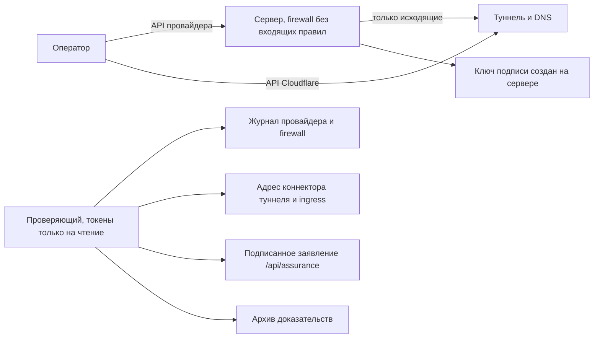

[English](../HIGH-ASSURANCE.md) · **Русский**

# Развёртывание с повышенной доказуемостью

Подписанный журнал доказывает, что записи не меняли **после** подписи. В серьёзных делах
следующий вопрос — мог ли кто-то повлиять на данные **до** подписи: кто запускал
коллектор, на какой машине и заходил ли на неё кто-нибудь. Этот необязательный режим
разворачивает коллектор так, чтобы третья сторона могла это проверить по записям
облачного провайдера и Cloudflare, а не на слово оператора.

Обычный локальный запуск и Docker не меняются. Режим работает только при развёртывании через
`python -m tgwitness.cloud`, а коллектор измеряет свой хост только при заданной
переменной `TGWITNESS_ASSURANCE`.



## Что может проверить третья сторона

| Утверждение | Как проверяется | Кто хранит запись |
| --- | --- | --- |
| Сервер создан через API провайдера в известное время | Объект сервера и его создание в журнале самого провайдера | Провайдер |
| Пути доступа провайдера не использовались | Журнал: запрос консоли, rescue, сброс пароля, переустановка, ISO, образы, бэкапы | Провайдер |
| К серверу нельзя было подключиться | У firewall провайдера нет входящих правил; SSH замаскирован с первой загрузки | Провайдер (firewall), хост (SSH) |
| Панель доступна только через туннель | Ingress туннеля ведёт только в панель; коннектор работает с адреса сервера | Cloudflare |
| Работает именно этот код | Подписанный хеш дерева исходников равен хешу чекаута развёрнутого коммита | Коллектор, сверка с Git |
| Ключ подписи создан на этом сервере | Ключ подписывает заявление с ID сервера у провайдера и хешем полученного cloud-init | Коллектор, сверка с провайдером |
| Журнал относится к этому ключу и серверу | Каждый запуск процесса в архиве несёт замер хоста этого сервера | Архив доказательств |

Замеры хоста (SSH-слушатели и процессы, текущие сессии, входы в `wtmp`, загрузка) сообщает
сам коллектор и подписывает их в каждом событии запуска и в записях `host.state` при любом
изменении. Root на сервере мог бы их подделать, поэтому они дополняют записи провайдера и
Cloudflare, но не заменяют их.

## Провайдеры

| `--provider` | Доступ для развёртывания | Доступ проверяющего (только чтение) | Журнал провайдера | Срок хранения |
| --- | --- | --- | --- | --- |
| `hetzner` | `HCLOUD_TOKEN` | Read-токен того же проекта | Действия над сервером и firewall | Пока ресурсы существуют |
| `digitalocean` | `DIGITALOCEAN_TOKEN` | Read-only personal access token | Действия над Droplet | Пока Droplet существует |
| `linode` | `LINODE_TOKEN` | Права `linodes`, `firewall`, `events` только на чтение | События аккаунта, версии правил firewall | 90 дней |
| `vultr` | `VULTR_API_KEY` | Пользователь с чтением и правом `activity_logs` | Журнал активности (метод, путь, кто) | 30 дней, дольше с подпиской на audit logs |
| `aws` | `AWS_ACCESS_KEY_ID`, `AWS_SECRET_ACCESS_KEY` | `ec2:DescribeInstances`, `ec2:DescribeSecurityGroups`, `cloudtrail:LookupEvents` | История событий CloudTrail | 90 дней |
| `generic` | не нужен | не нужен | нет: **self-attested** | – |

Для каждого дела берите отдельный проект, команду, аккаунт или субаккаунт: тогда доступ
проверяющего на чтение покажет только это развёртывание. Ключи читаются из
`--provider-token-file` или переменной окружения, никогда из командной строки. Для AWS файл
содержит `ACCESS_KEY_ID SECRET_ACCESS_KEY [SESSION_TOKEN]`, регион задаётся `--location`.

Чего не показывают записи конкретного провайдера, перечисляется в каждом отчёте. Коротко:
Hetzner пишет в журнал запрос консоли. Recovery Console у DigitalOcean, Lish/Glish у Linode и
веб-консоль Vultr в журнале как таковые не видны. Поэтому root блокируется при первой
загрузке: для входа через консоль пришлось бы сбросить пароль или изменить загрузку, а это
в журнале видно. Vultr отдаёт адрес консоли любому ключу, который может читать инстанс;
ни запись развёртывания, ни отчёт его не сохраняют.

## Что нужно заранее

1. Зона в Cloudflare, ID аккаунта и API-токен с правами **Cloudflare Tunnel Edit**,
   **Zone Read** и **DNS Edit**. Для проверяющего: **Cloudflare Tunnel Read**, **DNS Read**,
   а для журнала аудита — **Account Settings Read**.
2. Ключ провайдера с правом записи в отдельный проект.
3. Коммит, который будет работать. Тег релиза один раз превращается в коммит через
   `git ls-remote`; на сервер попадает только 40-символьный коммит.

## Развёртывание

Сначала посмотрите всё, что будет отправлено. `plan` не делает запросов к провайдеру и Cloudflare:

```sh
python -m tgwitness.cloud plan --provider hetzner --name case-2026-11 --server-type cpx22 \
    --ref 0123456789abcdef0123456789abcdef01234567 --zone example.org \
    --cloudflare-account CLOUDFLARE_ACCOUNT_ID --panel-host case.example.org
```

Затем то же самое с ключами:

```sh
python -m tgwitness.cloud deploy --provider hetzner --name case-2026-11 --server-type cpx22 \
    --ref 0123456789abcdef0123456789abcdef01234567 --zone example.org \
    --cloudflare-account CLOUDFLARE_ACCOUNT_ID --panel-host case.example.org \
    --witness-host case-witness.example.org \
    --provider-token-file hetzner.token --cloudflare-token-file cloudflare.token
```

Типы серверов для начала: `cpx22` (Hetzner), `s-1vcpu-2gb` (DigitalOcean), `g6-standard-1`
(Linode), `vc2-1c-2gb` (Vultr), `t3.small` (AWS). `--location` и `--image` по умолчанию —
Ubuntu 24.04 соответствующего провайдера в европейском регионе.

Команда:

1. создаёт туннель Cloudflare: имя панели ведёт в панель, а имя свидетеля (если задано) —
   только на `/api/witness/head` и `/api/assurance`;
2. создаёт проксируемые CNAME-записи и отказывается работать с уже занятыми именами;
3. создаёт firewall провайдера без входящих правил и сервер за ним: без SSH-ключа, без
   бэкапов, без агента консоли, с cloud-init, который маскирует SSH, блокирует root,
   ставит `cloudflared`, забирает ровно этот коммит, проверяет его и запускает TgWitness
   как защищённую службу systemd;
4. ждёт подписанное заявление коллектора и проверяет, что в нём этот сервер и хеш этого cloud-init.

В `deployments/case-2026-11/` появятся:

| Файл | Содержимое | Передавать? |
| --- | --- | --- |
| `deployment.json` | ID, хеши, сделанные вызовы API (метод, путь, статус) и первое подписанное заявление | Да, проверяющему |
| `cloud-init.redacted.yaml` | Точный cloud-init, два секрета заменены на `REDACTED` | Да |
| `panel-token.txt` | Токен панели | Нет |

Root-пароль провайдера, токен туннеля и токен панели в `deployment.json` не попадают.
Отпечаток ключа коллектора, выведенный в конце, опубликуйте по каналу, который вы не
контролируете единолично: в канале свидетеля или в сообщении получателю.

Вход в Telegram — через `https://case.example.org` с токеном панели, как в
[инструкции по аккаунтам](../ACCOUNTS.md). Действия в панели пишутся в подписанный журнал и
не являются SSH-сессиями. [Свидетель](WITNESS.md) может опрашивать `https://case-witness.example.org`.

SSH нет: если bootstrap не отработал, коллектор не ответит. Удалите сервер и разверните
заново либо найдите причину через отладочное развёртывание.

### Секреты в user data

В cloud-init два секрета: токен панели и токен туннеля Cloudflare. Ключа подписи среди них
нет, он создаётся на сервере. Hetzner, DigitalOcean и Linode не отдают user data через API.
Vultr отдаёт его любому ключу, который может читать инстанс, а EC2 — через
`DescribeInstanceAttribute`. Поэтому в AWS давайте проверяющему только три действия из таблицы,
но не `ec2:Describe*`. В Vultr исходите из того, что ключ проверяющего может прочитать оба токена.
С токеном туннеля можно запустить второй коннектор: `verify` показывает любой коннектор не с
сервера. Подделать заявления коллектора так нельзя, потому что каждое подписывает свежий запрос.

Публичное заявление коллектора не содержит адрес сервера и источники входов; они остаются в
подписанном журнале.

## Отладочное развёртывание и блокировка

`--debug-ssh-key KEY --debug-ssh-from 198.51.100.4` оставляет SSH для одного ключа с одного
адреса или небольшой сети. Такое развёртывание записывается как `debug` и **никогда** не
проходит как high-assurance. Закончив, выполните `sudo tgwitness-lock` последней командой в
последней SSH-сессии, затем:

```sh
python -m tgwitness.cloud lock --record deployments/case-2026-11/deployment.json --provider-token-file hetzner.token
```

Firewall теряет все входящие правила. В отчёте видно, когда SSH был разрешён и когда закрыт;
это окно не скрывается.

## Любой сервер (self-attested)

`--provider generic` — для сервера, купленного или установленного вручную. `deploy` создаёт
туннель и DNS, пишет `install.sh` (не публиковать) и `install.redacted.sh` (публиковать) и ждёт.
Скопируйте `install.sh` на свежеустановленный Ubuntu 24.04 и запустите:

```sh
sudo bash install.sh
```

Скрипт фиксирует состояние хоста до установки (входы, учётные записи, `authorized_keys`,
слушающие порты, службы, задания cron, пакеты), ставит коммит, включает firewall на хосте,
удаляет сам себя, маскирует SSH и завершает сессию. Отчёт по такому серверу в лучшем случае
**SELF-ATTESTED**: у того, кто запускал установщик, до него был root, а записей провайдера у
проверяющего нет. Это всё равно лучше, чем сервер без объяснений: инвентаризация, хеш
установщика и каждый последующий вход подписаны.

## Проверка

Проверяющему нужны `deployment.json`, опубликованный установщик, ключи только на чтение и
желательно чекаут коммита и архив доказательств:

```sh
git clone -c core.autocrlf=false https://github.com/phishdestroy/TgWitness.git checkout
git -C checkout checkout 0123456789abcdef0123456789abcdef01234567
python -m tgwitness.cloud verify --record deployment.json \
    --provider-token-file read-only.token --cloudflare-token-file cloudflare-read.token \
    --fingerprint COLLECTOR_FINGERPRINT --cloud-init cloud-init.redacted.yaml \
    --source checkout --evidence tgwitness-evidence.zip --report report.md
```

Все значения провайдера и Cloudflare проверяющий запрашивает сам в момент проверки; запись
развёртывания даёт только ID, о которых спрашивать. Код выхода: 0 — **PASS**, 1 — **FAIL**,
2 — **REVIEW**, **INCOMPLETE** или **SELF-ATTESTED**. `--fingerprint` должен прийти по
независимому каналу; без него ключ сверяется только с записью оператора. Сам архив
по-прежнему проверяет `python verify.py`, см. [формат доказательств](../EVIDENCE.md).

Действия провайдера классифицируются: создание и запуск в первые 30 минут проходят;
консоль, rescue, сброс пароля, переустановка, ISO, образы, снапшоты, бэкапы, Systems
Manager, EC2 Instance Connect и открытие firewall — провал; действия с питанием и всё
неожиданное помечаются для проверки. Неизвестное действие никогда не проходит молча.

## Отчёт для передачи улик

`--report report.md` пишет отчёт в Markdown и рядом `report.json`:

1. итог, отпечаток ключа коллектора, развёртывание, провайдер, коммит, сервер, firewall, туннель;
2. все проверки со статусом и источником (API провайдера, API Cloudflare, заявление
   коллектора, архив доказательств);
3. журнал провайдера с оценкой каждого действия и, если провайдер это пишет, исполнителем;
4. адреса API Cloudflare с подключениями, конфигурацией и журналом аудита туннеля;
5. подписанное заявление коллектора;
6. что отчёт доказывает и чего не доказывает;
7. команды для повторения проверки и SHA-256 каждого переданного файла.

Передавайте отчёт, `report.json`, `deployment.json`, опубликованный установщик и архив
доказательств. Делайте отчёт сразу: журналы провайдеров хранятся ограниченное время.

## Чего режим не доказывает

- Провайдер и его сотрудники управляют гипервизором, дисками и сетью.
- Замеры хоста сообщает сам коллектор.
- Прежнее содержимое правил firewall есть не в каждом журнале; версии правил хранит только Linode.
- О подлинности сообщений Telegram режим ничего нового не говорит; см. [формат доказательств](../EVIDENCE.md).

## Что проверено

Логика развёртывания, блокировки и проверки покрыта автотестами на имитациях API Hetzner,
DigitalOcean, Linode, Vultr, EC2/CloudTrail и Cloudflare по их опубликованным спецификациям;
подпись запросов AWS сверена с опубликованными примерами AWS. На реальных аккаунтах
провайдеров режим **ещё не запускался**: перед использованием в деле проверьте первое
развёртывание у каждого провайдера через `plan`, отладочное развёртывание и `verify`.
