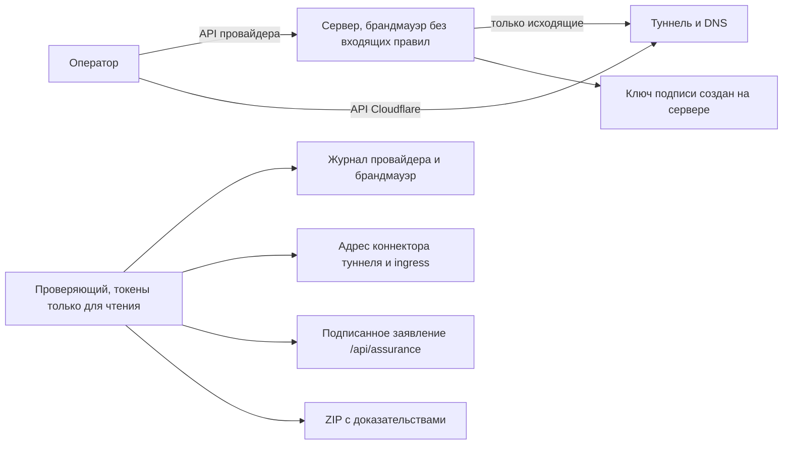

[TgWitness](../../README.md) / [Документация](../README.md) / [Папка](README.md) · [Уровни доказательности](https://phishdestroy.github.io/TgWitness/ru/docs/assurance-levels/)


[English](../HIGH-ASSURANCE.md) · **Русский**

# Проверяемый сервер

Проверяемый сервер — это обычный VPS, который TgWitness создаёт через API провайдера так, чтобы
кто-то другой мог проверить, как он собран и что его потом никто не открывал. Проверяющий читает
записи провайдера и Cloudflare с токенами только для чтения; верить оператору на слово не нужно.

Обычная работа локально и в Docker не меняется. Ничего из описанного здесь не запускается, если
вы не развёртываете через `python -m tgwitness.cloud`, а коллектор считывает сведения о своём
хосте, только если развёртывание задаёт `TGWITNESS_ASSURANCE`.

[Анимированное руководство](https://phishdestroy.github.io/TgWitness/ru/docs/verified-server/)
проходит развёртывание шаг за шагом. Следующий уровень: [конфиденциальная VM на Phala Cloud](PHALA.md).



<details>
<summary>На этой странице</summary>

- [Что может проверить проверяющая сторона](#что-может-проверить-проверяющая-сторона)
- [Как устроен облачный сервер и что может остаться незамеченным](#как-устроен-облачный-сервер-и-что-может-остаться-незамеченным)
- [Провайдеры по отдельности](#провайдеры-по-отдельности)
- [Перед началом](#перед-началом)
- [Из панели](#из-панели)
- [Быстрый туннель без домена](#быстрый-туннель-без-домена)
- [Развёртывание](#развёртывание)
- [Отладочное развёртывание и блокировка](#отладочное-развёртывание-и-блокировка)
- [Удаление развёртывания](#удаление-развёртывания)
- [Любой сервер (self-attested)](#любой-сервер-self-attested)
- [Проверка](#проверка)
- [Отчёт для передачи доказательств](#отчёт-для-передачи-доказательств)
- [Cloudflare как внешний свидетель](#cloudflare-как-внешний-свидетель)
- [Как читать результат развёртывания](#как-читать-результат-развёртывания)

</details>

## Что может проверить проверяющая сторона

| Утверждение | Как проверяется | Кто хранит запись |
| --- | --- | --- |
| Сервер создан через API провайдера в известное время | Объект сервера и запись о его создании в журнале самого провайдера | Провайдер |
| Никто не воспользовался путями доступа провайдера | Журнал запросов консоли, rescue, сброса пароля, переустановки, ISO, образов, резервных копий | Провайдер |
| К серверу ничто не могло подключиться | У брандмауэра провайдера нет входящих правил; SSH замаскирован с первой загрузки | Провайдер (брандмауэр), хост (SSH) |
| Панель доступна только через туннель | Ingress туннеля перенаправляет только на панель; коннектор работает с адреса сервера | Cloudflare |
| Работает именно это ПО | Подписанный коллектором хеш дерева исходников совпадает с хешем checkout развёрнутого коммита | Коллектор, сверка с Git |
| Ключ подписи создан на этом сервере | Ключ подписывает заявление, в котором указаны ID сервера у провайдера и хеш полученного сервером cloud-init | Коллектор, сверка с провайдером |
| Журнал принадлежит этому ключу и серверу | Каждый запуск процесса в ZIP с доказательствами содержит замер хоста этого сервера | ZIP с доказательствами |
| Ключ Telegram создан в аттестованном запуске | `account.authorized` фиксирует `key_origin: "created"` | ZIP с доказательствами |

Коллектор фиксирует состояние SSH, сеансы, историю входов и сведения о загрузке в подписанных
записях о запуске процесса и записях <code>host.state</code>. На обычной VM это локальные
инвентаризационные записи, которые проверяющий сверяет с независимыми записями провайдера.

Аттестованное развёртывание не ведёт сбор с импортированным ключом сессии. Войдите по телефону
или QR-коду либо используйте файл сессии для независимого входа: в любом случае ключ авторизации
Telegram создаётся внутри аттестованного запуска, журнал фиксирует
<code>key_origin: "created"</code>, а <code>python -m tgwitness.cloud verify</code> засчитывает
проверку <code>account_key</code>. Журнал с импортированным ключом эту проверку не проходит.

<a name="how-a-cloud-server-is-controlled-and-what-can-go-unseen"></a>
## Как устроен облачный сервер и что может остаться незамеченным

### Что такое облачный сервер физически

Облачный сервер — не отдельная машина. У провайдера есть физические хосты, на каждом работают
Linux и гипервизор **KVM**. Каждый сервер клиента на хосте — это отдельный **процесс QEMU** на
этом хосте:

- **память** сервера — это память этого процесса на хосте;
- **диск** сервера — файл или том на хосте или в кластере хранения провайдера;
- **сеть** сервера проходит через виртуальный коммутатор хоста;
- **часы** серверу задаёт хост.

На одном хосте могут работать десятки серверов разных клиентов: компаний, банков,
государственных учреждений, частных лиц.

### Два пути к серверу

**1. Панель управления клиента: API и веб-консоль.**
Всё, что можете сделать вы или любой, у кого есть ваш API-токен, идёт через API провайдера:
создание, запуск, остановка, консоль, rescue, сброс пароля, переустановка, ISO, снапшот,
резервная копия, изменения брандмауэра. Эти действия записываются в **журнал провайдера вашего
аккаунта**. Проверяющий читает этот журнал независимо, и `verify` проваливается на любом
действии, которое могло бы открыть сервер.

**2. Инфраструктура провайдера: сами хосты.**
Инженеры провайдера с административным доступом к физическому хосту работают ниже панели
управления клиента. С root на хосте они могут приостановить отдельный сервер, прочитать или
изменить его память, скопировать или изменить его диск или перенести его на другой хост. Эти
операции **затрагивают только этот один сервер**: соседи на том же хосте продолжают работать и
ничего не замечают. Они **не записываются в журнал вашего аккаунта**. Фиксирует ли их провайдер
у себя, решает сам провайдер, и ни вы, ни проверяющий этого не видите.

Именно этот второй путь не может исключить ни один журнал аудита, доступный клиентам.

### Кто может воспользоваться вторым путём

Не обычный злоумышленник. Для этого нужен один из вариантов:

- **собственные сотрудники провайдера** с доступом к рабочим хостам;
- **государственный орган**, который принуждает провайдера действовать, например через
  законный перехват или решение суда в юрисдикции провайдера;
- **злоумышленник, взломавший саму инфраструктуру провайдера.**

Соседи здесь важны, но не потому, что вмешательство в один сервер их потревожит. Тот же доступ к
хосту, который достаёт до вашего сервера, достаёт и до всех остальных серверов на этом хосте:
банков, компаний, государственных сервисов. Поэтому провайдеры жёстко ограничивают, отслеживают
и проверяют доступ к хостам; Hetzner, например, сертифицирован по ISO/IEC 27001. Тот, у кого есть
такой доступ, обладает крайне ценной возможностью, которая рискует раскрыться при каждом
использовании. Тайно потратить её на один сервер с доказательствами — решение уровня
государства, а не обычного противника.

Публично задокументированные вмешательства на уровне провайдера вписываются в эту картину.
В 2023 году трафик jabber.ru, размещённого у Hetzner и Linode, перехватывался на уровне
провайдера, по имеющимся сведениям — как законный перехват по запросу властей Германии. Это был
**перехват в сети**. Нам не известно ни одного публичного случая, когда провайдер изменял бы
данные внутри виртуальной машины клиента.

Обычный злоумышленник может украсть ваш API-токен. Каждое его действие с этим токеном появится
в журнале провайдера, и `verify` о нём сообщит.

### Что каждый уровень может и чего не может сделать с доказательствами

| Кто | Путь | Что может сделать | Обнаруживается? |
| --- | --- | --- | --- |
| Вы или любой, у кого есть ваш API-токен | Панель управления клиента | Консоль, rescue, переустановка, снапшот, открытие брандмауэра | **Да**: журнал провайдера, `verify` проваливается |
| Любой, у кого есть токен туннеля | Второй коннектор Cloudflare | Перенаправить трафик панели в другое место | **Да**: Cloudflare сообщает о коннекторах не на сервере |
| Перехват в сети (в том числе законный перехват) | Сеть провайдера | Блокировать или задерживать трафик. **Изменить содержимое Telegram не может**: ключ сессии создаётся на сервере, а MTProto закрепляет ключи серверов Telegram | Блокировка видна как **пропуски** в журнале |
| Сотрудники провайдера или принуждающее государство | Хост / гипервизор | Прочитать память, включая ключ подписи коллектора; изменить данные до подписи; изменить часы | **Не видно в журналах, доступных клиенту** |

### Пределы возможностей атакующего на уровне хоста

Даже с доступом к хосту прошлое ограничено тем, что уже покинуло сервер:

- **Контрольные точки, опубликованные у независимых свидетелей**, переписать нельзя. Всё, что
  уже засвидетельствовано, остаётся неизменным.
- **Метки времени RFC 3161 и OpenTimestamps** фиксируют, когда существовала каждая контрольная
  точка. Часы хоста их не сдвинут.
- **Сам Telegram** по-прежнему хранит сообщения. Любую подделку может опровергнуть другой сбор
  того же чата.

Поэтому реальный риск — манипуляция **в момент сбора**, а не тихое переписывание архива задним
числом.

### Как поднять планку

| Мера | Что это убирает |
| --- | --- |
| Проверяемое развёртывание сервера (эта страница) | Вас как оператора из круга доверия |
| Cloudflare как второй свидетель | Опору только на записи провайдера |
| Два коллектора у разных провайдеров в разных юрисдикциях, сообщения сравниваются одно за другим | Рычаг одного провайдера или одного государства |

**Наша оценка:** проверяемого развёртывания сервера достаточно, если только ваш оппонент не
может принудить провайдера к сотрудничеству или тайно его получить, что на практике означает
возможности уровня государства. Если это правдоподобно, используйте двух провайдеров в разных
юрисдикциях или следующий уровень доказательности.

<a name="providers-one-by-one"></a>
## Провайдеры по отдельности

Каждый провайдер ниже разворачивает одно и то же: брандмауэр без входящих правил, сервер без
SSH, туннель к Cloudflare. Различается то, что записывает их собственный журнал, а именно этот
журнал читает проверяющий, чтобы понять, не добирался ли кто-то до сервера через провайдера. Как
`verify` оценивает каждое действие, задано в [`tgwitness/providers/`](../../tgwitness/providers/).

| Провайдер | Срок хранения журнала | Кто действовал | Консоль в журнале | Изменения брандмауэра | Мастер в панели |
| --- | --- | --- | --- | --- | --- |
| Hetzner Cloud | Пока существует сервер | Нет | Да | Записываются; прежние правила не сохраняются | Да |
| Amazon EC2 | 90 дней | Да | Пути через агенты и ключи: Instance Connect, Systems Manager, последовательная консоль | Записываются | Нет, командная строка |
| Akamai (Linode) | 90 дней | Да | Нет | Хранится каждая версия правил | Нет, командная строка |
| DigitalOcean | Пока существует Droplet | Нет | Нет | Не записываются | Нет, командная строка |
| Vultr | 30 дней | Да | Не распознаётся | Записываются | Нет, командная строка |

Где консоли нет в журнале, root блокируется при первой загрузке: чтобы войти через консоль,
сначала понадобился бы сброс пароля или изменение загрузки, а они в журнале есть.

Для каждого дела используйте отдельный проект, команду, аккаунт или субаккаунт: тогда доступ
проверяющего только для чтения покажет лишь это развёртывание. Учётные данные читаются из
`--provider-token-file` или из переменной, указанной в карточке, но никогда из командной строки.
Для AWS файл содержит `ACCESS_KEY_ID SECRET_ACCESS_KEY [SESSION_TOKEN]`; регион задаётся через
`--location`.

Карточка каждого провайдера с интерактивным журналом, Cloudflare на нём, силой, ценой и развёртыванием: [провайдеры](https://phishdestroy.github.io/TgWitness/ru/docs/verified-server/#providers).

Все провайдеры берут плату по часам или секундам, но не больше месячной цены, поэтому тестовое
развёртывание, удалённое через час, стоит центы. Туннель, быстрый туннель, Gateway DNS на
бесплатном плане Zero Trust Cloudflare, ретранслятор drand и ntfy.sh ничего не стоят; для туннеля
под своим именем нужен домен в Cloudflare. Мастер показывает текущую цену Hetzner, с НДС вашего
аккаунта, до того как что-либо будет создано.

## Перед началом

1. Зона Cloudflare, ID её аккаунта и API-токен с правами **Cloudflare Tunnel Edit**,
   **Zone Read** и **DNS Edit**, переданный через `--cloudflare-token-file` или
   `CLOUDFLARE_API_TOKEN`. Для проверяющего: **Cloudflare Tunnel Read**, **DNS Read** и, для
   журнала аудита, **Account Settings Read**. Без домена
   [быстрому туннелю](#быстрый-туннель-без-домена) ничего из этого не нужно.
2. Учётные данные провайдера с правом записи в отдельный проект; те же использует `lock`:
   - Hetzner: API-токен с правом Read & Write;
   - DigitalOcean: personal access token с правом записи;
   - Linode: personal access token с областями `linodes`, `firewall` и `events` на чтение и запись;
   - Vultr: API-ключ отдельного аккаунта или субаккаунта;
   - AWS: учётные данные IAM с разрешениями `ec2:DescribeVpcs`, `ec2:DescribeImages`,
     `ec2:CreateSecurityGroup`, `ec2:AuthorizeSecurityGroupIngress`, `ec2:RunInstances`,
     `ec2:CreateTags`, `ec2:DescribeInstances`, `ec2:DescribeSecurityGroupRules` и
     `ec2:RevokeSecurityGroupIngress`.
3. Коммит для запуска. Тег релиза один раз разрешается в коммит через `git ls-remote`;
   сервер получает только 40-символьный коммит.

<a name="from-the-panel"></a>
## Из панели

На вашем компьютере раздел **Инструменты → Дополнительно → Сервер работает круглосуточно**
запускает тот же `deploy` для Hetzner в три шага: выберите Европу или США, вставьте токен Hetzner
(Read & Write), затем проверьте тип сервера, месячную цену, адрес и версию, которые панель нашла с
этим токеном. До вашего подтверждения ничего не создаётся. Панель показывает каждый шаг так, как о
нём сообщает `deploy`, а затем адрес, токен панели и отпечаток ключа подписи. Без домена сервер
получает [быстрый туннель](#быстрый-туннель-без-домена); после перезапуска
**Ваши серверы → Найти текущий адрес** находит его адрес заново. Для постоянного адреса под вашим
доменом откройте **Необязательно · свой домен** и добавьте токен Cloudflare (подготовленная ссылка
выбирает Zone Read, DNS Edit и Cloudflare Tunnel Edit).

Токены передаются с каждым запросом из вкладки браузера в TgWitness на том же компьютере и нигде
не записываются; запись о развёртывании, cloud-init с удалёнными секретами, токен панели и, для
быстрого туннеля, ключ адреса хранятся в `deployments/NAME` внутри каталога данных. Панель
предлагает эту функцию только главному администратору при прямом подключении через loopback
(`127.0.0.1`, без заголовков прокси или туннеля); панель, открытая по сети, вместо этого
показывает команды. Версией по умолчанию служит тег релиза работающей панели, который разрешается
через API GitHub. Расположение, тип сервера и цена берутся из API Hetzner: `cpx22`, где он
предлагается, иначе самый дешёвый тип x86 с памятью не менее 2 ГБ.

## Быстрый туннель без домена

`--quick-tunnel` заменяет `--zone`, `--cloudflare-account` и `--panel-host`; аккаунт и токен
Cloudflare не используются:

```sh
python -m tgwitness.cloud deploy --provider hetzner --name case-2026-11 --server-type cpx22 \
    --ref 0123456789abcdef0123456789abcdef01234567 --quick-tunnel --provider-token-file hetzner.token
```

На сервере cloudflared открывает к панели
[быстрый туннель](https://developers.cloudflare.com/tunnel/get-started/quick-tunnels/):
случайный адрес `https://….trycloudflare.com`, который меняется при каждом перезапуске cloudflared
или сервера. Небольшая служба на сервере публикует каждый адрес в случайный топик ntfy.sh с
подписью (HMAC-SHA256) ключом, который есть только в каталоге развёртывания (`address-key.txt`), и
повторяет публикацию каждые три часа, потому что ntfy.sh хранит сообщения 12 часов. `deploy` и
**Найти текущий адрес** принимают только подписанные сообщения, поэтому поддельное сообщение не
может направить вас, а вместе с вами и ваш токен панели, на чужой адрес. Топик указан в записи о
развёртывании и в опубликованном cloud-init: тот, у кого они есть, может узнать текущий адрес, но
по нему панель всё равно запросит токен панели. Входящих портов на сервере нет в любом случае.

У проверяющего нет ключа адреса, а публиковать в топик может любой, кто его читает. Поэтому
коллектор и сам публикует адрес с подписью своим ключом Ed25519, а `verify` берёт самое новое
сообщение, подписанное ключом коллектора из записи о развёртывании; сообщения упорядочиваются по
времени их получения ntfy.sh, а не по времени, которое в них указано. Коллектор версии до этого
изменения ничего не подписывает; тогда `verify` берёт самое новое сообщение и сообщает об этом в
проверке `statement`. Поддельное сообщение может лишь привести к провалу этой проверки, поскольку
по этому адресу всё равно должен отвечать ключ коллектора.

Цена такого варианта: ни один аккаунт Cloudflare не хранит записей о быстром туннеле, поэтому
`verify` отмечает проверку туннеля, коннектора и DNS как недоступную, и итог в лучшем случае —
`incomplete`; записи провайдера, брандмауэр, подписанное заявление, замеры хоста и
сравнение установщика проверяются как обычно. Для побайтового сравнения с эталонным установщиком
нужен развёрнутый коммит, который уже поддерживает `--quick-tunnel`; checkout 0.7.0 собирает
установщик для домена и сообщает о расхождении. Cloudflare предлагает быстрые туннели для пробного
использования, допускает 200 одновременно обрабатываемых запросов и не передаёт Server-Sent Events,
поэтому живые обновления панели (в версиях после 0.7.0) через такой туннель могут не приходить, и
представление придётся перезагружать; эта часть не проверялась. Для дела, которое должно выдержать
проверку, используйте свой домен.

## Развёртывание

Сначала просмотрите всё, что будет отправлено. `plan` не выполняет запросов ни к провайдеру, ни к
Cloudflare:

```sh
python -m tgwitness.cloud plan --provider hetzner --name case-2026-11 --server-type cpx22 \
    --ref 0123456789abcdef0123456789abcdef01234567 --zone example.org \
    --cloudflare-account CLOUDFLARE_ACCOUNT_ID --panel-host case.example.org
```

Затем выполните развёртывание с теми же параметрами и учётными данными:

```sh
python -m tgwitness.cloud deploy --provider hetzner --name case-2026-11 --server-type cpx22 \
    --ref 0123456789abcdef0123456789abcdef01234567 --zone example.org \
    --cloudflare-account CLOUDFLARE_ACCOUNT_ID --panel-host case.example.org \
    --witness-host case-witness.example.org \
    --provider-token-file hetzner.token --cloudflare-token-file cloudflare.token
```

Типы серверов для начала: `cpx22` (Hetzner), `s-1vcpu-2gb` (DigitalOcean), `g6-standard-1`
(Linode), `vc2-1c-2gb` (Vultr), `t3.small` (AWS). По умолчанию `--location` и `--image` выбирают
Ubuntu 24.04 соответствующего провайдера в европейском регионе.

`--repository` берёт коммит из другого Git-репозитория по https, без учётных данных в URL (по
умолчанию `https://github.com/phishdestroy/TgWitness.git`). `deploy` также принимает `--out` —
другой каталог развёртывания (по умолчанию `deployments/NAME`; каталог, где уже есть
развёртывание, отклоняется) — и `--wait` — число минут ожидания подписанного заявления коллектора:
от 1 до 240, по умолчанию 20, для `generic` — 60.

Команда:

1. создаёт туннель Cloudflare, ingress которого перенаправляет имя хоста панели на панель, а имя
   хоста свидетеля, если оно задано, — только на `/api/witness/head` и `/api/assurance`;
2. создаёт для этих имён проксируемые записи CNAME, отказываясь использовать уже существующие имена;
3. создаёт брандмауэр провайдера без входящих правил и сервер за ним — без SSH-ключа, без
   резервного копирования, без агента консоли и с cloud-init, который маскирует SSH, блокирует
   root, устанавливает `cloudflared`, загружает ровно этот коммит, проверяет его и запускает
   TgWitness как защищённую службу systemd;
4. ждёт подписанное заявление коллектора и проверяет, что в нём указаны этот сервер и хеш этого
   cloud-init.

После этого в `deployments/case-2026-11/` находятся:

| Файл | Содержимое | Передавать? |
| --- | --- | --- |
| `deployment.json` | ID, хеши, выполненные вызовы API (метод, путь, статус) и первое подписанное заявление | Да, проверяющему |
| `cloud-init.redacted.yaml` | Точный cloud-init, в котором два секрета заменены на `REDACTED` | Да |
| `panel-token.txt` | Токен панели | Нет |

Пароль root от провайдера, токен туннеля и токен панели никогда не записываются в
`deployment.json`. Опубликуйте отпечаток коллектора, выведенный в конце, через канал, который вы
не контролируете единолично, например канал свидетеля или сообщение получателю.

Войдите в Telegram по адресу `https://case.example.org` с токеном панели, как описано в
[руководстве по аккаунтам](../ACCOUNTS.md). Действия в панели записываются в подписанный журнал;
это не SSH-сеансы. [Свидетель](WITNESS.md) может опрашивать `https://case-witness.example.org`.

SSH нет: если начальная настройка (bootstrap) не удалась, коллектор так и не ответит. Удалите
сервер и выполните развёртывание заново или найдите причину с помощью отладочного развёртывания.

### Секреты в user data

Файл cloud-init содержит два секрета: токен панели и токен туннеля Cloudflare. Ключа подписи среди них
нет — он создаётся на сервере. Hetzner, DigitalOcean и Linode не возвращают user data через свой
API. Vultr возвращает их любому ключу, которому доступно чтение инстанса, а EC2 — через
`DescribeInstanceAttribute`. Для AWS давайте проверяющему только три действия из таблицы и никогда
не давайте `ec2:Describe*`. Для Vultr исходите из того, что ключ проверяющего может прочитать оба
токена. Токен туннеля позволяет запустить второй коннектор: `verify` сообщает о любом коннекторе,
работающем не на сервере, а заявления коллектора так подделать нельзя, потому что каждое из них
подписывает свежий запрос (challenge). С `--quick-tunnel` вторым секретом вместо этого становится
ключ адреса: кто его прочитает, может опубликовать ложный адрес, который панель примет.

Публичное заявление коллектора не содержит адреса сервера и источников входов; и то и другое
остаётся в подписанном журнале.

## Отладочное развёртывание и блокировка

`--debug-ssh-key KEY --debug-ssh-from 198.51.100.4` оставляет SSH для одного ключа с одного адреса
или небольшой сети — не шире /24 для IPv4 или /48 для IPv6. `KEY` — уже зарегистрированный у
провайдера ключ: имя или ID SSH-ключа в проекте Hetzner, ID или отпечаток SSH-ключа в команде
DigitalOcean, имя пользователя Linode, SSH-ключи из профиля которого добавляются для root, ID
SSH-ключа в аккаунте Vultr или имя пары ключей EC2 в регионе. К `generic` эти параметры не
применяются. Такое развёртывание записывается как `debug` и в отчётах **никогда** не считается
развёртыванием повышенной доказуемости. Закончив, выполните `sudo tgwitness-lock` последней командой
последнего SSH-сеанса, затем:

```sh
python -m tgwitness.cloud lock --record deployments/case-2026-11/deployment.json --provider-token-file hetzner.token
```

Брандмауэр лишается всех входящих правил. После этого отчёты показывают, когда SSH был разрешён и
когда закрыт; это окно остаётся видимым.

## Удаление развёртывания

`destroy` удаляет сервер и его брандмауэр (их находят по метке развёртывания, чтобы удалить и
развёртывание, прервавшееся на полпути), затем DNS-записи, указывающие на его туннель, и сам
туннель. Журнал и ключ подписи на сервере удаляются вместе с ним: сначала экспортируйте
доказательства. Запись о развёртывании сохраняется с отметкой `removed` и вызовами API,
выполненными при удалении.

```sh
python -m tgwitness.cloud destroy --record deployments/case-2026-11/deployment.json --confirm case-2026-11 \
    --provider-token-file hetzner.token --cloudflare-token-file cloudflare.token
```

Удаление через API реализовано для Hetzner. Для других провайдеров `destroy` останавливается,
ничего не удалив, и называет метку, по которой нужно удалить ресурсы в консоли провайдера. У
сервера, установленного вручную (`generic`), удаляются только туннель и DNS-записи. Для
развёртывания с быстрым туннелем токен Cloudflare не нужен: туннель прекращает существование вместе
с сервером, а его сообщения в ntfy.sh истекают в течение 12 часов.

## Любой сервер (self-attested)

`--provider generic` предназначен для сервера, купленного или установленного вручную. `deploy`
создаёт туннель и DNS, записывает `install.sh` (приватный) и `install.redacted.sh` (для
публикации) и ждёт. Скопируйте `install.sh` на только что установленный сервер Ubuntu 24.04 и
запустите его там:

```sh
sudo bash install.sh
```

Скрипт фиксирует исходное состояние хоста (входы, учётные записи, `authorized_keys`, прослушивающие
сокеты, службы, запланированные задания, пакеты), устанавливает коммит, включает брандмауэр хоста,
удаляет сам себя, маскирует SSH и завершает сеанс. Отчёт по такому серверу в лучшем случае
получает статус **SELF-ATTESTED**: у того, кто запускал установщик, до этого был root, а записи
провайдера проверяющему недоступны. Это всё равно лучше, чем сервер без объяснений:
инвентаризация, хеш установщика и каждый последующий вход подписаны.

## Проверка

Проверяющему нужны `deployment.json`, опубликованный установщик, учётные данные только для чтения
и, в идеале, checkout коммита и ZIP с доказательствами:

```sh
git clone -c core.autocrlf=false https://github.com/phishdestroy/TgWitness.git checkout
git -C checkout checkout 0123456789abcdef0123456789abcdef01234567
python -m tgwitness.cloud verify --record deployment.json \
    --provider-token-file read-only.token --cloudflare-token-file cloudflare-read.token \
    --fingerprint COLLECTOR_FINGERPRINT --cloud-init cloud-init.redacted.yaml \
    --source checkout --evidence tgwitness-evidence.zip --report report.md
```

Все значения провайдера и Cloudflare проверяющий запрашивает в момент проверки; запись о
развёртывании даёт только ID, о которых нужно спросить. Код выхода: 0 — **PASS**, 1 — **FAIL**,
2 — **REVIEW**, **INCOMPLETE** или **SELF-ATTESTED**. `--fingerprint` следует получить по
независимому каналу; без него ключ сверяется только с записью оператора. Сам ZIP с
доказательствами по-прежнему проверяет `python verify.py`, как описано в разделе
[Доказательства](../EVIDENCE.md).

Действия провайдера классифицируются: создание и запуск в течение 30 минут после создания
проходят; консоль, rescue, сброс пароля, переустановка, ISO, образы, снапшоты, резервные копии,
Systems Manager, EC2 Instance Connect и открытие брандмауэра приводят к провалу; действия с
питанием и всё непредусмотренное помечаются для проверки. Неизвестное действие никогда не проходит
молча.

## Отчёт для передачи доказательств

`--report report.md` записывает отчёт в формате Markdown и рядом с ним `report.json`:

1. итог, отпечаток ключа коллектора, развёртывание, провайдер, коммит, сервер, брандмауэр, туннель;
2. все проверки со статусом и источником (API провайдера, API Cloudflare, заявление коллектора,
   журнал доказательств);
3. журнал провайдера с оценкой каждого действия и, если провайдер это записывает, исполнителем;
4. конечные точки Cloudflare, где хранятся подключения туннеля, его конфигурация и журнал аудита;
5. подписанное заявление коллектора;
6. что охватывает отчёт и что лежит за его пределами;
7. команды для его воспроизведения и SHA-256 каждого переданного ему файла.

Передавайте отчёт, `report.json`, `deployment.json`, опубликованный установщик и ZIP с
доказательствами. Формируйте отчёт как можно раньше: журналы провайдеров хранятся ограниченное время.

<a name="cloudflare-as-an-outside-witness"></a>
## Cloudflare как внешний свидетель

Всё описанное здесь необязательно. Без аккаунта Cloudflare сервер всё равно работает, и два из этих
вариантов действуют уже сейчас:

| Что | Что это показывает | В TgWitness |
| --- | --- | --- |
| Быстрый туннель или туннель вашего домена | панель доступна только через туннель | мастер сервера, см. выше |
| Ретранслятор drand `drand.cloudflare.com` | записи после раунда drand новее этого раунда: журнал вёлся по ходу событий | режим «Доказательства», **Дополнительные свидетели**, без аккаунта ([формат](../EVIDENCE.md#optional-records-in-evidence-mode-drand-and-telegram-devices)) |
| Уведомления о состоянии туннеля | когда туннель был недоступен — по электронной почте или через вебхук от Cloudflare | настраиваются в панели управления Cloudflare |
| Gateway DNS (`--gateway-dns` или **Cloudflare Gateway DNS** в мастере) | каждое имя, которое запрашивал сервер, с ответами Cloudflare по TLS; брандмауэр Hetzner не пропускает DNS-запросы ни к кому другому; могла ли политика Gateway подменять ответы | Hetzner, бесплатный план Zero Trust, без домена; `verify` проверяет брандмауэр, расположение DNS (location), журналирование, политики, запросы сервера и журнал аудита; режим «Доказательства» копирует журнал Gateway в журнал TgWitness |
| Gateway с клиентом Cloudflare One на сервере и брандмауэром исходящего трафика, пропускающим только Cloudflare | каждое соединение сервера, а не только DNS | пока не реализовано |
| Access перед панелью | кто и когда входил в панель | не реализовано: нужен собственный домен |
| Журналирование команд SSH | каждая команда в отладочном сеансе | пока не реализовано |

Logpush, который хранил бы собственную копию Cloudflare в R2, доступен только в плане Enterprise:
на бесплатном плане Cloudflare отвечает `logpush is not enabled for this account`. Журнал Gateway
там хранится 24 часа, поэтому режим «Доказательства» копирует его в подписанный журнал
(**Журнал DNS-запросов данного сервера, составленный Cloudflare Gateway**, токен только для чтения
с правом Account Analytics Read).

`--gateway-location ID` (вместе с `--gateway-dns`) использует существующее расположение Gateway DNS
по его 32-символьному ID вместо создания нового; `destroy` его не удаляет.

Без плана Zero Trust у аккаунта одно расположение DNS (location). Если Cloudflare отказывается
создать ещё одно, сервер использует существующее совместно, а его запросы отличаются по адресу; для
такого фильтра также нужно право Zero Trust PII Read, а `destroy` общее расположение не удаляет.
Один запрос к журналу охватывает не более трёх часов, поэтому копирование и `verify` читают сутки
трёхчасовыми окнами.

Gateway DNS охватывает системный резолвер. DNS over HTTPS через порт 443 к другому резолверу и
соединения с адресами, которые нигде не запрашивались через DNS (например, с дата-центрами
Telegram), в его журнал не попадают.

Cloudflare не видит содержимого под шифрованием Telegram, других устройств аккаунта Telegram (их со
стороны Telegram фиксирует список устройств в режиме «Доказательства») и гипервизора провайдера.

## Как читать результат развёртывания

На обычной VM инфраструктурой хоста управляет провайдер, а локальная инвентаризация проверяется
вместе с записями провайдера. Смотрите отдельные результаты, чтобы понять, какие
проверки прошли, а какие были недоступны.

Доступность истории брандмауэра зависит от провайдера; Linode хранит версии правил. В
[протоколе проверок](../VERIFICATION.md) перечислены проверенные развёртывания и оставшиеся проверки
на реальных системах, а раздел [охват проверки](../EVIDENCE.md#verification-scope) связывает эти
проверки среды с получением и целостностью архива.
