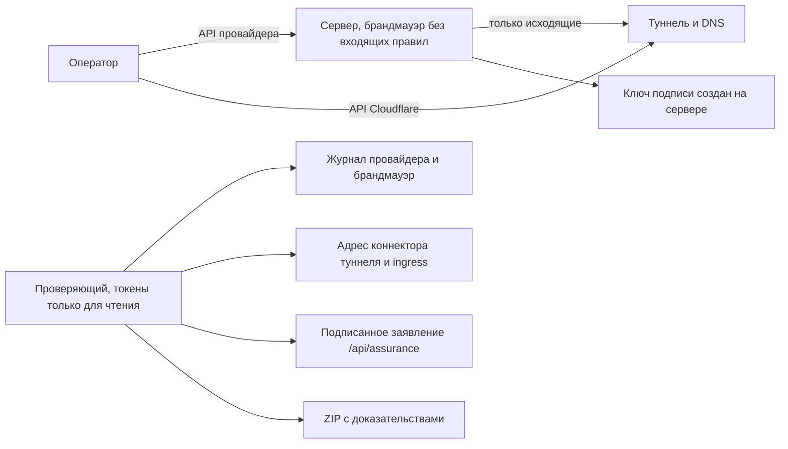

[TgWitness](../../README.md) / [Документация](../README.md) / [Папка](README.md) · [Развёртывание и восстановление](DEPLOYMENT.md)


[English](../HIGH-ASSURANCE.md) · **Русский**

# Развёртывание с повышенной доказуемостью

Развёртывание с повышенной доказуемостью дополняет проверку архива независимыми проверками
среды сбора. Проверяющий запрашивает записи о развёртывании и доступе, которые хранят облачный
провайдер и Cloudflare, а развёртывание на Intel TDX добавляет аппаратную аттестацию среды
коллектора.

Обычная работа локально и в Docker не меняется. Ничего из описанного здесь не запускается, если
вы не развёртываете через `python -m tgwitness.cloud`, а коллектор считывает сведения о своём
хосте, только если развёртывание задаёт `TGWITNESS_ASSURANCE`.



<details>
<summary>На этой странице</summary>

- [Что может проверить проверяющая сторона](#что-может-проверить-проверяющая-сторона)
- [Провайдеры](#провайдеры)
- [Конфиденциальная VM на Phala Cloud (Intel TDX)](#конфиденциальная-vm-на-phala-cloud-intel-tdx)
- [Перед началом](#перед-началом)
- [Из панели](#из-панели)
- [Быстрый туннель без домена](#быстрый-туннель-без-домена)
- [Развёртывание](#развёртывание)
- [Отладочное развёртывание и блокировка](#отладочное-развёртывание-и-блокировка)
- [Удаление развёртывания](#удаление-развёртывания)
- [Любой сервер (self-attested)](#любой-сервер-self-attested)
- [Проверка](#проверка)
- [Отчёт для передачи доказательств](#отчёт-для-передачи-доказательств)
- [Cloudflare как внешний свидетель](#cloudflare-как-внешний-свидетель)
- [Как читать результат развёртывания](#как-читать-результат-развёртывания)

</details>

## Что может проверить проверяющая сторона

| Утверждение | Как проверяется | Кто хранит запись |
| --- | --- | --- |
| Сервер создан через API провайдера в известное время | Объект сервера и запись о его создании в журнале самого провайдера | Провайдер |
| Никто не воспользовался путями доступа провайдера | Журнал запросов консоли, rescue, сброса пароля, переустановки, ISO, образов, резервных копий | Провайдер |
| К серверу ничто не могло подключиться | У брандмауэра провайдера нет входящих правил; SSH замаскирован с первой загрузки | Провайдер (брандмауэр), хост (SSH) |
| Панель доступна только через туннель | Ingress туннеля перенаправляет только на панель; коннектор работает с адреса сервера | Cloudflare |
| Работает именно это ПО | Подписанный коллектором хеш дерева исходников совпадает с хешем checkout развёрнутого коммита | Коллектор, сверка с Git |
| Ключ подписи создан на этом сервере | Ключ подписывает заявление, в котором указаны ID сервера у провайдера и хеш полученного сервером cloud-init | Коллектор, сверка с провайдером |
| Журнал принадлежит этому ключу и серверу | Каждый запуск процесса в ZIP с доказательствами содержит замер хоста этого сервера | ZIP с доказательствами |
| Ключ Telegram создан в аттестованном запуске | `account.authorized` фиксирует `key_origin: "created"` | ZIP с доказательствами |

Коллектор фиксирует состояние SSH, сеансы, историю входов и сведения о загрузке в подписанных
записях о запуске процесса и записях <code>host.state</code>. На обычной VM это локальные
инвентаризационные записи, которые проверяющий сверяет с независимыми записями провайдера.
Развёртывание на Intel TDX, описанное ниже, дополнительно проверяет аппаратно подкреплённые
измерения.

Аттестованное развёртывание не ведёт сбор с импортированным ключом сессии. Войдите по телефону
или QR-коду либо используйте файл сессии для независимого входа: в любом случае ключ авторизации
Telegram создаётся внутри аттестованного запуска, журнал фиксирует
<code>key_origin: "created"</code>, а <code>python -m tgwitness.cloud verify</code> засчитывает
проверку <code>account_key</code>. Журнал с импортированным ключом эту проверку не проходит.

## Провайдеры

| `--provider` | Учётные данные | Доступ проверяющего только для чтения | Журнал провайдера для проверяющего | Срок хранения |
| --- | --- | --- | --- | --- |
| `hetzner` | `HCLOUD_TOKEN` | Токен Read того же проекта | Действия с сервером и брандмауэром | Пока существуют ресурсы |
| `digitalocean` | `DIGITALOCEAN_TOKEN` | Personal access token только для чтения | Действия с Droplet | Пока существует Droplet |
| `linode` | `LINODE_TOKEN` | Области `linodes`, `firewall`, `events` только для чтения | События аккаунта, версии правил брандмауэра | 90 дней |
| `vultr` | `VULTR_API_KEY` | Пользователь с доступом на чтение и разрешением `activity_logs` | Журнал активности аккаунта (метод, путь, исполнитель) | 30 дней, дольше при подписке на журнал аудита |
| `aws` | `AWS_ACCESS_KEY_ID`, `AWS_SECRET_ACCESS_KEY` | `ec2:DescribeInstances`, `ec2:DescribeSecurityGroups`, `cloudtrail:LookupEvents` | История событий CloudTrail | 90 дней |
| `phala` | `PHALA_CLOUD_API_KEY` | Ключ API того же рабочего пространства | Ревизии приложения и операции CVM: изменения compose и переменных окружения, перезапуски, обновления ОС | Пока существует приложение |
| `generic` | нет | нет | нет: **self-attested** | – |

Для каждого дела используйте отдельный проект, команду, аккаунт или субаккаунт: тогда доступ
проверяющего только для чтения покажет лишь это развёртывание. Учётные данные читаются из
`--provider-token-file` или из указанной выше переменной, но никогда из командной строки. Для AWS
файл содержит `ACCESS_KEY_ID SECRET_ACCESS_KEY [SESSION_TOKEN]`; регион задаётся через `--location`.

В каждом отчёте указан охват записей каждого провайдера. Кратко: Hetzner записывает в журнал
запросы консоли; Recovery Console у DigitalOcean, Lish/Glish у Linode и веб-консоль Vultr сами по
себе в журнал не попадают, поэтому root блокируется при первой загрузке, и для входа через консоль
потребовались бы сброс пароля или изменение загрузки, а они в журнал попадают. Vultr возвращает
адрес консоли любому ключу, которому доступно чтение инстанса; ни запись о развёртывании, ни отчёт
этот адрес не сохраняют.

<a name="confidential-vm-on-phala-cloud-intel-tdx"></a>
## Конфиденциальная VM на Phala Cloud (Intel TDX)

С `--provider phala` коллектор работает в конфиденциальной виртуальной машине Intel TDX на
[Phala Cloud](https://phala.com/) под управлением dstack. Хост и сотрудники Phala не могут читать её
память, а процессор подписывает аттестацию того, что было загружено на машине. Верификатор не
полагается на слово Phala: `tgwitness.tdx` сам проверяет каждую аттестацию вплоть до закреплённого
Intel SGX Root CA, сверяет её со списками отзыва Intel и подписанными Intel данными о платформе и
отклоняет машины, которые можно отлаживать или мигрировать.

| Запись отчёта | Что она показывает |
| --- | --- |
| `tdx_binding` | Аттестация охватывает подписанное заявление коллектора и случайное значение этого запроса |
| `tdx_quote` | Intel ручается за аттестацию; проверка проходит, только если Intel признаёт платформу актуальной |
| `tdx_compose_hash` | RTMR3, воспроизведённый по журналу событий dstack, измеряет app-compose, о котором сообщает коллектор |
| `tdx_compose` | Этот compose побайтно совпадает с тем, который собирает код развёрнутого коммита: исходные файлы закреплены по хешу, оба образа — по digest, никакого другого кода нет |
| `tdx_identity` | Аттестация исходит от развёрнутого приложения и экземпляра, с ключами из KMS Phala и зашифрованным диском |
| `tdx_os` | MRTD и RTMR0-2 равны значениям, которые верификатор вычисляет из образа ОС dstack, публикуемого Dstack-TEE (образ находится по хешу образа ОС, который сообщает CVM), и из таблиц ACPI, которые QEMU строит для конфигурации VM: прошивка, ядро, initrd, командная строка с хешем корневой файловой системы, память, vCPU и устройства. Образ для разработки проверку не проходит |

Образ ОС (около 180 МБ, из которых сохраняется 21 МБ) скачивается один раз из
[Dstack-TEE/meta-dstack](https://github.com/Dstack-TEE/meta-dstack/releases) в
`dstack-images` рядом с записью; `--tdx-image FOLDER` использует другую папку или распакованный
образ, `--tdx-image none` пропускает сравнение. Расчёт измерений повторяет `dstack-mr` и крейт
`qemu-acpi` из Dstack-TEE/dstack. Приватные регрессионные проверки измерений сравнивают их с
собственным выводом ACPI от QEMU и сохранённым quote Phala Cloud; для квалификации на реальном
развёртывании также нужен опубликованный образ. `--tdx-measurements` по-прежнему позволяет вместо
этого сравнить MRTD и RTMR0-2, переданные в виде JSON.

Каждый запуск коллектора, записанный в журнале, несёт такую аттестацию, поэтому
`verify --evidence` проверяет каждый запуск и образ ОС, с которого он загрузился. Ревизии
приложения в Phala и операции CVM служат журналом провайдера: compose, изменённый после
развёртывания, приводит к провалу отчёта, а перезапуски перечисляются для проверки.

В панели выберите **Конфиденциальная виртуальная машина · Phala Cloud** в разделе
**Инструменты → Дополнительно → Сервер работает круглосуточно** и вставьте ключ API Phala Cloud;
быстрый туннель работает так же, как на Hetzner. Из командной строки:

```sh
python -m tgwitness.cloud deploy --provider phala --name case-1 --server-type tdx.small \
    --ref v0.8.0 --repository https://github.com/phishdestroy/TgWitness --quick-tunnel \
    --provider-token-file phala-key.txt
python -m tgwitness.cloud verify --record deployments/case-1/deployment.json \
    --provider-token-file phala-key.txt --cloud-init deployments/case-1/docker-compose.yaml \
    --source CHECKOUT_OF_COMMIT --fingerprint COLLECTOR_FINGERPRINT --report certificate.md
python -m tgwitness.cloud check-report --report certificate.pdf --verifier-fingerprint VERIFIER_KEY
```

`--tdx-collateral` читает сертификаты и списки отзыва Intel из файла, а не скачивает их у Intel.
Gateway DNS здесь недоступен: у Phala нет брандмауэра провайдера для исходящего трафика.

### Офлайн-проверка с verify.py

Получатель без аккаунта Phala проверяет quote автономным верификатором, без сети:

```sh
python verify.py tgwitness-evidence.zip --fingerprint COLLECTOR_FINGERPRINT
python verify.py phala-tdx-attestation.json
```

Для quote каждой записи `process.started` в архиве доказательств, а также для quote подписанного
заявления коллектора (в том числе внутри записи о развёртывании или опубликованной записи об
аттестации) `verify.py` проверяет: подпись ECDSA P-256 самого quote его ключом аттестации; подпись
отчёта quoting enclave сертификатом PCK; то, что этот отчёт указывает на ключ аттестации (SHA-256
ключа и данных аутентификации QE); то, что он исходит от TDX quoting enclave Intel в рабочем
(production) режиме; и цепочку сертификат PCK → Intel SGX PCK Platform CA или Processor CA →
Intel SGX Root CA, SHA-256 которого закреплён в `verify.py`. Он отклоняет TD, допускающие отладку
или миграцию, проверяет, что REPORTDATA равно SHA-512 записи о запуске (ключ журнала, запуск,
дерево исходников, хост) или подписанного заявления, и выводит MRTD, RTMR0-3 и REPORTDATA.

Если сервис Intel отвечает, коллектор также сохраняет вместе с каждым quote сопутствующие данные
Intel (collateral: TCB Info, QE Identity, списки отзыва и цепочки их издателей). С ними `verify.py`
проверяет подписи и списки отзыва Intel и вычисляет статус TCB на записанный момент времени либо
на дату выпуска collateral, если она позже. Без них результат гласит: «TCB status not checked (no
collateral in the archive)». Какой код выполняла VM (compose, который измеряет RTMR3, и образ ОС,
стоящий за MRTD и RTMR0-2), журнал провайдера и текущая оценка Intel остаются проверками
`python -m tgwitness.cloud verify`; поэтому офлайн-проверка отмечает аттестованный запуск сбора
как частичный и сама по себе не достигает уровня `sealed` или профиля `attested`.

<a name="attestation-certificate"></a>
### Аттестационный сертификат

Для развёртывания на Phala `verify --report certificate.md` также создаёт сертификат:
самодостаточный `certificate.html` и `certificate.pdf` формата A4 с вердиктом, цепочкой доверия от
корня Intel до ключа коллектора, сравнением с обычными серверами и серверами повышенной
доказуемости, измерениями рядом со значениями, вычисленными из опубликованного образа, сведениями
о том, кто ручается за каждую часть, цепочкой сертификатов Intel, всеми проверками, журналом
провайдера и инструкцией по повторению проверки. Определяющей записью остаётся JSON-отчёт;
страницы лишь отображают его.

Отчёт запечатан; печать хранится в `certificate.seal.json` и файлах `.tsq`/`.tsr` рядом с ним:

| Печать | Что она добавляет |
| --- | --- |
| Квалифицированная электронная метка времени, `http://tsa.belgium.be/connect` | Метка времени RFC 3161 над точными байтами `certificate.json` от квалифицированного поставщика доверенных услуг федерального правительства Бельгии (FPS Policy and Support, BOSA). Его подразделение внесено в доверенный список ЕС Бельгии как квалифицированная служба меток времени со статусом granted; корень (Belgium Root CA6) и записи списка по состоянию на его выпуск от 20 октября 2026 года закреплены в `tgwitness/tsa_roots.py`. Согласно статье 41 Регламента (ЕС) № 910/2014 такая метка времени во всех государствах — членах ЕС пользуется презумпцией точности указанных в ней даты и времени и целостности данных |
| Метка времени RFC 3161, FreeTSA | Вторая, независимая метка времени |
| Подпись проверяющего | Подпись Ed25519 собственным ключом проверяющего над заявлением, в котором указаны SHA-256 отчёта и все метки времени (`--sign-with FOLDER`, по умолчанию `~/.tgwitness/verifier`); PDF подписан тем же ключом |

`--timestamp URL` (можно указать несколько раз) выбирает другие службы, `--timestamp none`
отключает метки, `--sign-with none` оставляет печать без подписи. `check-report` проверяет хеш
отчёта, подпись проверяющего, каждую метку времени до доверенного корня и её квалифицированный
статус, а также подпись PDF. Юридическую силу квалифицированной метки времени за пределами ЕС, как
и отчёта в целом, оценивает суд или орган, который его получает; печать показывает, когда отчёт
существовал и что он не изменился.

Аттестация опирается на модуль TDX и микрокод Intel, а также на физическую целостность шины
памяти. Тот, кто управляет приложением в аккаунте Phala, может развернуть другой compose; он
появится как новая ревизия с новым хешем compose. Источник времени и сеть машины контролирует хост.

Развёртывание, проверка с `--evidence`, перезапуски, сравнение образа ОС, запечатанный сертификат
и удаление выполнены на самом Phala Cloud; см.
[прогон 4 ноября 2026 года](../VERIFICATION.md#live-phala-cloud-deployment--4-november-2026).

## Перед началом

1. Зона Cloudflare, ID её аккаунта и API-токен с правами **Cloudflare Tunnel Edit**,
   **Zone Read** и **DNS Edit**, переданный через `--cloudflare-token-file` или
   `CLOUDFLARE_API_TOKEN`. Для проверяющего: **Cloudflare Tunnel Read**, **DNS Read** и, для
   журнала аудита, **Account Settings Read**. Без домена
   [быстрому туннелю](#быстрый-туннель-без-домена) ничего из этого не нужно.
2. Учётные данные провайдера с правом записи в отдельный проект; те же использует `lock`:
   - Hetzner: API-токен с правом Read & Write;
   - DigitalOcean: personal access token с правом записи;
   - Linode: personal access token с областями `linodes`, `firewall` и `events` на чтение и запись;
   - Vultr: API-ключ отдельного аккаунта или субаккаунта;
   - AWS: учётные данные IAM с разрешениями `ec2:DescribeVpcs`, `ec2:DescribeImages`,
     `ec2:CreateSecurityGroup`, `ec2:AuthorizeSecurityGroupIngress`, `ec2:RunInstances`,
     `ec2:CreateTags`, `ec2:DescribeInstances`, `ec2:DescribeSecurityGroupRules` и
     `ec2:RevokeSecurityGroupIngress`.
3. Коммит для запуска. Тег релиза один раз разрешается в коммит через `git ls-remote`;
   сервер получает только 40-символьный коммит.

<a name="from-the-panel"></a>
## Из панели

На вашем компьютере раздел **Инструменты → Дополнительно → Сервер работает круглосуточно**
запускает тот же `deploy` для Hetzner в три шага: выберите Европу или США, вставьте токен Hetzner
(Read & Write), затем проверьте тип сервера, месячную цену, адрес и версию, которые панель нашла с
этим токеном. До вашего подтверждения ничего не создаётся. Панель показывает каждый шаг так, как о
нём сообщает `deploy`, а затем адрес, токен панели и отпечаток ключа подписи. Без домена сервер
получает [быстрый туннель](#быстрый-туннель-без-домена); после перезапуска
**Ваши серверы → Найти текущий адрес** находит его адрес заново. Для постоянного адреса под вашим
доменом откройте **Необязательно · свой домен** и добавьте токен Cloudflare (подготовленная ссылка
выбирает Zone Read, DNS Edit и Cloudflare Tunnel Edit).

Токены передаются с каждым запросом из вкладки браузера в TgWitness на том же компьютере и нигде
не записываются; запись о развёртывании, cloud-init с удалёнными секретами, токен панели и, для
быстрого туннеля, ключ адреса хранятся в `deployments/NAME` внутри каталога данных. Панель
предлагает эту функцию только главному администратору при прямом подключении через loopback
(`127.0.0.1`, без заголовков прокси или туннеля); панель, открытая по сети, вместо этого
показывает команды. Версией по умолчанию служит тег релиза работающей панели, который разрешается
через API GitHub. Расположение, тип сервера и цена берутся из API Hetzner: `cpx22`, где он
предлагается, иначе самый дешёвый тип x86 с памятью не менее 2 ГБ.

## Быстрый туннель без домена

`--quick-tunnel` заменяет `--zone`, `--cloudflare-account` и `--panel-host`; аккаунт и токен
Cloudflare не используются:

```sh
python -m tgwitness.cloud deploy --provider hetzner --name case-2026-11 --server-type cpx22 \
    --ref 0123456789abcdef0123456789abcdef01234567 --quick-tunnel --provider-token-file hetzner.token
```

На сервере cloudflared открывает к панели
[быстрый туннель](https://developers.cloudflare.com/tunnel/get-started/quick-tunnels/):
случайный адрес `https://….trycloudflare.com`, который меняется при каждом перезапуске cloudflared
или сервера. Небольшая служба на сервере публикует каждый адрес в случайный топик ntfy.sh с
подписью (HMAC-SHA256) ключом, который есть только в каталоге развёртывания (`address-key.txt`), и
повторяет публикацию каждые три часа, потому что ntfy.sh хранит сообщения 12 часов. `deploy` и
**Найти текущий адрес** принимают только подписанные сообщения, поэтому поддельное сообщение не
может направить вас, а вместе с вами и ваш токен панели, на чужой адрес. Топик указан в записи о
развёртывании и в опубликованном cloud-init: тот, у кого они есть, может узнать текущий адрес, но
по нему панель всё равно запросит токен панели. Входящих портов на сервере нет в любом случае.

У проверяющего нет ключа адреса, а публиковать в топик может любой, кто его читает. Поэтому
коллектор и сам публикует адрес с подписью своим ключом Ed25519, а `verify` берёт самое новое
сообщение, подписанное ключом коллектора из записи о развёртывании; сообщения упорядочиваются по
времени их получения ntfy.sh, а не по времени, которое в них указано. Коллектор версии до этого
изменения ничего не подписывает; тогда `verify` берёт самое новое сообщение и сообщает об этом в
проверке `statement`. Поддельное сообщение может лишь привести к провалу этой проверки, поскольку
по этому адресу всё равно должен отвечать ключ коллектора.

Цена такого варианта: ни один аккаунт Cloudflare не хранит записей о быстром туннеле, поэтому
`verify` отмечает проверку туннеля, коннектора и DNS как недоступную, и итог в лучшем случае —
`incomplete` (на Phala Cloud эта проверка, напротив, проходит: коннектор работает внутри
измеренного compose); записи провайдера, брандмауэр, подписанное заявление, замеры хоста и
сравнение установщика проверяются как обычно. Для побайтового сравнения с эталонным установщиком
нужен развёрнутый коммит, который уже поддерживает `--quick-tunnel`; checkout 0.7.0 собирает
установщик для домена и сообщает о расхождении. Cloudflare предлагает быстрые туннели для пробного
использования, допускает 200 одновременно обрабатываемых запросов и не передаёт Server-Sent Events,
поэтому живые обновления панели (в версиях после 0.7.0) через такой туннель могут не приходить, и
представление придётся перезагружать; эта часть не проверялась. Для дела, которое должно выдержать
проверку, используйте свой домен.

## Развёртывание

Сначала просмотрите всё, что будет отправлено. `plan` не выполняет запросов ни к провайдеру, ни к
Cloudflare:

```sh
python -m tgwitness.cloud plan --provider hetzner --name case-2026-11 --server-type cpx22 \
    --ref 0123456789abcdef0123456789abcdef01234567 --zone example.org \
    --cloudflare-account CLOUDFLARE_ACCOUNT_ID --panel-host case.example.org
```

Затем выполните развёртывание с теми же параметрами и учётными данными:

```sh
python -m tgwitness.cloud deploy --provider hetzner --name case-2026-11 --server-type cpx22 \
    --ref 0123456789abcdef0123456789abcdef01234567 --zone example.org \
    --cloudflare-account CLOUDFLARE_ACCOUNT_ID --panel-host case.example.org \
    --witness-host case-witness.example.org \
    --provider-token-file hetzner.token --cloudflare-token-file cloudflare.token
```

Типы серверов для начала: `cpx22` (Hetzner), `s-1vcpu-2gb` (DigitalOcean), `g6-standard-1`
(Linode), `vc2-1c-2gb` (Vultr), `t3.small` (AWS). По умолчанию `--location` и `--image` выбирают
Ubuntu 24.04 соответствующего провайдера в европейском регионе.

`--repository` берёт коммит из другого Git-репозитория по https, без учётных данных в URL (по
умолчанию `https://github.com/phishdestroy/TgWitness.git`). `deploy` также принимает `--out` —
другой каталог развёртывания (по умолчанию `deployments/NAME`; каталог, где уже есть
развёртывание, отклоняется) — и `--wait` — число минут ожидания подписанного заявления коллектора:
от 1 до 240, по умолчанию 20, для `generic` — 60.

Команда:

1. создаёт туннель Cloudflare, ingress которого перенаправляет имя хоста панели на панель, а имя
   хоста свидетеля, если оно задано, — только на `/api/witness/head` и `/api/assurance`;
2. создаёт для этих имён проксируемые записи CNAME, отказываясь использовать уже существующие имена;
3. создаёт брандмауэр провайдера без входящих правил и сервер за ним — без SSH-ключа, без
   резервного копирования, без агента консоли и с cloud-init, который маскирует SSH, блокирует
   root, устанавливает `cloudflared`, загружает ровно этот коммит, проверяет его и запускает
   TgWitness как защищённую службу systemd;
4. ждёт подписанное заявление коллектора и проверяет, что в нём указаны этот сервер и хеш этого
   cloud-init.

После этого в `deployments/case-2026-11/` находятся:

| Файл | Содержимое | Передавать? |
| --- | --- | --- |
| `deployment.json` | ID, хеши, выполненные вызовы API (метод, путь, статус) и первое подписанное заявление | Да, проверяющему |
| `cloud-init.redacted.yaml` | Точный cloud-init, в котором два секрета заменены на `REDACTED` | Да |
| `panel-token.txt` | Токен панели | Нет |

Пароль root от провайдера, токен туннеля и токен панели никогда не записываются в
`deployment.json`. Опубликуйте отпечаток коллектора, выведенный в конце, через канал, который вы
не контролируете единолично, например канал свидетеля или сообщение получателю.

Войдите в Telegram по адресу `https://case.example.org` с токеном панели, как описано в
[руководстве по аккаунтам](../ACCOUNTS.md). Действия в панели записываются в подписанный журнал;
это не SSH-сеансы. [Свидетель](WITNESS.md) может опрашивать `https://case-witness.example.org`.

SSH нет: если начальная настройка (bootstrap) не удалась, коллектор так и не ответит. Удалите
сервер и выполните развёртывание заново или найдите причину с помощью отладочного развёртывания.

### Секреты в user data

Файл cloud-init содержит два секрета: токен панели и токен туннеля Cloudflare. Ключа подписи среди них
нет — он создаётся на сервере. Hetzner, DigitalOcean и Linode не возвращают user data через свой
API. Vultr возвращает их любому ключу, которому доступно чтение инстанса, а EC2 — через
`DescribeInstanceAttribute`. Для AWS давайте проверяющему только три действия из таблицы и никогда
не давайте `ec2:Describe*`. Для Vultr исходите из того, что ключ проверяющего может прочитать оба
токена. Токен туннеля позволяет запустить второй коннектор: `verify` сообщает о любом коннекторе,
работающем не на сервере, а заявления коллектора так подделать нельзя, потому что каждое из них
подписывает свежий запрос (challenge). С `--quick-tunnel` вторым секретом вместо этого становится
ключ адреса: кто его прочитает, может опубликовать ложный адрес, который панель примет.

Публичное заявление коллектора не содержит адреса сервера и источников входов; и то и другое
остаётся в подписанном журнале.

## Отладочное развёртывание и блокировка

`--debug-ssh-key KEY --debug-ssh-from 198.51.100.4` оставляет SSH для одного ключа с одного адреса
или небольшой сети — не шире /24 для IPv4 или /48 для IPv6. `KEY` — уже зарегистрированный у
провайдера ключ: имя или ID SSH-ключа в проекте Hetzner, ID или отпечаток SSH-ключа в команде
DigitalOcean, имя пользователя Linode, SSH-ключи из профиля которого добавляются для root, ID
SSH-ключа в аккаунте Vultr или имя пары ключей EC2 в регионе. К `generic` эти параметры не
применяются. Такое развёртывание записывается как `debug` и в отчётах **никогда** не считается
развёртыванием повышенной доказуемости. Закончив, выполните `sudo tgwitness-lock` последней командой
последнего SSH-сеанса, затем:

```sh
python -m tgwitness.cloud lock --record deployments/case-2026-11/deployment.json --provider-token-file hetzner.token
```

Брандмауэр лишается всех входящих правил. После этого отчёты показывают, когда SSH был разрешён и
когда закрыт; это окно остаётся видимым.

## Удаление развёртывания

`destroy` удаляет сервер и его брандмауэр (их находят по метке развёртывания, чтобы удалить и
развёртывание, прервавшееся на полпути), затем DNS-записи, указывающие на его туннель, и сам
туннель. Журнал и ключ подписи на сервере удаляются вместе с ним: сначала экспортируйте
доказательства. Запись о развёртывании сохраняется с отметкой `removed` и вызовами API,
выполненными при удалении.

```sh
python -m tgwitness.cloud destroy --record deployments/case-2026-11/deployment.json --confirm case-2026-11 \
    --provider-token-file hetzner.token --cloudflare-token-file cloudflare.token
```

Удаление через API реализовано для Hetzner. Для других провайдеров `destroy` останавливается,
ничего не удалив, и называет метку, по которой нужно удалить ресурсы в консоли провайдера. У
сервера, установленного вручную (`generic`), удаляются только туннель и DNS-записи. Для
развёртывания с быстрым туннелем токен Cloudflare не нужен: туннель прекращает существование вместе
с сервером, а его сообщения в ntfy.sh истекают в течение 12 часов.

## Любой сервер (self-attested)

`--provider generic` предназначен для сервера, купленного или установленного вручную. `deploy`
создаёт туннель и DNS, записывает `install.sh` (приватный) и `install.redacted.sh` (для
публикации) и ждёт. Скопируйте `install.sh` на только что установленный сервер Ubuntu 24.04 и
запустите его там:

```sh
sudo bash install.sh
```

Скрипт фиксирует исходное состояние хоста (входы, учётные записи, `authorized_keys`, прослушивающие
сокеты, службы, запланированные задания, пакеты), устанавливает коммит, включает брандмауэр хоста,
удаляет сам себя, маскирует SSH и завершает сеанс. Отчёт по такому серверу в лучшем случае
получает статус **SELF-ATTESTED**: у того, кто запускал установщик, до этого был root, а записи
провайдера проверяющему недоступны. Это всё равно лучше, чем сервер без объяснений:
инвентаризация, хеш установщика и каждый последующий вход подписаны.

## Проверка

Проверяющему нужны `deployment.json`, опубликованный установщик, учётные данные только для чтения
и, в идеале, checkout коммита и ZIP с доказательствами:

```sh
git clone -c core.autocrlf=false https://github.com/phishdestroy/TgWitness.git checkout
git -C checkout checkout 0123456789abcdef0123456789abcdef01234567
python -m tgwitness.cloud verify --record deployment.json \
    --provider-token-file read-only.token --cloudflare-token-file cloudflare-read.token \
    --fingerprint COLLECTOR_FINGERPRINT --cloud-init cloud-init.redacted.yaml \
    --source checkout --evidence tgwitness-evidence.zip --report report.md
```

Все значения провайдера и Cloudflare проверяющий запрашивает в момент проверки; запись о
развёртывании даёт только ID, о которых нужно спросить. Код выхода: 0 — **PASS**, 1 — **FAIL**,
2 — **REVIEW**, **INCOMPLETE** или **SELF-ATTESTED**. `--fingerprint` следует получить по
независимому каналу; без него ключ сверяется только с записью оператора. Сам ZIP с
доказательствами по-прежнему проверяет `python verify.py`, как описано в разделе
[Доказательства](../EVIDENCE.md).

Действия провайдера классифицируются: создание и запуск в течение 30 минут после создания
проходят; консоль, rescue, сброс пароля, переустановка, ISO, образы, снапшоты, резервные копии,
Systems Manager, EC2 Instance Connect и открытие брандмауэра приводят к провалу; действия с
питанием и всё непредусмотренное помечаются для проверки. Неизвестное действие никогда не проходит
молча.

## Отчёт для передачи доказательств

`--report report.md` записывает отчёт в формате Markdown и рядом с ним `report.json`:

1. итог, отпечаток ключа коллектора, развёртывание, провайдер, коммит, сервер, брандмауэр, туннель;
2. все проверки со статусом и источником (API провайдера, API Cloudflare, заявление коллектора,
   журнал доказательств);
3. журнал провайдера с оценкой каждого действия и, если провайдер это записывает, исполнителем;
4. конечные точки Cloudflare, где хранятся подключения туннеля, его конфигурация и журнал аудита;
5. подписанное заявление коллектора;
6. что охватывает отчёт и что лежит за его пределами;
7. команды для его воспроизведения и SHA-256 каждого переданного ему файла.

Передавайте отчёт, `report.json`, `deployment.json`, опубликованный установщик и ZIP с
доказательствами. Формируйте отчёт как можно раньше: журналы провайдеров хранятся ограниченное время.

<a name="cloudflare-as-an-outside-witness"></a>
## Cloudflare как внешний свидетель

Всё описанное здесь необязательно. Без аккаунта Cloudflare сервер всё равно работает, и два из этих
вариантов действуют уже сейчас:

| Что | Что это показывает | В TgWitness |
| --- | --- | --- |
| Быстрый туннель или туннель вашего домена | панель доступна только через туннель | мастер сервера, см. выше |
| Ретранслятор drand `drand.cloudflare.com` | записи после раунда drand новее этого раунда: журнал вёлся по ходу событий | режим «Доказательства», **Дополнительные свидетели**, без аккаунта ([формат](../EVIDENCE.md#optional-records-in-evidence-mode-drand-and-telegram-devices)) |
| Уведомления о состоянии туннеля | когда туннель был недоступен — по электронной почте или через вебхук от Cloudflare | настраиваются в панели управления Cloudflare |
| Gateway DNS (`--gateway-dns` или **Cloudflare Gateway DNS** в мастере) | каждое имя, которое запрашивал сервер, с ответами Cloudflare по TLS; брандмауэр Hetzner не пропускает DNS-запросы ни к кому другому; могла ли политика Gateway подменять ответы | Hetzner, бесплатный план Zero Trust, без домена; `verify` проверяет брандмауэр, расположение DNS (location), журналирование, политики, запросы сервера и журнал аудита; режим «Доказательства» копирует журнал Gateway в журнал TgWitness |
| Gateway с клиентом Cloudflare One на сервере и брандмауэром исходящего трафика, пропускающим только Cloudflare | каждое соединение сервера, а не только DNS | пока не реализовано |
| Access перед панелью | кто и когда входил в панель | не реализовано: нужен собственный домен |
| Журналирование команд SSH | каждая команда в отладочном сеансе | пока не реализовано |

Logpush, который хранил бы собственную копию Cloudflare в R2, доступен только в плане Enterprise:
на бесплатном плане Cloudflare отвечает `logpush is not enabled for this account`. Журнал Gateway
там хранится 24 часа, поэтому режим «Доказательства» копирует его в подписанный журнал
(**Журнал DNS-запросов данного сервера, составленный Cloudflare Gateway**, токен только для чтения
с правом Account Analytics Read).

Без плана Zero Trust у аккаунта одно расположение DNS (location). Если Cloudflare отказывается
создать ещё одно, сервер использует существующее совместно, а его запросы отличаются по адресу; для
такого фильтра также нужно право Zero Trust PII Read, а `destroy` общее расположение не удаляет.
Один запрос к журналу охватывает не более трёх часов, поэтому копирование и `verify` читают сутки
трёхчасовыми окнами.

Gateway DNS охватывает системный резолвер. DNS over HTTPS через порт 443 к другому резолверу и
соединения с адресами, которые нигде не запрашивались через DNS (например, с дата-центрами
Telegram), в его журнал не попадают.

Cloudflare не видит содержимого под шифрованием Telegram, других устройств аккаунта Telegram (их со
стороны Telegram фиксирует список устройств в режиме «Доказательства») и гипервизора провайдера.

## Как читать результат развёртывания

На обычной VM инфраструктурой хоста управляет провайдер, а локальная инвентаризация проверяется
вместе с записями провайдера. Для Intel TDX верификатор дополнительно проверяет аппаратный quote,
привязку коллектора, измерения compose и ОС. Смотрите отдельные результаты, чтобы понять, какие
проверки прошли, а какие были недоступны.

Доступность истории брандмауэра зависит от провайдера; Linode хранит версии правил. В
[протоколе проверок](../VERIFICATION.md) перечислены проверенные развёртывания и оставшиеся проверки
на реальных системах, а раздел [охват проверки](../EVIDENCE.md#verification-scope) связывает эти
проверки среды с получением и целостностью архива.
