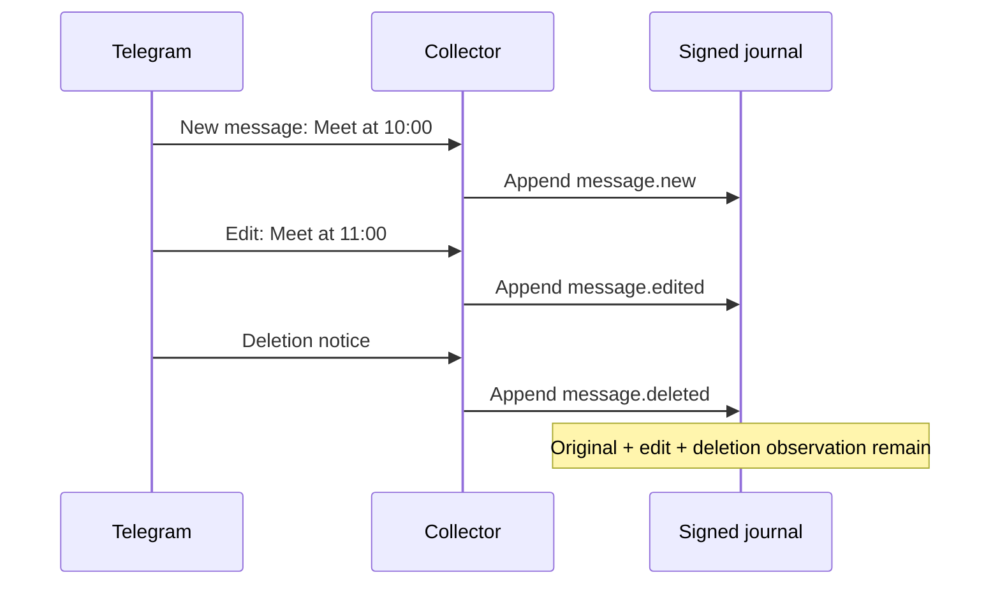
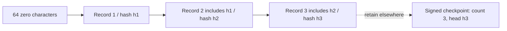
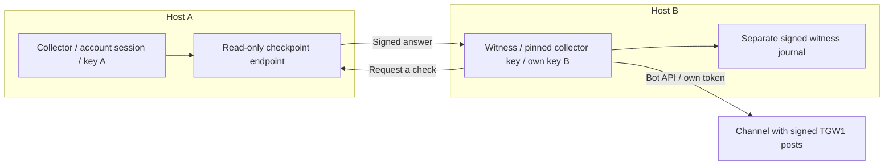

[TgWitness](../../README.md) / [Документация](../README.md) / [Папка](README.md) · [Доказательства и проверка](../EVIDENCE.md)

[English](../HOW-IT-WORKS.md) · **Русский**

# Следуйте содержанию сообщения. Разберитесь в фактах.

TgWitness сохраняет данные, зафиксированные сбором данных, объединяет эти данные
в подписанный журнал и позволяет другому пользователю проверить экспортированные данные на соответствие доверенному
ключу, внешнему времени от третьей стороны и ранее сохраненной контрольной точке.

На [веб-сайте с локальной документацией](../internal/PUBLISHING.md#preview-the-website-locally) добавлены
интерактивные примеры по адресу `/docs/concepts/`, инструмент для анализа решений на контрольных точках по адресу
`/docs/witness/`, а также пошаговые инструкции по [Case Board](../CASE-BOARD.md),
[составлению отчетов](../CASE_REPORTS.md) и [выдержкам из протоколов передачи дел](../EVIDENCE.md#handover-extract).
Все примеры сообщений,
количества и задержки являются вымышленными. Хэши в тестовой среде цепочки рассчитываются с помощью
алгоритма SHA-256 в браузере. Никакие данные не отправляются в Telegram.

На этой странице

- [Сообщение изменяется; накапливаются наблюдения](#a-message-changes-observations-accumulate)
- [Что охватывает хеш](#what-a-hash-covers)
- [Что добавляет более ранняя контрольная точка](#what-an-earlier-checkpoint-adds)
- [Куда относится свидетель](#where-a-witness-belongs)
- [Проверка выполнения по известным действиям](#test-delivery-against-known-actions)
- [Выберите рабочий процесс](#pick-a-workflow)

## Сообщение меняется; наблюдения накапливаются

В этой упрощённой последовательности предполагается, что Telegram доставил каждое обновление и выбранный
аккаунт смог его увидеть. Операционные события также записываются в журнал. Уведомление об удалении
не содержит информации об удаляющем пользователе или точном времени удаления. Повторные доставки считаются
отдельными наблюдениями; в журнале не предусмотрено подавление дубликатов.

## Что включает в себя хэш

Прочитайте формулу изнутри наружу: **C** преобразует девять полей в конкретные байты;
**SHA-256** вычисляет их дайджест; **hex** — это формат, в котором этот дайджест хранится. Предыдущий
хэш уже находится внутри события. **unhex** преобразует сохраненный хэш обратно в 32
байта, которые подписывает Ed25519.

[Схема статической цепи](../assets/presentation/evidence-chain-static.svg)

Пусть $C(e_i)$ — канонический JSON в кодировке UTF-8, состоящий из девяти полей события. Первая запись
`previous_hash` состоит из 64 нулей. Каждая последующая запись содержит шестнадцатеричный хеш предыдущей
записи:

$$
h_i = \operatorname{hex}(\operatorname{SHA256}(C(e_i)))
$$

$$
\sigma_i = \operatorname{Ed25519.Sign}(sk,\operatorname{unhex}(h_i))
$$

Подпись охватывает 32 байта исходного дайджеста. Входные данные для хеширования содержат ровно
`seq`, `observed_at`, `source_at`, `kind`, `chat_id`, `message_id`, `actor_id`,
`payload` и `previous_hash`. Ключи объектов отсортированы; пробелы и ASCII-
экранирование опущены; значения NaN и бесконечность отбрасываются. См.
[точную кодировку](../EVIDENCE.md#event-canonicalization).

| Внести изменения в прилагаемый журнал | Что это обнаруживает |
| --- | --- |
| Изменить запись № 2, сохранив при этом её хеш | Пересчитанный хеш события отличается; его сигнатура больше не охватывает измененное событие |
| Восстановить измененную запись и все последующие хэши | Проверка подлинности подписей завершилась неудачно; сохраненная контрольная точка на затронутой границе также не совпадает |
| Удалите конец, но оставьте оставшуюся часть префикса без изменений | Наличие более ранней сохраненной контрольной точки, расположенной за указанным префиксом, указывает на то, что экспортный файл слишком короткий |
| Переподписать журнал замены с использованием другого ключа | Отпечаток ключа, который считается отдельно доверенным, отклоняет замену идентификатора |

**Попробуйте применить эту логику к записи № 2:** замените `Meet at 11:00` на `Meet at 12:00` в
сохраненном событии. Пересчитанный хеш больше не совпадает. Пересчет последующей цепочки
позволяет восстановить её звенья, но не может заставить исходные подписи покрывать новые дайджесты.
В отличие от этого, зафиксированное редактирование в Telegram становится новой записью в журнале.

[Диаграмма изменения статических параметров](../assets/presentation/evidence-tamper-static.svg)

Сами по себе хеш-ссылки не препятствуют пересчету замещающей цепочки.
Доверие обеспечивается проверкой подписей с помощью независимого доверенного ключа, внешним
временем от третьей стороны, фиксирующим начало журнала, а также ссылками, хранящимися
вне коллектора.

## Что даёт использование более ранней контрольной точки

**Ссылка остаётся неизменной, в то время как журнал пополняется.** Если в контрольной точке указано:
«3 записи, заголовок h3», то экспорт из четырёх записей может пройти успешно, так как h3 совпадает с записью на третьей позиции.
Её новейший заголовок — h4, который, как и ожидается, будет отличаться. Экспорт, содержащий только две записи, завершится сбоем.

[Схема статической контрольной точки](../assets/presentation/evidence-checkpoint-static.svg)

После проверки подписи контрольной точки необходимо:

$$
N_{\mathrm{export}} \ge N_{\mathrm{checkpoint}}
\qquad\text{и}\qquad
h_{\mathrm{export}}[N_{\mathrm{checkpoint}}] = H_{\mathrm{checkpoint}}
$$

Экспорт может выходить за пределы контрольной точки. Он должен совпадать на сохраненной границе.
Ключ сборщика подписывает контрольную точку, поэтому сборщик может подписать и другую.
Он связывает записи только в том случае, если получатель получил их до архивирования через
другой канал; для подтверждения также требуется внешнее время от третьей стороны.
Настоящий верификатор также проверяет последовательность каждого события, предыдущую ссылку, хеш и
подпись. Сравнение только конечной сохраненной головки привело бы к пропуску измененной внутренней
записи, хеш которой не был обновлен.

## К какой категории относится свидетель

Свидетель фиксирует откат, смену заголовка при том же счёте, изменение ключей,
неверные ответы и отсутствующие ответы. Чтобы убедиться, что все предыдущие записи
остались неизменными, сравните экспорт с сохраненными контрольными точками. Наличие свидетеля на другом хосте позволяет избежать последствий сбоя хоста-сборщика;
отдельный оператор обеспечивает дополнительную независимость. Верификатор проверяет, что ключ свидетеля
отличается от ключа сборщика; запись о контроле ключей хранителя показывает, кто им владеет.
Telegram проставляет дату на каждом сообщении в публичном
канале, а `verify.py --channel https://t.me/s/…` считывает эти даты как внешнее время.

Свидетель подтверждает состояние журнала, сообщаемое сборщиком. Воспользуйтесь тестом с контролируемой
доставкой, чтобы определить, какие действия Telegram поступили на счет сборщика.
См. [настройка свидетеля](../WITNESS.md).

## Проверка выполнения по сравнению с известными действиями

Используйте контрольную группу, отдельные сборочные счета и новый маркер. Выполняйте отправку,
редактирование и удаление целенаправленно, проверяя правильность фиксации данных на каждом этапе. Определите ожидаемые
действия и предельное значение перед проверкой результатов.

$$
R = \frac{|\mathrm{наблюдаемое}\cap\mathrm{ожидаемое}|}{|\mathrm{ожидаемое}|}
\qquad\qquad
\Delta t = t_{\mathrm{получения}} - t_{\mathrm{действия}}
$$

Учитываются только совпадающие ожидаемые действия; дубликаты квитанций не увеличивают
числитель. Знаменатель должен быть не равен нулю. Для отсутствующей квитанции задержка не измеряется.
Учтите погрешность системного времени; используйте собственное контролируемое время удаления,
поскольку Telegram не предоставляет точное время удаления. Результат, например, 5/6
(83,3 %), описывает тестовые действия, а не полноту всего трафика Telegram.

## Выберите рабочий процесс

[Пошаговое руководство по расследованию](../INVESTIGATION.md) описывает ход событий,
произошедших в канале, группе, боте и личном чате:

1. На специальном сборе данных включите режим «Расследование всего аккаунта» и
   перечислите доступные чаты. Используйте выбранные чаты или папку в качестве основного аккаунта.
2. Соберите моментальные снимки журнала, полную историю каждого чата и сохраненные вложения.
3. Сохраняйте текущие изменения и любые целенаправленные взаимодействия с панелью вместе с подтверждениями.
4. Отслеживайте цифровые идентификаторы отправителей, связи между ответами, повторяющиеся адресаты и
   хэши файлов через упомянутые записи и профили пользователей.
5. Добавляйте привязанные к источнику заметки и коллекции в Case Board. Восстановите кросс-чат-
   временную шкалу с отметками времени и явными пробелами.
6. Сравнивайте рабочие пространства других учётных записей, сохраняя при этом их происхождение и ключи отдельно.
7. Соберите и проверьте подписанные журналы, профили и экспортированную историю с помощью заметок по делу.

Руководство по работе с сайтом `/docs/cases/` содержит интерактивную карту дел и варианты
решений для споров, связанных с ботами, удаленных сообщений и смены имен участниками. Case Board
хранит заметки и коллекции в рамках рабочего пространства. Групповой экспорт позволяет собирать отдельные
пакеты данных из рабочих пространств; сопоставление данных между рабочими пространствами и составление общей хронологии остаются
задачей аналитиков.

[Завершенная проверка и оставшиеся задачи](../VERIFICATION.md) ·
[Экспорт и проверка](../EVIDENCE.md#investigation-handoff) ·
[Начать с одной учетной записи](../QUICKSTART.md)
