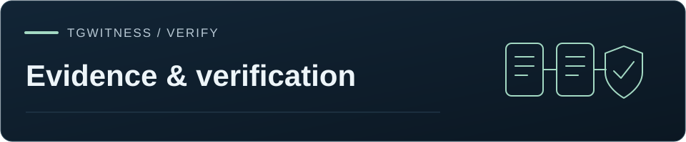
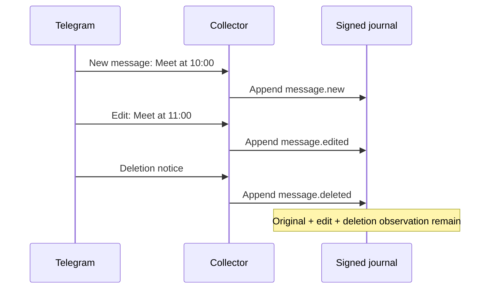
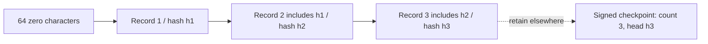
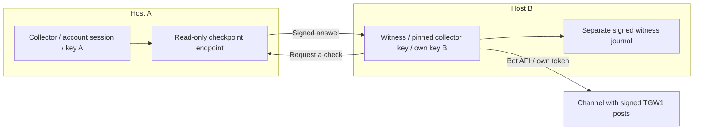

[TgWitness](../../README.md) / [Документация](../README.md) / [Папка](README.md) · [Доказательства и проверка](EVIDENCE.md)

[English](../HOW-IT-WORKS.md) · **Русский**

# Следите за сообщением. Разберитесь в доказательствах.

TgWitness сохраняет данные, зафиксированные аккаунтом-сборщиком, связывает эти наблюдения в подписанный журнал и позволяет другому лицу проверить экспорт по доверенному ключу, внешнему времени от третьей стороны и ранее сохраненной контрольной точке.

На [веб-сайте локальной документации](../internal/PUBLISHING.md#preview-the-website-locally) добавлены интерактивные примеры в разделе `/docs/concepts/`, инструмент для анализа решений по контрольным точкам в разделе `/docs/witness/`, а также пошаговые инструкции по работе с [Case Board](CASE-BOARD.md), [созданию отчётов](CASE_REPORTS.md) и [выдержкам для передачи дел](EVIDENCE.md#handover-extract). Все примеры сообщений, количества и задержки являются вымышленными. Хэши в тестовой среде цепочки рассчитываются с помощью алгоритма SHA-256 в браузере. Ничто не отправляется в Telegram.

На этой странице

- [Сообщение изменяется; накапливаются наблюдения](#a-message-changes-observations-accumulate)
- [Что охватывает хеш](#what-a-hash-covers)
- [Что добавляет более ранняя контрольная точка](#what-an-earlier-checkpoint-adds)
- [Где находится свидетель](#where-a-witness-belongs)
- [Проверка доставки по известным действиям](#test-delivery-against-known-actions)
- [Выберите рабочий процесс](#pick-a-workflow)

## Сообщение изменяется; накапливаются наблюдения

Эта упрощённая последовательность предполагает, что Telegram доставил каждое обновление и выбранный аккаунт мог его увидеть. Операционные события также фиксируются в журнале. Уведомление об удалении не содержит информации об удаляющем пользователе или точном времени удаления. Повторные доставки считаются отдельными наблюдениями; в журнале не предусмотрено подавление дубликатов.

## Что охватывает хеш

Прочитайте формулу изнутри наружу: **C** преобразует девять полей в конкретные байты; **SHA-256** вычисляет их дайджест; **hex** — это формат хранения данного дайджеста. Предыдущий хеш уже содержится в событии. **unhex** преобразует сохраненный хеш обратно в 32 байта, которые подписывает Ed25519.

[Схема статической цепочки](../assets/presentation/evidence-chain-static.svg)

Пусть $C(e_i)$ — канонический JSON в кодировке UTF-8, состоящий из девяти полей события. Первый хеш `previous_hash` состоит из 64 нулей. Каждая последующая запись содержит шестнадцатеричный хеш предыдущей записи:

$$
h_i = \operatorname{hex}(\operatorname{SHA256}(C(e_i)))
$$

$$
\sigma_i = \operatorname{Ed25519.Sign}(sk,\operatorname{unhex}(h_i))
$$

Подпись охватывает 32 байта исходного дайджеста. Входные данные для хеширования содержат именно `seq`, `observed_at`, `source_at`, `kind`, `chat_id`, `message_id`, `actor_id`, `payload` и `previous_hash`. Ключи объектов отсортированы; пробелы и ASCII-эскейпинг опущены; значения NaN и бесконечность отбрасываются. См. [точное кодирование](EVIDENCE.md#event-canonicalization).

| Изменение в предоставленном журнале | Что позволяет его обнаружить |
| --- | --- |
| Измените запись № 2, сохранив при этом её сохраненный хеш | Пересчитанный хеш события отличается; его подпись больше не охватывает измененное событие |
| Восстановите измененную запись и все последующие хеши | Первоначальные подписи не проходят проверку; сохраненная контрольная точка на затронутой границе также не совпадает |
| Удалите конец записи, но сохраните оставшийся префикс в неизменном виде | Более ранняя сохраненная контрольная точка, расположенная за пределами указанного префикса, показывает, что экспортный файл слишком короткий |
| Заново подпишите заменяющий журнал с помощью другого ключа | Отпечаток ключа, являющийся отдельным источником доверия, отклоняет замену идентификатора |

**Попробуйте применить эту логику к записи № 2:** измените `Meet at 11:00` на `Meet at 12:00` в сохраненном событии. Его пересчитанный хеш больше не совпадает. Пересчёт последующей цепочки может восстановить её звенья, но не может заставить исходные подписи покрывать новые дайджесты. Напротив, наблюдаемое редактирование в Telegram становится новой записью в журнале.

[Схема статических изменений](../assets/presentation/evidence-tamper-static.svg)

Сами по себе хеш-ссылки не препятствуют пересчёту цепочки замены. Доверие обеспечивается проверкой подписей с помощью независимого доверенного ключа, внешнего времени от третьей стороны, фиксирующей вершину журнала, а также ссылок, хранящихся за пределами сборщиков.

## Что добавляет более ранняя контрольная точка

**Ссылка остаётся неизменной, пока журнал растёт.** Если контрольная точка указывает «3 записи, вершина h3», экспорт из четырёх записей может пройти, сопоставив h3 в позиции 3. Его новейшая вершина — h4, которое, как ожидается, будет отличаться. Экспорт, содержащий только две записи, завершится неудачей.

[Схема статической контрольной точки](../assets/presentation/evidence-checkpoint-static.svg)

После проверки подписи контрольной точки необходимо:

$$
N_{\mathrm{export}} \ge N_{\mathrm{checkpoint}}
\qquad\text{and}\qquad
h_{\mathrm{export}}[N_{\mathrm{checkpoint}}] = H_{\mathrm{checkpoint}}
$$

Экспорт может выходить за пределы контрольной точки. Он должен совпадать на сохраненной границе. Ключ сборщика подписывает контрольную точку, поэтому сборщик может подписать и другую. Он связывает записи только в том случае, если получатель получил их до архивирования через другой канал; для обеспечения минимального уровня доказательности также требуется внешнее время от третьей стороны. Настоящий верификатор также проверяет последовательность каждого события, предыдущую ссылку, хеш и подпись. Сравнение только конечной сохраненной головки приведёт к пропуску измененной внутренней записи, хеш которой не был обновлён.

## Где находится свидетель

Свидетель фиксирует откат, наличие другой вершины при том же счёте, изменение ключей, неверные ответы и отсутствующие ответы. Чтобы подтвердить, что все более ранние записи остались неизменными, необходимо сравнить экспорт с сохраненными контрольными точками. Наличие свидетеля на другом хосте позволяет избежать последствий сбоя хоста сборщика; отдельный оператор обеспечивает дополнительную независимость. Верификатор проверяет, отличается ли ключ свидетеля от ключа сборщика; запись о контроле ключей хранителя показывает, кто им владеет. Telegram проставляет дату на каждом сообщении в публичном канале, а команда ``verify.py --channel https://t.me/s/…`` считывает эти даты в качестве внешнего времени.

Свидетель подтверждает состояние журнала, сообщённое сборщиком. Используйте тест контролируемой доставки, чтобы определить, какие действия в Telegram достигли аккаунта сборщика. См. [настройку свидетеля](WITNESS.md).

## Проверка доставки по известным действиям

Используйте контрольную группу, отдельные аккаунты-коллекторы и новый маркер. Намеренно отправляйте, редактируйте и удаляйте сообщения, проверяя их фиксацию между этапами. Определите ожидаемые действия и пороговое значение до начала анализа результатов.

$$
R = \frac{|\mathrm{observed}\cap\mathrm{expected}|}{|\mathrm{expected}|}
\qquad\qquad
\Delta t = t_{\mathrm{receipt}} - t_{\mathrm{action}}
$$

Учитываются только совпавшие ожидаемые действия; дубликаты квитанций не увеличивают числитель. Знаменатель должен быть не равен нулю. Отсутствующая квитанция не имеет измеримой задержки. Зафиксируйте погрешность часов; используйте собственное время контролируемого действия удаления, поскольку Telegram не предоставляет точное время удаления. Результат, например 5/6 (83,3 %), описывает тестовые действия, а не полноту всего трафика Telegram.

## Выберите рабочий процесс

[Полное руководство по расследованию](INVESTIGATION.md) прослеживает инцидент в канале, группе, боте и личном чате:

1. На специальном аккаунте для сбора данных включите режим расследования для всего аккаунта и составьте перечень доступных чатов. Для основного аккаунта используйте выбранные чаты или папку.
2. Получите моментальные снимки журнала, полную историю каждого чата и сохраненные вложения.
3. Сохраняйте текущие изменения и любые целенаправленные действия в панели управления вместе с квитанциями.
4. Отслеживайте цифровые идентификаторы отправителей, связи между ответами, повторяющиеся адресаты и хеши файлов через упомянутые записи и профили пользователей.
5. Добавляйте примечания и коллекции со ссылками на источники в Case Board. Восстановите хронологию событий, охватывающую несколько чатов, с указанием временных меток и явных пробелов.
6. Сравнивайте рабочие области других аккаунтов, сохраняя при этом их происхождение и ключи отдельно.
7. Соберите и проверьте подписанные журналы, профили и экспортированную историю с помощью верификатора.

Руководство на веб-сайте `/docs/cases/` содержит интерактивную карту дела и варианты действий в случае споров с ботами, удаленных сообщений и смены имен участниками. Case Board хранит заметки и коллекции в пределах одной рабочей области. Групповой экспорт собирает отдельные пакеты рабочих областей; межрабочая корреляция и объединенная временная шкала остаются задачей аналитиков.

[Завершённая проверка и оставшаяся работа](VERIFICATION.md) · [Экспорт и проверка](EVIDENCE.md#investigation-handoff) · [Начните с одного аккаунта](QUICKSTART.md)
