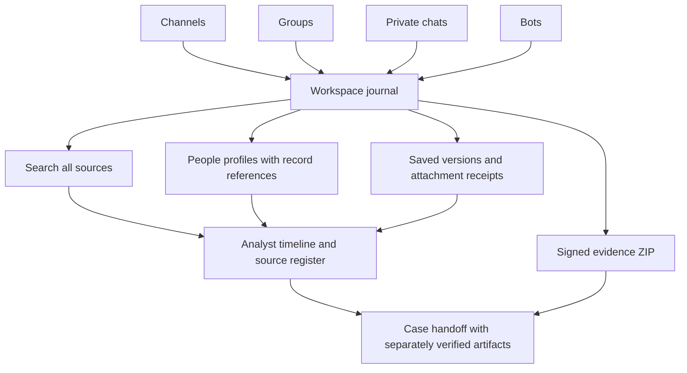

[TgWitness](../../README.md) / [Документация](../README.md) / [Папка](README.md)

[English](../INVESTIGATION.md) · **Русский**


<a id="an-investigation-across-all-account-visible-chats"></a>
# Проверка всех чатов, доступных для просмотра владельцем аккаунта

Отслеживайте ход дела по различным каналам, группам, личным чатам и ботам — от момента первоначального
поступления до указания сроков и подтверждаемой передачи дела. Интерактивная версия сайта
доступна по адресу `/docs/cases/`; [инструкции по предварительному просмотру](../internal/PUBLISHING.md#preview-the-website-locally).

<details>

<summary>На этой странице</summary>

- [Пример из практики: изменение пункта назначения в ходе четырёх диалогов](#worked-case-a-destination-changes-across-four-conversations)
- [1. Определить суть дела и собрать полную информацию об учетной записи](#1-define-the-case-and-collect-the-whole-account)
- [2. Проанализировать все источники и установить исторический контекст](#2-inventory-every-source-and-acquire-historical-context)
- [3. Отслеживать развитие дела и анализировать взаимодействия](#3-preserve-the-evolving-case-and-deliberate-interactions)
- [4. Установить связи между наблюдениями в разных чатах](#4-connect-observations-across-chats)
- [5. Составить хронологию событий по всем чатам](#5-build-the-cross-chat-timeline)
- [6. Добавьте точки зрения участников дела, не теряя их происхождения](#6-add-account-perspectives-without-losing-their-origin)
- [7. Скомпонуйте и проверьте передачу дела](#7-assemble-and-verify-the-case-handoff)
- [Адаптируйте расследование](#adapt-the-investigation)

</details>

<a id="worked-case-a-destination-changes-across-four-conversations"></a>
## Пример из практики: изменение пункта назначения в ходе четырёх диалогов

В сообщении упоминается бот. Группа операторов обсуждает новый адрес
получения платежа, и он отображается на клавиатуре бота. Сообщение редактируется,
в частном сообщении повторяется этот адрес, а групповое сообщение исчезает.

Вопросы следующие: что наблюдалось до и после изменения, какие аккаунты в Telegram
опубликовали каждый элемент, где появился пункт назначения, какие байты вложения
сохранились и какие интервалы остаются неизвестными?

Все имена, идентификаторы, временные отметки и ссылки на журналы в данном примере являются вымышленными. В
рабочем процессе используются актуальные функции; схема дела представляет собой иллюстрацию, а не автоматический
график, сгенерированный приложением.



<a id="1-define-the-case-and-collect-the-whole-account"></a>
## 1. Определить суть дела и собрать полную информацию

1. Подключите счет для сбора данных в отдельной рабочей области. В [Панели дел](CASE-BOARD.md)
   или в реестре дел зафиксируйте номер дела, ID счета, рабочую область и
   время начала наблюдения. Отдельно сохраните отпечаток доверенного ключа подписи.
2. Для выделенного сбора данных откройте **Дополнительные инструменты → Источники → Область действия → Режим расследования**. По умолчанию выбран
   **Весь аккаунт**, каналы/группы/личные чаты/боты, собственные действия, профили
   источников и последние 200 видимых сообщений для вновь обнаруженных источников.
   Проверьте настройки, нажмите **Сохранить область** и подтвердите выбор области.
   Для основных аккаунтов используется выбор чатов или папки; сбор данных со всего аккаунта
   доступен для аккаунтов, помеченных для расследования.
3. **Загрузите чаты** и сравните источники со списком диалогов аккаунта. Проверьте
   исключения. **Дополнительные инструменты → Параметры → Чаты, считываемые из списка аккаунта** по умолчанию
   установлено значение 1 000, максимально допустимое — 20 000. Источники, выходящие за пределы списка, добавляются, когда
   они становятся активными. Запишите, что было фактически перечислено.
4. В разделе **Дополнительные инструменты → Источники → Запись** выберите **Вся видимая активность** и сохраните
   настройки мониторинга. Проверьте типы вложений/ограничения и свободное место на диске.
5. Начните наблюдение. Проверьте отправку нового сообщения, редактирование и удаление, затем
   сохраните тестовые ссылки и все сбои.

Область действия «Весь аккаунт» фиксирует видимую для аккаунта активность в соответствии с сохраненными настройками в
чатах, к которым присоединился аккаунт. Секретные чаты фиксируются модулем [«Секретный чат»](../PSEUDO-SECRET.md),
а данные по существующим беседам заполняются через [«История»](HISTORY.md). См. [область сбора данных](COLLECTION.md#observation-scope-chosen-chats-a-folder-or-the-whole-account).

<a id="2-inventory-every-source-and-acquire-historical-context"></a>
## 2. Провести перечень всех источников и изучить исторический контекст

Ведите реестр источников, в котором на каждый чат приходится одна строка:

| Поле | Запись |
| --- | --- |
| Идентичность | Рабочая область, идентификатор учетной записи, числовой идентификатор чата, название и тип |
| Видимость | Членство/роль, подтвержденный или неподтвержденный доступ, исключения |
| Захват в реальном времени | Время начала, выбранные типы мероприятий и последующие изменения в правилах |
| История журнала | Запрос/выполнение моментального снимка, ограничение, время и ссылки на записи |
| Полная история | Имя файла экспорта для каждого чата, границы и статус завершения/сбоя |
| Вложения | Заполненные данные о полученных медиафайлах, хэши, размеры и результаты пропуска/сбоя |
| Охват | Сбои, неполный ввод данных, режим FloodWait, недоступные сообщения и другие пробелы |

Используйте подходящий метод сбора данных для каждого источника:

- Функция **Загрузить полную историю** в меню **Дополнительные инструменты → Источники → Чаты в области действия** загружает доступные прошлые
  сообщения из включенных источников в журнал рабочей области. Она поддерживает приостановку/возобновление
  и отчет о ходе с подписью. См. [получение истории](HISTORY.md).
- **Снимок истории** сохраняет последние видимые сообщения в журнал наблюдений.
  По умолчанию максимальное количество составляет 500; в разделе **Дополнительные инструменты → Параметры → Максимальный размер снимка истории** можно увеличить
  это значение до 10 000. Это текущие наблюдения истории, а не реконструированные правки.
- **Экспорт → Захват или экспорт одного чата → Экспорт полного чата** или **Чаты → Экспорт чата** извлекает
  текущую видимую историю одного чата в отдельный подписанный пакет `chat.json` /
  `chat.html`. Повторите эту операцию для источников дела и сохраните каждый результат.
- **При появлении нового чата или бота** можно сохранить его профиль и до 1 000 последних
  сообщений; в режиме расследования выбирается 200. Существующие чаты не получают эту
  информацию задним числом при включении режима.
- **Скачать видимые вложения** сохраняет байты в соответствии с настроенной политикой.
  Требуется полная квитанция `media.saved` с SHA-256 и подсчётом байтов. Задание в очереди,
  миниатюра или имя файла не являются сохраняемым вложением.

Полный экспорт чата **не** заполняет журнал или профили пользователей всеми
сообщениями. Для просмотра истории, которую необходимо
проанализировать в TgWitness, используйте функцию **«Загрузить полную историю»** или ограниченные снимки журнала. Перед запуском
просмотра истории проверьте список включенных источников. Ни один из этих способов не позволяет восстановить данные, которые Telegram больше не возвращает.

<a id="3-preserve-the-evolving-case-and-deliberate-interactions"></a>
## 3. Сохранение развивающейся ситуации и продуманных взаимодействий

В качестве приоритетных источников используйте активные чаты с ключевыми пользователями. Проанализируйте интервалы повторной проверки, ход
наверстывания пропущенного и результаты в СМИ. Во время работы с аккаунтом продолжайте наблюдение за сборщиком данных.
Используйте **«Чаты» → «Профиль» → «Сохранить профиль сейчас»**, чтобы сохранить метаданные источника, такие как
описания и команды бота. Это не связано с профилями пользователей, сформированными
на основе сохраненных сообщений.

Если дело связано с отслеживанием источника или взаимодействием с ботом:

1. **«Открыть ссылку в Telegram → Сохранить предварительный просмотр»** сохраняет указанную ссылку и
   отображаемый предварительный просмотр перед выполнением действия.
2. **«Присоединиться / открыть и наблюдать»** выполняет присоединение/открытие и отправляет стартовый
   параметр бота, если он указан. Запрос на присоединение, ожидающий одобрения, фиксируется как «в ожидании».
3. Текстовые ответы, отправленные через панель, и нажатия поддерживаемых кнопок сохраняют
   `interaction.requested` и `interaction.result`. Квитанции обратного вызова могут сохранять
   возвращаемый текст всплывающего окна, состояние оповещения и URL.

Это реальные действия с учетной записью. Нажатия на кнопку обратного вызова в другом приложении Telegram не
отображаются в системе сбора данных, хотя последующие сообщения или изменения могут быть зафиксированы.
Мини-клиент не поддерживает рабочие процессы, связанные с веб-приложениями, платежами, телефоном или местоположением.
Точное поведение описано в разделе [взаимодействие с панелями](COLLECTION.md#act-from-the-panel).

<a id="4-connect-observations-across-chats"></a>
## 4. Связывание наблюдений из разных чатов

В **Журнале** выберите **Все источники** и выполните поиск по записанному контенту. Откройте соответствующие
записи и сохраните рабочую область, чат, ID сообщения, последовательность и хеш записи.

В соответствующем чате откройте **«Люди» → «Включить профили»** и просмотрите информацию о пользователе:

- Имена/пользовательские имена, зафиксированные за определенный период, и числовой ID в Telegram.
- Связи ответов со ссылками на исходные записи.
- **Также в…** других чатах в этом журнале рабочего пространства, где этот ID оставлял сообщения.
- Активность, правки/удаления, а также упомянутые кошельки, телефоны, имена пользователей и ссылки.
- Сохраненные метаданные аватаров и похожие аватары из кэша с указанием их отдельного источника.

Перед использованием производного профиля в результатах поиска откройте упомянутые записи. Профили охватывают
лиц, у которых сохранены сообщения, а не всех участников группы. **Дополнительные инструменты → Параметры → Записи,
упомянутые в каждом факте** ограничивают список ссылок, но не количество соответствующих действий.
Упоминания и сходство аватаров являются ориентирами; принадлежность и идентичность определяются на основе числовых идентификаторов и указанных отправителей.

В подписанном досье подсказки кодировщика отделяются от пересланных и повторно использованных файлов в
`clients.forwarded` и `clients.reused`. Такие файлы не включаются в список
`clients.observed` или `media_timing.pre_existing`. Под повторно использованным файлом понимается
то, что тот же идентификатор документа Telegram ранее встречался в другом сообщении в
этом журнале, в рамках чатов, доступных читателю. Указывается его первая зафиксированная запись;
последующее появление или редактирование того же сообщения не считается повторным использованием.

В разделе досье `paid_reactions` хранится последняя доступная таблица лидеров Stars
для каждого перечисленного сообщения с указанием исходных записей и флагов анонимности.
Это данные на момент создания моментального снимка, а не суммы дополнительных выплат или полный список
людей, отреагировавших на сообщение. Моментальный снимок без таблицы лидеров не содержит заменяющего
списка. В этом разделе отображается информация об опущенных сообщениях, когда достигается предел отображения.

Списки наблюдения и экспорт индикаторов проверяют метки кнопок, URL-адреса, текст копирования, встроенные
запросы и байты обратного вызова, которые декодируются как допустимый UTF-8. Недопустимые или превышающие допустимый размер
кодировки обратного вызова пропускаются при извлечении текста; исходные байты остаются
в сохраненной записи. Существующие списки наблюдения требуют повторного сканирования для проверки старых записей
с этими дополнительными полями. Проверка не приводит к нажатию кнопки.

В примере с решением:

| Ссылка | Записи | Наблюдение с поддержкой |
| --- | --- | --- |
| Тот же аккаунт отправителя | Группа № 146 и индивидуальное наблюдение № 205 | Оба укажите ID отправителя в Telegram: 71001 |
| Тот же пункт назначения | № 146, клавиатура бота № 173, редактирование канала № 188, личное сообщение № 205 | Во всех есть тег `pay.example.invalid/new`; повторяющаяся ссылка ведет на материал |
| Тот же сохраненный файл | Завершены приемки носителей № 151 и № 209 | Полные значения SHA-256 совпадают для сохраненных байтов |
| Атрибуция каналов | № 101 и № 188 | Не приписывайте сообщение в канале пользователю 71001 без указания отправителя |

Сравнивайте хэши вложений и связанные с ними ссылки на сообщения, а также храните
хронологии аккаунтов, сгруппированные по Telegram-идентификаторам, указанным в этих записях.

Храните рабочие заметки команды на [доске дел](CASE-BOARD.md): добавьте в закладки записи,
на которые вы опираетесь, например № 146, № 188 и № 205, выделите точную целевую строку и
сохраните фрагмент каждого зафиксированного действия между двумя записями или в определенном временном диапазоне. Заметки
и статусы сохраняют результаты проверки команды в собственной подписанной истории, отдельно
от исходных наблюдений.

<a id="5-build-the-cross-chat-timeline"></a>
## 5. Создание ленты событий для всех чатов

Используйте сохраненные версии в **Чатах** и ссылки на их **записи в журнале №…**. В
**Журнале** объедините **Все источники** с **Изменениями**, **Удалениями** и **Охватом**.
Сохраните как `source_at` (если есть), так и `observed_at`.

| Примерное время наблюдения | Ссылка | Наблюдение |
| --- | --- | --- |
| 09:00 | Канал № 101 | Зафиксирован исходный пункт назначения |
| 09:12 | Группа № 146; СМИ № 151 | Опубликовано новое место назначения; загрузка файла завершена |
| 09:16 | Бот № 173 | Клавиатура указывает на новый пункт назначения |
| 09:20 | Канал № 188 | Объявление отредактировано; обе сохраненные версии остаются |
| 09:24 | Частный № 205; СМИ № 209 | Идентификатор отправителя совпадает с адресом получателя; байты файла сохранены без изменений |
| 09:28 | Группа № 231 | Получено уведомление об удалении; лицо, удалившее файл, и точное время удаления неизвестны |

Между приведенными в примере ссылками могут встречаться и другие записи. Порядковые номера определяют
последовательность наблюдений; моментальные снимки истории могут содержать более ранние даты источника и поступать позже,
чем текущие события. Различайте моментальные снимки, восстановленные сообщения, уведомления об удалении и
результаты, указывающие на отсутствие данных при повторной проверке. Обозначьте пробелы в охвате как неизвестные интервалы. Получение данных
истории позднее не устанавливает задним числом непрерывность наблюдений.

<a id="6-add-account-perspectives-without-losing-their-origin"></a>
## 6. Добавление перспектив учетной записи без потери информации об их происхождении

Используйте отдельную рабочую область для каждой отдельной учетной записи и повторяйте проверку её содержимого.
При каждом
сравнении фиксируйте идентификатор учетной записи, роль, отпечаток ключа подписи и ссылки на источник. Номера сообщений не являются глобальными идентификаторами, общими для всех чатов и учетных записей.

Case Board хранит заметки и коллекции со ссылками на источники в пределах каждого рабочего пространства.
На экране группы можно совместно просматривать статус учетных записей и объединять отдельные экспорты
из рабочих пространств. Сопоставляйте эти источники в своих заметках по делу или в инструментах анализа; каждый журнал
сохраняет собственное происхождение и ключ подписи. Глобальный поиск или объединенная временная шкала, охватывающая все рабочие пространства,
не формируются. Экспорт одного канала/супергруппы для нескольких учетных записей
позволяет получить историю чата с использованием подходящих учетных записей.

При выполнении более длительных работ следует обеспечить контроль с привлечением [независимого свидетеля](WITNESS.md).
Используйте проверки контролируемой доставки для оценки
маршрута доставки и видимости каждого счета.

<a id="media-recurrence-and-forwarding-sources"></a>
## Источники повторного появления и пересылки материалов в СМИ

В отчетах о доказательствах отдельно сравниваются идентификаторы документов Telegram и хэши SHA-256 из записей о сохраненных файлах.
В них отображаются отдельные сообщения, чаты, а также первое и последнее
сохраненное вхождение, с возможностью развертывания временной шкалы наблюдений в формате HTML. Повторные
снимки или правки одного и того же сообщения не увеличивают количество вхождений для
одного и того же ключа. Другой файл в отредактированном сообщении сохраняет собственное вхождение.

«Впервые замечено» соответствует порядку публикаций в журнале в рамках выбранного отчета. Это не
означает, что речь идет о самой ранней публикации в Telegram. Идентификаторы документов позволяют идентифицировать документы Telegram;
SHA-256 сравнивает сохраненные байты. Совпадающие 64-битные dHash-хэши разных сохраненных
изображений отображаются в качестве визуальных улик; при этом сравнении используются равные хэши, а не
поиск ближайшего соседа. Байты изображения должны совпадать с их сохраненным SHA-256 перед
анализом dHash; файлы размером более 64 MiB и изображения размером более 40 миллионов пикселей пропускаются.

В сводках «Источник-получатель» учитываются отдельные сообщения получателей. Идентификаторы участников в заголовках,
скрытые имена, подписи авторов сообщений и контекст «Сохраненных сообщений» остаются отдельными.
JSON-профиль пользователя включает источники каждого отправителя; сообщения канала также отображаются в
сводке на уровне чата. Именованный источник без идентификатора участника представляет собой группу текста, а не
идентифицированное лицо. Заголовки импортированных чатов остаются помеченными как импортированные.

К некомпактным ZIP-файлам с доказательствами относятся `media-repeats.json`, `forward-sources.json` и
`observed-sources.gexf`, защищённые манифестом архива. Граф GEXF 1.3 содержит
типизированные ребра `forwarded_from` и `recommended`. Стрелки идут от наблюдаемого чата
к упомянутому участнику. Веса рекомендаций учитывают сохраненные наблюдения
рекомендаций; веса пересылки учитывают отдельные сообщения. Скрытые имена и импортированные
заголовки не создают ребер идентичности. Ни одна операция над графом не разрешает профили и не
вызывает Telegram. Метаданные ребер включают исходные последовательности и хеши.

Сводки соответствуют выбранному фрагменту отчета; архив ZIP с данными по-прежнему содержит
полный подписанный журнал. Выборка, содержащая только события сообщений, сравнивает
идентификаторы документов; для сравнения сохраненных байтов и изображений требуются события сохранения файлов в
выбранном потоке. Текущая выборка облачных сообщений исключает `media.saved`.
Ограничения явно указаны: 200 000 сохраненных вхождений ключей/сообщений
на один анализ, 100 000 медиа-ключей, 20 групп отчетов, 100 хронологических
ссылок на группу и 1 000 экспортированных ребер графа. Когда достигается предел сравнения,
в результатах отображаются пропущенные вхождения, а подсчёты становятся нижними границами.
Ограничения на отображение хронологии и графов указываются отдельно. В компактных ZIP-архивах
эти производные сводки опускаются. Исходные записи с подписью остаются без изменений.

<a id="7-assemble-and-verify-the-case-handoff"></a>
## 7. Сборка и проверка передачи дела

Храните их вместе в папке с материалами дела, составленной аналитиком:

| Материал | Цель |
| --- | --- |
| Заметки по делу и реестр источников | Вопрос, методология сбора данных, доступ/роль, результаты, альтернативные объяснения и пробелы |
| Хронология событий | Время и ссылки на рабочую область, чат, сообщение или последовательность для каждой записи |
| Экспорт таблицы случаев и срезы, если они используются | Закладки с указанием источника, цитаты, заметки команды, коллекции, история изменений и выбранные записи, сверенные с ZIP-архивом с доказательствами |
| ZIP-архив с подписанными доказательствами для каждой рабочей области | Полный набор записанных журналов, манифестов и прилагаемых сохраненных носителей; панельные фильтры не ограничивают экспорт журналов |
| Отдельно подписанные файлы с данными о лицах | Проверка производных ссылок на соответствие данным рабочей области |
| Подписанные полные экспорты чата | Текущий учет видимых событий, отдельно от журнала наблюдений |
| Доверенные отпечатки, корневые сертификаты TSA и более ранние контрольные точки | Идентификатор ключа, внешнее время последней записи и сохраненные границы журнала |
| Артефакты свидетелей, если они настроены | Отдельный журнал, подписанные записи и отпечатки пальцев свидетелей |
| Результаты проверки и хэши предоставленных файлов | Что проверялось, какие байты были переданы и кому |

Из доверенной установки, с указанием имен файлов и фактических отпечатков каждого рабочего пространства:

```sh
python -m tgwitness.verify evidence.zip --fingerprint TRUSTED_PUBLIC_KEY_SHA256 --tsa-ca TSA-ROOT.pem --checkpoint retained-checkpoint.json --require evidence
python -m tgwitness.verify profiles-operations.json --fingerprint TRUSTED_PUBLIC_KEY_SHA256 --evidence evidence.zip
python -m tgwitness.verify history-channel.zip --fingerprint TRUSTED_PUBLIC_KEY_SHA256
python -m tgwitness.verify board-slice.json --evidence evidence.zip --fingerprint TRUSTED_PUBLIC_KEY_SHA256
```

`--require evidence` завершается с кодом 2, если отпечаток не совпадает и внешнее время
от третьей стороны не охватывает последнюю запись; контрольная точка служит в качестве дополнительной проверки.

Сохраните фактические результаты проверки и исходные артефакты. Экспортируйте заметки из рабочей области
Case Board вместе с цитируемыми исходными материалами. Сгруппируйте результаты, полученные в разных рабочих областях,
в каталоге дела верхнего уровня; каждый артефакт TgWitness имеет собственную
сигнатуру и процедуру проверки.

<a id="adapt-the-investigation"></a>
## Адаптировать расследование

| Дело | Трейс | Доставить |
| --- | --- | --- |
| Спор по поводу заказа/оплаты, инициированный ботом | Объявление о записи → предварительный просмотр сохраненной ссылки → параметр запуска бота → версии сообщений и клавиатуры → подтверждения обратных вызовов панели → последующие действия в личных сообщениях/группах | Были проанализированы временные рамки предложения и ответа, а также проверены источники; подтверждение оплаты получено из записи о платеже |
| Сообщения, удаленные после инцидента | Все затронутые чаты → сохраненные исходные версии/изменения → результаты удаления или отсутствия при повторной проверке → сохраненные медиафайлы → охват и другие аспекты учетной записи | Сохраненные варианты и явно обозначенные неизвестные интервалы; отсутствие вымышленного агента делеции |
| Участник использует разные имена в разных чатах | Числовой идентификатор отправителя → история имен/имен пользователей → ответы → другие просмотренные чаты → упомянутые адресаты/файлы | Хронология активности аккаунта в Telegram со ссылками на исходные записи |

[Ссылка на коллекцию](COLLECTION.md) · [Проверка профиля лица](EVIDENCE.md#people-profiles) ·
[Передача доказательств](EVIDENCE.md#investigation-handoff) · [Завершение проверки](VERIFICATION.md)
