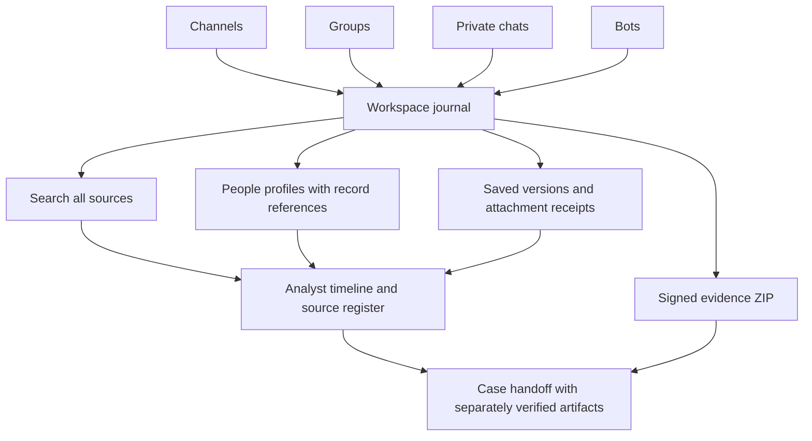

[TgWitness](../../README.md) / [Документация](../README.md) / [Папка](README.md)

[English](../INVESTIGATION.md) · **Русский**


<a id="an-investigation-across-all-account-visible-chats"></a>
# Расследование во всех чатах, доступных для просмотра с данного аккаунта

Отслеживайте дело по каналам, группам, личным чатам и ботам — от первоначального получения до указанной временной шкалы и подтверждаемой передачи. Интерактивная версия веб-сайта находится по адресу `/docs/cases/`; [инструкции по предварительному просмотру](../internal/PUBLISHING.md#preview-the-website-locally).

<details>
<summary>На этой странице</summary>

- [Пример из практики: изменение пункта назначения в четырёх диалогах](#worked-case-a-destination-changes-across-four-conversations)
- [1. Определите дело и соберите всю информацию о весном аккаунте](#1-define-the-case-and-collect-the-whole-account)
- [2. Проведите инвентаризацию всех источников и соберите исторический контекст](#2-inventory-every-source-and-acquire-historical-context)
- [3. Сохранение развивающихся дел и целенаправленных взаимодействий](#3-preserve-the-evolving-case-and-deliberate-interactions)
- [4. Связывание наблюдений между чатами](#4-connect-observations-across-chats)
- [5. Создайте временную шкалу, охватывающую несколько чатов](#5-build-the-cross-chat-timeline)
- [6. Добавляйте перспективы аккаунтов без потери их происхождения](#6-add-account-perspectives-without-losing-their-origin)
- [7. Сбор и проверка материалов дела](#7-assemble-and-verify-the-case-handoff)
- [Адаптация расследования](#adapt-the-investigation)
</details>

<a id="worked-case-a-destination-changes-across-four-conversations"></a>
## Пример из практики: изменение пункта назначения в четырёх диалогах

В объявлении указано на бота. Группа операторов обсуждает новый пункт назначения платежа, и он отображается на клавиатуре бота. Объявление редактируется, в частном сообщении повторяется пункт назначения, а групповое сообщение исчезает.

Возникают следующие вопросы: что наблюдалось до и после изменения, какие аккаунты Telegram опубликовали каждый элемент, где появился пункт назначения, какие байты вложения сохранились и какие интервалы остаются неизвестными?

Все имена, идентификаторы, временные отметки и ссылки на журналы в данном примере являются вымышленными. Рабочий процесс использует текущие функции; карта дела является иллюстрацией, а не автоматическим графиком, сгенерированным приложением.



<a id="1-define-the-case-and-collect-the-whole-account"></a>
## 1. Определите дело и соберите всю информацию о весном аккаунте

1. Подключите аккаунт для сбора данных в отдельной рабочей области. В [Case Board](CASE-BOARD.md) или в вашем реестре дел зафиксируйте ссылку на дело, идентификатор аккаунта, рабочую область и дату начала наблюдения. Отдельно сохраните отпечаток доверенного ключа подписи.
2. Для специальной учетной записи, предназначенной для сбора данных, откройте **Дополнительные инструменты → Источники → Область действия → Режим расследования**. По умолчанию выбраны параметры **Весь аккаунт**, «каналы/группы/личные чаты/боты», «собственные действия», «профили источников» и «последние 200 видимых сообщений» для вновь обнаруженных источников. Проверьте настройки, нажмите **Сохранить область** и подтвердите выбор области. Для основных аккаунтов используется выбор чатов или папки; сбор данных с всего аккаунта доступен для аккаунтов, помеченных для расследования.
3. **Загрузите чаты** и сравните источники со списком диалогов аккаунта. Проверьте исключения. В разделе **Дополнительные инструменты → Параметры → «Чаты**, **считываемые из списка аккаунта»** по умолчанию установлено значение 1 000, максимально допустимое — 20 000. Источники, выходящие за пределы этого лимита, добавляются по мере их активации. Зафиксируйте фактически перечисленные элементы.
4. В разделе **Дополнительные инструменты → Источники → Регистрация** выберите **Вся видимая активность** и сохраните настройки мониторинга. Проверьте типы вложений, ограничения на их размер и свободное место на диске.
5. Начните наблюдение. Проверьте отправку нового сообщения, его редактирование и удаление в контролируемом режиме, затем сохраните тестовые ссылки и информацию о любых сбоях.

Режим «Весь аккаунт» регистрирует видимую для аккаунта активность в соответствии с сохраненными настройками в чатах, к которым присоединился аккаунт. Секретные чаты регистрируются [модулем Секретные чаты](PSEUDO-SECRET.md), а существующие переписки заполняются из [Истории](HISTORY.md). См. [раздел Область сбора данных](COLLECTION.md#observation-scope-chosen-chats-a-folder-or-the-whole-account).

<a id="2-inventory-every-source-and-acquire-historical-context"></a>
## 2. Проведите инвентаризацию всех источников и соберите исторический контекст

Ведите реестр источников, в котором на каждый чат приходится одна строка:

| Поле | Запись |
| --- | --- |
| Идентификационные данные | Рабочая область, идентификатор аккаунта, числовой идентификатор чата, название и тип |
| Видимость | Членство/роль, подтверждённый или неподтверждённый доступ, исключения |
| Запись в реальном времени | Время начала, выбранные типы событий и последующие изменения политики |
| История журнала | Запрос/завершение создания моментального снимка, ограничение, время и ссылки на записи |
| Полная история | Имя файла экспорта с подписью для каждого чата, границы и статус завершения/сбоя |
| Вложения | Подтверждения получения медиафайлов, хеши, размеры и результаты (пропущенные/неудачные) |
| Охват | Перебои в работе, неполный приём данных, состояние FloodWait, недоступные сообщения и другие пробелы |

Используйте подходящий метод сбора данных для каждого источника:

- **Функция Загрузить полную историю** в разделе **Дополнительные инструменты → Источники → Чаты в области действия** загружает доступные прошлые сообщения из включённых источников в журнал рабочей области. Она поддерживает приостановку/возобновление и предоставляет отчёт о ходе с подписью. См. раздел [Сбор истории](HISTORY.md).
- **Снимок истории** сохраняет последние видимые сообщения в журнале наблюдений. По умолчанию максимальное количество составляет 500; в разделе **Дополнительные инструменты → Параметры → Максимальный размер снимка истории** это значение можно увеличить до 10 000. Речь идёт о текущих наблюдениях за историей, а не о реконструированных редакциях.
- **Экспорт → Захват или экспорт одного чата → Экспорт полного чата** или **Чаты → Экспорт чата** извлекает текущую видимую историю одного чата в отдельный подписанный пакет `chat.json`/`chat.html`. Повторите эту операцию для источников данного дела и сохраните каждый результат.
- **При появлении нового чата или бота** можно сохранить его профиль и до 1 000 последних сообщений; в режиме расследования выбирается 200. Существующие чаты не получают эти данные задним числом при включении данного режима.
- **Загрузка видимых вложений** сохраняет данные в соответствии с настроенной политикой. Требуется наличие заполненной квитанции `media.saved` с SHA-256 и указанием количества байтов. Задание в очереди, миниатюра или имя файла не являются сохраненным вложением.

Полный экспорт чата **не** заполняет журнал или профили участников всеми его сообщениями. Для анализа истории в TgWitness используйте функцию **Загрузить полную историю** или ограниченные снимки журнала. Перед запуском обработки истории ознакомьтесь со списком включенных источников. Ни один из этих способов не позволяет восстановить материалы, которые Telegram больше не возвращает.

<a id="3-preserve-the-evolving-case-and-deliberate-interactions"></a>
## 3. Сохранение развивающихся дел и целенаправленных взаимодействий

Отметьте активные чаты по делу звёздочкой в качестве приоритетных источников. Проверьте интервалы повторной проверки, непрерывное наверстывание пропущенных данных и результаты обработки медиафайлов. Оставьте сборщика в режиме наблюдения во время использования аккаунта. Воспользуйтесь **меню Чаты → Профиль → Сохранить профиль сейчас**, чтобы сохранить метаданные источника, такие как описания и команды ботов. Это отличается от профилей пользователей, формируемых на основе сохраненных сообщений.

Если дело связано с подпиской на источник или взаимодействием с ботом:

1. **Функция Открыть ссылку Telegram → Сохранить предварительный просмотр** фиксирует предоставленную ссылку и возвращённый предварительный просмотр перед выполнением действия.
2. Функция **Присоединиться/открыть и наблюдать** выполняет присоединение/открытие и отправляет стартовый параметр бота, если он указан. Запрос на присоединение, ожидающий одобрения, регистрируется как «находящийся в ожидании».
3. Текстовые ответы, отправленные через панель, и нажатия поддерживаемых кнопок сохраняют значения `interaction.requested` и `interaction.result`. Квитанции обратного вызова могут сохранять текст всплывающего окна, состояние оповещения и URL-адрес.

Это реальные действия аккаунта. Нажатия с обратным вызовом в другом приложении Telegram не видны сборщику, хотя последующие сообщения или изменения могут быть зафиксированы. Мини-клиент не выполняет рабочие процессы, связанные с веб-приложениями, платежами, телефоном или местоположением. Точное поведение см. в разделе [Взаимодействия с панелью](COLLECTION.md#act-from-the-panel).

<a id="4-connect-observations-across-chats"></a>
## 4. Связывание наблюдений между чатами

В **Журнале** выберите **Все источники** и выполните поиск по записанному контенту. Откройте соответствующие записи и сохраните рабочие области, чат, ID сообщения, последовательность и хеш записи.

В соответствующем чате откройте **Люди → Включить профили** и просмотрите информацию о пользователе:

- Имена/имена пользователей, подвергавшиеся наблюдению на протяжении времени, и числовой идентификатор Telegram.
- Связи ответов со ссылками на исходные записи.
- **А также в…** других чатах в журнале данной рабочей области, где этот идентификатор оставлял сообщения.
- Активность, правки/удаления, а также упомянутые кошельки, телефоны, имена пользователей и ссылки.
- Сохраненные метаданные аватаров и похожие кэшированные аватары с указанием их отдельного источника.

Откройте цитируемые записи, прежде чем использовать производный профиль в выводе. Профили охватывают людей, чьи сообщения сохранены, а не всех участников группы. **Дополнительные инструменты → Параметры → Записи, цитируемые по факту** ограничивают список ссылок, а не количество базовых действий. Упоминания и сходство аватаров являются ориентирами; принадлежность и личность определяются на основе числовых идентификаторов и приписанных отправителей.

Подписанное досье разделяет подсказки кодировщика от пересланных и повторно использованных файлов на категории `clients.forwarded` и `clients.reused`. Такие файлы не включаются в список `clients.observed` или `media_timing.pre_existing`. Под повторно использованным файлом понимается ситуация, когда один и тот же идентификатор документа Telegram был ранее замечен в другом сообщении в данном журнале в пределах чатов, доступных читателю. Цитируется его первое наблюдение; последующее наблюдение или редактирование того же сообщения не считается повторным использованием.

Раздел `paid_reactions` досье содержит последнюю доступную таблицу лидеров по «Звёздочкам» для каждого перечисленного сообщения с указанием источников записей и флагов анонимности. Это данные на момент создания моментального снимка, а не суммы дополнительных платежей или полный список людей, оставивших реакции. Моментальный снимок без таблицы лидеров не предоставляет заменяющего списка. Данный раздел сообщает об опущенных сообщениях при достижении предела отображения.

Списки наблюдения и экспорт индикаторов проверяют метки кнопок, URL-адреса, текст копирования, встроенные запросы и байты обратного вызова, которые декодируются как допустимый формат UTF-8. Недопустимые или превышающие допустимый размер кодировки обратного вызова пропускаются при извлечении текста; исходные байты остаются в сохраненной записи. Существующие списки наблюдения требуют повторного сканирования для проверки старых записей с этими дополнительными полями. В ходе проверки кнопка не нажимается.

В приведённом примере:

| Ссылка | Записи | Поддерживаемое наблюдение |
| --- | --- | --- |
| Один и тот же аккаунт отправителя | Группа № 146 и частное сообщение № 205 | В обоих случаях указан идентификатор отправителя в Telegram: 71001 |
| Одинаковый адресат | № 146, клавиатура-бота № 173, редактирование канала № 188, личное сообщение № 205 | Все сообщения содержат ссылку `pay.example.invalid/new`; повторяющийся адресат связывает эти материалы |
| Один и тот же сохраненный файл | Квитанции получения медиафайлов № 151 и № 209 | Полные значения SHA-256 совпадают для сохраненных байтов |
| Атрибуция канала | № 101 и № 188 | Не приписывайте сообщение в канале пользователю 71001 без указания отправителя |

Сравните хеши вложений и связанные с ними ссылки на сообщения, а также группируйте хронологии аккаунтов по Telegram-идентификаторам, указанным в этих записях.

Храните рабочие заметки команды на [Case Board](CASE-BOARD.md): добавьте в закладки записи, на которые вы опираетесь, такие как № 146, № 188 и № 205, выделите точную целевую строку и сохраните фрагмент каждого зафиксированного действия между двумя записями или в определенном временном диапазоне. Заметки и статусы сохраняют результаты проверки команды в собственной подписанной истории, отдельно идентифицируемой от исходных наблюдений.

<a id="5-build-the-cross-chat-timeline"></a>
## 5. Создайте временную шкалу, охватывающую несколько чатов

Используйте сохраненные версии в **чатах** и ссылки на **записи №…** в **Журнале**. В **Журнале** объедините **Все источники** с **Редактированиями**, **Удалениями** и **Охватом**. Сохраняйте как `source_at` (если указано), так и `observed_at`.

| Примерное время наблюдения | Ссылка | Наблюдение |
| --- | --- | --- |
| 09:00 | Канал № 101 | Зафиксировано исходное место назначения |
| 09:12 | Группа № 146; медиафайлы № 151 | Опубликован новый пункт назначения; загрузка файла завершена |
| 09:16 | Бот № 173 | Клавиатура указывает на новый пункт назначения |
| 09:20 | Канал № 188 | Объявление отредактировано; обе сохраненные версии остаются |
| 09:24 | Личное сообщение № 205; медиафайлы № 209 | Один и тот же идентификатор отправителя повторяет адресата; байты файла сохранены без изменений |
| 09:28 | Группа № 231 | Получено уведомление об удалении; удаляющий пользователь и точное время удаления неизвестны |

Между приведёнными примерами имеются и другие записи. Порядок наблюдений определяется порядковыми номерами; моментальные снимки истории могут содержать более ранние даты источника и поступать позже, чем текущие события. Различайте моментальные снимки, восстановленные сообщения, уведомления об удалении и результаты, указывающие на отсутствие данных при повторной проверке. Обозначайте пробелы в охвате как неизвестные интервалы. Получение данных истории позднее не позволяет задним числом установить непрерывность наблюдений.

<a id="6-add-account-perspectives-without-losing-their-origin"></a>
## 6. Добавляйте перспективы аккаунтов без потери их происхождения

Используйте отдельную рабочую область для каждого отдельного аккаунта и повторяйте его инвентаризацию. Сохраняйте идентификатор аккаунта, роль, отпечаток ключа подписи и ссылки на источники при каждом сравнении. Номера сообщений не являются глобальными идентификаторами, общими для всех чатов и аккаунтов.

Case Board хранит заметки и коллекции, привязанные к источникам, в пределах каждой рабочей области. На экране группы можно просматривать статус аккаунтов в совокупности и объединять экспорты из отдельных рабочих областей. Сопоставляйте эти источники в своих заметках по делу или в инструментах анализа; каждый журнал сохраняет своё происхождение и ключ подписи. Глобальный поиск или объединенная временная шкала, охватывающая все рабочие области, не формируются. Экспорт данных из нескольких аккаунтов для одного канала или супергруппы позволяет получить историю данного чата с использованием подходящих аккаунтов.

При выполнении длительных задач обеспечьте независимость с помощью [стороннего свидетеля](WITNESS.md). Используйте проверки контролируемой доставки для подтверждения пути сбора данных и видимости каждого аккаунта.

<a id="media-recurrence-and-forwarding-sources"></a>
## Источники повторного появления и пересылки медиафайлов

В отчётах о доказательствах отдельно сравниваются идентификаторы документов Telegram и хеши SHA-256 из записей сохраненных файлов. В них отображаются отдельные сообщения, чаты, а также первое и последнее сохраненное появление с расширяемой временной шкалой наблюдений в формате HTML. Повторные снимки или правки одного и того же сообщения не увеличивают количество появлений для одного и того же ключа. Отдельный файл в отредактированном сообщении учитывается как отдельное появление.

Показатель «Первое наблюдение» соответствует последовательности журнала в рамках выбранного отчёта. Он не указывает на самую раннюю публикацию в Telegram. Идентификаторы документов позволяют идентифицировать документы Telegram; алгоритм SHA-256 сравнивает сохраненные байты. Совпадающие 64-битные dHash-хеши различных сохраненных изображений отображаются в качестве визуальных ориентиров; при этом сравнении используются равные хеши, а не поиск ближайшего соседа. Байты изображения должны совпадать с их сохраненным SHA-256 перед анализом dHash; файлы размером более 64 MiB и изображения размером более 40 миллионов пикселей пропускаются.

В сводках по источникам пересылки учитываются отдельные сообщения-получатели. Идентификаторы участников в заголовках, скрытые имена, подписи авторов сообщений и контекст «Сохраненных сообщений» остаются отдельными элементами. JSON-файлы профилей пользователей включают источники каждого отправителя; сообщения канала также отображаются в сводке на уровне чата. Именованный источник без идентификатора участника представляет собой группу текста, а не идентифицированное лицо. Заголовки импортированных чатов остаются помеченными как импортированные.

Несжатые ZIP-архивы с доказательствами включают файлы `media-repeats.json`, `forward-sources.json` и `observed-sources.gexf`, защищённые манифестом архива. Граф GEXF 1.3 содержит типизированные ребра `forwarded_from` и `recommended`. Стрелки проходят от наблюдаемого чата к упомянутому участнику. Веса рекомендаций учитывают сохраненные наблюдения за рекомендациями; веса пересылки учитывают уникальные сообщения. Скрытые имена и импортированные заголовки не формируют ребрышки идентичности. Ни одна операция над графом не приводит к определению профилей или вызову Telegram. Метаданные ребрышек включают последовательности источников и хеши.

Сводки соответствуют выбору, указанному в отчёте; ZIP-архив с доказательствами по-прежнему содержит полный подписанный журнал. Выбор, содержащий только события сообщений, сравнивает идентификаторы документов; сравнение сохраненных байтов и изображений требует наличия событий сохраненных файлов в выбранном потоке. Текущий набор облачных сообщений исключает файл `media.saved`. Ограничения указаны явно: 200 000 сохраненных вхождений ключей/сообщений на один анализ, 100 000 медиафайлов, 20 групп отчётов, 100 ссылок на хронологию в каждой группе и 1 000 экспортированных ребер графа. При достижении предельного значения сравнения в результатах отображаются пропущенные вхождения, а подсчёты становятся нижними границами. Ограничения на отображение хронологии и графов указываются отдельно. В компактных ZIP-архивах эти производные сводки не включаются. Подписанные исходные записи остаются без изменений.

<a id="7-assemble-and-verify-the-case-handoff"></a>
## 7. Сбор и проверка материалов дела

Храните следующие материалы вместе в каталоге дела, сформированном аналитиком:

| Материалы | Цель |
| --- | --- |
| Заметки по делу и реестр источников | Вопрос, политика сбора данных, права доступа/роли, выводы, альтернативные объяснения и пробелы |
| Хронология | Указание даты и времени, а также ссылки на рабочую область, чат, сообщения и последовательность действий для каждой записи |
| Экспорт Case Board и её фрагментов, если они использовались | Закладки со ссылками на источники, цитаты, заметки команды, коллекции, история изменений и выбранные записи, сверенные с архивом доказательств в формате ZIP |
| Подписанный ZIP-архив с доказательствами для каждой рабочей области | Полный запись журнала, манифеста и включенных сохраненных медиафайлов; фильтры панели не ограничивают экспорт журнала |
| Отдельно подписанные файлы профилей участников | Проверка производных ссылок на соответствие доказательствам соответствующей рабочей области |
| Подписанные полные экспорты чатов | Сбор текущей видимой истории, отдельно от журнала наблюдений |
| Доверенные отпечатки, корневые сертификаты TSA и более ранние контрольные точки | Идентификатор ключа, внешнее время последней записи и сохраненные границы журнала |
| Артефакты свидетелей, если они настроены | Отдельный журнал, подписанные записи и отпечаток свидетеля |
| Результаты проверки и хеши доставленных файлов | Что проверялось, какие байты были переданы и кому |

Из доверенной установки с указанием имён файлов и фактических отпечатков каждой рабочей области:

```sh
python -m tgwitness.verify evidence.zip --fingerprint TRUSTED_PUBLIC_KEY_SHA256 --tsa-ca TSA-ROOT.pem --checkpoint retained-checkpoint.json --require evidence
python -m tgwitness.verify profiles-operations.json --fingerprint TRUSTED_PUBLIC_KEY_SHA256 --evidence evidence.zip
python -m tgwitness.verify history-channel.zip --fingerprint TRUSTED_PUBLIC_KEY_SHA256
python -m tgwitness.verify board-slice.json --evidence evidence.zip --fingerprint TRUSTED_PUBLIC_KEY_SHA256
```

Команда `--require evidence` завершается с кодом 2, если отпечаток не совпадает и время от третьей стороны не охватывает последнюю запись; контрольная точка служит вспомогательной проверкой.

Сохраните фактические результаты проверки и исходные артефакты. Экспортируйте заметки по рабочей области из Case Board вместе с цитируемым исходным материалом. Сгруппируйте результаты, полученные в разных рабочих областях, в каталоге дела верхнего уровня; каждый артефакт TgWitness имеет собственную подпись и процедуру проверки.

<a id="adapt-the-investigation"></a>
## Адаптация расследования

| Дело | Trace | Доставка |
| --- | --- | --- |
| Спор по заказу/оплате, инициированный ботом | Объявление о входе → предварительный просмотр сохраненной ссылки → параметр запуска бота → версии сообщений и клавиатурных команд → квитанции обратного вызова панели → последующие действия в личных сообщениях/группах | Проведено наблюдение за хронологией предложений и ответов, а также проверены источники; подтверждение оплаты получено из записи о платеже |
| Удаленные сообщения после инцидента | Все затронутые чаты → сохраненные оригиналы/редакции → результаты удаления или отсутствия при повторной проверке → сохраненные медиафайлы → охват и другие точки зрения аккаунта | Сохранены версии и явно обозначенные неизвестные интервалы; отсутствует вымышленный субъект удаления |
| Участник меняет имена в разных чатах | Числовой идентификатор отправителя → история имен/имен пользователей → ответы → другие чаты, подвергнутые наблюдению → указанные адреса/файлы | Хронология активности аккаунта Telegram со ссылками на исходные записи |

[Ссылка на сбор данных](COLLECTION.md) · [Проверка профилей пользователей](EVIDENCE.md#people-profiles) · [Передача доказательств](EVIDENCE.md#investigation-handoff) · [Завершённая проверка](VERIFICATION.md)
