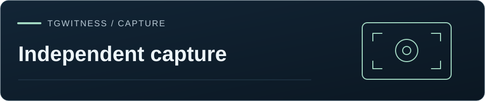

[TgWitness](../../README.md) / [Документация](../README.md) / [Папка](README.md) · [Независимый сбор данных](OPTIONAL-CAPTURE.md)

[English](../OFFICIAL-WITNESS.md) · **Русский**



<a id="official-client-witness"></a>
# Свидетель официального клиента

Предварительная версия официального клиента использует новый браузер на базе Chromium, в котором запущена [веб-версия Telegram](https://web.telegram.org/a/). Она обеспечивает пассивный просмотр или последовательную прокрутку, записывает видимый процесс с помощью FFmpeg и подписывает отображаемые наблюдения и видеофрагменты. Сборщик самостоятельно не выполняет вызовы API Telegram и не импортирует сеанс Telegram. Официальный клиент по-прежнему использует собственный протокол Telegram во внутреннем режиме.

| Режим | Что сохраняется | Область действия |
| --- | --- | --- |
| Официальный веб-клиент, пассивный режим | Видимые сообщения, скриншоты, отображённые страницы, видео без звука | Один выбранный видимый чат с ручной прокруткой в определённых пределах |
| Официальный веб-сайт, с фиксированным темпом прокрутки | Те же данные, с последовательной прокруткой и переменными паузами | Один выбранный видимый чат, ограниченный по времени, шагам и объёму хранения |
| Экспорт аккаунта через API | Структурированная история аккаунта и выбранные вложения | Экспорт через Takeout или стандартный API: выбранные чаты или весь видимый аккаунт |
| «Trusted Live» в локальном режиме | Официальный формат JSON для чатов в Desktop, видео и аннотации операторов, привязанные к кадрам | Отдельный локальный предварительный просмотр, ручная настройка, без подтверждения GitHub для данного веб-режима |

Официальное веб-наблюдение не заменяет полный экспорт аккаунта из Telegram Desktop. Выбирайте существующий [экспорт аккаунта,](ACCOUNT-EXPORT.md) если требуется полнота данных по выбранным чатам. Для ручного сбора данных из Telegram Desktop см. [Trusted Live](TRUSTED-LIVE.md), который сохраняет экспорт JSON для отдельного чата и имеет иную границу доверия. Данный веб-режим не фиксирует произвольные нажатия, ввод текста, посещения профилей, загрузку медиафайлов или автоматизацию в Telegram Desktop. Извлекаются только поля, отображаемые в данный момент; отсутствующие поля остаются недоступными, а исчезающие элементы DOM не регистрируются как удаления сообщений.

<details>
<summary>На этой странице</summary>

- [Запуск через GitHub Actions](#run-through-github-actions)
- [Локальное развертывание в Linux](#local-linux-deployment)
- [Поведение сети и аккаунта](#network-and-account-behavior)
- [Доказательства](#evidence)
- [Проверка](#validation)
</details>

<a id="run-through-github-actions"></a>
## Запуск через GitHub Actions

1. Откройте инструмент [для записи](https://phishdestroy.github.io/TgWitness/sealed.html), сохраните ключ получателя и включите Actions в своём форке.
2. Запустите **захват зашифрованного чата** с параметром ``client=official_web``, указав свой открытый ключ `recipient` и продолжительность сеанса.
3. Выберите `official_egress=proxy` (по умолчанию) и укажите `official_proxy` в формате `http://host:port` или `socks5://host:port` без учетных данных. Для аутентификации создайте секретные данные Actions в репозитории: `OFFICIAL_PROXY_USERNAME` и `OFFICIAL_PROXY_PASSWORD`. В качестве альтернативы явно выберите `official_egress=direct` и оставьте поле `official_proxy` пустым, чтобы использовать публичный IP-адрес раннера. Прямой режим не требует использования прокси или WARP, раскрывает адрес исполнителя Telegram и отмечается на панели, в подписанных настройках и отчёте о проверке. Необязательный параметр ``official_expected_ip`` требует указания адреса, наблюдаемого во время наблюдения, в любом из режимов. Маршрут не может изменяться во время сбора данных.
4. Расшифруйте файл `connection.tgwsealed` в вспомогательной программе и откройте временную панель. Выберите пассивное или поэтапное наблюдение, затем откройте официальный клиент. Отсканируйте QR-код с помощью вашего доверенного устройства Telegram; введите облачный пароль только в том случае, если этого требует официальная форма входа. В данной предварительной версии возможность ввода телефонного кода отсутствует.
5. Просмотрите отображаемый список чатов и выберите один из них. Перед началом записи загрузите **ожидаемые настройки** и сохраните этот файл отдельно. Источник нельзя изменить после начала записи.
6. Начните запись, затем приостановите её или завершите с помощью панели. Завершение записи приводит к запечатыванию видео перед попыткой официального выхода из системы. Если выход из системы не удаётся подтвердить, отмените этот временный сеанс в **настройках** Telegram **→ Устройства** на вашем доверенном устройстве.
7. Загрузите и расшифруйте файл `sealed-result`. Проверьте его с помощью независимой доверенной установки и GitHub CLI:

```sh
python -m tgwitness.sealed_verify evidence.zip --bundle attestation.jsonl --repo OWNER/TgWitness --expected-selection official-settings.json --confirm-drand
```

Утверждённый рабочий процесс запускает новый браузер и ключ подписи на запуске, размещённом на GitHub, закрывает сборщик до подтверждения и шифрует результат для получателя. Модифицированный рабочий процесс или неутверждённая версия сборщика не соответствуют политике верификатора. GitHub и официальный сайт Telegram остаются доверенными источниками; это не TEE. Наблюдатель может выбирать источник и время, поэтому по-прежнему необходимы независимые ожидаемые настройки и проверка охвата.

<a id="local-linux-deployment"></a>
## Локальное развертывание в Linux

Установите Docker Compose и используйте хост, поддерживающий пользовательские пространства имён Chromium. Рекордер работает без прав администратора хоста и с включённой песочницей Chromium. Предоставленный профиль seccomp позволяет вложенной песочнице пространства имён выполнять `chroot`. Не отключайте песочницу Chromium, чтобы обойти ошибку конфигурации хоста.

Скопируйте [конфигурацию регистратора](../../addons/capture/config/official.example.json) и [конфигурацию исходного сервера](../../addons/capture/config/official-upstream.example.json) в частный каталог. Укажите реальный адрес исходного сервера и, при необходимости, его учетные данные в файле исходного сервера, который монтируется только в прокси-мост. Для файлов с секретной информацией используйте режим доступа `0600`. Укажите пути для переменных `OFFICIAL_CAPTURE_CONFIG` и `OFFICIAL_UPSTREAM_CONFIG`, а затем запустите программу из корневого каталога репозитория:

```sh
docker compose --project-directory . -f addons/capture/compose.official.yaml --profile official up --build -d
docker compose --project-directory . -f addons/capture/compose.official.yaml --profile official exec official-recorder cat /data/control-token.txt
```

Откройте `http://127.0.0.1:8794` и введите токен локально. Не вставляйте его в заявку или чат. Запись по умолчанию отключена. Профиль браузера существует только во временном хранилище контейнера, а постоянный том содержит доказательства и ключи записывающего устройства. Для каждого аккаунта используйте отдельное имя проекта Compose и частную конфигурацию исходного сервера, например, опцию Compose `-p case-one`. Независимость от оператора обеспечивается внешним подтверждением GitHub или отдельным свидетелем контрольной точки; локальные подписи охватывают записанные байты.

В главном приложении в разделе **Дополнительные инструменты → Дополнительные функции → Независимая запись** можно подключиться к данному рекордеру в качестве браузерного рекордера. После проверки закреплённой идентичности панель перенаправляет к элементам управления официального клиента и скрывает несовместимые общие настройки браузера.

<a id="network-and-account-behavior"></a>
## Поведение сети и аккаунта

В режиме прокси по умолчанию у записывающего устройства имеется только внутренняя сеть Docker. Отдельный мост CONNECT направляет запросы через ровно один настроенный исходящий сервер HTTP или SOCKS5, включая аутентифицированный SOCKS5 через мост. При сбое исходящего сервера прямое соединение не устанавливается. Режим «explicit-direct» (явное прямое соединение), напротив, предоставляет браузеру обычную исходящую сеть Docker и фиксирует `explicit-direct` в подписанной процедуре; он не обеспечивает сокрытие IP-адреса или сетевую защиту Cloudflare. Оба режима отклоняют проверку недоступности выходного сервера, первоначальное несоответствие адресов или наблюдение за изменением адреса и повторно выполняют проверку примерно каждые тридцать секунд. Маршрутизация за пределами данного выходного сервера, например маршрутизация через Cloudflare или выделенный адрес, обеспечивается предоставленным сервером-провайдером. Отдельные запуски на GitHub могут иметь разные публичные IP-адреса.

Обычный Cloudflare Tunnel или Quick Tunnel представляет собой входной узел панели, а не выходной узел WARP. Общий WARP не даёт фиксированного публичного IP-адреса; для [выделенных выходных адресов Cloudflare](https://developers.cloudflare.com/cloudflare-one/traffic-controls/egress-policies/dedicated-egress-ips/) требуется соответствующая функция Enterprise. В данной предварительной версии не происходит автоматического развертывания коннектора Cloudflare WARP, политики Gateway DNS или независимо проверенного сетевого свидетеля, а в отчёте статус гарантии Cloudflare остаётся `INCOMPLETE` (неполный). Не следует рассматривать настроенную метку прокси в качестве такой проверки.

Официальный веб-сайт по-прежнему открывает новый сеанс Telegram и может отправлять уведомления о прочтении или отображать статус «онлайн». Сеанс регулируется переменными паузами и последовательными действиями; ограничения по аккаунту определяет Telegram. Механизм защиты блокирует ввод текста в окне создания сообщения, реакции, кнопки ботов, контекстные меню и произвольные запросы управления, а также останавливается при появлении неожиданных диалоговых окон, смене источника или потере авторизации. Сам клиент и хост остаются в пределах указанной границы доверия.

<a id="evidence"></a>
## Доказательства

Запись начинается после входа в систему и выбора источника. Скриншоты, MHTML, извлечённый видимый текст и метаданные отображённых сообщений хешируются и включаются в подписанный журнал. FFmpeg записывает примерно десятисекундные сегменты H.264 без звука, которые подписываются по мере их появления. Верификатор отклоняет отсутствующие или переставленные в другом порядке сегменты и помечает прерванные или некорректные окончания как неполные. Ни пароль для доступа к аккаунту, ни код входа, ни скриншот QR-кода намеренно не экспортируются. В случае восстановления авторизации защитный механизм приостанавливает наблюдение.

Наложение на видео включает часы записывающего устройства в формате UTC. По умолчанию записывающее устройство также загружает закреплённую публичную цепочку DRAND через тот же прокси-сервер, записывает новые раунды и отображает номер раунда. Сбой или устаревший маяк приостанавливает наблюдение. Параметр observation.`--confirm-drand` самостоятельно запрашивает публичный ретранслятор для завершения данной проверки. DRAND предоставляет ограничение «не ранее»; подписанные видеосегменты демонстрируют непрерывность. Для независимо сохраненного верхнего предела используйте [отдельную контрольную точку](../../addons/capture/README.md#independent-verification-and-witness) или внешнее подтверждение GitHub.

Для локального ZIP-архива проверьте независимо сохраненную идентичность записывающего устройства и ожидаемые настройки:

```sh
python -m tgwitness_capture verify official-evidence.zip --fingerprint RECORDER_SHA256 --expected-settings official-settings.json --confirm-drand
```

В отчёте отдельно перечислены завершение процедуры, аттестация среды и проверка Cloudflare. Параметр `--require-complete` отклоняет визуальный сеанс в качестве экспорта полной учётной записи. Видеозапись фиксирует наблюдаемый процесс, подписанные файлы выявляют последующие изменения, а запись о сборе данных идентифицирует захваченный материал и интервалы наблюдения.

<a id="validation"></a>
## Проверка

Автоматизированная приёмная проверка включает в себя тестирование реальной версии Chromium в изолированной среде, защищённую панель в форматах для настольных компьютеров и мобильных устройств, сбои прокси-сервера, несоответствие источника и настроек, проверку подписанного архива и прерывание видеозаписи. Система непрерывной интеграции (CI) под Linux дополнительно запускает фактический изолированный образ Docker с Xvfb и FFmpeg, проверяет отклоненные прямые соединения по IPv4 и IPv6, а также верифицирует записанные фрагменты. Была проверена совместимость селекторов на публичной странице Telegram с QR-кодом и на официальном веб-ресурсе. В этих тестах используются синтетические аутентифицированные шаблоны чатов; запись реального запуска данного режима на действующем аккаунте пока не была произведена.
