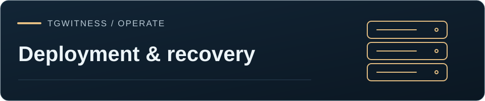
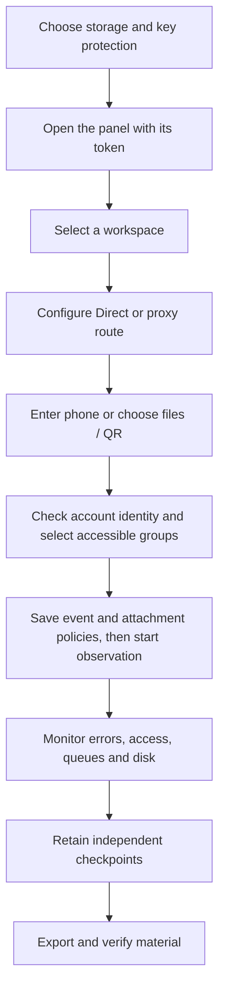
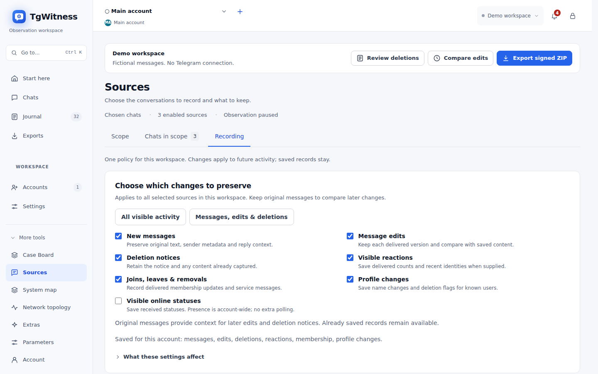
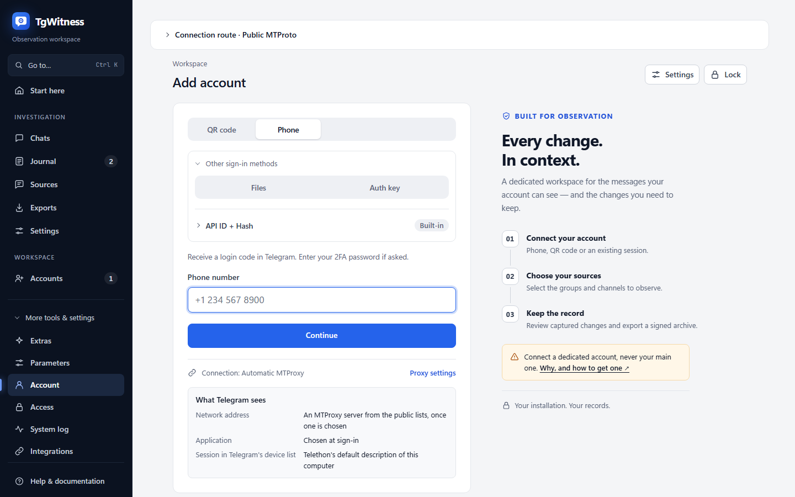

[TgWitness](../../README.md) / [Документация](../README.md) / [Папка](README.md) · [Развёртывание и восстановление](DEPLOYMENT.md)

[English](../OPERATIONS.md) · **Русский**



<a id="workflows-and-operations"></a>
# Рабочие процессы и операции

При первом подключении используйте [аккаунты и форматы сеансов](ACCOUNTS.md). Описание сохраненных версий, политик событий и пробелов см. в разделе [Как работает коллекция](COLLECTION.md). В данном руководстве рассматриваются повседневная эксплуатация и восстановление.

Управляемая установка включает **файлы START-HERE.html** и **START-HERE.txt** рядом с программой запуска, содержащие ссылку на репозиторий и команды, адаптированные к пути установки. Запустите команду ``tgwitness guide --print`` через SSH или ``tgwitness paths``, чтобы определить фактический каталог данных. При установке в корневой каталог с помощью systemd частные данные хранятся в каталоге ``/var/lib/tgwitness-…``; программа находится в каталоге ``/opt/tgwitness``.

Для управляемого временного туннеля Cloudflare команда `tgwitness tunnel off` закрывает публичный доступ, при этом локальная панель управления и сбор данных продолжают работать. Команда `tgwitness tunnel on` включает его; команда `tgwitness tunnel restart` создаёт новое туннельное соединение. Используйте команду `tgwitness open`, чтобы увидеть его текущий адрес. Явное отключение сохраняется после перезапуска службы. Команда `tgwitness stop` останавливает как панель управления, так и сбор данных.

<details>
<summary>На этой странице</summary>

- [Рабочий процесс оператора](#operator-workflow)
- [Совместная работа без передачи главного ключа](#share-work-without-sharing-the-main-key)
- [Режимы работы](#runtime-modes)
- [Категории мониторинга](#monitoring-categories)
- [Уведомления](#notifications)
- [Структура панели](#panel-layout)
- [Среды развертывания](#deployment-environments)
- [Проверки при запуске и экспорт](#startup-checks-and-exports)
- [Резервное копирование, восстановление и прерывания](#backup-restore-and-interruptions)
- [Емкость и срок хранения](#capacity-and-retention)
</details>

<a id="operator-workflow"></a>
## Рабочий процесс оператора



Авторизация, транспортная связь, доступ к группе и полнота доставки представляют собой различные свойства. Зелёный статус соединения не означает, что все события были зафиксированы.

<a id="share-work-without-sharing-the-main-key"></a>
## Совместная работа без передачи главного ключа

Откройте **Дополнительные инструменты → Доступ**, чтобы предоставить рецензенту или аналитику собственный токен. Выберите аккаунты и чаты, которые они смогут открывать, а затем разрешите просмотр, экспорт или операционные действия. Оператору, запускающему или останавливающему сбор данных, требуется доступ к всей рабочей области; доступ рецензента может быть ограничен одним чатом. Ограничения сеансов, срок действия и правила IP-адресов не связаны с авторизацией аккаунта Telegram. См. раздел [Доступ и разрешения](ACCESS.md).

Используйте **Открытые сеансы,** чтобы прервать соединение, или отзовите доступ, чтобы завершить все его сеансы. Консоль администратора объединяет данные о текущей активности во всех рабочих областях. Закрытие сеанса не останавливает сбор данных.

<a id="runtime-modes"></a>
## Режимы работы

| Режим | Действие | Поведение |
| --- | --- | --- |
| Демо | scripts\Demo.cmd или `--demo` | Синтетические данные; подключения к реальным аккаунтам отключены |
| Наблюдение | Начать наблюдение | Запись поступивших обновлений для выбранных источников |
| Снимок истории | Чаты → Действия в чате → Загрузить историю | До 500 текущих сообщений; реконструкция всех прошлых изменений не производится |
| Приостановить | Приостановка наблюдения | Остановить сбор данных с сохранением данных и заданий в очереди |
| Просмотр/передача | Экспорт | ZIP, JSONL/CSV/HTML, контрольная точка, квитанция о обработке и запрос с отметкой времени |
| Несколько аккаунтов | Рабочие области или кнопка **+** вверху | Любое количество отдельных рабочих областей в рамках одного процесса |

Доступ к локальной демо-версии открывается автоматически без ручного ввода токена. Он использует возможность, действующую на протяжении всего срока жизни процесса и действительную только для прямого доступа по петле к изолированной синтетической демо-версии; токен главной панели не раскрывается. Реальные рабочие области, а также удаленный или проксированный доступ к демо-версии сохраняют аутентификацию по токену. Вход в демо-версию не предоставляет авторизации в Telegram.

<a id="monitoring-categories"></a>
## Категории мониторинга



В разделе **Дополнительные инструменты → Источники → Запись → «Выберите**, **какие изменения сохранить»** выберите по отдельности новые сообщения, правки, уведомления об удалении, обновления реакций и события, связанные с членством. По умолчанию сохраняются все категории. Настройка **Сообщения, правки и удаления** сохраняет исходный контекст, отключая при этом отдельные обновления реакций и события, связанные с членством. Опция **Вся видимая активность** восстанавливает все пять категорий. Предустановленные настройки изменяют форму; нажмите **Сохранить настройки записи** для применения.

Сохраненная политика применяется ко всем выбранным источникам в данной рабочей области. Другие рабочие области сохраняют свои собственные настройки. Каждое фактическое изменение фиксируется с указанием подписанных значений «до» и «после»; текущая политика также включается в квитанции о обработке и записи о начале наблюдения. Отключение категории не приводит к удалению ранее зафиксированных наблюдений. Повторное включение не восстанавливает пропущенные изменения. В данной версии отсутствует возможность переопределения категорий на уровне отдельных групп.

Оставляйте функцию «Новые сообщения» включённой, если важно сохранить предыдущее содержимое: уведомление об удалении не может восстановить текст, который никогда не был зафиксирован. Записи об эксплуатации/покрытии и другие события группового обслуживания всегда сохраняются. Явные моментальные снимки истории отделены от выбора категорий в режиме реального времени и могут включать служебные сообщения. Эти переключатели не редактируют метаданные реакций/участников, встроенные в иначе зафиксированный объект Telegram.

Снимок истории может помещать в очередь вложения во время приостановки. Начните наблюдение, чтобы обработать их. Нахождение в очереди не означает, что файл загружен. Недоступный исходный файл не заменяется более новой отредактированной версией; результаты фиксируются отдельно.

**Блокировка** очищает доступ браузера и секретные поля, но оставляет сбор данных в рабочем состоянии. Закрытие вкладки также не останавливает процесс. Остановка процесса Python или службы останавливает сбор данных независимо от состояния браузера.

Дополнительная рабочая область можно удалить после полной загрузки подписанного ZIP-архива или контейнера ASiC-E, содержащего его журнал и заметки на Case Board. Подготовки архива недостаточно: запись, не относящаяся к событиям настройки, или заметка, добавленная после загрузки, делает **функцию Удалить** недоступной.

Когда панель получает сам файл, она учитывает экспорт только после получения каждого байта, а затем сообщает размер по запросу `POST /api/exports/{id}/received`; прерванная загрузка не учитывается. При использовании диалога выбора места сохранения в браузере (доступ к файловой системе) панель сообщает об этом после записи и закрытия файла. В отсутствие такого диалога панель передаёт полученный файл в список загрузок браузера и не может определить, сохранил ли браузер файл, например, если диалог сохранения был отменен; в таком случае панель сообщает, что загрузка началась, а не о том, что файл был сохранен. Файл, загружаемый браузером самостоятельно (экспорт, размер которого превышает буфер браузера панели), а также загрузка, осуществляемая другим HTTP-клиентом, учитываются после отправки сервером полного ответа. Операционная система и обратный прокси-сервер буферизуют несколько мегабайт ответа, поэтому в случае таких загрузок сервер не может определить разрыв вблизи конца. Если панель не сообщила о сохранении файла, проверьте загруженный файл перед удалением. Групповой экспорт учитывается для соответствующих аккаунтов, если он загружен сразу после подготовки; повторная загрузка из раздела **Подготовленные экспорты** не учитывается.

Перед удалением панель отображает формат, размер, время подготовки и SHA-256 последнего загруженного подписанного архива и запрашивает подтверждение того, что данный архив сохранен за пределами рабочей области. Сервер отклоняет запрос `DELETE /api/profiles/{id}`, если для параметра `kept_copy` не установлено значение, соответствующее данному SHA-256 (или значение `confirmed` для архива, загруженного до записи отпечатка).

Удаление дополнительной рабочей области останавливает работу её сборщика и удаляет локальные данные. Если удаление прерывается из-за заблокированного файла или ошибки файловой системы, панель сообщает об ошибке и оставляет рабочую область в списке как недоступную (`DeletionPending`). Закройте программы, в которых открыты её файлы, и повторите попытку **удаления**. Перезапуск TgWitness оставляет данную рабочую область в остановленном состоянии и не восстанавливает её частично удалённый журнал или ключи. Успешное удаление фиксируется только после удаления каталога; отдельно экспортированные или скопированные в резервную копию файлы остаются в соответствии со своей собственной политикой хранения.

<a id="notifications"></a>
## Уведомления

Откройте **Настройки → Уведомления и Внешняя копия → Пункты назначения уведомлений** или **Дополнительные инструменты → Дополнительные функции → Уведомления → Настроить**. TgWitness использует Apprise для отправки оповещений в Matrix, Telegram, Discord, Slack, ntfy, по электронной почте и в другие поддерживаемые сервисы. К одной рабочей области можно добавить несколько пунктов назначения.

1. Введите один URL-адрес назначения Apprise в каждой строке. Воспользуйтесь [каталогом сервисов и форматами URL-адресов](https://appriseit.com/services/), соответствующими вашему сервису.
2. Включите параметр **Отправлять уведомления**, затем выберите оповещения о проблемах, изменениях в чатах, подлежащих наблюдению, и ежедневную сводку. Время в сводке определяется по серверному времени.
3. Включите параметр **Включать краткие выдержки,** если хотите, чтобы в оповещениях отображался сохраненный текст из удалённых и отредактированных сообщений.
4. Нажмите **Сохранить уведомления**, а затем **Отправить тестовое сообщение,** чтобы проверить доставку.

Для собственного получателя используйте [веб-хук JSON](https://appriseit.com/services/json/) от Apprise. Например, `jsons://notify.example.org/tgwitness` отправляет JSON по HTTPS на этот конечный пункт. Это вымышленный пример; замените его своим собственным пунктом назначения.

Пункты назначения и настройки относятся к выбранной рабочей области. Уведомления об изменениях охватывают источники, подвергающиеся наблюдению, включая недавно добавленные чаты. Значок колокольчика в верхней панели также отображает недавние проблемы и изменения в чатах.

В демо-версии элементы управления уведомлениями отображаются, но отправка отключена. Настройте доставку в реальной рабочей области. Уведомления используют маршрут Direct, SOCKS5 или HTTP данной рабочей области; MTProxy не может их передавать. Для пунктов назначения, отличных от HTTP, таких как SMTP, требуется прямой маршрут.

<a id="panel-layout"></a>
## Структура панели



**Журнал** отображает наблюдения, поиск и фильтры. При нажатии кнопки «Редактировать» открываются сохраненные версии; при нажатии кнопки «Удалить» — предыдущее содержимое, если оно доступно. Неизвестные источники остаются явно обозначенными. Статистика доступна в разделе **Обзор**; подробности о получении данных хранятся в локальном справочнике.

Откройте отредактированное сообщение, чтобы сравнить его версии с помощью **функции Встроенное сравнение** или **Рядом**; **в разделе Исходные данные** отображаются сохраненные поля. Изменения в скрытых ссылках и кнопках ботов отображаются отдельно. Откройте предварительный просмотр вложения, чтобы просмотреть сохраненные изображения, аудио- или видеофайлы; кнопка загрузки обеспечивает доступ к сохраненному оригиналу.

Журнал и чаты обновляются **в режиме реального времени** по мере поступления записей. Вы можете приостановить обновление на время просмотра или воспользоваться кнопкой «Новые события», когда будете готовы; сбор данных при этом продолжается. **Комбинация клавиш Ctrl/Cmd+K** позволяет найти действия панели и выполнить поиск в журнале.

**Дополнительные инструменты → Источники** содержит область наблюдения (выбранные чаты, папку Telegram или Весь аккаунт), доступные чаты всех типов, выбранные источники с звездочками приоритета, настройки вложений и повторной проверки, а также снимки истории. Частные источники выбираются по диалогу/ID без публичной ссылки. Статус доступа описывает последнюю проверку, а не постоянные разрешения.

Отфильтруйте источники, установите флажки напротив них, а затем одновременно включите, приостановите или пометьте их как приоритетные. В списке доступных чатов функция **Добавить выбранное** использует ваш выбор; функция **Добавить все подходящие** — текущий поиск и фильтр по типу.

**В разделе Чаты → Люди** отображаются все пользователи с сохраненными сообщениями; если для данного чата включена функция просмотра профилей участников, щелчок по имени открывает профиль этого человека со ссылками на записи в дневнике.

**Дополнительные инструменты → Дополнительные функции → Независимый свидетель** создаёт токены свидетеля, доступные только для чтения, показывает, когда каждый свидетель проверялся в последний раз, и предоставляет команды и параметры для запуска одного из них ([независимого свидетеля](WITNESS.md)).

**Дополнительные инструменты → Параметры** содержит все ограничения и настройки рабочей области, которые не указаны на других страницах: количество прочитанных диалогов, частота перечитывания списка чатов, интервалы пульсации и контрольных точек, буфер запуска, способ распределения запросов при повторной проверке (начальная задержка, количество чатов за проход, пауза между чатами, восстановленные и повторно запрошенные сообщения), резерв дискового пространства, таймауты и повторные попытки загрузки, параметры поиска профилей пользователей (включая ваши собственные регулярные выражения), размер и частота уведомлений, ограничения на создание снимков, ZIP-архивы и загрузку через браузер, а также таймауты и повторные попытки клиента Telegram. В каждом поле отображается его диапазон значений и значение по умолчанию; изменённые поля помечаются и могут быть восстановлены по отдельности или все сразу. Каждое изменение фиксируется в виде записи `parameters.changed` с указанием значений до и после, а записи о начале наблюдения фиксируют действующие значения. Значения вступают в силу при следующем использовании; таймауты и повторные попытки клиента — при следующем подключении. Интервалы повторной проверки, типы и размеры вложений, интервалы внешней копии и копирования остаются на отдельных страницах и могут принимать любые значения в пределах своего диапазона, а не только предустановленные значения.

Звоночек в верхней панели отображает список недавних проблем и изменений в чатах во время наблюдения; непрочитанные сообщения подсчитываются до тех пор, пока не будут помечены как прочитанные. Изменения сгруппированы по чатам и часам («12 удалено, 1 отредактировано, 0 не найдено»), а такие проблемы, как выход из системы или переполнение диска, остаются в списке независимо от загруженности чатов.

**Дополнительные инструменты → Аккаунт** начинается с поля для ввода номера телефона. **Нажатие Продолжить** ведёт непосредственно к вводу кода; запрос учетных данных API происходит только в случае их отсутствия. Вкладки «QR-код» и «Импорт файлов» представляют собой альтернативные варианты. Сохраненные учетные данные API используются повторно только в пределах собственной рабочей области. Экран входа не содержит боковой панели, статистики или разделов настроек. Значок **Настройки** открывает управление API, прокси, хранилищем и дополнительными аккаунтами. Новая рабочая область открывает [первоначальную настройку](SETTINGS.md); после входа в систему рабочая область с сохраненными источниками и записями открывает **раздел Чаты**. Изменение маршрута требует приостановки наблюдения и отменяет незавершённый вход в систему. Существующий журнал нельзя автоматически привязать к другому аккаунту Telegram.

**Функция Экспорт** проверяет целостность журнала и создаёт переносимые файлы. Идентификатор рабочей области можно передать в командную строку для загрузки. Каждый экспорт фиксирует префикс полного журнала; последующие события попадают в следующий экспорт. Фильтры поиска не изменяют область действия пакета. Подробная информация о подписи и охвате находится в разделе **Верификация и доказательства**.

На панели в разделе «Состояние сборщика» отображаются данные о состоянии сборщика, медиафайлах в очереди или с ошибками, самых старых медиафайлах в ожидании, свободном месте на диске, приостановках запросов и источниках с неподтверждённым доступом. Эти сведения изначально свернуты и скрыты на вкладке «Аккаунт». На карте настроек указан следующий шаг: подключить аккаунт, выбрать источники или начать наблюдение. Список аккаунтов представляет собой моментальный снимок на момент загрузки; выбранная рабочая область периодически обновляется. Данный инструмент не является многопроцессным монитором SLA.

В пользовательском интерфейсе для отображения содержимого источников используются локальные ресурсы и рендеринг текста. Проверены макеты для настольных компьютеров и узкоформатных устройств на базе Chromium.

<a id="deployment-environments"></a>
## Среды развертывания

| Среда | Установка | Статус проверки |
| --- | --- | --- |
| ПК/сервер под управлением Windows | Python 3.11 и выше, папка scripts\Setup.cmd/Start.cmd, каталог с личными данными | Проверено локально на Windows/Python 3.12 |
| Сервер/VPS под управлением Linux | Python venv, выделенный пользователь службы, HTTPS/SSH | Предоставлены примеры кода, CI и systemd; на данном хосте не запускались |
| macOS | Python venv, процесс в фоновом режиме или пользовательский агент | Приведён пример с использованием launchd; требуется отдельная проверка установки |
| Docker/Compose | Постоянный том, один рабочий процесс | Предоставлено определение и проверка среды выполнения CI; Docker недоступен локально |
| Браузер мобильного устройства | Подключение к защищённой панели на работающем сервере | Протестирована узкая верстка Chromium; сборщик не работает на iOS/Android |

Переносимость означает отсутствие обязательного использования облачного сервиса или сборки интерфейса. Каждая целевая среда по-прежнему требует наличия совместимых зависимостей Python/crypto, доступа к локальному диску и сети. См. [файл DEPLOYMENT.md](DEPLOYMENT.md) и [шаблоны сервисов](../../deploy/README.md).

Рабочие области совместно используют ЦП, память и цикл событий. Для изоляции процессов используйте отдельные экземпляры, порты, каталоги данных и авторизацию аккаунтов. Единой панели управления для отдельных экземпляров не существует. Ни в коем случае не направляйте несколько рабочих процессов на одну базу данных.

<a id="startup-checks-and-exports"></a>
## Проверки при запуске и экспорт

Перед запуском подготовленной среды выполните команду ``python start.py --check``. Добавьте параметр ``--json`` для машинно-читаемых проверок или передайте нужные значения параметров ``--data-dir``, ``--host`` и ``--port``. Эта команда проверяет наличие необходимых условий без входа в Telegram или создания журнала. При запуске приложения журнал проверяется начиная с последней подписанной контрольной точки (записи до неё закреплены подписанным хешем головы цепочки в этой точке); экспорт и действие «Проверить» по-прежнему проверяют всю цепочку. Готовность к сбору данных отображается на панели управления. Занятый порт может просто означать наличие существующего экземпляра.

Браузеры, поддерживающие API доступа к файловой системе, сохраняют экспорты через поток с правом записи. Другие браузеры буферизуют не более 128 MiB. Для экспортов большего объёма или в браузерах без поддержки потоковой передачи файлов используйте потоковую командную строку:

```sh
python -m tgwitness.download --token-file data/live/panel-token.txt --out evidence.zip
```

Добавьте параметр `--profile ID` из раздела «Экспорт» для дочерней рабочей области. Для удалённого доступа используйте параметр `--url https://server`. Простой HTTP допускается только для адресатов с обратной связью. Токен считывается из файла и отправляется в заголовке, он не выводится на экран и не включается в URL-адрес. Перенаправления не допускаются. Существующие пункты назначения не перезаписываются. В случае сбоя передачи временно созданный файл удаляется. Указанный SHA-256 представляет собой контрольную сумму передачи; проверьте подписанный ZIP-архив отдельно с помощью доверенного отпечатка/контрольной точки.

<a id="backup-restore-and-interruptions"></a>
## Резервное копирование, восстановление и прерывания

1. Приостановите наблюдение и корректно завершите процесс.
2. Скопируйте весь каталог данных: базы данных, WAL/SHM (если имеются), медиафайлы, файлы ``credentials.enc``, ``signing.enc``, ``network.enc``, ключи и метаданные хранилища, токен, контрольные точки, а также каждый каталог ``profiles/``.
3. В режиме внешнего ключа отдельно сохраните главный ключ и каждый файл ``vault.external.json``. Генерация нового ключа не позволяет восстановить старые секретные данные.
4. Выполняйте восстановление при остановленном целевом сервере; настройте исходный ключ, ограничьте доступ и проверьте целостность данных перед возобновлением работы.
5. Зафиксируйте время простоя и результаты проверки. Время простоя остаётся зафиксированным промежутком; моментальный снимок истории добавляет состояние, наступившее после него.

Архивы ZIP с доказательствами не включают сеансы и личные ключи и не являются полными резервными копиями сервиса. Команда `tgwitness backup FOLDER` создаёт такую же копию при продолжающейся работе панели и исключает индекс поиска, который восстанавливается самостоятельно; см. раздел [Обновления и резервное копирование](DEPLOYMENT.md#updates-and-backups). Четыре элемента защищаются по-разному:

| Что | Защита |
| --- | --- |
| Экспорт файлов без пароля (по умолчанию) | Подписаны, что позволяет обнаруживать изменения; установите пароль для шифрования экспорта |
| Файлы экспорта с паролем | Если вы установите пароль, готовый экспорт без изменений помещается в ZIP-архив с шифрованием WinZip AES-256, который открывается программами 7-Zip и WinRAR; пароль не сохраняется ([в целях обеспечения сохранности доказательств](EVIDENCE.md)) |
| База данных журнала и сохраненные вложения на диске | Зашифрованный диск или том, а также права доступа к папкам |
| Сеансы Telegram и ключи подписи | Зашифрованы в каталоге данных (`credentials.enc`, `signing.enc`, `network.enc`) |

Полная резервная копия сервиса представляет собой остановленный каталог данных, описанный выше, а не экспорт. Для обоих случаев используйте защищённое хранилище и механизм контролируемой передачи данных. Временные экспорты сервера хранятся в папке ``temporary-exports/`` каждой рабочей области; завершённые ответы очищаются, а файлы прерванных экспортов удаляются при следующем запуске, пока удерживается блокировка экземпляра данной рабочей области.

После восстановления соединения сборщик запрашивает пропущенные обновления, начиная с сохраненной позиции обновления. Постоянные задания по работе с медиафайлами и позиция обновления Telegram сохраняются после перезапуска; см. [формат доказательств](EVIDENCE.md#durable-collection-and-process-receipts-02).

<a id="capacity-and-retention"></a>
## Емкость и срок хранения

Стандартные ограничения, все из которых можно изменить в разделе **Дополнительные инструменты → Параметры**: первые 1 000 диалогов, 500 сообщений на один снимок, 4 ГиБ несжатого содержимого ZIP-архива с подписью (для архивов большего размера необходимо использовать команду ``verify.py --max-gib N``) и резервный вариант для браузера объёмом 128 МиБ. Вложения занимают от 1 до 2 000 MiB на тип в разделе **Дополнительные инструменты → Источники → Запись → Вложения**. По умолчанию для командной строки загрузки установлено ограничение в 5 GiB переданных данных. Доступное дисковое пространство может служить нижним пределом. Зарезервируйте место для журналов, медиафайлов, WAL, временных экспортов и резервных копий. При экспорте используется объем данных, а не папка `/tmp` в Compose объемом 512 MiB.

Измеряйте количество событий в секунду, возраст очереди, объём медиафайлов в байтах и задержку диска, а не ограничивайтесь подсчётом только групп. Доставка в режиме реального времени измеряется на работающем сборщике. Автоматического удаления сохраненных данных не происходит. Удаление конца журнала приводит к аннулированию его связи с сохраненными контрольными точками.

Уже предусмотрены повторные проверки по приоритету: источники, помеченные звёздочкой, по умолчанию перепроверяются каждые 15 минут, остальные — каждые 6 часов (см. [уровни повторной проверки](COLLECTION.md#recheck-tiers)). Экспорты, защищённые паролем, реализованы, как описано выше. Доступ с ограничением области действия описан в разделе [Доступ и разрешения](ACCESS.md). См. [файлы READINESS.md](../internal/READINESS.md), [LIVE_ACCEPTANCE.md](../internal/LIVE_ACCEPTANCE.md) и [VERIFICATION.md](VERIFICATION.md).
