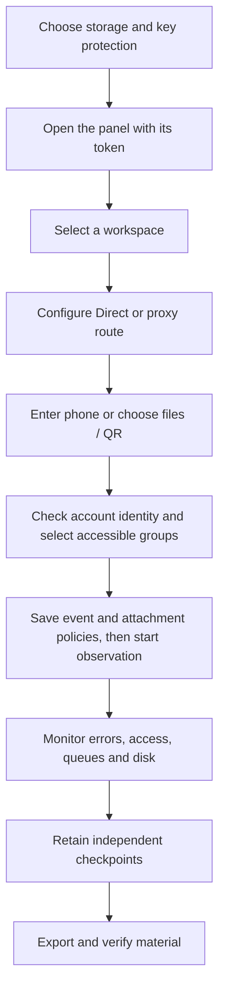

[TgWitness](../../README.md) / [Документация](../README.md) / [Папка](README.md) · [Deployment and recovery](../DEPLOYMENT.md)

[English](../OPERATIONS.md) · **Русский**


<a id="workflows-and-operations"></a>
# Рабочие процессы и операции

Для первого подключения воспользуйтесь разделом [Аккаунты и форматы сеансов](../ACCOUNTS.md).
Описание сохраненных версий, политик событий и пробелов см. в разделе
[Как работает сбор данных](../COLLECTION.md). В данном руководстве рассматриваются вопросы повседневной эксплуатации и восстановления.

Управляемая установка включает файлы **START-HERE.html** и **START-HERE.txt** наряду с
её программой запуска, в которых содержатся ссылка на репозиторий и команды, адаптированные к пути установки.
Запустите `tgwitness guide --print` через SSH или `tgwitness paths`, чтобы определить
фактический каталог данных. При установке в корневой каталог с помощью systemd частные данные хранятся в
файле `/var/lib/tgwitness-…`; программа находится в файле `/opt/tgwitness`.

В случае управляемого временного туннеля Cloudflare `tgwitness tunnel off` блокирует общедоступный
доступ, при этом локальная панель и коллекция продолжают работать. `tgwitness tunnel on`
включает его; `tgwitness tunnel restart` создаёт новое туннельное соединение. Используйте
`tgwitness open`, чтобы увидеть его текущий адрес. Явное отключение сохраняется
даже после перезапуска службы. `tgwitness stop` останавливает как панель, так и коллекцию.

<details>

<summary>
На этой странице</summary>

- [Рабочий процесс оператора](#operator-workflow)
- [Совместная работа без передачи главного ключа](#share-work-without-sharing-the-main-key)
- [Режимы выполнения](#runtime-modes)
- [Категории мониторинга](#monitoring-categories)
- [Уведомления](#notifications)
- [Макет панели](#panel-layout)
- [Среды развертывания](#deployment-environments)
- [Проверки при запуске и экспорт](#startup-checks-and-exports)
- [Резервное копирование, восстановление и прерывания](#backup-restore-and-interruptions)
- [Емкость и срок хранения](#capacity-and-retention)

</details>

<a id="operator-workflow"></a>
## Рабочий процесс оператора



Авторизация, транспортная связь, доступ к группе и полнота
доставки — это разные свойства. Зеленый статус соединения не означает, что все
события были зарегистрированы.

<a id="share-work-without-sharing-the-main-key"></a>
## Передача результатов работы без передачи главного ключа

Откройте **«Дополнительные инструменты» → «Доступ»**, чтобы предоставить рецензенту или аналитику собственный токен. Выберите аккаунты
и чаты, которые они смогут открывать, а затем разрешите просмотр, экспорт или операционные действия.
Оператору, запускающему/останавливающему сбор данных, требуется доступ ко всему рабочему пространству; доступ рецензента
может быть ограничен одним чатом. Ограничения сеансов, срок действия и правила IP-адресов не связаны
с авторизацией аккаунта Telegram. См. [доступ и разрешения](../ACCESS.md).

Используйте функцию **«Открытые сеансы»**, чтобы прервать соединение или отозвать доступ и закрыть все связанные с ним
сеансы. Консоль администратора объединяет данные о деятельности текущего процесса во всех
рабочих пространствах. Закрытие сеанса не приводит к остановке работы коллекции.

<a id="runtime-modes"></a>
## Режимы работы

| Режим | Действие | Поведение |
| --- | --- | --- |
| Демо-версия | scripts\Demo.cmd или `--demo` | Синтетические данные; подключение к реальным счетам отключено |
| Наблюдение | Начать наблюдение | Записать обновления для выбранных источников |
| Краткий обзор истории | Чаты → Действия в чате → Загрузить историю | До 500 текущих сообщений; реконструкция всех прошлых изменений не производится |
| Пауза | Приостановить наблюдение | Остановить сбор данных с сохранением данных и заданий в очереди |
| Проверка/передача | Экспорт | ZIP, JSONL/CSV/HTML, контрольная точка, обработка квитанции и запрос временной метки |
| Несколько аккаунтов | Рабочие области или верхняя кнопка **+** | Любое количество отдельных рабочих пространств в одном процессе |

Доступ к локальной демо-версии открывается автоматически без ручного ввода токена. При этом используется
право доступа, действующее в течение всего срока жизни процесса и действительное только для прямого доступа по петлевому соединению к изолированной
синтетической демо-версии; токен главной панели не раскрывается. При доступе к реальным рабочим пространствам, а также к удаленным
или проксированным демо-версиям сохраняется аутентификация по токену. Вход в демо-версию не предоставляет авторизации в Telegram.

<a id="monitoring-categories"></a>
## Категории мониторинга


В разделе **«Дополнительные инструменты» → «Источники» → «Запись» → «Выбрать, какие изменения сохранять»** выберите по отдельности новые сообщения, правки,
уведомления об удалении, обновления реакций и события, связанные с членством. По умолчанию
сохраняются все категории. Настройка **«Сообщения, правки и удаления»** сохраняет исходный контекст,
отключая при этом отдельные обновления реакций и события, связанные с членством. **Вся видимая активность** восстанавливает
все пять категорий. Предустановки изменяют форму; нажмите **Сохранить настройки записи**, чтобы применить изменения.

Сохраненная политика применяется ко всем выбранным источникам в данной рабочей области. Другие
рабочие области сохраняют свои собственные настройки. При каждом фактическом изменении фиксируются подписанные значения «до» и «после»
; текущая политика также включается в квитанции о выполнении процесса и записи о начале
наблюдения. Отключение категории не приводит к удалению ранее сделанных наблюдений. Повторное включение
не позволяет восстановить пропущенные изменения. В данной версии отсутствует возможность переопределения категорий на уровне групп.

Оставьте функцию сохранения новых сообщений включенной, если важно сохранить предыдущее содержимое: уведомление об удалении не может
восстановить текст, который никогда не был сохранен. Операционные записи, записи об охвате и другие события, связанные с
работой группы, всегда сохраняются. Явные моментальные снимки истории не связаны с
выбором категорий в режиме реального времени и могут включать служебные сообщения. Эти переключатели не
удаляют метаданные о реакциях/участниках, встроенные в иначе сохраненный объект Telegram.

В режиме «Снимок истории» вложения могут помещаться в очередь во время приостановки. Начните наблюдение, чтобы обработать
их. Нахождение в очереди не означает, что файлы загружены. Недоступный исходный файл не заменяется
более новой отредактированной версией; результаты фиксируются отдельно.

**Lock** очищает поля доступа и секретные поля браузера, но оставляет сбор данных в рабочем состоянии.
Закрытие вкладки также не приводит к остановке процесса. Остановка процесса Python или службы
останавливает сбор данных независимо от состояния браузера.

Дополнительное рабочее пространство можно удалить только после того, как подписанный ZIP-архив или контейнер ASiC-E, содержащий его
журнал и заметки на доске дела, будет полностью загружен. Одной лишь подготовки архива
недостаточно: запись, не относящаяся к событиям настройки, или заметка, добавленная после загрузки, делает функцию **Удалить**
недоступной.

Когда панель получает сам файл, она учитывает экспорт только после получения каждого
байта, а затем сообщает размер в `POST /api/exports/{id}/received`; прерванная загрузка
не учитывается. При использовании диалога выбора файла в браузере (доступ к файловой системе) панель сообщает об этом после того, как
файл записан и закрыт. Без него панель передаёт полученный файл в список
загрузок браузера и не может определить, сохранил ли его браузер, например, если диалоговое окно сохранения было
отменено; в этом случае панель сообщает, что загрузка началась, а не что файл был сохранен. Файл,
который браузер загружает самостоятельно (экспорт, размер которого превышает буфер браузера панели), а также
загрузка другим HTTP-клиентом учитываются после того, как сервер отправил весь ответ.
Операционная система и обратный прокси-сервер буферизуют несколько мегабайт ответа, поэтому в случае таких
загрузок сервер не может определить прерывание в конце. Если панель не сообщила, что файл был сохранен,
проверьте загруженный файл перед удалением. Групповой экспорт учитывается для соответствующих аккаунтов, если он
загружен сразу после подготовки; повторная загрузка из раздела **Подготовленные экспорты** не учитывается.

Перед удалением на панели отображаются формат, размер, время подготовки и SHA-256 последнего загруженного
подписанного архива, а также запрашивается подтверждение того, что этот архив сохранен за пределами рабочей области. Сервер отклоняет запрос
`DELETE /api/profiles/{id}`, если `kept_copy` не установлено в значение этого SHA-256 (или в значение `confirmed` для архива,
загруженного до того, как был записан отпечаток).

Удаление дополнительной рабочей области останавливает работу её коллектора и удаляет локальные данные. Если
процесс удаления прерывается из-за заблокированного файла или ошибки файловой системы, панель сообщает об ошибке и
продолжает отображать рабочую область в списке как недоступную (`DeletionPending`). Закройте программы, в которых открыты её
файлы, и повторите попытку **Удалить**. Перезапуск TgWitness оставляет эту рабочую область в остановленном состоянии и
не восстанавливает её частично удалённый журнал или ключи. Успешное удаление фиксируется
только после удаления каталога; отдельно экспортированные или скопированные в резервную копию файлы остаются
в соответствии со своей собственной политикой хранения.

<a id="notifications"></a>
## Уведомления

Откройте **«Настройки» → «Уведомления и резервные копии» → «Пункты назначения уведомлений»**, либо
**Дополнительные инструменты → Дополнительные функции → Уведомления → Настройка**. TgWitness использует
Apprise для отправки уведомлений в Matrix, Telegram, Discord, Slack, ntfy, по электронной почте и в другие
поддерживаемые сервисы. Вы можете добавить несколько пунктов назначения в одно рабочее пространство.

1. Введите по одному URL-адресу назначения Apprise в каждой строке. Используйте
   [каталог услуг и форматы URL](https://appriseit.com/services/), соответствующие вашей услуге.
2. Включите функцию **«Отправлять уведомления»**, затем выберите оповещения о проблемах, изменениях в отслеживаемых
   чатах и ежедневную сводку. Время в сводке определяется по серверному времени.
3. Включите опцию **«Включать короткие выдержки»**, если хотите, чтобы в оповещениях отображался сохраненный текст из удаленных и отредактированных
   сообщений.
4. Нажмите **«Сохранить уведомления»**, а затем **«Отправить тест»**, чтобы проверить доставку.

Для вашего собственного приемника используйте [JSON-вебхук](https://appriseit.com/services/json/) от Apprise.
Например, `jsons://notify.example.org/tgwitness` отправляет JSON по HTTPS на эту
конечную точку. Это вымышленный пример; замените его на свой собственный адрес назначения.

Направления и настройки относятся к выбранной рабочей области. Уведомления об изменениях
охватывают отслеживаемые источники, включая недавно добавленные чаты. Кнопка в виде колокольчика на верхней панели
также отображает список недавних проблем и изменений в чатах.

В демо-версии элементы управления уведомлениями отображаются, но отправка отключена. Настройте
доставку в реальной рабочей среде. Уведомления используют маршрут Direct, SOCKS5 или
HTTP данной рабочей среды; MTProxy не может их передавать. Для не-HTTP-адресатов, таких как SMTP, требуется
прямой маршрут.

<a id="panel-layout"></a>
## Расположение панелей


В разделе **Журнал** отображаются наблюдения, результаты поиска и фильтры. При редактировании открываются сохраненные версии;
при удалении — предыдущее содержимое, если оно имеется. Неизвестные источники указываются явно.
Статистика доступна в разделе **Обзор**; подробности о получении данных остаются в локальном руководстве.

Откройте отредактированное сообщение, чтобы сравнить его версии с помощью **Встроенного сравнения** или **Параллельного просмотра**;
в режиме **Raw** отображаются сохраненные поля. Изменения в скрытых ссылках и кнопках ботов отображаются
отдельно. Откройте предварительный просмотр вложения, чтобы просмотреть сохраненные изображения, аудио- или видеофайлы;
кнопка загрузки позволяет получить доступ к сохраненному оригиналу.

**Live** обновляет журнал и чаты по мере поступления записей. Приостановите его на время просмотра
или нажмите кнопку «Новые события», когда будете готовы; сбор данных продолжается. **Ctrl/Cmd+K**
позволяет найти действия на панели и выполнить поиск в журнале.

**«Дополнительные инструменты → Источники»** содержит область наблюдения (выбранные чаты, папку Telegram или весь
аккаунт), доступные чаты всех типов, выбранные источники с звездочками приоритета, настройки вложений
и повторной проверки, а также снимки истории. Частные источники выбираются по диалогу/ID
без публичной ссылки. Статус доступа отражает результаты последней проверки, а не постоянные разрешения.

Отфильтруйте источники, установите флажки напротив них, а затем одновременно включите, приостановите или отметьте их как приоритетные.
В списке доступных чатов функция **«Добавить выбранные»** использует ваш выбор;
функция **«Добавить все подходящие»** использует текущий поиск и фильтр по типу.

**«Чаты → Участники»** — здесь отображаются все пользователи, сообщения которых сохранены; если в чате включена функция просмотра профилей участников,
при нажатии открывается профиль данного пользователя со ссылками на записи в журнале.

**«Дополнительные инструменты» → «Дополнительные функции» → «Независимый свидетель»** позволяет создавать токены свидетелей, доступные только для чтения, отображает, когда каждый свидетель в последний раз проверял систему, и
предоставляет команды и параметры для запуска одного из них ([независимый свидетель](../WITNESS.md)).

**«Дополнительные инструменты → Параметры»** содержит все ограничения и настройки темпа работы рабочей среды, которые не указаны на других страницах:
количество прочитанных диалогов, частота перечитывания списка чатов, интервалы пульсации и контрольных точек,
буфер запуска, распределение запросов при повторной проверке (начальная задержка, количество чатов за
проход, пауза между чатами, восстановленные и повторно запрошенные сообщения), резерв дискового пространства, таймауты и
повторные попытки загрузки, что ищут профили пользователей (включая ваши собственные регулярные выражения),
размер и частота уведомлений, ограничения на снимки, ZIP-файлы и загрузку через браузер, а также таймауты и повторные попытки
клиента Telegram. В каждом поле отображается диапазон значений и значение по умолчанию; изменённые поля
отмечаются и могут быть восстановлены по одному или все сразу. Каждое изменение фиксируется в виде
`parameters.changed` с указанием значений до и после, а записи о начале наблюдения
указывают действующие значения. Значения вступают в силу при следующем использовании; таймауты и повторные попытки клиента — при
следующем подключении. Интервалы повторной проверки, типы и размеры вложений, интервалы хранения доказательств и копирования вне сайта
остаются на отдельных страницах и могут принимать любые значения в пределах своего диапазона, а не только предустановленные значения.

Значок в верхней панели отображает список недавних проблем и изменений в отслеживаемых чатах; непрочитанные
сообщения учитываются до тех пор, пока их не помечают как прочитанные. Изменения сгруппированы по чатам и часам («12 удалено,
1 отредактировано, 0 не найдено»), а такие проблемы, как выход из системы или переполнение диска, остаются в списке,
независимо от того, насколько активны чаты.

**Дополнительные инструменты → Учетная запись** начинается с поля для ввода номера телефона. Кнопка **Продолжить** ведет непосредственно к
вводу кода, а учетные данные API запрашиваются только в случае их отсутствия. QR-код и импорт файла — это
альтернативные вкладки. Сохраненные учетные данные API используются повторно только в пределах собственной рабочей области.
На экране ввода нет боковой панели, статистики или разделов настроек. Значок **«Настройки»**
открывает управление API, прокси, хранилищем и дополнительными аккаунтами. Открывается новая рабочая область
[первая настройка](../SETTINGS.md); после входа в систему в рабочей области с сохраненными источниками и записями открывается раздел **«Чаты»**.
Смена маршрута требует приостановки наблюдения и отменяет незавершённый вход в систему. Существующий
журнал нельзя автоматически перепривязать к другой учётной записи Telegram.

**Экспорт** проверяет целостность журнала и создает переносимые файлы. Идентификатор рабочей области
можно передать в командную строку загрузчика. Каждый экспорт фиксирует префикс полного журнала; последующие
события попадают в следующий экспорт. Фильтры поиска не изменяют область действия пакета.
Подробная информация о подписи и охвате приведена в разделе **Проверка и подтверждающие данные**.

На панели отображается состояние коллектора, медиафайлы в очереди/с ошибками, самые старые медиафайлы в ожидании, свободное
место на диске, паузы в запросах и источники, доступ к которым не подтвержден, в разделе **Состояние коллектора**.
Эти сведения изначально свернуты и скрыты на странице «Учетная запись». На вкладке настроек
отображается следующий шаг: подключить учетную запись, выбрать источники или начать мониторинг.
Список учётных записей представляет собой моментальный снимок на момент загрузки;
выбранная рабочая область периодически обновляется. Это не многопроцессный монитор SLA.

В пользовательском интерфейсе для отображения исходного контента используются локальные ресурсы и рендеринг текста. Проведено тестирование макетов для настольных компьютеров и узких
экранов на базе Chromium.

<a id="deployment-environments"></a>
## Среды развертывания

| Окружающая среда | Установка | Статус проверки |
| --- | --- | --- |
| ПК/сервер на базе Windows | Python 3.11+, папка scripts\Setup.cmd/Start.cmd, каталог с личными данными | Проверено локально в среде Windows/Python 3.12 |
| Сервер/VPS под управлением Linux | Python venv, выделенный пользователь службы, HTTPS/SSH | Приведены примеры кода, CI и systemd; на данном хосте они не выполнялись |
| macOS | Python venv, процесс в фоновом режиме или пользовательский агент | Приведён пример использования launchd; требуется отдельная проверка установки |
| Docker/Compose | Постоянный объем, один рабочий процесс | Предоставлено определение и проверка в режиме выполнения CI; Docker недоступен локально |
| Браузер на телефоне | Подключиться к защищённой панели на работающем сервере | Проведено тестирование версии Narrow Chromium; коллектор не работает на iOS/Android |

Переносимость означает отсутствие обязательного использования облачного сервиса или сборки интерфейса. Каждая целевая среда по-прежнему
требует наличия совместимых зависимостей Python и криптографических библиотек, а также доступа к локальному диску и сети. См.
[DEPLOYMENT.md](../DEPLOYMENT.md) и [шаблоны сервисов](../../deploy/README.md).

Рабочие пространства совместно используют ЦП, память и цикл событий. Для изоляции процессов используйте отдельные
экземпляры, порты, каталоги данных и авторизацию аккаунтов. Единой
панели управления для отдельных экземпляров не существует. Ни в коем случае не направляйте несколько рабочих процессов на одну базу данных.

<a id="startup-checks-and-exports"></a>
## Проверка запуска и экспорт данных

Перед запуском подготовленной среды выполните команду `python start.py --check`. Добавьте `--json`
для проверки машиночитаемым способом или передайте нужные `--data-dir`, `--host` и `--port`.
Команда проверяет наличие необходимых условий без входа в Telegram и создания журнала.
Проверка журнала выполняется при запуске приложения, а готовность к захвату отображается
на панели. Занятый порт может просто означать наличие существующего экземпляра.

Браузеры, поддерживающие API доступа к файловой системе, сохраняют экспортированные данные через поток с возможностью записи.
Другие браузеры буферизуют не более 128 MiB. Для экспорта больших объемов данных
или при использовании браузеров без поддержки потоковой передачи файлов воспользуйтесь командной строкой потоковой передачи:

```sh
python -m tgwitness.download --token-file data/live/panel-token.txt --out evidence.zip
```

Добавьте `--profile ID`
из раздела «Экспорт» для дочерней рабочей области. Используйте `--url https://server`
для удаленного доступа. Простой HTTP допускается только для адресатов с обратной связью. Токен
считывается из файла и отправляется в заголовке, а не выводится на экран и не включается в URL. Перенаправления
не допускаются. Существующие адресаты не перезаписываются. При неудачных передачах удаляется их
временный фрагмент файла. Указанный SHA-256 является контрольной суммой передачи; проверьте подписанный
ZIP-файл отдельно с помощью доверенного отпечатка/контрольной точки.

<a id="backup-restore-and-interruptions"></a>
## Резервное копирование, восстановление и сбои

1. Приостановите наблюдение и корректно остановите процесс.
2. Скопируйте весь каталог данных: базы данных, WAL/SHM (если имеются), носители,
   `credentials.enc`, `signing.enc`, `network.enc`, ключи хранилища/метаданные, токен,
   контрольные точки и каждый каталог `profiles/`.
3. В режиме внешнего ключа отдельно сохраните главный ключ и каждый
   `vault.external.json`. Генерация нового ключа не позволяет восстановить старые секреты.
4. Выполните восстановление, пока целевая система остановлена; настройте исходный ключ, ограничьте
   доступ и проверьте целостность перед возобновлением работы.
5. Зафиксируйте время простоя и результаты проверки. Время простоя остаётся зафиксированным промежутком;
   моментальный снимок истории добавляет состояние после него.

Архивы ZIP с данными не содержат сеансов и личных ключей и не являются полными резервными копиями.
`tgwitness backup FOLDER` создает такую же копию при продолжающейся работе панели и исключает
индекс поиска, который восстанавливается самостоятельно; см. раздел [Обновления и резервное копирование](../DEPLOYMENT.md#updates-and-backups).
Четыре элемента защищаются по-разному:

| Что | Защита |
| --- | --- |
| Экспорт файлов без пароля (по умолчанию) | Подписано, чтобы можно было обнаружить изменения; установите пароль для шифрования экспорта |
| Экспорт файлов с паролем | Если вы установите пароль, готовый файл экспорта будет сохранен без изменений в формате ZIP с шифрованием AES-256 в WinZip, который можно открыть с помощью 7-Zip и WinRAR; пароль не сохраняется ([работа с доказательствами](../EVIDENCE.md)) |
| База данных журнала и вложения, сохраненные на диске | Зашифрованный диск или том и права доступа к папкам |
| Сеансы Telegram и ключи подписи | Зашифрованы в каталоге данных (`credentials.enc`, `signing.enc`, `network.enc`) |

Полное резервное копирование — это описанный выше каталог данных с остановленным процессом, а не экспорт.
Для обоих случаев используйте защищённое хранилище и механизм контролируемой передачи данных. Временные экспортные файлы сервера хранятся в папке
`temporary-exports/` каждой рабочей области; завершённые ответы очищаются, а прерванные экспортные
файлы удаляются при следующем запуске, пока удерживается блокировка экземпляра данной рабочей области.

После восстановления соединения коллектор запрашивает пропущенные обновления, начиная с
позиции сохраненного обновления. Постоянные задания на носителях и позиция обновления Telegram сохраняются после перезапуска; см.
[формат доказательств](../EVIDENCE.md#durable-collection-and-process-receipts-02).

<a id="capacity-and-retention"></a>
## Вместимость и удержание

Значения по умолчанию, которые можно изменить в разделе **Дополнительные инструменты → Параметры**: первые 1 000 диалоговых окон, 500 сообщений
на каждый снимок, 4 ГиБ несжатого содержимого ZIP-архива с подписью (для архивов большего размера требуется
`verify.py --max-gib N`) и резервный вариант для браузера объёмом 128 МиБ. Вложения занимают от 1 до 2 000 MiB на
тип в разделе **Дополнительные инструменты → Источники → Запись → Вложения**. По умолчанию для CLI-загрузки установлено ограничение в 5 GiB переданных данных. Доступное дисковое пространство может служить
нижним пределом. Зарезервируйте место для журналов, мультимедиа, WAL, временных экспортов и резервных копий.
При экспорте учитывается объем данных, а не ограничение Compose в 512 MiB `/tmp`.

Измеряйте количество событий в секунду, время нахождения в очереди, объем данных в байтах и задержку диска, а не ограничивайтесь подсчетом
только групп. Измерение потоковой передачи осуществляется на работающем коллекторе.
Автоматического удаления сохраненных данных не происходит. Удаление конца журнала приводит к утрате его
связи с сохраненными контрольными точками.

Уже реализована приоритетная повторная проверка: источники, отмеченные звездочкой, по умолчанию перепроверяются каждые 15 минут,
остальные — каждые 6 часов (см. [уровни повторной проверки](../COLLECTION.md#recheck-tiers)). Имеются экспорты, защищенные паролем,
как описано выше. Доступ с ограничениями по области действия
описан в разделе [доступ и разрешения](../ACCESS.md). См.
[READINESS.md](../internal/READINESS.md), [LIVE_ACCEPTANCE.md](../internal/LIVE_ACCEPTANCE.md) и
[VERIFICATION.md](../VERIFICATION.md).
