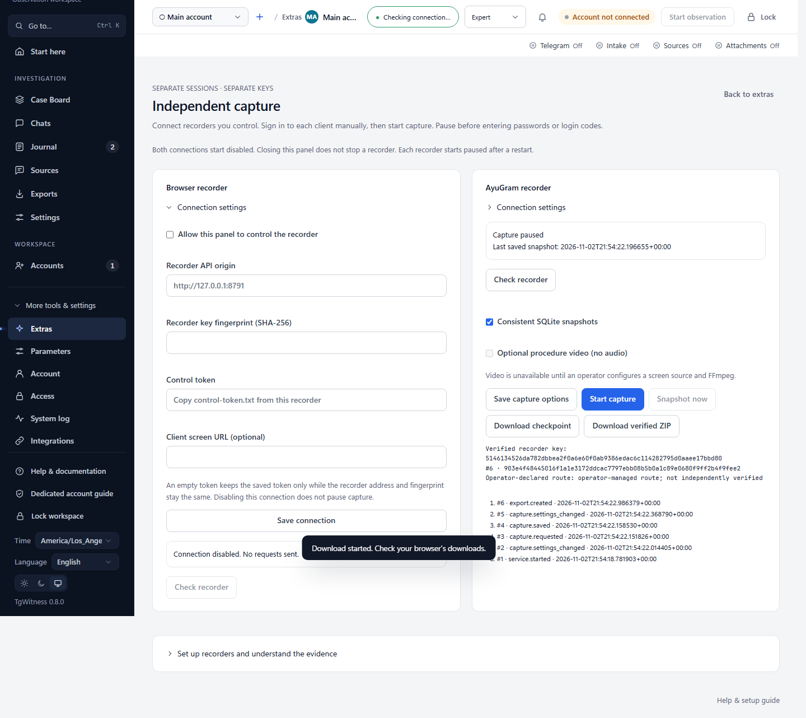

[TgWitness](../../README.md) / [Документация](../README.md) / [Папка](README.md)

[English](../OPTIONAL-CAPTURE.md) · **Русский**


<a id="optional-independent-browser-and-ayugram-capture"></a>
# Дополнительная возможность: использование отдельного браузера и функция захвата AyuGram

[Проект](../../README.md) · [Установка и управление](../../addons/capture/README.md)

**Trusted Live (предварительная версия)** добавляет изолированный официальный сеанс Telegram Desktop/Web, встроенный импорт JSON, защищённую визуальную запись и аннотированный отчёт о непрерывности. Ознакомьтесь с [инструкциями по настройке, проверке и ограничениями квалификации](TRUSTED-LIVE.md). Данная функция использует собственную среду выполнения для Linux и проект Compose; она не активируется с помощью приведённых ниже профилей браузера/AyuGram.

`tgwitness-capture` — это дополнительный пакет с отдельными средствами записи. Он не затрагивает основной сборщик данных или его подписанные форматы.

- **Дополнительные инструменты → Дополнительные функции → Независимая запись** на главной панели, а также автономные панели на английском языке.
- Собственные процессы, тома, ключи Ed25519, сеансы и экспортные файлы.
- Запись отключена при каждом запуске; видео — отдельный переключатель, также отключенный.
- Chromium: снимки выбранной вкладки в форматах PNG, MHTML и текста с опросом на наличие изменений.
- AyuGram: согласованные копии локальной базы данных SQLite (включая WAL).
- Подписанная цепочка событий, контрольные точки, подтверждающие квитанции, подписанный ZIP-архив с отчётом в формате HTML, автономный верификатор.

Используйте профили `capture-browser` и `capture-ayugram` в файле [`addons/capture/compose.yaml`](../../addons/capture/compose.yaml) или установите пакет в отдельную среду venv. Простой запуск `docker compose up` не запускает ни один из них. Подключения к панели по умолчанию отключены. Администратор сохраняет URL-адрес регистратора, токен управления и отпечаток ключа (получите его самостоятельно, не доверяйте сети), а затем нажимает **Проверить регистратор**. Токены шифруются в хранилище рабочей области и никогда не передаются обратно через API.

С панели вы можете выбрать вкладку, настроить параметры, запустить/приостановить запись, сделать снимок экрана, просмотреть недавние события, а также загрузить контрольные точки и подписанный ZIP-файл. Перед выполнением каждой команды панель проверяет закреплённый ключ и верифицирует весь экспортный файл перед его передачей. Закрытие панели или отключение соединения не останавливает работу рекордера, поэтому **сначала приостановите его**. Рекордеры всегда перезапускаются в приостановленном состоянии.

<a id="connect-from-the-main-panel"></a>
## Подключение с главной панели

Установка на локальном компьютере: запустите устройства записи в соответствии с [руководством по установке](../../addons/capture/README.md), затем используйте `http://127.0.0.1:8791` (браузер) и `http://127.0.0.1:8792` (AyuGram). Другой хост должен использовать протокол HTTPS с действительным сертификатом. Допускаются только простые источники, без путей, строк запроса или учетных данных; перенаправления не допускаются. Эти запросы поступают непосредственно на устройство записи, а не через основные настройки подключения.

Получите файл `control-token.txt` и отпечаток ключа SHA-256 с панели записывающего устройства или с помощью команды `python -m tgwitness_capture identity --data /data`, используя надёжное локальное соединение. В разделе **Дополнительные инструменты → Экстра → Независимый захват** введите оба этих элемента, а также источник API, включите управление, сохраните настройки и **проверьте записывающее устройство**. Дополнительная ссылка на экран клиента открывает Neko или ваш собственный удалённый рабочий стол; вводите коды Telegram самостоятельно, пока захват приостановлен.

Всё в Docker (сначала настройте прокси, пароли Neko и монтирование AyuGram):

```sh
docker compose --project-directory . -f compose.yaml -f addons/capture/compose.yaml -f deploy/compose/compose.capture-panel.yaml --profile capture-browser --profile capture-ayugram up -d --build
```

Удалите профиль, если вам нужен только один рекордер. Имена существующих томов остаются без изменений. В панели используйте `http://capture-browser:8791` и `http://capture-ayugram:8792` (`localhost` внутри контейнера не является сайдкаром). Neko доступен локально по адресу `http://127.0.0.1:8081`. Ни один сокет Docker не монтируется в главную панель.

Панель принимает экспорты объёмом до 512 MiB с двухминутным ограничением по времени, более объёмные экспорты проходят через панель регистратора. ZIP-архивы сохраняют подпись регистратора и включают файл `report.html`; они не импортируются в журнал Telegram. Основной журнал фиксирует контрольные действия и проверенные границы экспорта, но никогда не фиксирует токены или контент. Примечание: один администратор управляет обоими регистраторами; наличие отдельных ключей не делает их независимыми операторами.



Профиль браузера включает в себя опциональную поддержку Neko/Chromium и перенаправление через прокси-сервер. Графический интерфейс AyuGram, данные для входа и настройки прокси/WARP должны быть уже настроены; данный профиль запускает только регистратор базы данных.

Команда `python -m tgwitness_capture ayugram` впоследствии считывает копии базы данных AyuGram: удалённые сообщения и более ранние версии отредактированных сообщений. Строки, удалённые между копиями, а также заменённая (повернутая) база данных подписываются в журнале регистратора. При сравнении с ZIP-файлом доказательств TgWitness каждая строка сопоставляется: «только AyuGram», «только TgWitness», «конфликт» или «неоднозначность» (отрицательный идентификатор чата, который журнал не может разрешить). Файл AyuGram можно редактировать локально; он содержит даты по локальному времени и незаписанные строки, не хранит медиафайлы удалённых сообщений, а только сообщения, загруженные в память, поэтому каждая строка представляет собой второе, незаписанное наблюдение. Парсер тестировался на базах данных, созданных с помощью определения хранилища AyuGram Desktop, а не с помощью работающего клиента. См. раздел [Интерпретация базы данных AyuGram](../../addons/capture/README.md#ayugram-database-interpretation).

Предварительный просмотр. Предположения об изоляции, видео, привязка ключей, контрольные точки, ограничения хранения и этапы принятия в среде Linux изложены в руководстве по установке. Ещё не реализовано: WACZ/rrweb, PDF с цифровой подписью, автоматический импорт журнала.
