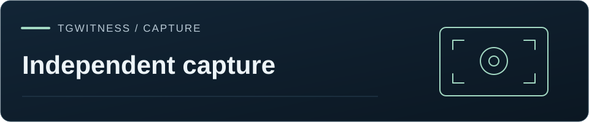

[TgWitness](../../README.md) / [Документация](../README.md) / [Папка](README.md)

[English](../OPTIONAL-CAPTURE.md) · **Русский**



<a id="optional-independent-browser-and-ayugram-capture"></a>
# Дополнительная возможность: захват изображений в отдельном браузере и в AyuGram

[Проект](../../README.md) · [Монтаж и органы управления](../../addons/capture/README.md)

**Trusted Live (предварительная версия)** добавляет изолированный официальный сеанс Telegram Desktop/Web,
встроенный импорт JSON, защищенную визуальную запись и отчет о непрерывности с аннотациями.
См. [настройку, проверку и ограничения по квалификации](TRUSTED-LIVE.md). Функция использует собственную
среду выполнения для Linux и проект Compose; она не включается с помощью приведенных ниже профилей браузера/AyuGram.

`tgwitness-capture` — это дополнительный пакет с отдельными модулями записи. Он не затрагивает
основной сборщик или его подписанные форматы.

- **«Дополнительные инструменты» → «Дополнения» → «Независимый захват»** на главной панели, а также отдельные панели на английском языке.
- Собственные процессы, тома, ключи Ed25519, сеансы и экспорт данных.
- Захват отключен при каждом запуске; для видео предусмотрен отдельный переключатель, который также находится в выключенном состоянии.
- Chromium: снимки выбранной вкладки в форматах PNG, MHTML и текстовом формате с отслеживанием изменений.
- AyuGram: согласованные копии локальной базы данных SQLite (включая WAL).
- Подписанная цепочка событий, контрольные точки, подтверждающие квитанции, подписанный ZIP-архив с отчётом в формате HTML, автономный верификатор.

Используйте профили `capture-browser` и `capture-ayugram` в
[`addons/capture/compose.yaml`](../../addons/capture/compose.yaml) или установите пакет в
собственную среду venv. Простой `docker compose up` тоже не запускается. Подключения к панели по
умолчанию отключены. Администратор сохраняет URL-адрес регистратора, токен управления и отпечаток ключа (получите его
самостоятельно, не доверяйте сети), а затем нажимает **Проверить регистратор**. Токены шифруются
в хранилище рабочей среды и никогда не передаются обратно через API.

На панели можно выбрать вкладку, настроить параметры, запустить/приостановить запись, сделать снимок экрана, просмотреть последние
события, а также скачать контрольные точки и подписанный ZIP-файл. Панель проверяет закреплённую ключевую комбинацию перед
выполнением каждой команды и проверяет весь экспорт перед его передачей. Закрытие панели или
отключение соединения не останавливает запись, поэтому **сначала поставьте её на паузу**. Запись всегда
возобновляется с того места, где была поставлена на паузу.

<a id="connect-from-the-main-panel"></a>
## Подключение с главной панели

Нативная установка: запустите записывающие программы в соответствии с [руководством по установке](../../addons/capture/README.md),
затем используйте `http://127.0.0.1:8791` (браузер) и `http://127.0.0.1:8792` (AyuGram). Другой
хост должен поддерживать HTTPS с действительным сертификатом. Только простые источники, без путей, строк запроса или
учетных данных, перенаправления не допускаются. Эти запросы поступают напрямую в записывающее устройство, а не через
основные настройки соединения.

Получите `control-token.txt` и отпечаток ключа SHA-256 на панели записывающего устройства или
`python -m tgwitness_capture identity --data /data` через надежное локальное соединение. В
**«Дополнительные инструменты» → «Дополнения» → «Независимый захват»** введите и то, и другое, а также источник API, включите управление, сохраните и
**«Проверить рекордер»**. Дополнительная ссылка на экран клиента открывает Neko или ваш собственный удалённый рабочий стол;
введите там коды Telegram самостоятельно, пока захват приостановлен.

Всё в Docker (сначала настройте прокси, пароли Neko и монтирование AyuGram):

```sh
docker compose --project-directory . -f compose.yaml -f addons/capture/compose.yaml -f deploy/compose/compose.capture-panel.yaml --profile capture-browser --profile capture-ayugram up -d --build
```

Удалите профиль, если вам нужен только один рекордер. Имена существующих томов останутся прежними. На панели используйте
`http://capture-browser:8791` и `http://capture-ayugram:8792` (`localhost` внутри
контейнера не является сайдкаром). Neko находится локально в `http://127.0.0.1:8081`. Сокет Docker
не монтируется в главную панель.

Панель принимает экспорты объемом до 512 MiB с двухминутным ограничением по времени, более крупные файлы проходят через
панель регистратора. ZIP-файлы сохраняют подпись регистратора и содержат тег `report.html`; они
не импортируются в журнал Telegram. Основной журнал фиксирует контрольные действия и
проверенные границы экспорта, но никогда не фиксирует токены или содержимое. Примечание: один администратор управляет обоими
регистраторами; наличие отдельных ключей не делает их независимыми операторами.


Профиль браузера включает в себя опциональную поддержку Neko/Chromium и перенаправление через прокси-сервер.
Графический интерфейс AyuGram, данные для входа и настройки прокси/WARP должны быть уже настроены; данный профиль запускает только
модуль записи данных в базу данных.

`python -m tgwitness_capture ayugram` Затем считываются копии базы данных AyuGram: удаленные
сообщения и более ранние версии отредактированных сообщений. Строки, удаленные между копиями, и замененная
(повернутая) база данных регистрируются в журнале регистратора. По сравнению с ZIP-архивом TgWitness,
каждая строка сопоставляется: только в AyuGram, только в TgWitness, конфликт или неоднозначность (отрицательный идентификатор чата,
который журнал не может разрешить). Файл AyuGram можно редактировать локально, он содержит даты по локальному времени и
неподписанные записи, а также не хранит мультимедиа из удалённых сообщений и содержит только сообщения, загруженные в память, поэтому
каждая запись представляет собой второе, неподписанное наблюдение. Парсер был протестирован с базами данных, записанными AyuGram
в соответствии с определением хранилища AyuGram Desktop, а не с работающим клиентом. См.
[Интерпретация базы данных AyuGram](../../addons/capture/README.md#ayugram-database-interpretation).

Предварительный обзор. Сведения о допущениях относительно изоляции, видео, привязке ключей, контрольных точках, ограничениях на объем хранения и
этапах приведения к рабочему состоянию в Linux приведены в руководстве по установке. Пока не реализовано: WACZ/rrweb,
подписанные PDF-файлы, автоматический импорт журналов.
