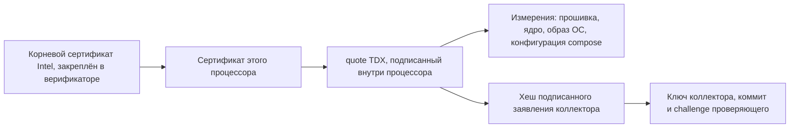

[TgWitness](../../README.md) / [Документация](../README.md) / [Папка](README.md) · [Уровни доказательности](https://phishdestroy.github.io/TgWitness/ru/docs/assurance-levels/)


[English](../PHALA.md) · **Русский**

# Phala Cloud и Intel TDX

Высший из трёх [уровней доказательности](https://phishdestroy.github.io/TgWitness/ru/docs/assurance-levels/).
Коллектор работает в конфиденциальной виртуальной машине, память которой хост не может прочитать,
а то, что работает внутри, подписывает сам процессор.



<details>
<summary>На этой странице</summary>

- [Зачем](#why)
- [Что это значит для суда](#what-it-means-for-a-court)
- [Что это значит для вас](#what-it-means-for-you)
- [На чём держится доверие](#what-the-trust-rests-on)
- [Кто использует](#who-uses-it)
- [Что если TDX взломают](#what-if-tdx-is-broken)
- [Откат диска хостом](#rollback-of-the-disk-by-the-host)
- [Цена](#price)
- [Технический справочник](#technical-reference)

</details>

<a name="confidential-vm-on-phala-cloud-intel-tdx"></a>
<a name="why"></a>
## Зачем

На [проверяемом сервере](HIGH-ASSURANCE.md) журнал провайдера показывает всё, что сделано через
API. Он не может показать, что делает тот, у кого есть root на физическом хосте: читает память
сервера и его ключ подписи или меняет данные до подписи. Это могут сотрудники провайдера,
государство, которое принуждает провайдера, или тот, кто взломал провайдера, и ни один доступный
вам журнал этого не запишет.

Intel TDX закрывает этот пробел. Процессор шифрует память виртуальной машины и защищает её
целостность, поэтому хост, его гипервизор и сотрудники Phala не могут ни прочитать её, ни
изменить. Ещё процессор подписывает quote TDX: измерения прошивки, ядра, образа ОС и той самой
конфигурации compose, которая работает, привязанные к ключу коллектора. Любой может проверить
этот quote TDX по корневому сертификату Intel, не доверяя ни Phala, ни TgWitness, ни вам.

<a name="what-it-means-for-a-court"></a>
## Что это значит для суда

- Доказательства сопровождаются заявлением, подписанным оборудованием Intel: этот опубликованный
  код на этом коммите работал в запечатанной виртуальной машине, которую ни хостинговая компания,
  ни оператор не могли прочитать или изменить.
- Любой может повторить проверку офлайн автономным `verify.py` — без аккаунта Phala, без сервера
  TgWitness и без доверия к тому, кто собрал доказательства.
- Отчёт о проверке запечатан квалифицированной меткой времени ЕС и второй, независимой меткой
  времени и подписан проверяющим.
- Аттестация показывает, как собраны доказательства. Она не показывает, что написанное в
  сообщении правда. Какой вес это имеет, решает суд или орган.

<a name="what-it-means-for-you"></a>
## Что это значит для вас

- Вы разворачиваете из панели: **Инструменты → Дополнительно → Сервер работает круглосуточно →
  Конфиденциальная виртуальная машина · Phala Cloud**, с API-ключом Phala Cloud. Без домена сервер
  получает быстрый туннель.
- SSH и консоли нет, в том числе для вас. Вы работаете через панель, а данные покидают машину
  только в виде экспортов.
- Войдите в Telegram внутри VM по телефону или QR-коду: тогда ключ сессии создаётся там, и отчёт
  это показывает.
- Каждый перезапуск и каждое изменение приложения попадают в список. Не меняйте приложение после
  развёртывания: изменённая конфигурация compose проваливает отчёт.
- Оплата почасовая; см. [Цена](#price).

<a name="what-the-trust-rests-on"></a>
## На чём держится доверие

| Сторона | Доверяем? | Как это проверяется вместо доверия |
| --- | --- | --- |
| Intel | **Да** | Ничем не заменяется: модуль TDX, микрокод, ключи подписи Intel и физическая целостность шины памяти. Верификатор закрепляет корневой сертификат Intel и проверяет списки отзыва и уровень безопасности платформы |
| dstack, операционная система | Нет | Верификатор заново вычисляет измерения прошивки, ядра и командной строки из образа ОС, который публикует Dstack-TEE, и сравнивает их с quote TDX. Образ для разработки проверку не проходит |
| Код TgWitness | Нет | Конфигурация compose закрепляет каждый файл исходников развёрнутого коммита по хешу, а оба образа контейнеров — по digest. Процессор её измеряет, а верификатор собирает ту же конфигурацию compose из коммита и сравнивает побайтно |
| Phala Cloud | Нет | Не может прочитать память машины. Любое изменение приложения — новая ревизия с новым хешем конфигурации compose, и отчёт проваливается; перезапуски попадают в список |
| Вы, оператор | Нет | Нет SSH и консоли; ключ Telegram создаётся внутри машины; любое изменение приложения видно, как описано выше |

Сеть и часы по-прежнему контролирует хост. Заблокированный трафик виден как пропуски в журнале, а
время берётся из внешних привязок: меток времени RFC 3161, OpenTimestamps и drand.

<a name="who-uses-it"></a>
## Кто использует

- **dstack**, фреймворк с открытым кодом, на котором работает машина, — проект Confidential
  Computing Consortium при Linux Foundation; его аудит провела zkSecurity, а описание
  опубликовано в [arXiv:2509.11555](https://arxiv.org/abs/2509.11555), *Dstack: A Zero Trust
  Framework for Confidential Containers*. На нём строят свои сервисы OpenRouter и NEAR AI.
  Исходный код: [Dstack-TEE/dstack](https://github.com/Dstack-TEE/dstack).
- **Phala Cloud**, хостинговый сервис, заявляет соответствие SOC 2 Type I и HIPAA. Оба касаются
  того, как Phala ведёт свой сервис. Доказательство на этой странице на них не опирается.

<a name="what-if-tdx-is-broken"></a>
## Что если TDX взломают

Уязвимости в механизмах безопасности процессоров находят и закрывают обновлениями микрокода; после
этого Intel считает платформы без исправления устаревшими. Допустим, кто-то взломал TDX на машине,
где работает ваш коллектор:

| Он может | Он не может |
| --- | --- |
| Прочитать память машины на этом хосте, включая ключ подписи | Изменить контрольные точки, которые уже хранят свидетели |
| С этого момента подписывать ложные новые записи | Сдвинуть метки времени RFC 3161 или квитанции OpenTimestamps |
| Выпускать quote TDX, которые выглядят действительными, для новых записей | Изменить копии, уже сохранённые под S3 Object Lock |
| | Изменить то, что по-прежнему хранит сам Telegram: другой сбор опровергнет подделку |
| | Изменить результат прежних quote TDX: уровень безопасности каждого quote TDX вычисляется на момент его записи |

То, что было закреплено вне машины до взлома, остаётся как было. Взлом действует вперёд, а не
назад.

<a name="rollback-of-the-disk-by-the-host"></a>
## Откат диска хостом

dstack шифрует диск машины, но хост может подложить его более старую копию. dstack признаёт это
ограничение. Машина тогда запустится заново с более ранним журналом.

Это ловят две вещи:

- **Контрольные точки вне машины.** [Свидетель](WITNESS.md) и метки времени хранят более позднюю
  длину и хеш журнала; откатанный назад журнал с ними больше не совпадает, и об этом сообщается.
- **Копии под S3 Object Lock.** [Внешняя копия](STORAGE.md) под Object Lock хранит более поздний
  журнал, и никто не может удалить или перезаписать её до конца срока хранения.

Для каждого развёртывания этого уровня держите свидетеля и внешнюю копию с Object Lock.

<a name="price"></a>
## Цена

| Тип | vCPU · память | В час | В месяц (730 часов) |
| --- | --- | --- | --- |
| `tdx.small` | 1 · 2 ГБ | $0,06 | Около $43,80 |
| `tdx.medium` | 2 · 4 ГБ | $0,12 | Около $87,60 |
| `tdx.large` | 4 · 8 ГБ | $0,23 | Около $167,90 |

Диск стоит $0,000139 за ГБ в час, около $0,10 за ГБ в месяц, пока машина существует —
остановленная или работающая. Цены из [прайс-листа Phala](https://phala.com/pricing) на
21 ноября 2026 года. Мастер выбирает `tdx.small` и показывает текущую цену до того, как что-либо
будет создано.

<a name="technical-reference"></a>
## Технический справочник

### Шесть проверок

| Проверка | Что она показывает |
| --- | --- |
| `tdx_binding` | quote TDX охватывает подписанное заявление коллектора и случайный challenge этой проверки |
| `tdx_quote` | Подписи quote TDX ведут к корню Intel, Intel считает платформу актуальной, а машину нельзя ни отлаживать, ни мигрировать |
| `tdx_compose_hash` | RTMR3, воспроизведённый по журналу событий dstack, равен хешу конфигурации compose, о которой сообщает коллектор |
| `tdx_compose` | Эта конфигурация compose побайтно совпадает с той, которую собирает развёрнутый коммит |
| `tdx_identity` | quote TDX исходит от развёрнутого приложения и экземпляра, с ключами из KMS Phala и зашифрованным диском |
| `tdx_os` | MRTD и RTMR0-2 равны значениям, вычисленным из опубликованного образа ОС dstack для размера этой машины; образ для разработки проверку не проходит |

`verify` один раз скачивает образ ОС (около 180 МБ, из которых сохраняется 21 МБ) из
[Dstack-TEE/meta-dstack](https://github.com/Dstack-TEE/meta-dstack/releases) в `dstack-images`
рядом с записью. `--tdx-image FOLDER` берёт другую папку, `--tdx-image none` пропускает
сравнение, `--tdx-measurements` сравнивает значения, переданные в JSON, а `--tdx-collateral`
читает сертификаты и списки отзыва Intel из файла. С `--evidence` каждый запуск коллектора в
журнале сверяется с образом, с которого он загрузился.

### Развёртывание и проверка из командной строки

```sh
python -m tgwitness.cloud deploy --provider phala --name case-1 --server-type tdx.small \
    --ref v1.0.0 --quick-tunnel --provider-token-file phala-key.txt
python -m tgwitness.cloud verify --record deployments/case-1/deployment.json \
    --provider-token-file phala-key.txt --cloud-init deployments/case-1/docker-compose.yaml \
    --source CHECKOUT_OF_COMMIT --fingerprint COLLECTOR_FINGERPRINT \
    --evidence tgwitness-evidence.zip --report certificate.md
python -m tgwitness.cloud check-report --report certificate.pdf --verifier-fingerprint VERIFIER_KEY
```

`--source` собирает эталонную конфигурацию compose из вашей копии репозитория, то есть запускает
код этой копии на вашем компьютере; для репозитория, отличного от официального, `verify`
дополнительно требует `--trust-source`. Gateway DNS здесь недоступен: у Phala нет брандмауэра
провайдера для исходящего трафика.

### Офлайн-проверка с verify.py

```sh
python verify.py tgwitness-evidence.zip --fingerprint COLLECTOR_FINGERPRINT
python verify.py phala-tdx-attestation.json
```

Без сети `verify.py` проверяет подпись каждого quote TDX, цепочку от сертификата процессора до
корня Intel (закреплён в файле), то, что quote TDX исходит от рабочего quoting enclave Intel, что
машину нельзя отлаживать или мигрировать и что quote TDX охватывает запись о запуске или
подписанное заявление. Если рядом с quote TDX сохранены сопутствующие данные Intel (collateral),
он также вычисляет уровень безопасности платформы на момент записи. Какой код работал, журнал
провайдера и текущая оценка Intel остаются за `python -m tgwitness.cloud verify`, поэтому
офлайн-результат помечается как частичный.

<a name="attestation-certificate"></a>
### Аттестационный сертификат

`verify --report certificate.md` также записывает `certificate.html` и `certificate.pdf`
формата A4: вердикт, цепочку доверия от корня Intel до ключа коллектора, измерения рядом со
значениями, вычисленными из опубликованного образа, все проверки, журнал провайдера и порядок
повторной проверки. Определяющей записью остаётся `certificate.json`. Его печать — в
`certificate.seal.json`:

| Печать | Что она добавляет |
| --- | --- |
| Квалифицированная метка времени, `http://tsa.belgium.be/connect` | Метка времени RFC 3161 от квалифицированной службы доверия федерального правительства Бельгии (BOSA), внесённой в доверенный список ЕС; согласно статье 41 Регламента (ЕС) № 910/2014 она пользуется презумпцией точности во всех государствах — членах ЕС |
| Метка времени RFC 3161, FreeTSA | Вторая, независимая метка времени |
| Подпись проверяющего | Ed25519 над SHA-256 отчёта и всеми метками времени, собственным ключом проверяющего; PDF подписан тем же ключом |

`check-report` проверяет их все. `--timestamp URL` выбирает другие службы, `--sign-with` —
другой ключ.

### Проверено на Phala Cloud

Развёртывание, проверка с `--evidence`, перезапуски, сравнение образа ОС, запечатанный сертификат
и удаление выполнены на Phala Cloud: см.
[прогон 4 ноября 2026 года](../VERIFICATION.md#live-phala-cloud-deployment--4-november-2026),
[живой аккаунт Telegram](../VERIFICATION.md#phala-cloud-with-live-telegram-account--9-november-2026)
и [ключ сессии, созданный внутри машины](../VERIFICATION.md#session-key-created-inside-the-tdx-vm--9-november-2026).
