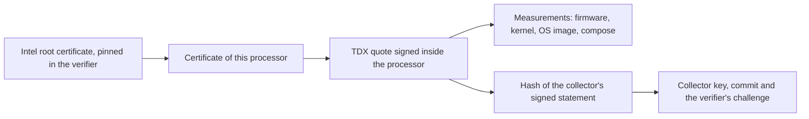

[TgWitness](../../README.md) / [Документация](../README.md) / [Папка](README.md) · [Уровни доказательности](https://phishdestroy.github.io/TgWitness/docs/assurance-levels/)


<a id="phala-cloud-and-intel-tdx"></a>
# Phala Cloud и Intel TDX

Самый высокий из трёх [уровней безопасности](https://phishdestroy.github.io/TgWitness/docs/assurance-levels/). Сборщик работает в конфиденциальной виртуальной машине, память которой недоступна для хоста, а сам процессор подписывает всё, что выполняется внутри неё.



<details>
<summary>На этой странице</summary>

- [Почему](#why)
- [Что это означает для суда](#what-it-means-for-a-court)
- [Что это означает для вас](#what-it-means-for-you)
- [На чём основано доверие](#what-the-trust-rests-on)
- [Кто использует эту систему](#who-uses-it)
- [Что произойдёт, если TDX будет взломан](#what-if-tdx-is-broken)
- [Откат диска, выполняемый хостом](#rollback-of-the-disk-by-the-host)
- [Стоимость](#price)
- [Техническая справка](#technical-reference)
</details>

<a name="confidential-vm-on-phala-cloud-intel-tdx"></a>
<a id="why"></a>
## Почему

На [проверенном сервере](HIGH-ASSURANCE.md) в журнале провайдера отображаются все действия, выполненные через API. В нём не отражаются действия лиц, обладающих правами root на физическом хосте: считывание содержимого памяти сервера и его ключа подписи, а также изменение данных до их подписания. Сотрудники провайдера, государственные органы, принуждающие провайдера к определенным действиям, или злоумышленник, проникший в систему провайдера, могут совершить такие действия, и ни один доступный вам журнал не зафиксирует их.

Технология Intel TDX устраняет этот пробел. Процессор шифрует память виртуальной машины и защищает её целостность, благодаря чему хост, его гипервизор и сотрудники Phala не могут ни считывать, ни изменять её содержимое. Процессор также подписывает «цитату» TDX: результаты измерений микропрограммы, ядра, образа ОС и точного состава запущенного кода, привязанные к ключу сборщика. Любой может проверить эту «цитату» по корневому сертификату Intel, не доверяя ни Phala, ни TgWitness, ни вам.

<a id="what-it-means-for-a-court"></a>
## Что это означает для суда

- К доказательству прилагается заявление, подписанное аппаратным обеспечением Intel: данный опубликованный код в данной версии коммита выполнялся в запечатанной виртуальной машине, которую ни хостинг-провайдер, ни оператор не могли ни прочитать, ни изменить.
- Любой желающий может повторить проверку в автономном режиме с помощью отдельно стоящей программы `verify.py` — без аккаунта в Phala, без сервера TgWitness и без необходимости доверять тому, кто подготовил доказательства.
- Отчет о проверке запечатан с помощью квалифицированной временной метки ЕС и второй, независимой временной метки, а также подписан верификатором.
- В аттестате указано, как были собраны доказательства. Он не подтверждает, что то, что кто-то написал в сообщении, соответствует действительности. Какой вес придавать этим доказательствам, решает суд или компетентный орган.

<a id="what-it-means-for-you"></a>
## Что это означает для вас

- Вы осуществляете развёртывание через панель управления: **Дополнительные инструменты → Дополнения → Сервер 24/7 → Конфиденциальная виртуальная машина · Phala Cloud** с использованием ключа API Phala Cloud. Без указания домена сервер получает быстрый туннель.
- SSH и консоль отсутствуют, в том числе и для вас. Вы работаете через панель управления, а данные покидают машину исключительно в виде экспортированных файлов.
- Войдите в Telegram внутри виртуальной машины с помощью телефона или QR-кода: после этого там создаётся ключ сеанса, который отображается в отчёте.
- Каждый перезапуск и каждое изменение приложения фиксируются в отчёте. Не изменяйте приложение после развёртывания: изменение конфигурации приведёт к сбою в формировании отчёта.
- Оплата производится по часовой ставке; см. раздел [Цены](#price).

<a id="what-the-trust-rests-on"></a>
## На чём основано доверие

| Сторона | Доверие? | Как это проверяется вместо этого |
| --- | --- | --- |
| Информация | **Да** | Ничто не может заменить это: модуль TDX, микрокод, ключи подписи Intel и физическая целостность шины памяти. Верификатор привязывает корневой сертификат Intel и проверяет списки отзывов сертификатов, а также уровень безопасности платформы |
| dstack, операционная система | Нет | Верификатор восстанавливает прошивку, ядро и измерения командной строки из образа ОС, публикуемого Dstack-TEE, и сравнивает их с предоставленными данными. Образ для разработки не проходит проверку |
| Код TgWitness | Нет | Композитор фиксирует каждый исходный файл развернутого коммита по хешу, а оба образа контейнеров — по дайджесту. Процессор производит измерение, а верификатор собирает тот же самый композит из коммита и сравнивает его байт за байтом |
| Phala Cloud | Нет | Он не может считывать содержимое памяти машины. Любое изменение приложения представляет собой новую ревизию с новым хешем компоновки, что приводит к сбою отчёта; перезапуски фиксируются в списке |
| Вы, оператор | Нет | Нет доступа по SSH и нет консоли; ключ Telegram создаётся внутри машины; любое изменение приложения отображается, как указано выше |

Хост по-прежнему контролирует сеть и часы. Заблокированный трафик отображается в виде пробелов в журнале, а время поступает от внешних источников: временные метки RFC 3161, OpenTimestamps и drand.

<a id="who-uses-it"></a>
## Кто использует эту систему

- **dstack** — платформа с открытым исходным кодом, на которой работает устройство, — является проектом Консорциума по конфиденциальным вычислениям при Linux Foundation, прошла аудит компании zkSecurity и описана в [статье arXiv:2509.11555](https://arxiv.org/abs/2509.11555) *Dstack: платформа с нулевым доверием для конфиденциальных контейнеров*. На его основе созданы OpenRouter и NEAR AI. Источник: [Dstack-TEE/dstack](https://github.com/Dstack-TEE/dstack).
- Хостинг-сервис **Phala Cloud** заявляет о соответствии стандартам SOC 2 Type I и HIPAA. Оба стандарта касаются способа предоставления услуг компанией Phala. Доказательства, приведённые на этой странице, не опираются на них.

<a id="what-if-tdx-is-broken"></a>
## Что произойдёт, если TDX будет взломан

Недостатки в средствах защиты процессора выявляются и устраняются посредством обновлений микрокода; после чего компания Intel классифицирует платформы без данного исправления как устаревшие. Предположим, что кто-то взломает TDX на компьютере, на котором работает ваш сборщик:

| Он сможет | Он не сможет |
| --- | --- |
| Считывать содержимое памяти компьютера на данном хосте, включая ключ подписи | Изменить контрольные точки, которые уже хранятся у свидетелей |
| подписывать с этого момента ложные новые записи | Сдвигать временные метки RFC 3161 или квитанции OpenTimestamps |
| Генерировать цитаты, которые выглядят действительными для новых записей | Изменить копии, уже хранящиеся в рамках S3 Object Lock |
|  | Изменить то, что по-прежнему хранится в самой системе Telegram: другой снимок противоречит подделке |
|  | Измените результат предыдущих цитат: уровень безопасности каждой цитаты рассчитывается на момент её записи |

То, что было закреплено вне системы до момента сбоя, остаётся без изменений. Сбой действует в будущем, а не в прошлом.

<a id="rollback-of-the-disk-by-the-host"></a>
## Откат диска, выполняемый хостом

dstack шифрует диск машины, но хост может восстановить более раннюю его копию. dstack признает это ограничение. В таком случае машина начнёт работу заново с более раннего журнала.

Два механизма предотвращают это:

- **Контрольные точки, хранящиеся за пределами машины.** [Свидетель](WITNESS.md) и временные метки фиксируют более позднюю длину и хеш журнала; журнал, откат которого произошёл за пределами этих контрольных точек, больше не совпадает с ними, о чём поступает соответствующее уведомление.
- **Копии, защищённые с помощью S3 Object Lock.** [Внешняя копия,](STORAGE.md) защищённая с помощью Object Lock, сохраняет более позднюю версию журнала, и никто не может удалить или перезаписать её в течение срока хранения.

Для каждого развёртывания на этом уровне запускайте свидетеля и внешнюю копию с Object Lock.

<a id="price"></a>
## Стоимость

| Тип | vCPU · память | В час | В месяц (730 часов) |
| --- | --- | --- | --- |
| `tdx.small` | 1 · 2 ГБ | 0,06 | Около 43,80 |
| `tdx.medium` | 2 · 4 ГБ | 0,12 | Около 87,60 долларов |
| `tdx.large` | 4 · 8 ГБ | 0,23 | Около 167,90 |

Стоимость диска составляет 0,000139 доллара за ГБ в час, что составляет примерно 0,10 доллара за ГБ в месяц, в течение всего срока существования машины, независимо от того, находится ли она в рабочем состоянии или остановлена. Цены взяты из [прайс-листа компании Phala](https://phala.com/pricing) от 21 ноября 2026 года. Мастер выбирает конфигурацию `tdx.small` и отображает текущую цену до начала создания каких-либо ресурсов.

<a id="technical-reference"></a>
## Техническая справка

<a id="the-six-checks"></a>
### Шесть проверок

| Проверка | Что показывает |
| --- | --- |
| `tdx_binding` | Предложение включает подписанное заявление сборщика и случайный контрольный запрос данной проверки |
| `tdx_quote` | Подписи в цитате ведут к корню Intel, Intel оценивает платформу как обновленную, и данную машину нельзя ни отлаживать, ни переносить |
| `tdx_compose_hash` | RTMR3, воспроизведённый из журнала событий dstack, совпадает с хешем компоновки, о которой сообщает сборщик |
| `tdx_compose` | Данный компоуз байт за байтом соответствует тому, который создаётся развернутым коммитом |
| `tdx_identity` | Данные получены из развернутого приложения и экземпляра с использованием ключей из KMS Phala и зашифрованного диска |
| `tdx_os` | Значения MRTD и RTMR0–2 соответствуют значениям, рассчитанным на основе опубликованного образа ОС dstack для данного размера машины; образ для разработки не проходит проверку |

Команда `verify` загружает образ ОС один раз (примерно 180 МБ, из которых сохраняется 21 МБ) из [каталога Dstack-TEE/meta-dstack](https://github.com/Dstack-TEE/meta-dstack/releases) в каталог `dstack-images`, расположенный рядом с записью. Параметр `--tdx-image FOLDER` использует другую папку, `--tdx-image none` пропускает сравнение, `--tdx-measurements` сравнивает значения, заданные в формате JSON, а `--tdx-collateral` считывает сертификаты Intel и списки отзывов из файла. При использовании параметра `--evidence` каждый запуск сборщика, зафиксированный в журнале, проверяется на соответствие образу, с которого он был загружен.

<a id="deploy-and-verify-from-the-command-line"></a>
### Развертывание и проверка из командной строки

```sh
python -m tgwitness.cloud deploy --provider phala --name case-1 --server-type tdx.small \
    --ref v1.0.2 --quick-tunnel --provider-token-file phala-key.txt
python -m tgwitness.cloud verify --record deployments/case-1/deployment.json \
    --provider-token-file phala-key.txt --cloud-init deployments/case-1/docker-compose.yaml \
    --source CHECKOUT_OF_COMMIT --fingerprint COLLECTOR_FINGERPRINT \
    --evidence tgwitness-evidence.zip --report certificate.md
python -m tgwitness.cloud check-report --report certificate.pdf --verifier-fingerprint VERIFIER_KEY
```

`--source` создаёт эталонную сборку из вашего чек-аута, которая запускает код этого чек-аута на вашем компьютере; для репозиториев, отличных от официального, при использовании команды `verify` также требуется параметр `--trust-source`. Шлюзовый DNS здесь недоступен: у Phala отсутствует брандмауэр провайдера для исходящего трафика.

<a id="offline-check-with-verifypy"></a>
### Офлайн-проверка с помощью verify.py

```sh
python verify.py tgwitness-evidence.zip --fingerprint COLLECTOR_FINGERPRINT
python verify.py phala-tdx-attestation.json
```

В отсутствие подключения к сети программа `verify.py` проверяет подпись каждой цитаты, цепочку от сертификата процессора до корневого сертификата Intel (зафиксированного в файле), подтверждает, что цитата поступила из производственной анклавы Intel, предназначенной для формирования цитат, что машина не поддаётся отладке или миграции, а также что цитата охватывает запись запуска или подписанное заявление. При наличии сопутствующих данных Intel, хранящихся рядом с цитатой, также вычисляется уровень безопасности платформы на момент создания записи. В отсутствие залоговых данных (сервис Intel не ответил во время получения цитаты) статус TCB платформы, списки отзывов Intel, идентификатор QE и модуль TDX не проверяются: статус цитаты будет `partial` вместо `pass`, о чём указывается в строке условия. Информация о том, какой код был выполнен, журнал поставщика и текущий рейтинг Intel сохраняются при выполнении команды ``python -m tgwitness.cloud verify``, поэтому результат автономной проверки помечается как «частичный».

<a name="attestation-certificate"></a>
### Сертификат подтверждения

Команда ``verify --report certificate.md`` также создаёт файл ``certificate.html`` и документ формата A4 ``certificate.pdf``: в них содержатся вердикт, цепочка доверия от корневого сертификата Intel до ключа сборщика, результаты измерений рядом со значениями, рассчитанными на основе опубликованного образа, все проверки, журнал провайдера и инструкции по повторению процедуры. Файл ``certificate.json`` остаётся авторитетным записью. Его печать находится в файле ``certificate.seal.json``:

| Печать | Что это добавляет |
| --- | --- |
| Квалифицированная временная метка`http://tsa.belgium.be/connect` | Временная метка RFC 3161 от квалифицированной службы доверия федерального правительства Бельгии (BOSA), включённой в список доверенных служб ЕС; в соответствии со статьёй 41 Регламента (ЕС) № 910/2014 она считается точной во всех государствах-членах ЕС |
| Временная метка RFC 3161, FreeTSA | Вторая, независимая метка времени |
| Подпись верификатора | Подпись Ed25519, наложенная на SHA-256 отчёта и каждую метку времени с использованием собственного ключа верификатора; PDF-файл подписан тем же ключом |

`check-report` проверяет все эти элементы. `--timestamp URL` выбирает другие центры сертификации, `--sign-with` — другой ключ.

<a id="tested-on-phala-cloud"></a>
### Протестировано на Phala Cloud

Развёртывание, проверка с помощью параметра `--evidence`, перезапуски, сравнение образов ОС, запечатанный сертификат и его удаление были выполнены на Phala Cloud: см. [запуск от 4 ноября 2026 года](VERIFICATION.md#live-phala-cloud-deployment--4-november-2026), [действующий аккаунт в Telegram](VERIFICATION.md#phala-cloud-with-live-telegram-account--9-november-2026) и [сеансный ключ, сгенерированный внутри машины](VERIFICATION.md#session-key-created-inside-the-tdx-vm--9-november-2026).
